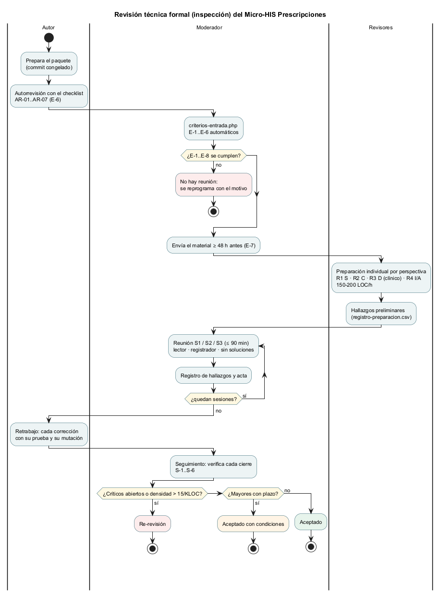

# Semana 13 — Calidad del software y revisión técnica formal de Prescripciones

| | |
|---|---|
| **Curso** | Análisis de Sistemas II — Proyecto Final 2026 |
| **Módulo** | Prescripciones electrónicas con validación de alergias (ASII-15) |
| **Proceso** | «Creación de prescripción con verificación previa de alergias» |
| **Estudiante** | Boris Alexander Quiroa Orellana |

## Entregables

| Pedido | Dónde |
|---|---|
| Plan de revisión | [`plan-revision-tecnica.md`](plan-revision-tecnica.md): objetivo, tipo, alcance y paquete, proceso y calendario, reglas, métricas y riesgos |
| Checklist de 12–15 ítems | [`checklist-revision.md`](checklist-revision.md): **15 ítems** (RT-01..15) en 5 perspectivas |
| Roles de autor, moderador y revisores | [Plan §3](plan-revision-tecnica.md#3-roles-y-responsabilidades): autor, moderador, registrador, lector y R1..R4 por perspectiva; R3 con formación clínica |
| Criterios de entrada y salida | [Plan §6–§7](plan-revision-tecnica.md#6-criterios-de-entrada): E-1..E-8 (6 automatizados) y S-1..S-6, con la regla de decisión |
| Formato de hallazgos | [`formato-hallazgos.md`](formato-hallazgos.md) y [`plantillas/registro-hallazgos.csv`](plantillas/registro-hallazgos.csv), con las plantillas de [acta](plantillas/acta-revision.md) y de [preparación](plantillas/registro-preparacion.csv) |

## 1. Lo que cubre la revisión

| Pide la tarea | Ítems | Perspectiva | Revisor |
|---|---|:-:|---|
| Reglas de dominio | RT-01 completa y dosis · RT-02 coincidencia directa · RT-03 cruzada y advertencia · RT-04 sin registros | D | R3 |
| Contrato API | RT-07 contrato = código · RT-08 errores sin fuga · RT-09 formato en la frontera | C | R2 |
| Permisos / tenant | RT-10 permiso en el caso de uso · RT-11 tenant · RT-12 identidad del actor | S | R1 |
| Integridad: validación previa y bloqueo seguro | RT-05 bloqueo seguro · RT-06 reverificación · RT-13 inmutabilidad y anulación · RT-14 idempotencia y traza | I | R4 (RT-06, R3) |
| Dependencias estrictamente necesarias | RT-15 capas y dependencias | A | R4 |

**Dos características del checklist:**
- **Cada ítem es una afirmación para refutar,** con la prueba que hoy la respalda **y un caso que esa prueba no cubre**. El revisor busca ahí, en lugar de repetir la suite.
- **El paquete se divide en 3 sesiones** de menos de 1600 líneas efectivas (672, 1241 y 1023), para que cada reunión quepa en 90 minutos.

## 2. Criterios de entrada: automatizados y probados

[`herramientas/criterios-entrada.php`](herramientas/criterios-entrada.php) verifica E-1..E-6 y arma el paquete: archivos y líneas por sesión, y el commit.

| Corrida | E-1 | E-2 | E-3 | E-4 | E-5 | E-6 |
|---|:-:|:-:|:-:|:-:|:-:|:-:|
| [Antes](evidencia/criterios-entrada-1-antes.txt) (sin checklist ni autorrevisión) | PASA | PASA | PASA | PASA | **FALLA** | **FALLA** |
| [Después](evidencia/criterios-entrada-2-despues.txt) | PASA | PASA | PASA | PASA | PASA | PASA |

- **La primera corrida falla, y eso demuestra que los criterios no son decorativos:** sin checklist ni autorrevisión, el script impide convocar la reunión.
- **E-7 y E-8** (envío con 48 h o más y roles confirmados) son manuales y los firma el moderador en el acta.

## 3. Resultado de la autorrevisión

El autor pasó los 15 ítems **antes** de convocar ([autorrevisión](autorrevision-autor.md)). Cada hallazgo se reproduce contra el kernel real ([salida](evidencia/autorrevision-verificaciones.txt)).

| ID | Hallazgo | Ítem | Severidad · tipo |
|---|---|---|---|
| AR-01 | `crearKernel()` acepta siempre los tokens de demostración: «Bearer token-dr-lopez» emite | RT-12 | **Crítico** · Riesgo |
| AR-02 | La clave de idempotencia es del hospital: otro médico recibe «ya emitida» una prescripción ajena, aun sin override | RT-14 | **Mayor** · Defecto |
| AR-03 | La coincidencia por nombre es exacta: una alergia **grave** registrada como «Amoxicilina trihidrato» no bloquea la Amoxicilina | RT-02 | **Mayor** · Riesgo |
| AR-04 | El contrato dice `integer` y el código rechaza `7.0` en días y frecuencia | RT-07 | Menor · Contrato |
| AR-05 | Anular no es idempotente: el reintento responde 409 sin decir quién anuló | RT-13 | Menor · Contrato |
| AR-06 | El hallazgo y la consulta traen el código del alérgeno sin su nombre | RT-07 | Menor · Contrato |
| AR-07 | El tipo de la alergia no participa en ninguna regla: una intolerancia leve bloquea | RT-15 | Observación · Riesgo |

**Lectura honesta:**
- Hay **un Crítico abierto**. Con la regla de decisión del plan (§7), hoy el resultado sería **«Re-revisión»**.
- **AR-03 es el hallazgo más importante para un paciente:** es un falso negativo de la regla que justifica el módulo. Ninguna de las 111 pruebas lo cubría, porque todas usan los nombres exactos del catálogo. Necesita una decisión de farmacia, no solo código.
- **AR-02 y AR-03 nacen de decisiones del propio autor:** la huella sin el usuario y la comparación por nombre. La revisión formal existe justamente para eso.
- **AR-05 y AR-06 ya se conocían** (semanas 10 y 11) y ahora quedan registrados con el formato, para no perderse.
- **Los 7 ítems restantes** se cumplen con evidencia ejecutable de las semanas 3 a 12.

## 4. Cómo se ejecuta la revisión

1. **Confirmar los roles** (E-8) y las fechas con el plan §4. Sin un R3 clínico no se convoca.
2. **Congelar el paquete:** `php herramientas/criterios-entrada.php` debe terminar con código 0.
3. **Enviar** el material con 48 h o más de anticipación (E-7).
4. **Preparación** individual por perspectiva, anotada en `registro-preparacion.csv`.
5. **Tres reuniones** de 90 min como máximo, con la [plantilla de acta](plantillas/acta-revision.md).
6. **Retrabajo:** cada cierre con su prueba y su mutación.
7. **Seguimiento** y decisión.

## 5. Limitaciones

- **La reunión no se hizo todavía:** los revisores están «por confirmar» (E-8). Esta entrega es el **plan** y la **autorrevisión**, como pide la tarea.
- **La autorrevisión la hizo el autor,** con sus puntos ciegos declarados.
- **Los tiempos** (90 min, 150–200 LOC/h, umbral de 15/KLOC) son los habituales de la literatura de inspecciones, no calibrados con datos de este equipo. El plan SQA (semana 14) propone medirlos.
- **Los hallazgos no se corrigieron en esta entrega.** El proceso pide registrarlos primero y cerrarlos en el retrabajo, con prueba y mutación. El plan SQA los toma como riesgos.
