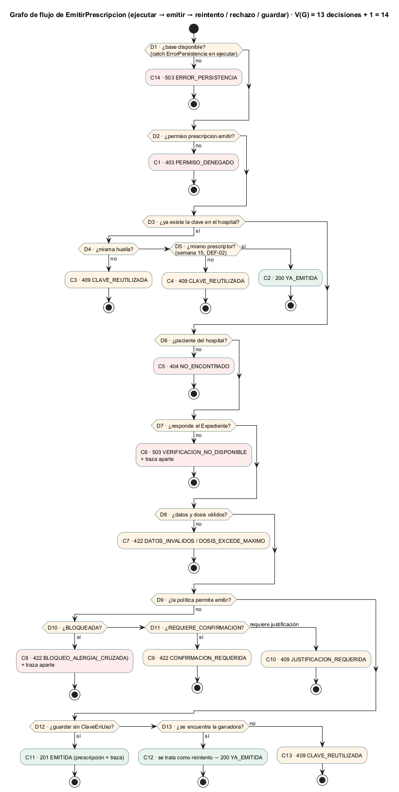

# Semana 15 — Pruebas unitarias, de caja blanca y de caja negra de Prescripciones

| | |
|---|---|
| **Curso** | Análisis de Sistemas II — Proyecto Final 2026 |
| **Módulo** | Prescripciones electrónicas con validación de alergias (ASII-15) |
| **Proceso** | «Creación de prescripción con verificación previa de alergias» |
| **Estudiante** | Boris Alexander Quiroa Orellana |

## Entregables

| Pedido | Dónde |
|---|---|
| Matriz RF/RNF → prueba | [`matriz-rf-rnf-pruebas.md`](matriz-rf-rnf-pruebas.md): 20 RF y 15 RNF |
| Mínimo 3 unitarias | **8:** UNI-01..08 en [`tests/Dominio/UnitariasPrueba.php`](../micro-his-prescripciones/tests/Dominio/UnitariasPrueba.php) |
| Mínimo 2 de caja blanca | **3:** CB-01..03 en [`tests/Aplicacion/CajaBlancaPrueba.php`](../micro-his-prescripciones/tests/Aplicacion/CajaBlancaPrueba.php), con el [grafo de flujo](diagramas/semana-15-grafo-emitir.png) y la cobertura medida (**100 %**) |
| Mínimo 4 de caja negra | **7:** CN-01..07 en [`tests/Presentacion/CajaNegraPrueba.php`](../micro-his-prescripciones/tests/Presentacion/CajaNegraPrueba.php) |
| Comandos y resultados | [§5](#5-comandos-y-resultados) y [`evidencia/`](evidencia/) |
| Capturas | [`capturas/`](capturas/): una por evidencia |
| Defectos registrados | [`registro-defectos.md`](registro-defectos.md): 1 cerrado (DEF-02) y 7 abiertos con su prueba, 1 de ellos **nuevo** (DEF-08, hallado por la caja negra) |

## 1. Qué se prueba y qué no

- **Se prueba el Micro-HIS Prescripciones:** reglas del dominio, casos de uso, contrato HTTP y persistencia (las INT, con PostgreSQL 18).
- **No se prueban los módulos ajenos** (Expediente, RBAC, identidad del HIS). Se simulan con los adaptadores de demostración y los dobles (`FuenteConmutable`, `FuenteAlergiasCaida`, `PoliticaAccesoEstatica`), como pide la tarea.
- **Las pruebas de las semanas 3 a 12 siguen en la suite;** esta semana agrega 18. La suite queda en **129/129 con PostgreSQL**.

## 2. Pruebas unitarias (UNI-01..08)

Cada una prueba **una** clase del Dominio, sin kernel, sin transacción y sin base. Cubre un tema de la tarea por prueba ([evidencia](evidencia/1-unitarias.txt) · [captura](capturas/1-unitarias.png)).

| ID | Tema | Clase | Qué afirma | Req. |
|---|---|---|---|---|
| UNI-01 | Prescripción | `Prescripcion` | Todas las propiedades son `readonly`; anular devuelve **otra** instancia; la dosis queda decimal | R-10, RF-11 |
| UNI-02 | Dosis | `ValidadorPrescripcion` | Máxima inclusiva: 1000 c/6 h = 4000 sí; 1000,5 no; 4000 c/24 h sí; 0,001 sí | R-02, RF-03 |
| UNI-03 | Medicamentos | `ValidadorPrescripcion` | Días 1/90 sí, 0/91 no; frecuencia, vía y unidad del catálogo; un inactivo se rechaza solo por el medicamento | R-01, RF-02 |
| UNI-04 | Alergias | `VerificadorAlergias` | Directa por código (mayúsculas y espacios) y por nombre normalizado (tildes); la resuelta no cuenta; con código, el nombre no se mira | R-04, RF-05 |
| UNI-05 | Alergias | `VerificadorAlergias`, `ResultadoVerificacion` | Cruzada por severidad: leve, moderada y grave advierten; mortal y desconocida bloquean; sin grupo no hay cruzada; la directa manda en el código | R-05, RF-06 |
| UNI-06 | Alergias | `Alergia` | Sin código ni nombre, o con severidad fuera del esquema, no existe; `impideJustificar` solo en mortal y desconocida | R-05 |
| UNI-07 | Validación previa | `PoliticaEmision` | Orden confirmación → bloqueo → advertencia; justificación 19/20 sin espacios; override solo con advertencia; `puedeJustificar` | R-05, R-06, RF-06, RF-07, RF-19 |
| UNI-08 | Bloqueo seguro de la anulación | `PoliticaAnulacion` | El estado se mira antes que el motivo; 9/10 caracteres | RF-15, RF-16 |

## 3. Pruebas de caja blanca (CB-01..03)

Se diseñaron **leyendo el código** ([evidencia y cobertura](evidencia/2-caja-blanca-cobertura.txt) · [captura](capturas/2-caja-blanca-cobertura.png)).



| ID | Técnica | Sobre | Casos |
|---|---|---|---|
| CB-01 | Caminos básicos (McCabe) | `EmitirPrescripcion` (`ejecutar` → `emitir` → `reintento`/`rechazo`/`guardar`), 13 decisiones, V(G) = 14 | 14 caminos C1..C14: sin permiso, reintento igual, otro contenido, **otro prescriptor (DEF-02)**, paciente ajeno, Expediente caído, datos inválidos, bloqueo, sin confirmar, sin justificación, emitida, carrera con ganadora, carrera sin ganadora, base caída |
| CB-02 | MC/DC | Las 3 condiciones compuestas del flujo | «!evaluado **y** !confirma»; «justificación < 20 **o** !override»; «misma huella **y** mismo prescriptor». Cada condición cambia la salida sola. Más las ramas de la previa (`resultadoPrevio`, `puedeJustificar`) |
| CB-03 | Caminos y ramas | `AnularPrescripcion` | 8 ramas: sin permiso, otro hospital, motivo corto, anulada, ya anulada, **carrera** (la política vio «emitida» pero otra transacción anuló primero: `YaAnulada`), base caída, traza que falla (todo o nada) |

**Cobertura de líneas lograda solo por CB-01..03** (phpdbg):

| Clase | Líneas |
|---|---|
| `EmitirPrescripcion` | 34/34 |
| `PoliticaEmision` | 13/13 |
| `AnularPrescripcion` | 13/13 |
| `PoliticaAnulacion` | 3/3 |
| **Total** | **63/63 (100 %)** |

La [primera medición](evidencia/2a-caja-blanca-cobertura-primera.txt) dio **96,8 %**. Mostró dos líneas de `PoliticaEmision` sin recorrer (las que usa solo la verificación previa), que se agregaron a CB-02.

**CB-01 se escribió antes de corregir DEF-02 y falló justo en C4.** Los otros 13 caminos pasaban ([antes](evidencia/def-02-1-antes.txt) → [después](evidencia/def-02-2-despues.txt)).

## 4. Pruebas de caja negra (CN-01..07)

Se diseñaron **solo desde el contrato** (`api/openapi.yaml` 1.2.0) y los requisitos, y entran por HTTP ([evidencia](evidencia/3-caja-negra.txt) · [captura](capturas/3-caja-negra.png)).

| ID | Técnica | Casos |
|---|---|---|
| CN-01 | Particiones de equivalencia | `frecuencia_horas`: las 5 clases válidas (4, 6, 8, 12, 24) y 5 inválidas (0, 5, 48, `"8"`, `null`) |
| CN-02 | Valores límite | Dosis diaria de Paracetamol: 4000 exacta, 4002, 0, −1 y 0,001 |
| CN-03 | Valores límite | Días 1/90 y 0/91; justificación 19/20 sin espacios; motivo de anulación 9/10 |
| CN-04 | Permisos (tabla de decisión) | 3 roles × 5 operaciones: cada rol hace exactamente lo suyo |
| CN-05 | Permisos / tenant | Sin cabecera o vacía → 400; ajena → 403; una prescripción de otro hospital da el **mismo** 404 que una inexistente; un paciente ajeno → 404 |
| CN-06 | Errores | JSON roto, cuerpo sin paciente, `Idempotency-Key` ausente, fuera del patrón y de 129 (128 sí), PUT/DELETE → 405, id no numérico y ruta desconocida → 404, sin token → 401 con `WWW-Authenticate`, Expediente caído → 503 sin detalles |
| CN-07 | Idempotencia según el contrato | 201 con Location; el reintento → 200, mismo id, sin Location y **sin volver a verificar** (con el Expediente caído); otro contenido → 409 |

**CN-02 encontró un defecto nuevo (DEF-08):** **la dosis máxima se aplica por ítem.** Dos ítems de Paracetamol de 4000 mg/día cada uno (**8000 mg/día**) pasan sin hallazgos. Diseñar desde el requisito («la dosis diaria no supera la máxima») llevó a preguntar por el mismo medicamento repetido. El código, leído ítem por ítem, nunca lo habría sugerido. Queda registrado con su prueba (DEF-08), sin corregir: es una regla clínica que necesita el criterio de farmacia ([registro](registro-defectos.md)).

## 5. Comandos y resultados

```bash
cd docs/modulos/prescripciones-alergias/micro-his-prescripciones
php tests/ejecutar.php --solo=UNI                 # 8/8
php tests/ejecutar.php --solo=CB                  # 3/3
php tests/ejecutar.php --solo=CN                  # 7/7
php tests/ejecutar.php --defectos --solo=DEF      # 7 FALLAN: defectos abiertos (es lo esperado)
PRESCRIPCIONES_DB_DSN=… php tests/ejecutar.php    # 129/129 con PostgreSQL 18
PRESCRIPCIONES_DB_DSN=… php tests/mutaciones.php  # 36/36
cd ../semana-15 && phpdbg -qrr herramientas/cobertura-caja-blanca.php   # 63/63 líneas
```

| Evidencia | Resultado | Captura |
|---|---|---|
| [1-unitarias.txt](evidencia/1-unitarias.txt) | 8 pasan, 0 fallan | [png](capturas/1-unitarias.png) |
| [2-caja-blanca-cobertura.txt](evidencia/2-caja-blanca-cobertura.txt) | 3 pasan · 100 % de líneas | [png](capturas/2-caja-blanca-cobertura.png) |
| [3-caja-negra.txt](evidencia/3-caja-negra.txt) | 7 pasan, 0 fallan | [png](capturas/3-caja-negra.png) |
| [4-defectos-abiertos.txt](evidencia/4-defectos-abiertos.txt) | 7 fallan (abiertos) | [png](capturas/4-defectos-abiertos.png) |
| [5-suite-completa.txt](evidencia/5-suite-completa.txt) | 129/129 con PostgreSQL | [png](capturas/5-suite-completa.png) |
| [mutaciones.txt](evidencia/mutaciones.txt) | 36/36 (M36 nueva, vigila DEF-02) | [png](capturas/mutaciones.png) |
| [6-medir-sqa-despues.txt](evidencia/6-medir-sqa-despues.txt) | M1 129/129, M2 36/36, **M4 12/12** y M7 con un mayor menos; M3 y M7 siguen en rojo; M6 sigue en 20/23 (ver el [registro](registro-defectos.md)) | [png](capturas/6-medir-sqa-despues.png) |
| [def-02-1-antes.txt](evidencia/def-02-1-antes.txt) → [def-02-2-despues.txt](evidencia/def-02-2-despues.txt) | CB-01/CB-02 rojo → verde | [png](capturas/def-02-1-antes.png) · [png](capturas/def-02-2-despues.png) |

## 6. Limitaciones

- **La caja blanca mide líneas, no ramas:** phpdbg no informa la cobertura de ramas. Las ramas y condiciones se aseguraron **por diseño** (caminos básicos y MC/DC), y la cobertura de líneas lo confirma.
- **DEF-01 (crítico) sigue abierto:** su corrección depende del autenticador real del HIS, que es otro módulo.
- **DEF-03 y DEF-08 son reglas clínicas:** sus pruebas ya describen el comportamiento correcto, pero el criterio exacto lo decide farmacia (plan SQA, 03/11).
- **Todas las pruebas usan los adaptadores InMemory, salvo las 18 de PostgreSQL.** La paridad entre los adaptadores la garantiza la suite de contrato (CON-*).
