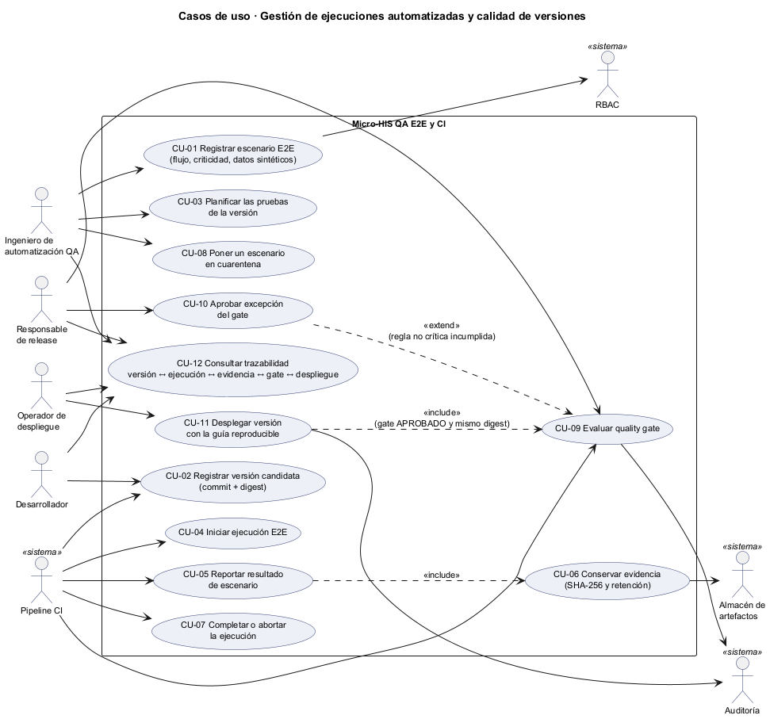
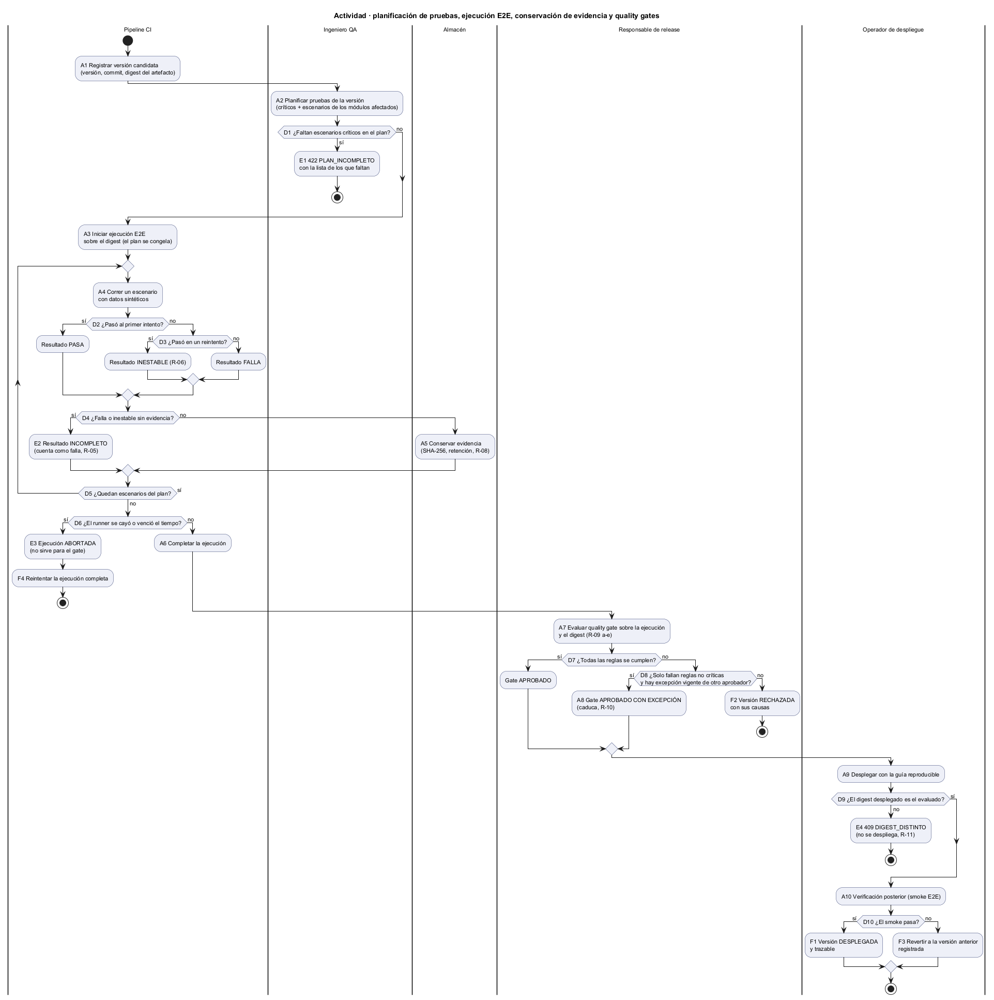
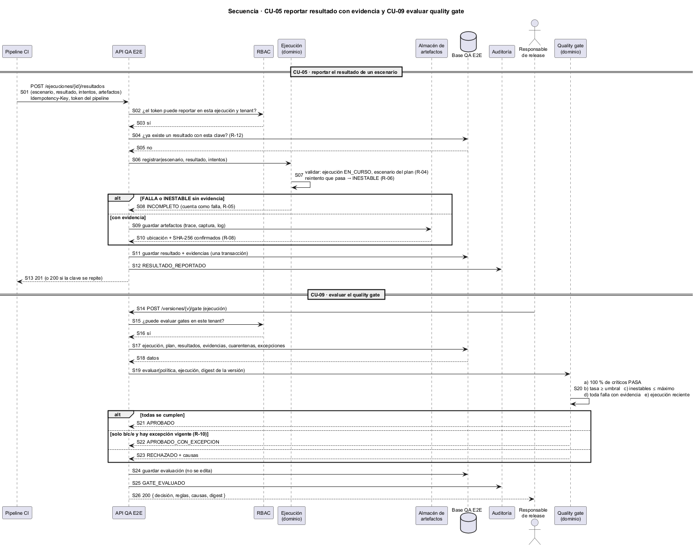

# Semana 1 — Modelado UML del proceso de ejecuciones automatizadas y calidad de versiones

| | |
|---|---|
| **Curso** | Análisis de Sistemas II — Proyecto Final 2026 |
| **Proyecto** | Sistema Hospitalario Integrado (HIS) |
| **Módulo** | QA, pruebas E2E, CI y guía de despliegue final |
| **Adaptación** | Gestión de ejecuciones automatizadas y calidad de versiones |
| **Tema de la semana** | Conceptos generales, orientación a objetos y UML |
| **Proceso modelado** | «Planificación de pruebas, ejecución E2E, conservación de evidencia y aplicación de quality gates» |
| **Estudiante** | Boris Alexander Quiroa Orellana |
| **Fecha** | Octubre 2026 |

## Índice

1. [Introducción y punto de partida](#1-introducción-y-punto-de-partida)
2. [Narrativa de alcance](#2-narrativa-de-alcance)
3. [Actores](#3-actores)
4. [Modelo de objetos del dominio](#4-modelo-de-objetos-del-dominio)
5. [Reglas de negocio](#5-reglas-de-negocio)
6. [Diagrama de casos de uso](#6-diagrama-de-casos-de-uso)
7. [Especificación de casos de uso](#7-especificación-de-casos-de-uso)
8. [Diagrama de actividad](#8-diagrama-de-actividad)
9. [Diagrama de secuencia](#9-diagrama-de-secuencia)
10. [Matriz de trazabilidad](#10-matriz-de-trazabilidad)
11. [Conclusión](#11-conclusión)

## 1. Introducción y punto de partida

Una prueba **E2E** (de punta a punta) maneja el sistema como un usuario: abre el navegador, inicia sesión, admite un paciente, prescribe, imprime. Si pasa, la cadena completa funciona: interfaz, API, reglas y base. En un HIS esas cadenas son las que no pueden romperse en un despliegue. Un **quality gate** es la regla que decide, con los resultados de esas pruebas, si una versión puede avanzar hacia producción.

Este módulo modela la **gestión de las ejecuciones automatizadas y de la calidad de cada versión**:
1. Se **planifica** qué escenarios E2E deben correr para una versión.
2. El pipeline de **CI** los **ejecuta** sobre un artefacto identificado por su digest.
3. Se **conserva la evidencia** de cada resultado (traza, captura, video, log, reporte JUnit) con su hash.
4. Se **aplica un quality gate** explícito que aprueba o rechaza la versión.
5. Solo una versión aprobada se **despliega**, con una **guía reproducible** que verifica que lo desplegado es exactamente lo que se probó.

**Punto de partida en el proyecto real** (verificado el 2026-10-29):

| Lo que hay en el repositorio | Lo que falta | Dónde lo resuelve el modelo |
|---|---|---|
| `.github/workflows/branch-protection.yml`: valida la descripción del PR y el nombre de la rama | **No corre ninguna prueba.** Además, la API de GitHub Actions informa **0 ejecuciones** en toda la historia del repositorio: el workflow está declarado y nunca corrió | CU-04, CU-05, CU-07; R-04 |
| `phpunit.xml` con las suites Unit, Feature y Database (`tests/Database/Central`, `tests/Database/Hospital`) | Nadie las ejecuta en un pipeline; sus resultados se copian a mano en `apply-progress.md` | CU-05, CU-06; R-05, R-08 |
| `package.json` con Vue 3 y Vite | **Ninguna prueba E2E**: nada maneja la interfaz como un usuario | CU-01, CU-03; R-01, R-02 |
| La regla «a `main` solo desde `develop`» | **Ningún criterio de calidad** para promover una versión: se integra si el PR tiene texto y la rama un nombre válido | CU-09, CU-10; R-09, R-10 |
| El patrón de ramas exige `feature/asii-NN-…`, pero las ramas `semana-N-…` se mergean igual | La regla existe solo en papel, porque el workflow nunca se ejecuta | R-04, R-13 |
| Sin Dockerfile en la raíz, sin guía de despliegue | **No hay forma de reproducir** lo que se desplegó ni de demostrar que fue lo probado | CU-11; R-03, R-11 |

Relación con el módulo vecino: el módulo «QA funcional y matriz de regresión» dejó explícitamente fuera de su alcance **la ejecución automática de pruebas**. Este módulo es esa pieza. Sus resultados pueden alimentar a una campaña manual como evidencia, pero no la reemplazan.

Las tres vistas del modelo comparten identificadores para trazarse entre sí (§10):

| Prefijo | Qué identifica |
|---|---|
| CU | Caso de uso |
| A, D, E, F | Actividad, decisión, excepción y resultado final del diagrama de actividad |
| R | Regla de negocio |
| S | Mensaje del diagrama de secuencia |

## 2. Narrativa de alcance

**Objetivo del proceso.** Que cada versión del HIS que llega a un hospital tenga:
- un plan de pruebas E2E con todos los escenarios críticos;
- una ejecución completa sobre **el mismo artefacto** que se desplegó;
- evidencia conservada de cada resultado;
- una evaluación de quality gate que se pueda reconstruir;
- un registro de despliegue que diga qué digest se instaló, con qué guía y si pasó la verificación posterior.

**Dentro del alcance:**

| Elemento | Detalle |
|---|---|
| Escenarios E2E | Flujo del HIS que recorren (admisión, prescripción, resultados de laboratorio…), criticidad, requisitos que cubren y **datos sintéticos** que usan |
| Versión candidata | Número semántico, commit y **digest del artefacto** construido una sola vez |
| Plan de pruebas | Para una versión: todos los críticos más los escenarios de los módulos afectados; se congela al iniciar la primera ejecución |
| Ejecución | Una corrida del pipeline sobre un digest, en un entorno, con un estado (EN_CURSO, COMPLETADA, ABORTADA) |
| Resultados | Por escenario: PASA, FALLA, INESTABLE (falló y pasó al reintentar) u OMITIDO, con el número de intentos |
| Evidencia | Traza del navegador, captura, video, log y JUnit, con su SHA-256, su tamaño y su retención |
| Cuarentena | Un escenario no crítico e inestable puede salir del gate por un tiempo, con dueño y fecha de caducidad |
| Quality gate | Política versionada con reglas a–e (§5) y evaluaciones inmutables |
| Excepción | Permiso temporal y justificado para aprobar con una regla no crítica incumplida |
| Despliegue | Con la guía versionada; verifica el digest, registra los pasos y la verificación posterior, y puede revertir |
| Trazabilidad | Versión ↔ plan ↔ ejecución ↔ resultado ↔ evidencia ↔ gate ↔ despliegue, en los dos sentidos |

**Fuera del alcance:**
- **Escribir el código de las pruebas E2E.** El módulo registra escenarios y resultados; los scripts viven en el repositorio de la aplicación.
- **El motor de CI.** GitHub Actions u otro dispara y corre; el módulo recibe sus reportes por API.
- **La infraestructura de producción** (servidores, red, secretos de producción). La guía de despliegue describe y verifica pasos; no administra servidores.
- **Pruebas de carga y de seguridad ofensiva:** otros módulos.

**Supuestos:**
- Un artefacto se construye **una sola vez** por commit y se identifica por su digest SHA-256; ese mismo artefacto se prueba y se despliega.
- Los escenarios E2E usan exclusivamente **pacientes sintéticos**: las capturas y los videos pueden mostrar pantallas completas.
- El pipeline se autentica con un token de servicio de alcance limitado: solo puede reportar a ejecuciones de su repositorio y tenant.
- La hora se guarda en UTC y se muestra en la hora de Guatemala.

## 3. Actores

| Actor | Tipo | Objetivo |
|---|---|---|
| Ingeniero de automatización QA | Primario | Registrar escenarios E2E, planificar las pruebas de cada versión y gestionar la cuarentena de los inestables |
| Responsable de release | Primario | Mantener la política de quality gate, evaluarla y aprobar excepciones |
| Desarrollador | Primario | Proponer versiones candidatas y consultar resultados y evidencia de sus fallas |
| Operador de despliegue | Primario | Desplegar versiones aprobadas con la guía reproducible y registrar la verificación posterior |
| Pipeline CI | Primario (sistema) | Registrar versiones, iniciar ejecuciones, reportar resultados y evidencia, completarlas o abortarlas |
| Almacén de artefactos | Secundario (sistema) | Guardar la evidencia y confirmar su ubicación y su hash |
| RBAC | Secundario (sistema) | Decidir si un usuario o el token del pipeline puede hacer la operación en ese tenant |
| Auditoría | Secundario (sistema) | Guardar la traza de cada evaluación, excepción y despliegue |

**Segregación de funciones:**
- Quien escribe el cambio no aprueba la excepción del gate que ese cambio incumple (R-10).
- El pipeline reporta resultados, pero no puede evaluar con excepción ni desplegar (R-13).
- Quien registra un escenario no puede ponerlo en cuarentena él solo si es crítico, porque un crítico nunca entra en cuarentena (R-07).

## 4. Modelo de objetos del dominio

| Objeto | Responsabilidad | Invariante que protege |
|---|---|---|
| `EscenarioE2E` | Flujo, pasos de alto nivel, criticidad, requisitos cubiertos, conjunto de datos sintéticos | Solo datos sintéticos (R-01) |
| `Version` | Semver, commit, digest del artefacto, estado (CANDIDATA, APROBADA, RECHAZADA, DESPLEGADA, REVERTIDA) | El digest no cambia: otro artefacto es otra versión (R-03) |
| `PlanPruebas` | Escenarios que debe correr una versión | Incluye todos los críticos; se congela al iniciar (R-02) |
| `Ejecucion` | Corrida del pipeline sobre un digest y un entorno, con su estado | Solo EN_CURSO admite resultados; los resultados se agregan, no se reemplazan (R-04) |
| `ResultadoEscenario` | Resultado, intentos, duración y evidencias | PASA tras reintento = INESTABLE (R-06); falla sin evidencia = INCOMPLETO (R-05) |
| `Evidencia` | Tipo, ubicación, SHA-256, tamaño y retención | No se borra antes de su retención ni mientras su versión esté desplegada (R-08) |
| `Cuarentena` | Escenario, motivo, dueño y vencimiento | Nunca sobre un crítico; caduca sola (R-07) |
| `PoliticaGate` | Umbral de aprobados, máximo de inestables, antigüedad máxima, versión de la política | El gate se calcula, no se opina (R-09) |
| `EvaluacionGate` | Decisión, reglas evaluadas con su valor, causas, ejecución y digest | Inmutable; una evaluación nueva no borra la anterior |
| `Excepcion` | Regla, justificación, aprobador, autor del cambio y vencimiento | Solo reglas no críticas, aprobador distinto del autor (R-10) |
| `Despliegue` | Versión, digest instalado, entorno, guía usada, pasos, verificación posterior | Digest = evaluado; solo con gate aprobado (R-11) |

**Relaciones:**
- Una `Version` tiene 1 `PlanPruebas` y 0..n `Ejecucion`.
- Una `Ejecucion` tiene 1..n `ResultadoEscenario`, y cada uno 0..n `Evidencia`.
- Una `EvaluacionGate` se calcula sobre exactamente 1 `Ejecucion` COMPLETADA y 1 versión de la `PoliticaGate`.
- Un `Despliegue` referencia exactamente 1 `EvaluacionGate` aprobada.

## 5. Reglas de negocio

| # | Regla | Por qué |
|---|---|---|
| R-01 | Un escenario E2E solo usa datos sintéticos, declarados en su conjunto de datos | La evidencia (capturas y videos) muestra pantallas completas: no puede contener pacientes reales |
| R-02 | El plan de una versión incluye **todos** los escenarios críticos y los de los módulos afectados; se congela al iniciar la primera ejecución | Que nadie quite un crítico que falla para pasar el gate |
| R-03 | Una ejecución corre contra un digest; sus resultados valen solo para ese digest | Probar un artefacto y desplegar otro es el error que el gate debe impedir |
| R-04 | Solo una ejecución EN_CURSO admite resultados, y solo de escenarios de su plan; se agregan, nunca se reemplazan | Inmutabilidad de lo observado |
| R-05 | Una FALLA o INESTABLE sin evidencia queda INCOMPLETA y cuenta como falla | «Falló» sin traza no se puede investigar |
| R-06 | Un escenario que falla y pasa al reintentar es INESTABLE, no PASA | Los reintentos esconden fallas intermitentes |
| R-07 | Solo un escenario **no crítico** puede entrar en cuarentena, con dueño y vencimiento | La cuarentena es una deuda con fecha, no un olvido |
| R-08 | La evidencia se guarda con SHA-256 y una retención mínima de 90 días; la de una versión desplegada se conserva mientras esté desplegada, más un año | Poder demostrar después qué se probó |
| R-09 | El gate aprueba si: **a)** el 100 % de los críticos PASA en una ejecución COMPLETADA sobre el digest; **b)** la tasa de PASA de los no críticos fuera de cuarentena es mayor o igual al umbral; **c)** los INESTABLES no superan el máximo; **d)** toda falla tiene evidencia; **e)** la ejecución tiene 24 h o menos | Decisión calculable y explicable |
| R-10 | Una excepción solo cubre b, c o e; nunca a ni d. La aprueba un Responsable de release distinto del autor del cambio, con justificación y vencimiento | Flexibilidad sin abrir la puerta a lo crítico |
| R-11 | Solo se despliega una versión con gate aprobado, y el digest instalado debe ser el evaluado; la guía de despliegue está versionada y sus pasos se registran | Despliegue reproducible y verificable |
| R-12 | Reportar un resultado es idempotente con `Idempotency-Key` | El pipeline reintenta cuando la red falla |
| R-13 | Cada operación exige su permiso en el tenant; el token del pipeline solo reporta | Mínimo privilegio para una identidad automática |
| R-14 | Cada evaluación, excepción, cuarentena y despliegue deja traza en Auditoría | Rendición de cuentas |

## 6. Diagrama de casos de uso

Fuente: [semana-01-casos-de-uso.puml](diagramas/semana-01-casos-de-uso.puml).

- **CU-05 incluye a CU-06:** no hay resultado con evidencia sin conservarla.
- **CU-10 extiende a CU-09:** la excepción solo aparece cuando falla una regla no crítica. Según R-10, la aprueba un Responsable de release distinto del autor del cambio, con caducidad, y nunca sobre críticos (R-09a) ni evidencia (R-09d).
- **CU-11 incluye a CU-09:** desplegar exige consultar la evaluación aprobada y comparar el digest.

## 7. Especificación de casos de uso

| CU | Actor | Precondición | Flujo principal | Excepciones | Reglas |
|---|---|---|---|---|---|
| CU-01 Registrar escenario E2E | Ingeniero QA | Permiso `e2e.disenar` | Flujo, pasos, criticidad, requisitos y conjunto de datos sintético → escenario ACTIVO | Datos no sintéticos → 422; requisito inexistente → 422 | R-01, R-13 |
| CU-02 Registrar versión candidata | Pipeline CI o Desarrollador | Artefacto construido | Semver, commit y digest → versión CANDIDATA | Digest repetido con otro commit → 409 | R-03 |
| CU-03 Planificar pruebas | Ingeniero QA | Versión CANDIDATA | Críticos + escenarios de módulos afectados → plan | Falta un crítico → 422 PLAN_INCOMPLETO con la lista | R-02 |
| CU-04 Iniciar ejecución | Pipeline CI | Plan existente | Ejecución EN_CURSO sobre el digest y el entorno; el plan se congela | Digest distinto del de la versión → 409 | R-02, R-03 |
| CU-05 Reportar resultado | Pipeline CI | Ejecución EN_CURSO | Resultado, intentos y artefactos → resultado guardado (incluye CU-06) | Escenario fuera del plan → 409; sin evidencia → INCOMPLETO; clave repetida → mismo resultado | R-04..R-06, R-12 |
| CU-06 Conservar evidencia | Almacén | Resultado en curso | Guardar, calcular SHA-256, confirmar y fijar la retención | Almacén caído → 503 sin registrar el resultado (fail-closed) | R-08 |
| CU-07 Completar o abortar | Pipeline CI | Ejecución EN_CURSO | Todos los escenarios con resultado → COMPLETADA | Runner caído o tiempo vencido → ABORTADA | R-04 |
| CU-08 Poner en cuarentena | Ingeniero QA | Escenario no crítico e inestable | Motivo, dueño y vencimiento → cuarentena | Escenario crítico → 422 | R-07, R-14 |
| CU-09 Evaluar gate | Responsable de release o Pipeline | Ejecución COMPLETADA | Calcula las reglas a–e → APROBADO / RECHAZADO con causas | Ejecución no completada → 409 | R-09, R-14 |
| CU-10 Aprobar excepción | Responsable de release | Gate rechazado solo por b, c o e | Justificación y vencimiento → APROBADO_CON_EXCEPCION | Regla a o d → 422; aprobador = autor → 403 | R-10, R-14 |
| CU-11 Desplegar | Operador de despliegue | Gate aprobado | Pasos de la guía, verificación del digest y smoke → DESPLEGADA | Digest distinto → 409; smoke falla → REVERTIDA a la anterior | R-11, R-14 |
| CU-12 Consultar trazabilidad | Todos | Permiso `e2e.consultar` | Versión ↔ plan ↔ ejecución ↔ resultado ↔ evidencia ↔ gate ↔ despliegue | Otro tenant → 404 | R-13 |

## 8. Diagrama de actividad

Fuente: [semana-01-actividad.puml](diagramas/semana-01-actividad.puml). Carriles: Pipeline CI, Ingeniero QA, Almacén, Responsable de release y Operador de despliegue.

| Tipo | Elementos |
|---|---|
| Decisiones | D1 plan incompleto · D2/D3 primer intento o reintento · D4 falla sin evidencia · D5 quedan escenarios · D6 runner caído · D7 todas las reglas · D8 excepción válida · D9 digest coincide · D10 smoke |
| Excepciones | E1 PLAN_INCOMPLETO · E2 resultado INCOMPLETO · E3 ejecución ABORTADA · E4 DIGEST_DISTINTO |
| Resultados | F1 versión DESPLEGADA · F2 versión RECHAZADA · F3 despliegue REVERTIDO · F4 reintentar la ejecución |

## 9. Diagrama de secuencia

Fuente: [semana-01-secuencia.puml](diagramas/semana-01-secuencia.puml). Muestra CU-05 (con CU-06) y CU-09:

| Mensajes | Qué muestra |
|---|---|
| S01–S05 | El pipeline reporta con un token de servicio y una clave de idempotencia; RBAC y la base validan |
| S06–S08 | El dominio valida el estado y el plan, y convierte el reintento en INESTABLE y la falla sin evidencia en INCOMPLETO |
| S09–S13 | Evidencia confirmada con SHA-256, guardado en una transacción, traza y respuesta |
| S14–S20 | El Responsable de release evalúa: el dominio calcula a–e sobre la ejecución y el digest |
| S21–S26 | Tres salidas (aprobado, aprobado con excepción, rechazado); la evaluación se guarda sin edición y se audita |

## 10. Matriz de trazabilidad

| CU | Actividad | Decisiones y excepciones | Secuencia | Reglas |
|---|---|---|---|---|
| CU-01 | A4 (datos sintéticos) | — | — | R-01 |
| CU-02 | A1 | — | — | R-03 |
| CU-03 | A2 | D1, E1 | — | R-02 |
| CU-04 | A3 | — | — | R-02, R-03 |
| CU-05 | A4 | D2, D3, D4, E2 | S01–S08, S11–S13 | R-04..R-06, R-12 |
| CU-06 | A5 | D4 | S09–S10 | R-08 |
| CU-07 | A6 | D5, D6, E3, F4 | — | R-04 |
| CU-08 | (fuera del flujo principal) | — | — | R-07 |
| CU-09 | A7 | D7, F2 | S14–S21, S23–S26 | R-09, R-14 |
| CU-10 | A8 | D8 | S22 | R-10 |
| CU-11 | A9, A10 | D9, D10, E4, F1, F3 | — | R-11, R-14 |
| CU-12 | — | — | — | R-13 |

**Cobertura:** todos los CU aparecen en el diagrama de casos de uso. Diez de los doce están en la actividad; CU-08 y CU-12 son operaciones de apoyo fuera del flujo principal. Cinco aparecen en la secuencia. Las 14 reglas tienen al menos un CU.

## 11. Conclusión

El HIS tiene un pipeline declarado que nunca corrió, suites que nadie ejecuta automáticamente y ningún criterio para decir si una versión está lista. El modelo convierte eso en un proceso con cinco garantías:
1. Lo crítico siempre se prueba (R-02).
2. Lo que se prueba es lo que se despliega (R-03, R-11).
3. Ningún resultado se borra ni se maquilla con reintentos (R-04, R-06).
4. Toda falla deja evidencia sin datos de pacientes (R-01, R-05, R-08).
5. La decisión de promover es calculable, y sus excepciones tienen dueño y caducan (R-09, R-10).
