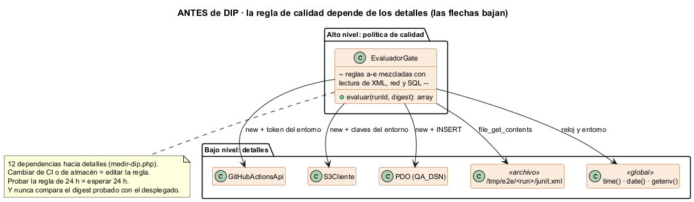
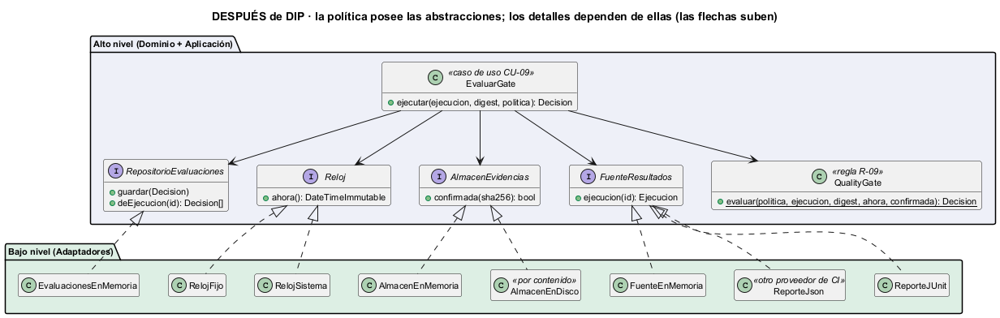

# Semana 2 — Requerimientos y DIP en el flujo de quality gates

| | |
|---|---|
| **Estudiante** | Boris Alexander Quiroa Orellana |
| **Módulo** | QA, pruebas E2E, CI y guía de despliegue final (adaptación: gestión de ejecuciones automatizadas y calidad de versiones) |
| **Tema** | Proceso y modelo de diseño; principios SOLID |
| **Principio** | DIP: principio de inversión de dependencias |

## Entregables

| Pedido | Dónde |
|---|---|
| RF/RNF | §2 (14 RF) y §3 (8 RNF), trazados a las reglas R-01..R-14 de la semana 1 |
| Criterios de aceptación | §4: 14 criterios. Los 14 son **ejecutables** con [verificar.php](ejemplo-dip/verificar.php) |
| Ejemplo SOLID antes/después | §5–§7, código en [ejemplo-dip/](ejemplo-dip/) y diagramas [antes](diagramas/semana-02-dip-antes.png) y [después](diagramas/semana-02-dip-despues.png) |
| Responsabilidades y dependencias | §8 |
| Evidencia verificable | §9: criterios 14/14, dependencias medidas 12 → 0 y mutaciones 8/8 ([evidencia/](evidencia/)) |

## 1. Introducción

La semana 1 dejó el proceso modelado. Esta semana fija **qué** debe hacer el módulo (RF), **cómo de bien** (RNF) y **cuándo se considera hecho** (criterios de aceptación). Además aplica un principio SOLID donde más falta hace.

**Por qué DIP aquí.** Un quality gate escrito «rápido» vive dentro de un script de CI: lee el XML de un directorio fijo, llama a la API de GitHub, consulta S3 y escribe en una base. Ese gate tiene tres problemas:
- **No se puede probar** sin el runner, la red y las credenciales.
- **Cambiar de proveedor** (de GitHub Actions a GitLab, de S3 a MinIO) obliga a tocar la **regla de calidad**.
- La regla de antigüedad («24 h o menos») depende de `time()`: probarla exige esperar 24 h.

Es el caso de manual de un módulo de alto nivel (la política) que depende de módulos de bajo nivel (los detalles).

## 2. Requerimientos funcionales

| RF | Requerimiento | Reglas |
|---|---|---|
| RF-01 | Registrar escenarios E2E con flujo, criticidad, requisitos cubiertos y un conjunto de datos **sintético**; rechazar datos no sintéticos | R-01 |
| RF-02 | Registrar una versión candidata con semver, commit y digest del artefacto; un digest no se reutiliza con otro commit | R-03 |
| RF-03 | Planificar las pruebas de una versión con **todos** los escenarios críticos y los de los módulos afectados (422 con los que faltan); congelar el plan al iniciar | R-02 |
| RF-04 | Iniciar una ejecución sobre el digest de la versión y un entorno | R-03 |
| RF-05 | Reportar el resultado de cada escenario con sus intentos y evidencias; una FALLA o un INESTABLE sin evidencia confirmada cuenta como incompleto | R-04, R-05 |
| RF-06 | Clasificar como INESTABLE el escenario que falló y pasó al reintentar | R-06 |
| RF-07 | Completar o abortar una ejecución; solo una COMPLETADA se evalúa | R-04 |
| RF-08 | Poner en cuarentena un escenario **no crítico**, con dueño y vencimiento | R-07 |
| RF-09 | Evaluar el quality gate con las reglas a–e y el digest, con todas las causas | R-03, R-09 |
| RF-10 | Guardar cada evaluación sin editarla, con la versión de la política, la ejecución y el digest | R-09, R-14 |
| RF-11 | Aprobar una excepción solo sobre las reglas b, c o e, con un aprobador distinto del autor del cambio, justificación y vencimiento | R-10 |
| RF-12 | Desplegar solo una versión aprobada cuyo digest coincida con el evaluado; registrar los pasos de la guía y la verificación posterior, y revertir si falla | R-11 |
| RF-13 | Reportar resultados de forma idempotente con `Idempotency-Key` | R-12 |
| RF-14 | Exigir el permiso de cada operación en el tenant; el token del pipeline solo reporta | R-13 |

## 3. Requerimientos no funcionales

| RNF | Atributo | Requerimiento medible |
|---|---|---|
| RNF-01 | **Inversión de dependencias** | Dominio y Aplicación tienen 0 instancias de clases concretas de infraestructura, 0 llamadas a E/S, red, entorno o reloj, y 0 imports de adaptadores (`medir-dip.php`) |
| RNF-02 | Testabilidad | Todos los criterios de aceptación de la regla corren sin red, sin runner y sin base, en menos de 5 s |
| RNF-03 | Portabilidad de proveedor | Cambiar de proveedor de CI o de formato de reporte = **un** adaptador nuevo y 0 líneas cambiadas en Dominio y Aplicación |
| RNF-04 | Integridad de la evidencia | Cada artefacto se direcciona por su SHA-256; uno alterado deja de confirmarse |
| RNF-05 | Seguridad | El token del pipeline tiene alcance mínimo (reportar en sus ejecuciones); ningún token ni secreto aparece en logs ni en la evidencia |
| RNF-06 | Privacidad | 0 datos de pacientes reales en escenarios y evidencias (R-01) |
| RNF-07 | Reproducibilidad | Lo desplegado se identifica por el mismo digest que se evaluó |
| RNF-08 | Rendimiento | Evaluar un gate de 300 escenarios en menos de 1 s (se mide en la semana 14) |

## 4. Criterios de aceptación

Formato: **dado** el estado, **cuando** ocurre algo, **entonces** el resultado. Todos están implementados en [verificar.php](ejemplo-dip/verificar.php).

| CA | Dado / cuando / entonces | RF/RNF |
|---|---|---|
| CA-01 | Dada una ejecución completada sobre el digest, con todo en PASA y de hace 6 h, cuando se evalúa, entonces APROBADO sin causas | RF-09 |
| CA-02 | … con un crítico en FALLA (con evidencia) → RECHAZADO, y la causa nombra el escenario | RF-09 |
| CA-03 | … con un crítico INESTABLE → RECHAZADO: no cuenta como PASA | RF-06 |
| CA-04 | … con un crítico OMITIDO → la regla a no se cumple | RF-09 |
| CA-05 | … con una FALLA sin evidencia, o con una huella que el almacén no confirma → la regla d no se cumple | RF-05 |
| CA-06 | Umbral 75 %: 3 de 4 no críticos aprueba la regla b; 2 de 4 no (valor límite) | RF-09 |
| CA-07 | Dos no críticos OMITIDOS cuentan igual que dos que FALLAN: **omitir no mejora la tasa** | RF-09 |
| CA-08 | Máximo 1 inestable: 1 cumple la regla c; 2 no | RF-09 |
| CA-09 | Con reloj fijo: 24 h exactas cumple la regla e; 24 h y 1 s no | RF-09, RNF-02 |
| CA-10 | La ejecución probó otro digest → RECHAZADO aunque todo pase | RF-04, RNF-07 |
| CA-11 | Una ejecución no completada no se evalúa (EJECUCION_NO_COMPLETADA) | RF-07 |
| CA-12 | Evaluar dos veces deja dos decisiones, cada una con la política y el digest | RF-10 |
| CA-13 | La misma ejecución leída del JUnit y del JSON de otro proveedor da la misma decisión | RNF-03 |
| CA-14 | El almacén en disco confirma un artefacto por su SHA-256, rechaza uno alterado y rechaza una ruta manipulada | RNF-04 |

## 5. El principio de inversión de dependencias

> a) Los módulos de alto nivel no deben depender de los de bajo nivel; ambos deben depender de abstracciones.
> b) Las abstracciones no deben depender de los detalles; los detalles deben depender de las abstracciones. (Martin, 2003)

Para aplicarlo hay que precisar dos cosas:
- **Las abstracciones las posee el alto nivel.** `FuenteResultados` habla de «ejecución», «escenario» y «evidencia», no de «run», «check-suite» ni «bucket». Si la interfaz copiara la API de GitHub, el alto nivel seguiría dependiendo de GitHub, solo que con un paso más.
- **No es lo mismo que inyectar dependencias.** Inyectar es *cómo* llega el objeto; invertir es *quién define el contrato*. En el después hacen falta las dos cosas.

## 6. Diseño antes de aplicar DIP



[antes/EvaluadorGate.php](ejemplo-dip/antes/EvaluadorGate.php) mezcla las reglas a–e con los detalles:

| Línea de responsabilidad | Detalle concreto | Consecuencia |
|---|---|---|
| Obtener el estado de la ejecución | `new GitHubActionsApi(getenv('GITHUB_TOKEN'))` | Sin red ni token, nada corre; migrar a GitLab = editar la regla |
| Leer resultados | `file_get_contents("/tmp/e2e/$runId/junit.xml")` | Ruta y formato fijos |
| Confirmar evidencia | `new S3Cliente(...)` | Probar la regla d exige un bucket |
| Antigüedad | `time()`, `strtotime()` | La regla e no se puede probar en el límite |
| Guardar la decisión | `new \PDO(getenv('QA_DSN'))`, `date('c')` | Persistencia acoplada a la regla |

**Medido** con [medir-dip.php](ejemplo-dip/medir-dip.php): **3 instancias de clases concretas y 9 llamadas a E/S, entorno o reloj** dentro de la regla.

**Lo que DIP destapa.** Al separar la regla de los detalles, la regla queda en unas 40 líneas legibles y se ve lo que el antes escondía: **nunca compara el digest probado con el de la versión**. Solo verifica que no esté vacío. Ese era el error que el gate existe para impedir (R-03), y en el después lo fija CA-10.

## 7. Diseño después de aplicar DIP



| Pieza | Nivel | Qué hace |
|---|---|---|
| `Dominio/Modelo.php` | Alto | Resultado, ResultadoEscenario, Ejecucion, PoliticaGate y Decision |
| `Dominio/Puertos.php` | Alto | Las 4 abstracciones que **posee** el dominio: `FuenteResultados`, `AlmacenEvidencias`, `Reloj`, `RepositorioEvaluaciones` |
| `Dominio/QualityGate.php` | Alto | Las reglas digest y a–e, pura: recibe datos y una función que confirma evidencia |
| `Aplicacion/EvaluarGate.php` | Alto | CU-09: recibe las 4 abstracciones por el constructor y orquesta |
| `Adaptadores/ReporteJUnit.php` | Bajo | Traduce el JUnit del runner (testcase, failure, skipped, `@critico`, propiedad `intentos`) |
| `Adaptadores/ReporteJson.php` | Bajo | Traduce el JSON de **otro** proveedor (success, failed, flaky, skipped) |
| `Adaptadores/Infraestructura.php` | Bajo | Almacén en disco por contenido, reloj del sistema y reloj fijo, dobles en memoria |

Las flechas de implementación **suben**: los detalles dependen de las abstracciones del dominio y nunca al revés.

## 8. Responsabilidades y dependencias

### Responsabilidades

| Clase | Una sola razón para cambiar |
|---|---|
| `QualityGate` | Cambia la política de calidad (una regla nueva, otro criterio) |
| `EvaluarGate` | Cambia el orden del caso de uso (por ejemplo, auditar) |
| `ReporteJUnit` / `ReporteJson` | Cambia el formato del proveedor |
| `AlmacenEnDisco` | Cambia dónde y cómo se guardan los artefactos |
| `RelojSistema` / `RelojFijo` | Cambia la fuente de la hora |

### Dependencias

| De | A | Tipo | Justificación |
|---|---|---|---|
| `EvaluarGate` | `FuenteResultados`, `AlmacenEvidencias`, `Reloj`, `RepositorioEvaluaciones` | Abstracción (constructor) | DIP: el caso de uso no sabe quién lo implementa |
| `EvaluarGate` | `QualityGate` | Concreta, del mismo nivel | Es la regla del dominio: no tiene sentido abstraerla |
| `QualityGate` | Una función `confirmada(sha256)` | Abstracción mínima | La regla no necesita el almacén entero, solo la pregunta |
| Adaptadores | `Dominio\*` | Implementan o construyen tipos del dominio | La dependencia apunta hacia el dominio |
| `verificar.php` | Todo | Raíz de composición | El único lugar que conoce las clases concretas |

## 9. Evidencia verificable

```bash
cd docs/modulos/qa-e2e-ci-despliegue/semana-02/ejemplo-dip
php verificar.php     # 14 criterios: 14 cumplen
php medir-dip.php     # dependencias del alto nivel hacia detalles: 12 antes, 0 después
php mutaciones.php    # 8 mutaciones de la regla: 8 detectadas
php datos/generar.php # regenera run-101 (JUnit y JSON) y sus 3 artefactos
```

| Verificación | Resultado | Evidencia |
|---|---|---|
| Criterios de aceptación | **14/14**, sin red ni CI | [verificar.txt](evidencia/verificar.txt) |
| DIP medido | **12 → 0** (3 `new` y 9 llamadas de E/S, entorno o reloj → ninguna) | [medir-dip.txt](evidencia/medir-dip.txt) |
| Portabilidad | El mismo run-101 en JUnit y en JSON da la misma decisión (CA-13) | [datos/](ejemplo-dip/datos/) |
| Mutaciones | **8/8** detectadas; cada una la detecta el criterio de su regla | [mutaciones.txt](evidencia/mutaciones.txt) |

**Hallazgo al escribir los criterios.** La primera versión de la regla sacaba los OMITIDOS de la tasa de no críticos, y el CA-07 original decía «no se puede mejorar la tasa omitiendo». Pasaba, pero solo porque omitía un escenario que **pasaba**. Si se omite uno que **falla**, la tasa sube: con 3 de 4 la regla no se cumplía y con 3 de 3 sí. Eso era un agujero en la regla, no en la prueba.

La corrección: un OMITIDO cuenta como no aprobado. El CA-07 nuevo compara omitir con fallar y exige el mismo resultado; la mutación M5 (sacar los omitidos de la tasa) lo confirma. En el antes este agujero ni se veía: la tasa estaba enredada con la lectura del XML.

## 10. Trazabilidad con la semana 1

| Semana 1 | Semana 2 |
|---|---|
| R-03 (digest) | RF-02, RF-04, RNF-07; CA-10 |
| R-05 (evidencia) | RF-05, RNF-04; CA-05, CA-14 |
| R-06 (inestable) | RF-06; CA-03, CA-08 |
| R-09 a–e | RF-09; CA-01..CA-09 |
| CU-09 y mensajes S14–S26 | `EvaluarGate` → `QualityGate`, con los puertos como participantes |
| Actor «Almacén de artefactos» | `AlmacenEvidencias` (puerto) y `AlmacenEnDisco` (adaptador) |
| Actor «Pipeline CI» | `FuenteResultados`: GitHub, GitLab o un archivo, intercambiables |

## 11. Conclusión

DIP convirtió un script atado a un runner en una regla que se puede probar en milisegundos, cambiar de proveedor sin tocarla y leer en una pantalla. También destapó un error grave del antes (nunca comparaba el digest) y, al escribir los criterios, un agujero de la regla nueva (omitir mejoraba la tasa). Las dos cosas solo se vieron cuando la regla quedó sola.

## 12. Bibliografía

- Martin, R. C. (2003). *Agile Software Development: Principles, Patterns, and Practices*. Prentice Hall. Cap. 11: «The Dependency-Inversion Principle».
- Humble, J. y Farley, D. (2010). *Continuous Delivery*. Addison-Wesley. Cap. 5: «Anatomy of the Deployment Pipeline» (construir el binario una sola vez).
- Fowler, M. (2004). *Inversion of Control Containers and the Dependency Injection pattern*. martinfowler.com.
