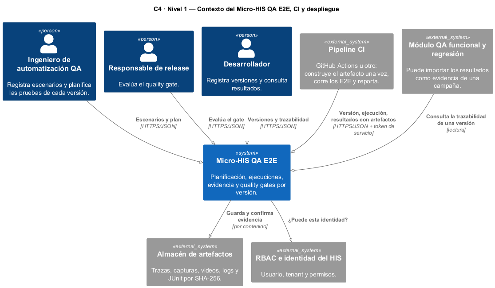
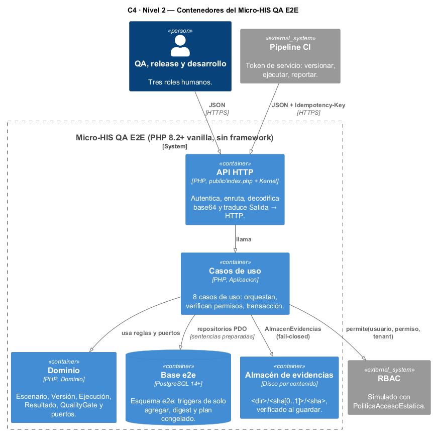
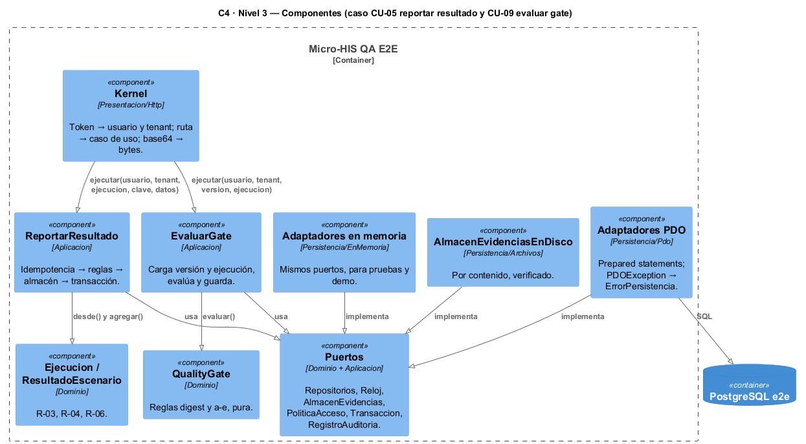
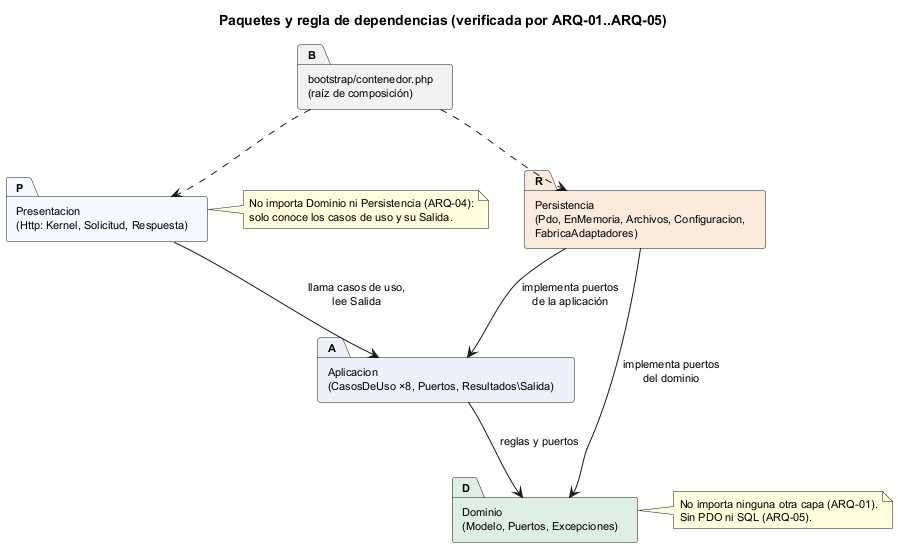

# Semana 3 — Micro-HIS por capas: vista arquitectónica y dependencias

| | |
|---|---|
| **Estudiante** | Boris Alexander Quiroa Orellana |
| **Módulo** | QA, pruebas E2E, CI y guía de despliegue final (adaptación: gestión de ejecuciones automatizadas y calidad de versiones) |
| **Tema** | Diseño arquitectónico, vistas y patrones |
| **Entregable** | Vista arquitectónica C4/UML del módulo y sus dependencias |

## Entregables

| Pedido | Dónde |
|---|---|
| Micro-HIS en PHP 8.2+ vanilla, 4 capas, PDO con sentencias preparadas, sin framework | [micro-his-e2e/](../micro-his-e2e/README.md): 8 casos de uso, de registrar un escenario a evaluar el gate |
| Pruebas: camino feliz, regla de dominio y error de persistencia | APP-01 (camino feliz), DOM-01..10 y APP-02 (reglas), APP-07, APP-08 y PER-01 (persistencia con dobles), INT-01..07 (PostgreSQL real) |
| Vista C4 | [Contexto](diagramas/semana-03-c4-contexto.png), [contenedores](diagramas/semana-03-c4-contenedores.png) y [componentes](diagramas/semana-03-c4-componentes.png) |
| Vista UML de dependencias | [Paquetes y regla de dependencias](diagramas/semana-03-paquetes-dependencias.png), verificada por ARQ-01..05 |
| Evidencia | [evidencia/](evidencia/): 39 pruebas, 16 mutaciones, demo HTTP y el hallazgo en rojo |

## 1. Qué se construyó

Los casos de uso de la semana 1 que forman el flujo principal, sobre los puertos que la semana 2 dejó definidos con DIP:

| CU | Caso de uso | Reglas que aplica |
|---|---|---|
| CU-01 | RegistrarEscenario | R-01 datos sintéticos |
| CU-02 | RegistrarVersion | R-03: un digest identifica un único artefacto (409 DIGEST_EN_USO) |
| CU-03 | PlanificarPruebas | R-02: críticos y módulos afectados (422 con los faltantes) |
| CU-04 | IniciarEjecucion | R-02 congela el plan; R-03 exige el digest de la versión |
| CU-05 + CU-06 | ReportarResultado | R-04, R-05, R-06 (INESTABLE), R-08 fail-closed, R-12 idempotencia |
| CU-07 | CerrarEjecucion | Completar exige todos los escenarios; abortar exige motivo |
| CU-09 | EvaluarGate | R-03 y R-09 a–e, con la política versionada |
| CU-12 | ConsultarTrazabilidad | Versión ↔ plan ↔ ejecuciones ↔ resultados ↔ evidencias ↔ evaluaciones |

Quedan para semanas siguientes: la cuarentena (CU-08), las excepciones (CU-10) y el despliegue (CU-11). Sus reglas ya están en el modelo de la semana 1.

| Capa | Archivos | Líneas | Qué contiene |
|---|---:|---:|---|
| Dominio | 16 | 649 | Entidades, reglas y puertos; no importa ninguna otra capa |
| Aplicación | 14 | 614 | 8 casos de uso, sus puertos y `Salida` |
| Persistencia | 20 | 848 | PDO, en memoria, almacén en disco, configuración |
| Presentación | 3 | 153 | Kernel HTTP (en la semana 4 pasa a MVC) |
| Base | 3 | 186 | Esquema `e2e` y datos de demostración |
| Pruebas | 11 | 936 | Arnés propio, dobles, 39 pruebas y 16 mutaciones |

## 2. Vista C4



**Nivel 1 — contexto.** Tres roles humanos y el pipeline de CI usan el módulo. El pipeline es el cliente que más escribe, con un token de servicio que solo puede versionar, ejecutar y reportar. El módulo de regresión manual lo consulta como fuente de evidencia.



**Nivel 2 — contenedores.** API HTTP, casos de uso, dominio, base `e2e` y almacén de evidencias por contenido. El almacén está separado de la base: la base guarda la huella y la ubicación, y el almacén guarda los bytes.



**Nivel 3 — componentes** de los dos casos de uso más delicados: reportar un resultado y evaluar el gate.

## 3. Dependencias



| Regla | Verificación |
|---|---|
| Dominio no importa Aplicación, Persistencia ni Presentación | ARQ-01 |
| Aplicación no importa Persistencia ni Presentación | ARQ-02 |
| Persistencia no importa Presentación | ARQ-03 |
| Presentación no importa Persistencia ni Dominio: solo conoce los casos de uso y su `Salida` | ARQ-04 |
| PDO y SQL solo en Persistencia; sin Composer | ARQ-05 |
| Las clases concretas se juntan en un solo lugar | `bootstrap/contenedor.php` |

**Patrones usados:**

| Patrón | Dónde | Por qué |
|---|---|---|
| Arquitectura en capas + puertos y adaptadores | Todo el módulo | El dominio no depende de la base ni del proveedor de CI (DIP, semana 2) |
| Repository | `Dominio/Puertos/Repositorio*` | La semana 4 lo formaliza con PDO e InMemory |
| Unit of Work simple | `Transaccion` | Resultado, evidencias y traza en una sola transacción |
| Almacenamiento direccionado por contenido | `AlmacenEvidenciasEnDisco` | La huella es el nombre: guardar dos veces es idempotente y una alteración se detecta |
| Clave de idempotencia | `ReportarResultado` + `UNIQUE (tenant, clave)` | El pipeline reintenta cuando la red falla |
| Raíz de composición | `bootstrap/contenedor.php` | Un solo lugar construye el grafo, el mismo en producción y en pruebas |

## 4. Las reglas también en la base

Las reglas que no pueden depender de que la aplicación «se porte bien» están en [schema.sql](../micro-his-e2e/database/schema.sql). Las pruebas INT las ejercitan saltándose la aplicación:

| Regla | En la base | Prueba |
|---|---|---|
| R-01 | `CHECK (datos ~ '^SINT-…')` | — (también en el dominio, DOM-01) |
| R-02 | Trigger: el plan congelado no cambia ni se descongela | INT-04 |
| R-03 | Trigger: la ejecución tiene el digest de su versión; el digest de una versión no cambia | INT-03 |
| R-04, R-08 | Triggers de solo agregar en resultados, evidencias, evaluaciones y auditoría | INT-02 |
| R-06 | `CHECK`: un PASA es al primer intento; INESTABLE es con más de uno | INT-04 |
| R-12 | `UNIQUE (tenant, clave)` | INT-05 |

## 5. Pruebas y evidencia

```bash
cd docs/modulos/qa-e2e-ci-despliegue/micro-his-e2e
php tests/ejecutar.php                                    # 32 pasan, 7 omitidas (integración sin base)
E2E_DB_DSN="pgsql:..." php tests/ejecutar.php             # 39/39
E2E_DB_DSN="pgsql:..." php tests/mutaciones.php           # 16/16
E2E_DB_DSN="pgsql:..." bash bin/demo-http.sh              # recorrido por HTTP real
```

| Lo que pide la tarea | Pruebas |
|---|---|
| Camino feliz | APP-01 (en memoria, con la traza de cada paso), HTTP-01 (por el kernel), INT-01 (PostgreSQL) |
| Regla de dominio | DOM-01..DOM-10 y APP-02, APP-05, APP-09, APP-10 por los casos de uso |
| Error de persistencia con dobles | APP-07 (lectura: 503 y nunca una excepción), APP-08 (escritura: la transacción deshace), APP-04 (almacén caído: fail-closed), PER-01 (PDO caído sin filtrar el host ni la clave) |
| Error de persistencia con base de prueba | INT-02..INT-06 |

| Evidencia | Resultado |
|---|---|
| [1-pruebas-dobles.txt](evidencia/1-pruebas-dobles.txt) | 32 pasan, 7 omitidas (sin base) |
| [2-pruebas-postgres.txt](evidencia/2-pruebas-postgres.txt) | **39/39** |
| [3-mutaciones-1-primera.txt](evidencia/3-mutaciones-1-primera.txt) | 14/16: **dos sobreviven** |
| [3-mutaciones-2-final.txt](evidencia/3-mutaciones-2-final.txt) | **16/16** |
| [4-demo-http.txt](evidencia/4-demo-http.txt) | 201 → 422 (plan sin el crítico E2E-102) → 200 → 201 → 201 INESTABLE → 200 → 403 (el pipeline no evalúa) → 200 RECHAZADO por el crítico inestable |
| [0-hallazgo-int05-rojo.txt](evidencia/0-hallazgo-int05-rojo.txt) | La primera corrida con PostgreSQL, en rojo (ver §6) |

## 6. Hallazgos

| # | Hallazgo | Quién lo encontró | Corrección |
|---|---|---|---|
| H-1 | `PdoRepositorioEjecuciones::traducir()` declaraba que devuelve `RuntimeException`, pero devolvía `ReglaRechazada` (un `DomainException`). Una carrera entre dos reintentos con la misma clave habría terminado en `TypeError`, es decir, un **500 en vez de 409**. Con los dobles en memoria no se ve: solo PostgreSQL tiene el `UNIQUE` | INT-05, en la primera corrida con la base | Tipo de retorno `\Exception` |
| H-2 | Mutación M7 (el gate no compara el digest) sobrevivía. La regla es una **defensa en profundidad**: `Ejecucion::iniciar` ya impide otro digest, así que ninguna prueba llegaba a ella | Mutaciones | DOM-10 construye una ejecución con otro digest (datos importados o alterados) |
| H-3 | Mutación M12 (el almacén se usa antes de revisar las reglas) sobrevivía: APP-05 fallaba en `critico()`, antes del punto mutado | Mutaciones | APP-05 agrega un duplicado de un escenario del plan con un artefacto nuevo: el almacén no lo guarda |

H-2 y H-3 tienen la misma lección: una prueba en verde no dice qué partes del código ejercita. Las mutaciones lo midieron.

## 7. Limitaciones

- **Sin cuarentena, excepciones ni despliegue todavía** (CU-08, CU-10, CU-11).
- **La identidad es de demostración:** tokens fijos en la configuración, mientras el HIS no expone su JWT.
- **El Kernel mezcla enrutamiento y traducción** en un solo archivo: la semana 4 lo separa en MVC.
- **La demo HTTP usa `sha256sum` y `base64`** de Git Bash o Linux.
