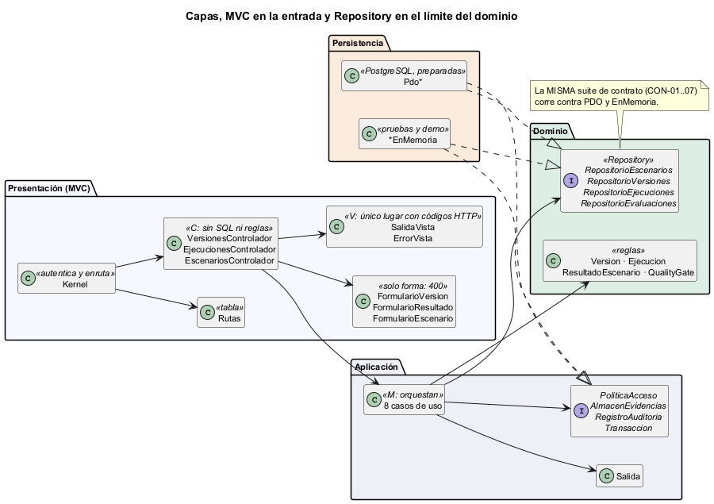
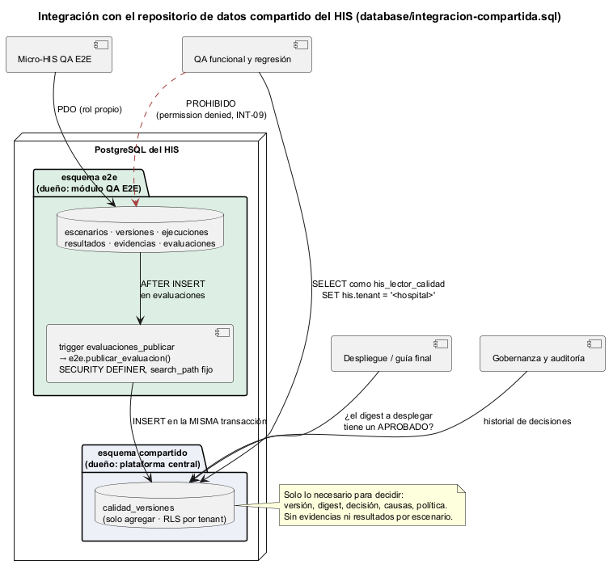

# Semana 4 — Capas, MVC, Repository y repositorio compartido

| | |
|---|---|
| **Estudiante** | Boris Alexander Quiroa Orellana |
| **Módulo** | QA, pruebas E2E, CI y guía de despliegue final (adaptación: gestión de ejecuciones automatizadas y calidad de versiones) |
| **Tema** | Arquitectura en capas y patrón repositorio |
| **Entregable** | Capas, responsabilidades y objetos reutilizables |

## Entregables

| Pedido | Dónde |
|---|---|
| MVC en la entrada | `src/Presentacion/Http/`: 3 formularios, 3 controladores, 2 vistas, tabla de rutas; el Kernel solo autentica y enruta |
| Controlador sin SQL ni reglas | ARQ-06 (verificada con una violación sembrada, §5) |
| Interfaz Repository en el límite apropiado | `Dominio/Puertos/Repositorio*` (4 interfaces) |
| Adaptadores PDO e InMemory | `Persistencia/Pdo/*` y `Persistencia/EnMemoria/*`, con **la misma suite de contrato** (CON-01..07 × 2) |
| Repositorio de datos compartido: análisis y diagrama | §4, [integracion-compartida.sql](../micro-his-e2e/database/integracion-compartida.sql) e INT-08/09 |
| Capas, responsabilidades y objetos reutilizables | §1–§3 y el [diagrama](diagramas/semana-04-capas-mvc-repository.png) |
| Evidencia | **61/61 pruebas** con PostgreSQL y **21/21 mutaciones** ([evidencia/](evidencia/)) |

## 1. Capas y responsabilidades



| Capa | Pieza | Responsabilidad | Lo que **no** hace |
|---|---|---|---|
| Presentación | `Kernel` | Token → `Identidad`; ruta → acción; 404/405; 500 sin detalles | No lee el cuerpo ni conoce los casos de uso |
| | Formularios | **Forma**: JSON, tipos, obligatorios, base64, Idempotency-Key → 400 con los campos | No decide reglas: un digest con mal formato pasa y lo rechaza el dominio con 422 (MVC-01) |
| | Controladores (C) | Formulario → caso de uso → vista | Sin SQL, sin Dominio, sin `Salida::`, sin reglas (ARQ-06) |
| | Vistas (V) | `Salida` → código HTTP y cuerpo; `Location` en los 201 | Único lugar con códigos de estado |
| Aplicación (M) | 8 casos de uso | Permiso → cargar → regla del dominio → transacción → traza | No conoce HTTP ni SQL |
| Dominio | Entidades y `QualityGate` | Reglas R-01..R-09 | No conoce ninguna otra capa (ARQ-01) |
| | **Repository** (4 interfaces) | El contrato de lo que se guarda y se lee, en el vocabulario del dominio | No sabe si hay PostgreSQL |
| Persistencia | `Pdo*` | SQL con sentencias preparadas; `PDOException` → `ErrorPersistencia` | No filtra el driver (PER-01) |
| | `*EnMemoria` | Los mismos puertos para pruebas y demo | No relaja ninguna regla del contrato (CON-05) |

**Por qué el Repository está en el Dominio y no en Persistencia:** lo **define** quien lo usa (DIP, semana 2). Si viviera en Persistencia, el dominio dependería de la capa de datos para saber qué puede pedir.

## 2. MVC en la entrada

| Ruta | Controlador · acción | Formulario | Caso de uso |
|---|---|---|---|
| `POST /escenarios` | Escenarios · registrar | `FormularioEscenario` | RegistrarEscenario |
| `POST /versiones` | Versiones · registrar | `FormularioVersion::registrar` | RegistrarVersion |
| `POST /versiones/{v}/plan` | Versiones · planificar | `FormularioVersion::plan` | PlanificarPruebas |
| `POST /versiones/{v}/ejecuciones` | Versiones · iniciarEjecucion | `FormularioVersion::ejecucion` | IniciarEjecucion |
| `POST /versiones/{v}/gate` | Versiones · evaluarGate | `FormularioVersion::gate` | EvaluarGate |
| `GET /versiones/{v}/trazabilidad` | Versiones · trazabilidad | — | ConsultarTrazabilidad |
| `POST /ejecuciones/{id}/resultados` | Ejecuciones · reportar | `FormularioResultado` | ReportarResultado |
| `POST /ejecuciones/{id}/cierre` | Ejecuciones · cerrar | `FormularioResultado::cierre` | CerrarEjecucion |

**El refactor no cambió el comportamiento:** las 39 pruebas de la semana 3 (incluidas las HTTP) pasaron sin tocarlas.

## 3. Objetos reutilizables

| Objeto | Reutilizable por | Por qué |
|---|---|---|
| `Formulario` (base) | Cualquier entrada JSON del módulo | Tipos y obligatorios en una tabla; los formularios concretos solo declaran sus campos |
| `SalidaVista` / `ErrorVista` | Todos los controladores | Una sola tabla `Salida` → HTTP; los errores siempre en `error` |
| `Salida` | Todos los casos de uso | Resultado sin HTTP; también lo podría usar una CLI o una cola |
| `ConsultasPdo` | Todos los adaptadores PDO | Preparadas siempre; traducción de errores sin filtrar datos |
| `TransaccionEnMemoria` | Cualquier conjunto de repositorios en memoria | Instantánea y restauración: todo o nada también en las pruebas |
| `AlmacenEvidenciasEnDisco` | Cualquier módulo que guarde archivos con huella | Direccionado por contenido y verificado |
| **La suite de contrato** | Cualquier adaptador nuevo (otro motor, una API) | Un adaptador nuevo es correcto si pasa CON-01..07 |
| `QualityGate` | Una CLI de CI, otro módulo | Función pura: recibe datos y devuelve una decisión |

## 4. Integración con un repositorio de datos compartido



**El problema.** Otros módulos necesitan saber si una versión pasó el gate:
- Despliegue, para no instalar un digest rechazado;
- QA y regresión, para usarlo como evidencia de una campaña;
- Gobernanza, para el historial.

Ninguno debería leer las tablas internas del módulo E2E: si lo hicieran, cada cambio del esquema `e2e` rompería a tres módulos.

| Alternativa | Ventaja | Problema | Decisión |
|---|---|---|---|
| A · Los consumidores leen `e2e.*` directamente | Cero trabajo | Acopla 3 módulos al esquema interno; ven evidencias y resultados que no necesitan; nadie controla el tenant | ❌ |
| B · API HTTP del módulo E2E | Desacopla | Cada consumidor depende de que el módulo esté arriba; Despliegue necesita la respuesta aunque E2E esté en mantenimiento | Para la semana 5 (cliente-servidor) |
| **C · Publicar hechos en un esquema compartido** | Contrato estable y mínimo; lectura sin depender del módulo; tenant forzado por la base | Un dato duplicado (la decisión) | ✅ |

**Cómo funciona C** ([integracion-compartida.sql](../micro-his-e2e/database/integracion-compartida.sql)):
1. **Un hecho por evaluación** en `compartido.calidad_versiones`: tenant, versión, digest, decisión, causas, política y hora. Sin evidencias ni resultados por escenario.
2. **Mismo commit:** lo publica un trigger `AFTER INSERT` sobre `e2e.evaluaciones`, en la misma transacción. Si la evaluación se deshace, el hecho también (INT-08).
3. **Solo agregar:** el hecho no se corrige; una reevaluación es un hecho nuevo (INT-08).
4. **Seguridad por filas:** el rol `his_lector_calidad` solo ve las filas del hospital que fija en la sesión (`SET his.tenant`). Sin tenant no ve nada (INT-09).
5. **Mínimo privilegio:** el lector solo tiene `SELECT` sobre esa tabla, no puede escribir y no entra al esquema `e2e` (INT-09).
6. **`SECURITY DEFINER` con `search_path` fijo:** la función que publica escribe en `compartido` sin dar permisos de escritura a nadie, y nadie puede colar una función homónima.

**Lo que no resuelve:** si el repositorio compartido está en **otra** base, el trigger no alcanza. Haría falta una bandeja de salida (outbox) y un publicador. Queda anotado para la semana 5.

## 5. Hallazgos

| # | Hallazgo | Quién lo encontró | Corrección |
|---|---|---|---|
| H-1 | **ARQ-06 era vacía.** La expresión que leía los `use` de los controladores quedó mal escapada y no capturaba nada, así que la prueba pasaba **aunque un controlador importara el Dominio** | Una violación sembrada a mano (un `use E2e\Dominio\...` en un controlador): la prueba siguió en verde | Expresión corregida y una guarda: si no lee ningún import, la prueba falla («la expresión no sirve»). Repetida la siembra: ahora falla |
| H-2 | **El adaptador en memoria aceptaba dos cierres de la misma ejecución**; el de PDO no, porque condiciona el `UPDATE` al estado `EN_CURSO` | La suite de contrato (CON-05-MEM en rojo, CON-05-PDO en verde) | En memoria también se compara con el estado guardado. Mutación M17 |
| H-3 | La suite de contrato usó `SINT-X` (no cumple el patrón de 2 a 40 caracteres). En memoria pasó y **PostgreSQL lo rechazó**: el `CHECK` del esquema sostiene R-01 aunque alguien construya el objeto sin pasar por la fábrica | CON-01-PDO en rojo | Error de la prueba, corregido. Lo que muestra se conserva: la base es la última defensa |

Primera corrida de la suite de contrato: [1-contrato-primera.txt](evidencia/1-contrato-primera.txt) (12/14).

## 6. Evidencia

```bash
cd docs/modulos/qa-e2e-ci-despliegue/micro-his-e2e
E2E_DB_DSN="pgsql:..." php tests/ejecutar.php      # 61/61
E2E_DB_DSN="pgsql:..." php tests/mutaciones.php    # 21/21 (16 de la semana 3 + 5 nuevas: M17–M21)
```

| Evidencia | Resultado |
|---|---|
| [1-contrato-primera.txt](evidencia/1-contrato-primera.txt) | 12/14: H-2 y H-3 |
| [2-pruebas-postgres.txt](evidencia/2-pruebas-postgres.txt) | **61/61** (39 de la semana 3 + 14 de contrato + 5 MVC + ARQ-06 + INT-08/09) |
| [3-mutaciones.txt](evidencia/3-mutaciones.txt) | **21/21**: memoria sin condición (M17), formulario sin tipos (M18), sin publicación (M19), sin RLS (M20), controlador sin formulario (M21) |
