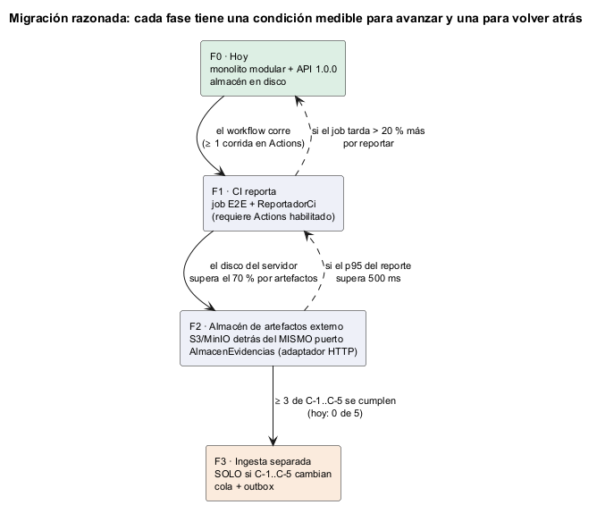

# Semana 5 — Cliente-servidor, contrato API y frontera de microservicio

| | |
|---|---|
| **Estudiante** | Boris Alexander Quiroa Orellana |
| **Módulo** | QA, pruebas E2E, CI y guía de despliegue final (adaptación: gestión de ejecuciones automatizadas y calidad de versiones) |
| **Tema** | Cliente-servidor, API REST, microservicios e integración |
| **Entregable** | Contrato API y plan de issue, rama, worktree y PR |

## Entregables

| Pedido | Dónde |
|---|---|
| Contrato API | [api/openapi.yaml](../micro-his-e2e/api/openapi.yaml): OpenAPI 3.1, versión 1.0.0, 8 operaciones con `x-permiso` y 36 códigos de error. Contrato = código, verificado por API-01..04 |
| Propiedad de datos, comunicación, seguridad, resiliencia, observabilidad y consistencia | §2–§7 |
| Diagramas | [cliente-servidor](diagramas/semana-05-cliente-servidor.png), [resiliencia](diagramas/semana-05-secuencia-resiliencia.png), [migración](diagramas/semana-05-migracion.png) |
| Frontera de microservicio, evaluada con medición | §8: [medicion-frontera.txt](evidencia/medicion-frontera.txt) |
| Migración razonada | §9 |
| Plan de issue, rama, worktree y PR | [plan/issue-reportador-ci.md](plan/issue-reportador-ci.md) y [plan/rama-worktree-pr.md](plan/rama-worktree-pr.md) |
| Evidencia | **76/76 pruebas** con PostgreSQL y **25/25 mutaciones** |

## 1. El contrato

| Operación | Permiso | Éxito | Errores de negocio |
|---|---|---|---|
| `POST /escenarios` | `e2e.disenar` | 201 | 409 existente, 422 datos no sintéticos |
| `POST /versiones` | `e2e.versionar` | 201 | 409 versión o digest en uso, 422 formato |
| `POST /versiones/{version}/plan` | `e2e.planificar` | 200 | 404, 409 plan congelado, 422 plan incompleto (con los faltantes) |
| `POST /versiones/{version}/ejecuciones` | `e2e.ejecutar` | 201 | 404, 409 digest distinto |
| `POST /ejecuciones/{id}/resultados` | `e2e.reportar` | 201 / **200** si la clave se repite | 409 (fuera del plan, ya reportado, clave reutilizada), 413, 422, **503 almacén** |
| `POST /ejecuciones/{id}/cierre` | `e2e.ejecutar` | 200 | 409 estado, 422 faltan escenarios o motivo |
| `POST /versiones/{version}/gate` | `e2e.evaluar` | 200 con reglas y causas | 409 ejecución no completada |
| `GET /versiones/{version}/trazabilidad` | `e2e.consultar` | 200 | 404 |

Todas documentan además 400, 401, 403, 500 y 503 (API-02). No hay `PUT` ni `DELETE`: lo observado no se edita.

**Contrato = código**, verificado en cada corrida:

| Prueba | Qué verifica |
|---|---|
| API-01 | Las 8 operaciones del YAML son las 8 rutas de `Rutas::tabla()`, y cada `x-permiso` es la constante `PERMISO` de su caso de uso |
| API-02 | Cada operación documenta su éxito y los 5 errores transversales; no hay ediciones ni borrados |
| API-03 | Se recorren 19 peticiones reales por el kernel (de 200 a 503) y cada estado está en **su** operación y cada código de error en el enum |
| API-04 | Estructura sin dependencias: cada `$ref` existe, los parámetros de ruta están declarados, los `operationId` son únicos y no hay tabulaciones |

**Validación externa:** el lint con Redocly (`npx @redocly/cli lint`) **no se pudo correr**, porque la descarga del paquete fue bloqueada en este entorno. API-04 cubre la estructura, pero no reemplaza a un validador de OpenAPI completo. Queda como paso del job de CI (plan, commit 4).

## 2. Propiedad de los datos

| Dato | Dueño | Quién más lo ve | Cómo |
|---|---|---|---|
| Escenarios, versiones, planes, ejecuciones, resultados, evaluaciones | **Módulo QA E2E** (esquema `e2e`) | Nadie directamente | Solo por la API |
| Bytes de los artefactos | **Almacén de artefactos** | El módulo, por huella | Puerto `AlmacenEvidencias` |
| «La versión X con digest D tiene decisión Y» | Publicado por QA E2E en el esquema **compartido** | QA y regresión, Despliegue, Gobernanza | Rol lector con seguridad por filas (semana 4) |
| Usuarios, hospitales y permisos | **Identidad y RBAC del HIS** | El módulo, por consulta | `PoliticaAcceso` |
| La bandeja de pendientes | **El job de CI** (su workspace) | Nadie | Se descarta con el runner |

## 3. Comunicación

| Interacción | Estilo | Por qué |
|---|---|---|
| Pipeline → API (reportar, cerrar) | HTTP síncrono, comandos idempotentes | El job necesita saber si quedó registrado para decidir si reintenta |
| Humanos → API | HTTP síncrono | Pantallas y decisiones |
| QA E2E → otros módulos | Hecho publicado en el esquema compartido, en la misma transacción | Los consumidores no dependen de que la API esté arriba |
| Módulo → almacén | Llamada con confirmación de huella **antes** de la base | Fail-closed |

## 4. Seguridad

| Amenaza | Control | Verificación |
|---|---|---|
| El pipeline evalúa su propio gate o planifica | Token de servicio con `e2e.versionar`, `e2e.ejecutar` y `e2e.reportar`, nada más | APP-06, HTTP-03 |
| Leer o escribir en otro hospital | El tenant sale del token; `X-Tenant-ID` distinto → 403; otro tenant → 404 | HTTP-02, APP-06, CON-*, INT-07 |
| Datos de pacientes en la evidencia | Solo conjuntos `SINT-…` (dominio y `CHECK` de la base) | DOM-01, CON-01-PDO |
| Reintentos que duplican | `Idempotency-Key` + `UNIQUE (tenant, clave)` | APP-03, INT-05, CLI-01/02 |
| Filtración en errores y registros | 500 genérico; `ErrorPersistencia` sin el DSN; registro de acceso sin token, cuerpo ni artefactos | PER-01, OBS-02 |
| Inyección en cabeceras de registro | `X-Request-ID` solo `[A-Za-z0-9-]{8,64}`; lo demás se reemplaza | OBS-01 (con `\r\nSet-Cookie`) |
| Secretos en el repositorio | El token del pipeline va en los secretos de Actions, nunca en el YAML | Plan, §4 del PR |

## 5. Resiliencia

| Falla | Qué pasa | Prueba |
|---|---|---|
| Red caída al reportar | 3 intentos con la **misma** clave (200 y 400 ms entre medio) | CLI-01 |
| Respuesta perdida después de registrar | El reintento recibe 200 RESULTADO_YA_REPORTADO: un solo resultado | CLI-02 |
| API caída durante todo el reporte | PENDIENTE en `bandeja.jsonl` del job; el paso final reenvía con su clave | CLI-03 |
| Almacén caído | 503 sin escribir nada; el pipeline lo deja pendiente y lo reenvía con su evidencia | APP-04, CLI-05 |
| Rechazo de negocio (4xx) | No se reintenta ni se encola: el job lo muestra | CLI-04 |
| Servidor que no responde | El transporte corta a los 5 s | CLI-07 |
| Base caída | 503 ERROR_PERSISTENCIA, nunca una excepción | APP-07, PER-01 |
| Job reiniciado | La clave es determinística (`sha256(ejecución|escenario)`): no duplica | CLI-06 |

## 6. Observabilidad

- **`X-Request-ID` en toda respuesta.** Se respeta el del pipeline si es seguro, así el log del job y el del servidor se cruzan por un identificador (OBS-01).
- **Una línea JSON por petición** con hora, request_id, método, ruta, estado, código, ms, usuario y tenant, sin token, cuerpo ni artefactos (OBS-02). Si el registro falla, la respuesta no cambia (OBS-03).
- **Lo que falta** (plan SQA, semana 14): métricas agregadas, como p95 del reporte, tasa de 5xx y pendientes por job.

## 7. Consistencia

| Dentro de… | Garantía |
|---|---|
| El módulo | Resultado, evidencias y traza en **una** transacción (APP-08, INT-06); la evidencia confirmada **antes** |
| Módulo ↔ repositorio compartido | El hecho se publica en la **misma** transacción que la evaluación (INT-08) |
| Pipeline ↔ módulo | **Eventual pero completa**: un resultado puede llegar después (bandeja), nunca dos veces (clave) ni perderse mientras el job viva |
| El gate | Solo evalúa ejecuciones COMPLETADAS: un resultado pendiente impide completar (`ESCENARIOS_SIN_RESULTADO`), así que el gate nunca decide con datos a medias |

## 8. ¿Separar un microservicio? La frontera evaluada

**Candidata:** un servicio de **ingesta** de resultados, separado de la API. Es la frontera que más se propone para CI («los runners escriben mucho, que escriban en otro lado»).

Prototipo para medir, no para producción: [bin/proxy-ingesta.php](../micro-his-e2e/bin/proxy-ingesta.php) reenvía a la API. La medición es [bin/medir.php](../micro-his-e2e/bin/medir.php): 100 resultados FALLA, cada uno con una traza de 200 KB.

| Escenario | p50 ms | p95 ms | Confirmados |
|---|---:|---:|---:|
| A · en proceso, memoria | 1,6 | 2,2 | 100/100 |
| B · en proceso, PostgreSQL + disco | 20,7 | 25,8 | 100/100 |
| C · por HTTP + PostgreSQL (hoy) | 127,8 | 168,2 | 100/100 |
| D · ingesta aparte → API → PostgreSQL | 149,1 | 198,1 | 100/100 |
| E · ingesta aparte con la API caída | 2 126,4 | 2 175,3 | **0/100** |

| Criterio para separar | ¿Se cumple? | Evidencia |
|---|---|---|
| C-1 Escala distinta | No | 300 escenarios a 168 ms p95 ≈ 50 s de reporte por job, sobre jobs E2E de minutos; un solo pipeline |
| C-2 Despliegue independiente | No | El contrato de ingesta cambia con el dominio (INESTABLE, evidencia): se desplegarían juntos |
| C-3 Datos propios | No | Para validar (R-04, plan, estado) la ingesta necesita los datos del módulo: los compartiría |
| C-4 Aislamiento de fallas | **No, empeora** | Con la API caída, la ingesta falla igual (E: 0/100) y tarda 2,1 s en decir que no; aislar exigiría una cola y un gate con datos a medias |
| C-5 Costo aceptable | No | +21 ms p50 por resultado (+6,4 s por job de 300) y un servicio más que operar |

**Decisión: no se separa.** Se mantiene el monolito modular, y lo que se pretendía con la separación (aguantar caídas sin perder resultados) se resuelve **en el borde**, con la bandeja del pipeline, sin otro servicio.

El almacén de artefactos **sí** es un sistema aparte desde la semana 1: otro dueño, otra escala (bytes) y su propio puerto. Su adaptador HTTP es la fase F2.

**Un error de la medición, corregido.** La primera corrida dio 0/100 confirmados en C y D: las claves de prueba (`c-0`, `c-1`…) eran más cortas que el mínimo del contrato (8 caracteres) y todo se rechazó con 422. Los p50 de esa corrida eran latencias de **rechazos**, no de registros. Si no se hubiera mirado la columna «confirmados», la comparación habría sido falsa.

## 9. Migración razonada



| Fase | Qué cambia | Para avanzar | Para volver atrás |
|---|---|---|---|
| F0 · hoy | Monolito modular, API 1.0.0, almacén en disco | — | — |
| F1 · el CI reporta | Job E2E que construye una vez y reporta con `ReportadorCi` | Actions habilitado y al menos 1 corrida | El job tarda más de un 20 % más por reportar |
| F2 · almacén externo | S3 o MinIO detrás del **mismo** puerto `AlmacenEvidencias` | Disco del servidor por encima del 70 % por artefactos | p95 del reporte por encima de 500 ms |
| F3 · ingesta aparte | Cola + outbox | Al menos 3 de C-1..C-5 se cumplen (hoy, 0 de 5) | — |

## 10. Hallazgos

| # | Hallazgo | Quién lo encontró | Corrección |
|---|---|---|---|
| H-1 | **Un código con dos significados:** `RESULTADO_YA_REPORTADO` era 200 (reintento con la misma clave, todo bien) y también 409 (el escenario ya tenía resultado con otra clave). El pipeline no podía distinguir un reintento exitoso de un conflicto | Escribir el enum del contrato | El 409 pasa a ser `ESCENARIO_YA_REPORTADO` |
| H-2 | La medición comparaba rechazos (claves demasiado cortas) | La columna «confirmados» en 0/100 | Claves válidas; la primera corrida no se usa |
| H-3 | API-04 interpolaba `$ref` como variable de PHP: la expresión funcionaba por casualidad | Un aviso de PHP | Cadena entre comillas simples |

## 11. Evidencia

```bash
cd docs/modulos/qa-e2e-ci-despliegue/micro-his-e2e
E2E_DB_DSN="pgsql:..." php tests/ejecutar.php    # 76/76
E2E_DB_DSN="pgsql:..." php tests/mutaciones.php  # 25/25
E2E_DB_DSN="pgsql:..." php bin/medir.php 100     # tabla de la §8
```

- [pruebas-postgres.txt](evidencia/pruebas-postgres.txt): **76/76**. Se agregaron 4 de contrato, 7 del cliente, 3 de observabilidad y ARQ-07.
- [mutaciones.txt](evidencia/mutaciones.txt): **25/25**. Las nuevas: clave distinta por reintento (M22), reintentar un 4xx (M23), el 413 sin documentar (M24) y un `X-Request-ID` inseguro aceptado (M25).
- [medicion-frontera.txt](evidencia/medicion-frontera.txt).
