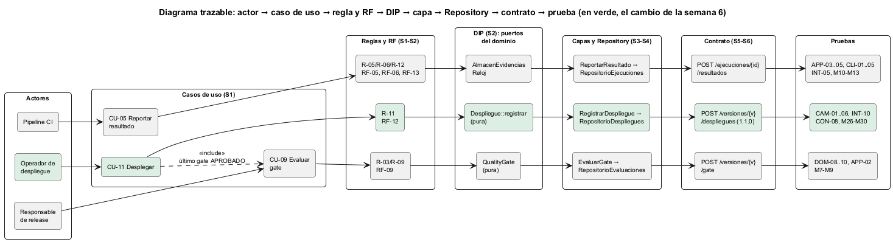

# Semana 6 — Primera evaluación parcial: defensa de la arquitectura

| | |
|---|---|
| **Estudiante** | Boris Alexander Quiroa Orellana |
| **Módulo** | QA, pruebas E2E, CI y guía de despliegue final (adaptación: gestión de ejecuciones automatizadas y calidad de versiones) |
| **Tarea** | Defender la arquitectura conectando actores, UML, RF/RNF, el principio SOLID, capas, Repository y contrato API, y responder un cambio práctico |
| **Entregable** | Presentación de 6–8 diapositivas, diagrama trazable, matriz decisión → evidencia y registro del cambio práctico defendido |

## Entregables

| Pedido | Dónde |
|---|---|
| Presentación de 6–8 diapositivas | [semana-06-defensa-qa-e2e.pptx](presentacion/semana-06-defensa-qa-e2e.pptx) ([PDF](presentacion/semana-06-defensa-qa-e2e.pdf)): **8 diapositivas** con notas del orador, unos 12 minutos |
| Diagrama trazable | [semana-06-trazabilidad.png](diagramas/semana-06-trazabilidad.png) |
| Matriz decisión → evidencia | [matriz-decision-evidencia.md](matriz-decision-evidencia.md): 23 decisiones, 20 con mutación |
| Registro del cambio práctico | [registro-cambio-practico.md](registro-cambio-practico.md): despliegue reproducible (CU-11, R-11) |
| Evidencia | **86/86 pruebas** con PostgreSQL y **31/31 mutaciones** ([evidencia/](evidencia/)) |

## 1. Hilo de la defensa

| # | Diapositiva | Qué conecta | Semana |
|---|---|---|---|
| 1 | Que lo desplegado sea lo que se probó | Las cifras que se pueden verificar en vivo | — |
| 2 | Punto de partida, actores y UML | El CI del HIS nunca corrió; 12 casos de uso y 3 actores clave | 1 |
| 3 | Requisitos y DIP | Reglas que deciden; 12 → 0 dependencias de la regla hacia detalles | 2 |
| 4 | Capas, MVC y Repository | Regla de dependencias verificada, suite de contrato y repositorio compartido | 3, 4 |
| 5 | Contrato API y frontera medida | 9 operaciones verificadas contra el código; la ingesta aparte no se justifica | 5 |
| 6 | Diagrama trazable | Actor → CU → regla → DIP → capa → Repository → contrato → prueba | 1–6 |
| 7 | Cambio: despliegue reproducible | Seis aspectos, prueba primero, lo que apareció en el camino | 6 |
| 8 | La arquitectura absorbió el cambio | Lo que no cambió y cómo verificarlo | — |

## 2. Diagrama trazable



Tres caminos completos (reportar, evaluar el gate y desplegar), de su actor a sus pruebas. En verde, el cambio de esta semana.

## 3. El cambio práctico, en resumen

**Pedido:** la 2.4.0 se instaló con un digest que nadie probó, y la última evaluación del gate era un RECHAZADO. Detalle en el [registro](registro-cambio-practico.md).

**Respuesta:** se despliega solo con:
- el **último** gate APROBADO;
- una aprobación de **72 h o menos**;
- el **mismo digest**;
- una **guía versionada**.

Si el smoke falla, el despliegue queda REVERTIDO a lo que estaba. El pipeline no puede desplegar.

| Paso | Resultado |
|---|---|
| Pruebas primero (CAM-01..06) | 6 de 6 en rojo |
| Implementación en las 4 capas + tabla con trigger | CAM en verde; **API-01 en rojo** hasta documentar la operación (contrato 1.1.0) |
| Prueba intermitente PER-04 | Destapó que el almacén no reparaba un artefacto corrupto → corregido (PER-05) |
| Final | **86/86**, **31/31** mutaciones |

## 4. Cómo verificarlo en vivo

```bash
cd docs/modulos/qa-e2e-ci-despliegue/micro-his-e2e
php tests/ejecutar.php --solo=CAM                    # el cambio
E2E_DB_DSN="pgsql:..." php tests/ejecutar.php        # 86/86
E2E_DB_DSN="pgsql:..." php tests/mutaciones.php      # 31/31
```
