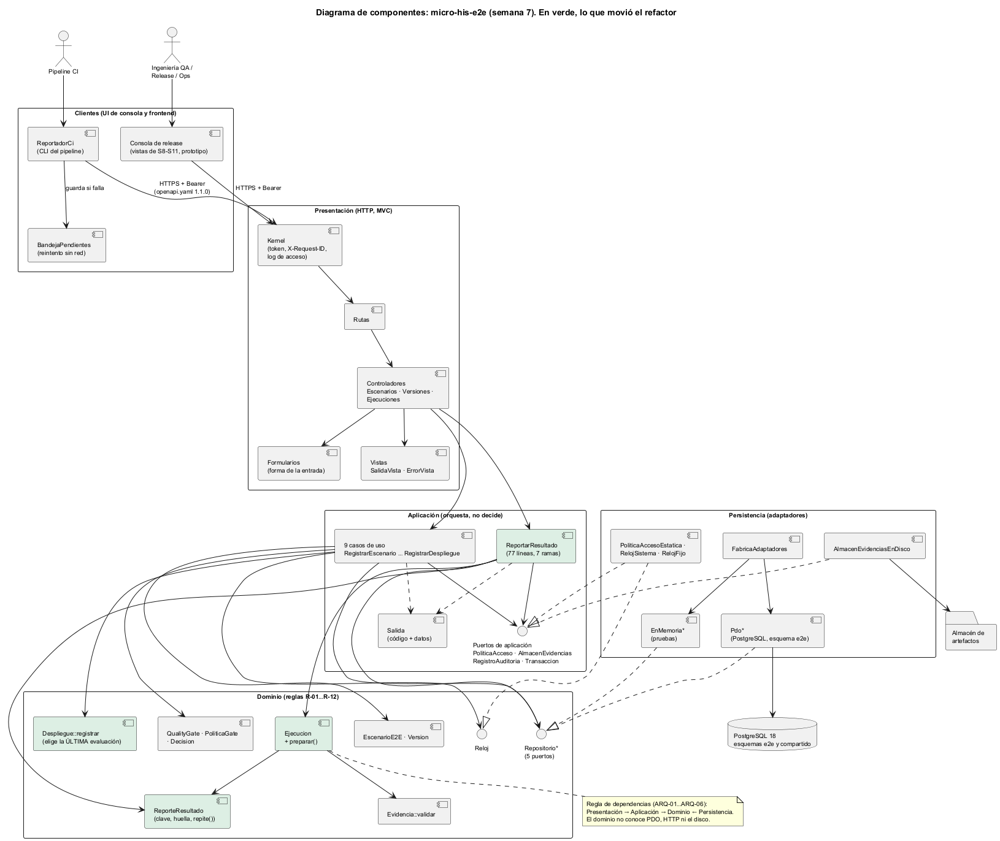

# Semana 7 — Componentes, contratos y refactor por capas

| | |
|---|---|
| **Estudiante** | Boris Alexander Quiroa Orellana (@bquiroao) |
| **Módulo** | QA, pruebas E2E, CI y guía de despliegue final |
| **Adaptación** | Gestión de ejecuciones automatizadas y calidad de versiones |
| **Proceso** | Planificación de pruebas, ejecución E2E, conservación de evidencia y aplicación de quality gates |
| **Entregables** | [Diagrama de componentes](diagramas/semana-07-componentes.png) · [Contratos de entrada/salida](contratos-entrada-salida.md) · refactor antes/después (este documento) · [evidencia](evidencia/) |

## 1. Diagrama de componentes



**Fuente:** [semana-07-componentes.puml](diagramas/semana-07-componentes.puml).

| Capa | Componentes | Depende de | Nunca depende de |
|---|---|---|---|
| Clientes (UI) | `ReportadorCi` y `BandejaPendientes`, la CLI del pipeline. La consola de release, cuyas vistas se diseñan en S8–S11 | Solo el contrato HTTP 1.1.0 | Nada del servidor |
| Presentación | Kernel, Rutas, 3 controladores, Formularios, Vistas | Aplicación | Dominio de forma directa, PDO |
| Aplicación | 9 casos de uso, `Salida`, 4 puertos (acceso, almacén, auditoría, transacción) | Dominio y sus propios puertos | HTTP, PDO, disco |
| Dominio | Entidades, `QualityGate`, `Despliegue`, `ReporteResultado`, 5 repositorios y `Reloj` como puertos | Nada | Todo lo demás |
| Persistencia | `Pdo*`, `EnMemoria*`, almacén en disco, configuración | Implementa los puertos | Aplicación de forma directa |

La regla de dependencias no queda en el dibujo:
- **ARQ-01…ARQ-06** fallan si un `use` cruza una capa en el sentido prohibido.
- ARQ-06 se probó inyectando una violación en la semana 4.

## 2. Por qué había que refactorizar: lo medido

`bin/acoplamiento.php` (nuevo esta semana) mide cada clase de `src/`:

| Métrica | Qué mide |
|---|---|
| **Ce** | Dependencias salientes |
| **Ca** | Quién depende de la clase |
| **Ramas** | `if`, `?:`, `??`, `&&`, `||`, `catch`, `match` |
| **Dr** | Decisiones de **regla de negocio**: `preg_match`, `hash`, `validar`, `tryFrom`, `end`, `reset`, `clone` |
| **P** | Cuántas de las 6 preocupaciones del módulo mezcla (ejecuciones E2E, CI, quality gates, versiones, evidencia, despliegue) |

Antes del refactor ([acoplamiento-antes.txt](refactor/acoplamiento-antes.txt)):

| Clase | Capa | Ramas | Dr | LOC | Problema |
|---|---|---|---|---|---|
| `ReportarResultado` | Aplicación | **27** | **5** | 90 | El caso de uso decidía reglas: el formato de la clave, la huella, cuándo una repetición es «la misma», el `clone` para validar sin escribir y la validación de artefactos |
| `RegistrarDespliegue` | Aplicación | 9 | **1** | 59 | Elegía con `end()` qué evaluación del gate cuenta, una regla de R-11 |
| Aplicación + Presentación | — | — | **8** | — | Reglas fuera del dominio |

**Síntoma concreto:**
- Las reglas de R-12 (idempotencia) solo se podían probar por el caso de uso, con todos sus dobles armados.
- Para saber «¿cuándo una clave repetida es un reintento?» había que leer 15 líneas de orquestación.

## 3. El refactor, antes y después

### 3.1 `ReportarResultado`: de 27 ramas a 7

**Antes** (semana 6, extracto):

```php
$artefactos = is_array($datos['evidencias'] ?? null) ? $datos['evidencias'] : [];
$huella = hash('sha256', json_encode([$ejecucionId, $datos['escenario'] ?? null, ...]));
try {
    if (!preg_match('/^[A-Za-z0-9._-]{8,80}$/', $clave)) {                    // regla R-12 en la aplicación
        throw new ReglaRechazada('DATOS_INVALIDOS', ['Idempotency-Key']);
    }
    $previo = $this->ejecuciones->resultadoPorClave($tenant, $clave);
    if ($previo !== null) {
        return $previo[0] === $ejecucionId && $previo[1]->huella === $huella  // «¿es el mismo reporte?» en la aplicación
            ? new Salida(Salida::OK, 'RESULTADO_YA_REPORTADO', ...) : new Salida(Salida::CONFLICTO, 'CLAVE_REUTILIZADA');
    }
    ...
    $sinEvidencias = ResultadoEscenario::desde($escenario, $ejecucion->critico($escenario), ...);
    (clone $ejecucion)->agregar($sinEvidencias);                              // truco: clonar para validar sin escribir
    foreach ($artefactos as $a) {
        Evidencia::validar(is_array($a) ? (string) ($a['tipo'] ?? '') : '', ...);
    }
    $evidencias = array_map(fn (array $a): Evidencia => $this->almacen->guardar(...), $artefactos);
    $resultado = new ResultadoEscenario(null, $sinEvidencias->escenario, ... 9 argumentos ...);
    $ejecucion->agregar($resultado);
```

**Después:**

```php
try {
    $reporte = ReporteResultado::desde($ejecucionId, $clave, $datos);           // dominio: clave, huella, normalización
    $previo = $this->ejecuciones->resultadoPorClave($tenant, $reporte->clave);
    if ($previo !== null) {
        return $reporte->repite(...$previo) ? new Salida(Salida::OK, 'RESULTADO_YA_REPORTADO', ...)
            : new Salida(Salida::CONFLICTO, 'CLAVE_REUTILIZADA');
    }
    $ejecucion = $this->ejecuciones->porId($tenant, $ejecucionId);
    if ($ejecucion === null) {
        return Salida::noEncontrado();
    }
    $resultado = $ejecucion->preparar($reporte, $this->reloj->ahora())          // dominio: todas las reglas, sin escribir
        ->conEvidencias(array_map(fn (array $a): Evidencia => $this->almacen->guardar($a['tipo'], $a['bytes']), $reporte->artefactos));
    $ejecucion->agregar($resultado);
```

| Qué se movió | De → a | Justificación |
|---|---|---|
| Formato de la clave y huella del contenido | Caso de uso → `ReporteResultado::desde` (dominio) | Son R-12, una regla del negocio y no de la orquestación. La fórmula de la huella **no cambió**: un reintento de antes del despliegue sigue reconociéndose |
| «La misma clave es el mismo reporte» | Caso de uso → `ReporteResultado::repite` | Ahora la regla tiene nombre y se prueba sola, con la mutación M32 |
| `clone` + `agregar` para validar sin escribir | Caso de uso → `Ejecucion::preparar` | El dominio ofrece «validar sin modificar» en lugar de que la aplicación lo simule con un clon |
| Validación de artefactos | Caso de uso → `Ejecucion::preparar` | El orden plan → datos → estado → evidencia queda en un solo lugar (M33) |
| Reconstruir el resultado con 9 argumentos | Caso de uso → `ResultadoEscenario::conEvidencias` | La aplicación ya no conoce el constructor de la entidad |

**Lo que el caso de uso conserva**, que es orquestación:
- permiso;
- buscar la ejecución;
- usar el almacén **después** de las reglas, fail-closed;
- transacción y auditoría;
- traducir excepciones a `Salida`.

### 3.2 `RegistrarDespliegue`: la regla de la última evaluación al dominio

**Antes:**

```php
$evaluaciones = $this->evaluaciones->deVersion($tenant, $numero);
$nuevo = Despliegue::registrar($v, $evaluaciones === [] ? null : end($evaluaciones), ...);   // la aplicación elige
```

**Después:**

```php
// RegistrarDespliegue (aplicación): solo pasa lo que hay
$nuevo = Despliegue::registrar($v, $this->evaluaciones->deVersion($tenant, $numero), ...);

// Despliegue::registrar (dominio): decide cuál cuenta
$ultima = $evaluaciones === [] ? null : $evaluaciones[array_key_last($evaluaciones)];
```

**Justificación:**
- «Cuenta la última evaluación, porque una posterior puede rechazar» es R-11, y la defendimos en la semana 6.
- Si cualquier caso de uso futuro, por ejemplo un redespliegue, tuviera que repetir el `end()`, podría olvidarlo.
- `array_key_last` reemplaza a `end()`, que además movía el puntero interno del arreglo como efecto lateral.

### 3.3 Sin agrandar el módulo

| Medida | Antes | Después | Diferencia |
|---|---|---|---|
| Clases en `src/` | 75 | 76 | +1 (`ReporteResultado`) |
| LOC de `src/` | 2679 | 2734 | +55 (+2,1 %) |
| Capas, puertos, adaptadores, rutas, tablas | — | — | **Sin cambios** |
| Contrato HTTP | 1.1.0 | 1.1.0 | **Sin cambios** |
| Decisiones de regla (Dr) en Aplicación + Presentación | **8** | **2** | −6 |
| Decisiones de regla en el Dominio | 13 | 17 | +4 (las que se movieron) |
| Ramas de `ReportarResultado` | 27 | 7 | −20 |
| LOC de `ReportarResultado` | 90 | 77 | −13 |
| `Dr` de `RegistrarDespliegue` | 1 | 0 | −1 |

**Lo que queda en Aplicación y Presentación (Dr = 2):**
- Son los `preg_match` del Kernel: `Bearer <token>` y el formato de `X-Request-ID`.
- Son reglas de **transporte**, no de negocio, así que se dejan donde están a propósito.

**Lo que empeoró, y por qué se acepta:**
- **`Ejecucion` pasó de 2 a 4 preocupaciones** (CI y evidencia) y de 113 a 133 LOC.
  - Es el costo de que la entidad valide un reporte completo.
  - Se evaluó crear un `ValidadorReporte` aparte. Se descartó porque necesitaría acceso al estado interno de `Ejecucion` (plan, resultados, estado): rompería el encapsulamiento o duplicaría las reglas de `exigirAdmite`.
  - Queda anotado para la revisión técnica de la semana 13.
- **Ce total** subió de 245 a 250: las dependencias nuevas son dentro del dominio, hacia `ReporteResultado`.
- **Ramas** de `ReporteResultado` = 19.
  - Son, casi una por una, las 20 que salieron del caso de uso (sobre todo los `??` e `is_array` de normalizar la entrada). Ahora están en el dominio, donde se prueban sin dobles.

## 4. Cómo se garantizó que el comportamiento no cambió

1. **Caracterización antes de tocar nada.**
   - `tests/Caracterizacion/escenarios.php` define 35 escenarios: 28 de reportar, R01–R28, y 7 de desplegar, D01–D07.
   - Incluyen las combinaciones de varias fallas a la vez (R24–R28), porque ahí el **orden** de las reglas decide qué código sale.
   - Por ejemplo, R25 tiene un escenario fuera del plan **y** una evidencia vacía, y la respuesta grabada es `ESCENARIO_FUERA_DEL_PLAN`.
   - `php bin/caracterizar.php` grabó las 35 respuestas en `esperado.json` **sobre el código de la semana 6** ([salida](refactor/caracterizacion-grabada.txt)).
2. **CAR-01** compara las 35 respuestas actuales contra lo grabado. Pasa.
3. **Suite completa contra PostgreSQL 18:** 88 de 88, con DOM-11 ([pruebas-postgresql.txt](evidencia/pruebas-postgresql.txt)).
4. **Mutaciones:**
   - Las 4 que buscaban código movido (M10, M11, M12 y M26) se **reubicaron** al código nuevo con el mismo defecto. M6 también, porque cambió el nombre de la variable.
   - Se sumaron 2 mutaciones sobre lo nuevo: M32 hace que `repite()` ignore la ejecución y M33 quita la validación de evidencias de `preparar()`.
   - **Primera corrida: 32 de 33 detectadas. M32 sobrevivió** ([mutaciones-1-M32-sobrevive.txt](evidencia/mutaciones-1-M32-sobrevive.txt)).
5. **Hallazgo: M32 y la prueba DOM-11.**
   - La huella ya incluye el id de la ejecución, así que por HTTP una clave reutilizada en otra ejecución siempre trae otra huella. Comparar la ejecución en `repite()` es defensa en profundidad, y ninguna prueba lo exigía.
   - El hueco **ya existía antes del refactor**: el código de la semana 6 tenía la misma condición, sin prueba. Mientras la regla estaba enterrada en el caso de uso, no había dónde sembrar la mutación.
   - Al darle nombre (`repite`), se pudo probar en el dominio. **DOM-11** cubre tres casos: el reintento idéntico, la misma huella con **otra** ejecución (una fila importada o alterada) y otro contenido. También cubre la clave con formato inválido.
   - **Segunda corrida: 33 de 33 detectadas (M32 por DOM-11)** ([mutaciones-2-final.txt](evidencia/mutaciones-2-final.txt)).

## 5. Comandos

```bash
cd micro-his-e2e
php bin/acoplamiento.php                                                   # acoplamiento por clase
php tests/ejecutar.php                                                     # sin base: omite las 18 de PostgreSQL
E2E_DB_DSN="pgsql:host=127.0.0.1;port=55432;dbname=micro_his_qa" php tests/ejecutar.php
E2E_DB_DSN="..." php tests/mutaciones.php                                  # 33 mutaciones
```
