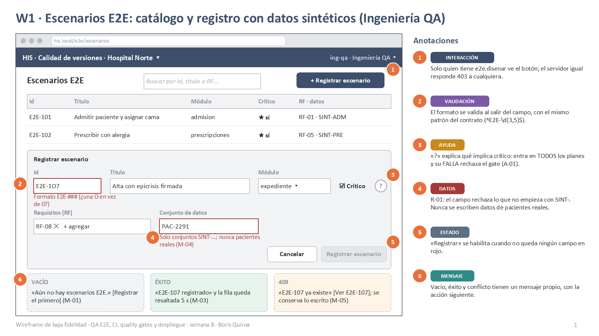
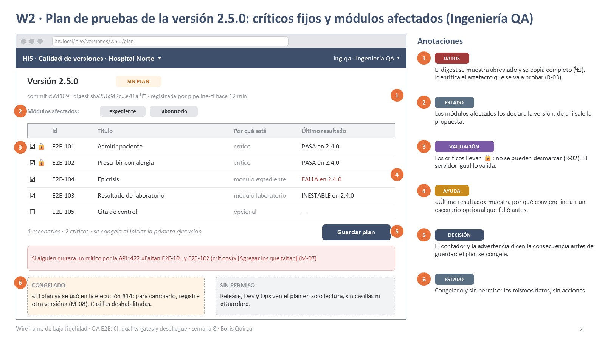
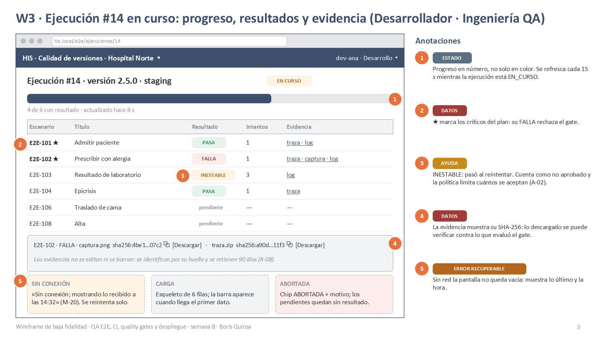
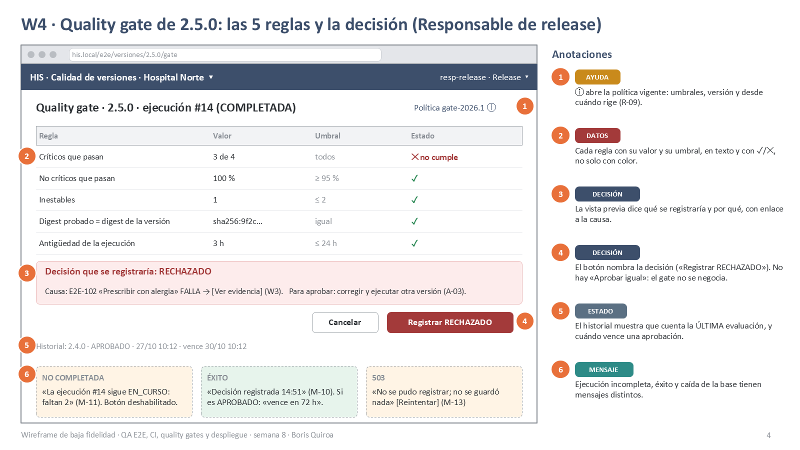
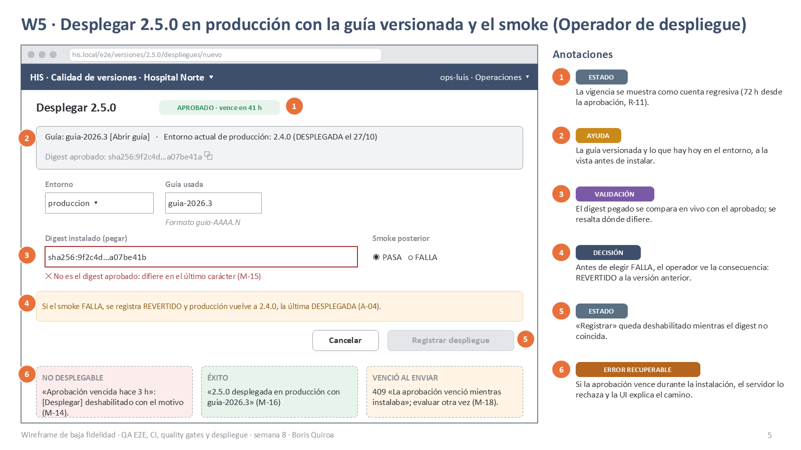
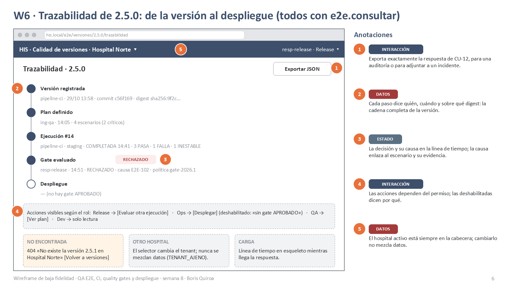

# Semana 8 — Diseño de experiencia de usuario del módulo QA E2E, CI y despliegue

| | |
|---|---|
| **Estudiante** | Boris Alexander Quiroa Orellana (@bquiroao) |
| **Módulo** | QA, pruebas E2E, CI y guía de despliegue final |
| **Adaptación** | Gestión de ejecuciones automatizadas y calidad de versiones |
| **Proceso** | Planificación de pruebas, ejecución E2E, conservación de evidencia y aplicación de quality gates |

## Entregables

| Entregable | Archivo |
|---|---|
| User flow por rol (4) | [Ingeniería QA](diagramas/semana-08-flujo-ingenieria-qa.png) · [Responsable de release](diagramas/semana-08-flujo-responsable-release.png) · [Operador de despliegue](diagramas/semana-08-flujo-operador-despliegue.png) · [Desarrollador](diagramas/semana-08-flujo-desarrollador.png) |
| 6 wireframes anotados | [PDF](wireframes/semana-08-wireframes-qa-e2e.pdf) · [PPTX](wireframes/semana-08-wireframes-qa-e2e.pptx) · imágenes `wireframes/w1.png`…`w6.png` |
| Catálogo de mensajes y ayuda | Secciones 6 y 7 |

## 1. Alcance y punto de partida

**Hoy el módulo tiene dos interfaces:**
- la API HTTP (contrato 1.1.0);
- la CLI del pipeline (`ReportadorCi`).

**Lo que no existe** es la consola de release: la pantalla donde las personas planifican, siguen una ejecución, deciden el gate y registran un despliegue. Esta semana se diseña esa consola. El [diagrama de componentes de la semana 7](../semana-07/diagramas/semana-07-componentes.png) ya la mostraba como un cliente más del contrato.

**Regla de diseño:** la UI no inventa reglas. Cada validación de pantalla tiene su par en el servidor (formulario o dominio), y el servidor tiene la última palabra. La UI anticipa el error para que no ocurra; si igual ocurre, lo explica.

**El pipeline CI no tiene pantalla.** Su "UI" es la salida de la CLI y los códigos del contrato. No se diseña aquí.

## 2. Roles autorizados y lo que ve cada uno

Los permisos son los de `config/config.php` (R-13).

| Rol | Permisos | Pantallas con acción | Pantallas de solo lectura |
|---|---|---|---|
| Ingeniería QA (`ing-qa`) | `e2e.disenar`, `e2e.planificar`, `e2e.consultar` | W1 registrar escenario · W2 plan | W3, W4, W6 |
| Responsable de release (`resp-release`) | `e2e.evaluar`, `e2e.consultar` | W4 evaluar gate | W2, W3, W6 |
| Operador de despliegue (`ops-luis`) | `e2e.desplegar`, `e2e.consultar` | W5 desplegar | W2, W3, W4, W6 |
| Desarrollador (`dev-ana`) | `e2e.versionar`, `e2e.consultar` | — (versiona por el pipeline) | W2, W3, W6 |
| Pipeline CI | `e2e.versionar`, `e2e.ejecutar`, `e2e.reportar`, `e2e.consultar` | Sin UI: CLI | — |

**Cómo se muestran los permisos:**
- Una acción sin permiso no se muestra.
- Si el permiso existe pero la regla no lo deja, la acción se muestra **deshabilitada con el motivo**. Por ejemplo, [Desplegar] aparece deshabilitado con «sin gate APROBADO».
- Mostrar el motivo ahorra la pregunta «¿por qué no puedo?».

## 3. Principios de diseño

| # | Principio | Dónde se ve |
|---|---|---|
| P1 | **La consecuencia antes de la acción.** Cada acción irreversible nombra su efecto en el botón y en un aviso | «Registrar RECHAZADO» (W4); «el plan se congela» (W2); «REVERTIDO a 2.4.0» (W5) |
| P2 | **El estado en texto, no solo en color.** Cada chip lleva su palabra y cada regla su ✓ o ✕ | W3, W4 |
| P3 | **El digest es la identidad.** Va abreviado, se copia completo y se compara en vivo | W2, W5, W6 |
| P4 | **Nada se pierde por un error.** Lo escrito se conserva en un 409 o un 422; sin red se muestra lo último recibido | W1, W3 |
| P5 | **Solo datos sintéticos.** El formulario rechaza lo que no sea `SINT-…` | W1 (R-01) |
| P6 | **El gate no se negocia.** No existe «aprobar igual»; para aprobar hay que corregir y ejecutar | W4 (R-09) |

## 4. User flows por rol

| Rol | Inicio | Decisión | Confirmación | Vacío / carga / éxito | Errores recuperables |
|---|---|---|---|---|---|
| [Ingeniería QA](diagramas/semana-08-flujo-ingenieria-qa.png) | «Escenarios E2E» | Registrar escenario o planificar; ¿crítico?; opcionales del plan | Resumen antes de registrar; «se congela al iniciar» | «Aún no hay escenarios»; esqueleto; resaltado del nuevo | 422 `DATOS_NO_SINTETICOS` (campo marcado); 409 `ESCENARIO_EXISTENTE` con enlace; 422 `PLAN_INCOMPLETO` con «agregar los que faltan»; 409 `PLAN_CONGELADO` |
| [Responsable de release](diagramas/semana-08-flujo-responsable-release.png) | «Versiones listas para evaluar» | Registrar la decisión que calcula la política | «No se edita después» | «Ninguna versión espera evaluación»; «vence en 72 h» | 409 `EJECUCION_NO_COMPLETADA`; 409 `EJECUCION_DE_OTRA_VERSION`; 503 sin guardar nada |
| [Operador de despliegue](diagramas/semana-08-flujo-operador-despliegue.png) | «Versiones aprobadas y vigentes» | Smoke PASA o FALLA | Resumen con el digest y la guía | Botón deshabilitado con motivo; DESPLEGADO o REVERTIDO | 409 `DIGEST_DISTINTO` (campo marcado); 409 `APROBACION_VENCIDA` con el camino; 409 `GATE_NO_APROBADO` |
| [Desarrollador](diagramas/semana-08-flujo-desarrollador.png) | Enlace del PR → «Ejecución #14» | ¿Qué falló y con qué evidencia? | — | Esqueleto; progreso «4 de 6»; refresco cada 15 s | Sin conexión → lo último recibido con su hora |

## 5. Wireframes anotados

Cada wireframe tiene llamadas numeradas, y cada una lleva una etiqueta:
- **ESTADO**
- **MENSAJE**
- **VALIDACIÓN**
- **INTERACCIÓN**
- **DATOS**
- **AYUDA**
- **DECISIÓN**
- **ERROR RECUPERABLE**

Abajo de cada pantalla van sus estados alternativos (vacío, carga, error, sin permiso).

| # | Pantalla | Rol | Estados | Validaciones | Reglas de interacción | Imagen |
|---|---|---|---|---|---|---|
| W1 | Escenarios E2E: catálogo y registro | Ingeniería QA | Vacío, éxito, 409 | Id `^E2E-\d{3,5}$` al salir del campo; RF `^RF-\d{2,3}$`; datos `SINT-…` | «Registrar» se habilita sin campos en rojo; botón solo con `e2e.disenar` |  |
| W2 | Plan de pruebas de una versión | Ingeniería QA | Sin plan, congelado, sin permiso | Críticos 🔒 no desmarcables (R-02) | La propuesta sale de los módulos afectados; contador y aviso de congelamiento antes de guardar |  |
| W3 | Ejecución en curso | Desarrollador, Ingeniería QA | En curso, carga, sin conexión, abortada | — (los resultados los reporta el pipeline) | Refresco cada 15 s solo mientras está EN_CURSO; evidencia con SHA-256 y descarga |  |
| W4 | Quality gate | Responsable de release | Incompleta, éxito, 503 | Botón deshabilitado si la ejecución no está COMPLETADA | Vista previa con 5 reglas; el botón nombra la decisión; historial con vencimiento |  |
| W5 | Desplegar | Operador de despliegue | No desplegable, éxito, vencida al enviar | Digest en vivo contra el aprobado; guía `^guia-\d{4}\.\d+$` | Cuenta regresiva de vigencia; aviso de REVERTIDO antes de elegir FALLA |  |
| W6 | Trazabilidad | Todos con `e2e.consultar` | No encontrada, otro hospital, carga | — | Acciones según permiso; las deshabilitadas dicen por qué; exportar JSON |  |

## 6. Catálogo de mensajes

Cada mensaje nombra el problema y la acción siguiente. Los códigos son los del contrato 1.1.0, así que el texto depende del código y no del mensaje del servidor.

| Id | Código / situación | Texto | Acción |
|---|---|---|---|
| M-01 | Sin escenarios | «Aún no hay escenarios E2E.» | [Registrar el primero] |
| M-02 | Formato inválido en el campo (400 en el servidor) | «Formato E2E-###» / «RF-##» | Se corrige en el campo |
| M-03 | 201 `ESCENARIO_REGISTRADO` | «E2E-107 registrado» | La fila queda resaltada |
| M-04 | 422 `DATOS_NO_SINTETICOS` | «Solo conjuntos sintéticos SINT-…; nunca pacientes reales» | El campo «datos» queda marcado |
| M-05 | 409 `ESCENARIO_EXISTENTE` | «E2E-107 ya existe» | [Ver E2E-107]; se conserva lo escrito |
| M-06 | 200 `PLAN_DEFINIDO` | «Plan definido. Espera a que el pipeline inicie la ejecución.» | — |
| M-07 | 422 `PLAN_INCOMPLETO` | «Faltan E2E-101, E2E-102 (críticos)» | [Agregar los que faltan] |
| M-08 | 409 `PLAN_CONGELADO` | «El plan ya se usó en la ejecución #14; para cambiarlo, registre otra versión» | — |
| M-09 | Sin versiones por evaluar | «Ninguna versión espera evaluación.» | — |
| M-10 | 200 `GATE_EVALUADO` | «Decisión registrada 14:51 · política gate-2026.1»; si es APROBADO, «vence en 72 h» | — |
| M-11 | 409 `EJECUCION_NO_COMPLETADA` | «La ejecución #14 sigue EN_CURSO: faltan 2 resultados» | Botón deshabilitado |
| M-12 | 409 `EJECUCION_DE_OTRA_VERSION` | «La ejecución #14 es de otra versión» | Recarga la lista |
| M-13 | 503 `ERROR_PERSISTENCIA` | «No se pudo registrar; no se guardó nada» | [Reintentar] |
| M-14 | Gate no aprobado o vencido (antes de enviar) | «Aprobación vencida hace 3 h» / «RECHAZADO» | [Desplegar] deshabilitado con el motivo |
| M-15 | 409 `DIGEST_DISTINTO` (o la validación en vivo) | «No es el digest aprobado: difiere en el último carácter» | El campo queda marcado |
| M-16 | 201 `DESPLIEGUE_REGISTRADO` (DESPLEGADO) | «2.5.0 desplegada en producción con guia-2026.3» | — |
| M-17 | 201 `DESPLIEGUE_REGISTRADO` (REVERTIDO) | «Smoke fallido: el entorno quedó en 2.4.0» | Aviso al responsable de release |
| M-18 | 409 `APROBACION_VENCIDA` | «La aprobación venció mientras instalaba» | Evaluar el gate otra vez |
| M-19 | 409 `GATE_NO_APROBADO` | «El último gate de 2.5.0 no está APROBADO» | Ver la decisión (W4) |
| M-20 | Sin conexión | «Sin conexión; mostrando lo recibido a las 14:32» | Se reintenta solo |
| M-21 | Corrección del código | «Una corrección es una versión NUEVA: otro commit y otro digest» | — |

**Comunes a todas las pantallas:**

| Situación | Texto | Acción |
|---|---|---|
| 401 | «La sesión venció» | [Ingresar de nuevo] |
| 403 `PERMISO_DENEGADO` | «No tiene permiso para esta acción en Hospital Norte» | — |
| 403 `TENANT_AJENO` | «Ese recurso es de otro hospital» | — |
| 500 | «Error inesperado (ref. `X-Request-ID`)» | La referencia permite buscarlo en el log |

## 7. Ayuda contextual

| Id | Dónde | Texto |
|---|---|---|
| A-01 | W1 «Crítico ?» | «Un escenario crítico entra en TODOS los planes, y su FALLA rechaza el gate sin excepción posible (R-09a, R-10).» |
| A-02 | W3 «INESTABLE» | «Pasó al reintentar. Cuenta como no aprobado, y la política limita cuántos se aceptan (R-06, R-09c).» |
| A-03 | W4 causa | «El gate no se negocia: para aprobar, corrija y ejecute otra versión.» |
| A-04 | W5 smoke | «Si el smoke falla, se registra REVERTIDO y el entorno vuelve a la última versión DESPLEGADA (R-11).» |

## 8. Protección de datos

- **Escenarios.** Solo usan conjuntos `SINT-…` (R-01). El formulario lo anticipa y el servidor lo exige.
- **Evidencia.** Se muestra por su huella y se descarga. No se previsualizan capturas en la lista, para no exponer en pantalla compartida algo que no debió capturarse.
- **Hospital activo.** Siempre en la cabecera. Cambiarlo cambia el tenant de cada petición; nunca se mezclan datos.
- **Tokens.** La UI no muestra tokens ni la cabecera `Authorization`.

## 9. Trazabilidad

| Pantalla | Caso de uso | Operación | Reglas | Pruebas que ya cubren el servidor |
|---|---|---|---|---|
| W1 | CU-01 | `POST /escenarios` | R-01, R-13 | DOM-01, HTTP-03, API-03 |
| W2 | CU-03 | `POST /versiones/{v}/plan` | R-02 | DOM-02, DOM-03, APP-09 |
| W3 | CU-05, CU-12 | `POST /ejecuciones/{id}/resultados` (pipeline) · `GET …/trazabilidad` | R-04, R-05, R-06, R-08 | DOM-05, APP-02, APP-04, CAR-01 |
| W4 | CU-09 | `POST /versiones/{v}/gate` | R-03, R-09 | DOM-08, DOM-10, APP-09 |
| W5 | CU-11 | `POST /versiones/{v}/despliegues` | R-11 | CAM-01…06, INT-10 |
| W6 | CU-12 | `GET /versiones/{v}/trazabilidad` | R-13, R-14 | HTTP-*, API-01 |

## 10. Validación y brecha

**Validado contra el código:**
- Cada código de error del catálogo existe en `api/openapi.yaml`.
- Cada permiso corresponde a uno de `config/config.php`.
- Los estados de las pantallas son los del dominio: EN_CURSO, COMPLETADA, ABORTADA, APROBADO, RECHAZADO, DESPLEGADO y REVERTIDO.

**Brechas que el diseño destapó** (el contrato no las cubre todavía; se registran para la semana 9):

| # | Brecha | Por qué importa |
|---|---|---|
| B-1 | No existe un `GET` de versiones «listas para evaluar» ni de escenarios | W1 y W4 necesitan listar. Hoy solo hay operaciones de escritura y la trazabilidad de una versión |
| B-2 | No existe un `GET` de la ejecución con su progreso | W3 debería leerla por trazabilidad, que trae la versión completa |
| B-3 | La vista previa del gate (W4) no tiene operación | `EvaluarGate` evalúa y **registra**. Una vista previa necesita un `dry-run` o un cálculo en el cliente, que duplicaría la política |

Las tres se resuelven sumando lecturas. No cambian ninguna regla.
