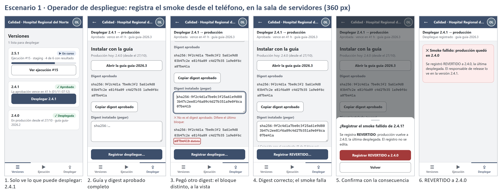
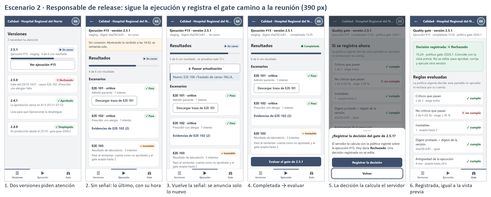

# Semana 10 — Diseño para movilidad de la consola de release (320–430 px)

| | |
|---|---|
| **Estudiante** | Boris Alexander Quiroa Orellana (@bquiroao) |
| **Módulo** | QA, pruebas E2E, CI y guía de despliegue final |
| **Adaptación** | Gestión de ejecuciones automatizadas y calidad de versiones |

## Entregables

| Entregable | Archivo |
|---|---|
| 4 pantallas responsive (HTML + CSS, mobile-first) | [m1-versiones](prototipo/m1-versiones.html) · [m2-ejecucion](prototipo/m2-ejecucion.html) · [m3-gate](prototipo/m3-gate.html) · [m4-desplegar](prototipo/m4-desplegar.html) |
| Reglas de breakpoint | Sección 3 |
| 2 escenarios móviles | Secciones 5 y 6 · [lámina 1](laminas/escenario-1-operador-360.png) · [lámina 2](laminas/escenario-2-release-390.png) |
| Capturas (43 vistas) | `capturas/` |
| Verificación medida | [verificar-responsive.cjs](herramientas/verificar-responsive.cjs) → [evidencia](evidencia/) |

Cada pantalla muestra sus estados con `?estado=…`; por ejemplo, `m4-desplegar.html?estado=digest-distinto`.

## 1. Por qué la consola de release en el teléfono

| Rol | Situación real | Pantalla |
|---|---|---|
| Operador de despliegue | Instala de noche, de pie junto al rack, y registra el smoke **donde está**. No siempre tiene la laptop a mano | m4 |
| Responsable de release | Recibe el aviso de que la ejecución terminó camino a la reunión de liberación, con señal intermitente | m2, m3 |
| Desarrollo e Ingeniería QA | Miran el resultado desde el enlace del PR | m2 |

**Lo que no se diseña para el teléfono:** registrar escenarios (W1) y planificar (W2). Son tareas de escritorio con texto largo y listas de requisitos. En el teléfono quedan en solo lectura, y se mantienen como en la semana 8.

## 2. Jerarquía de contenido (de mayor a menor prioridad)

| Prioridad | Contenido | Dónde queda en 320 px |
|---|---|---|
| 1 | **Qué versión** se ejecuta, evalúa o despliega | Contexto fijo bajo la barra, aun al desplazar (R-C1) |
| 1 | El hospital (tenant) | Barra superior, siempre (R-A1) |
| 1 | La acción principal y su consecuencia | Barra de acción fija, al alcance del pulgar |
| 2 | Estado de cada escenario y regla, con palabra | Tarjetas con chip de texto (R-S1) |
| 2 | Digest completo cuando hay que compararlo | En bloques de 8, monoespaciado (R-G1) |
| 3 | Política, número de ejecución, evidencias | Plegables («Evidencias de E2E-102 (2)») o desde 431 px (`.extra`) |

## 3. Reglas de breakpoint

Mobile-first: la base es **320 px** y cada breakpoint **agrega**.

| Breakpoint | Ancho | Qué cambia |
|---|---|---|
| **Base** | 320–359 | Una columna. El hospital en forma corta («H. Norte»). Acción principal fija abajo. Navegación inferior solo con las secciones del rol |
| **S** | 360–430 | El nombre largo del hospital |
| **M** | 431–767 | Aparecen los datos de prioridad 3 y el rol actual. Las reglas del gate pasan a tres columnas |
| **L** | 768–1023 | Navegación lateral. La hoja inferior pasa a diálogo centrado. La acción deja de estar fija |
| **XL** | ≥ 1024 | Los escenarios vuelven a ser **tabla** (W3 de la semana 8), y la tabla **reemplaza** a las tarjetas |

### 3.1 Reglas transversales (verificadas)

[verificar-responsive.cjs](herramientas/verificar-responsive.cjs) abre cada pantalla en **43 vistas**: anchos de 320, 360, 390, 430, 768 y 1024 px, en todos los estados. En cada una toma la captura y mide estas reglas:

| Regla | Qué exige | Origen |
|---|---|---|
| R-W1 | Sin desplazamiento horizontal ni controles fuera del borde | Tarea (320 px) |
| R-T1 | Todo objetivo táctil mide ≥ 44 × 44 px; en los radios cuenta su **etiqueta** | WCAG 2.5.8 (24 px), endurecido por el uso de pie |
| R-T2 | Campos con fuente ≥ 16 px (iOS no hace zoom al enfocar) | Móvil |
| R-A1 | El hospital (alcance) siempre visible en la barra | Semana 8 §8, tenant |
| R-D1 | Ni el token ni el contenido de una evidencia en la URL | Semana 8 §8 |
| R-C1 | La versión que se ejecuta, evalúa o despliega queda pegada bajo la barra, en el 25 % superior, **aun después de desplazarse** | Jerarquía, prioridad 1 |
| R-B1 | Ningún control `disabled` ni `aria-disabled` | Semana 9 B-03 |
| R-S1 | Cada chip de estado lleva texto, no solo color o icono | 1.4.1, semana 9 B-10 |
| R-G1 | Al desplegar, todo digest a la vista está completo, sin «…» | Semana 9 B-08 |
| R-V1 | La ejecución en curso tiene región viva y un botón visible para pausar | Semana 9 B-06 |
| R-F1 | Con un error, el foco está en el campo inválido, y el campo y su mensaje se ven enteros entre lo fijo de arriba y lo fijo de abajo | WCAG 2.4.11, semana 9 B-03 |
| R-X1 | Con la tabla a la vista, ninguna tarjeta de escenario duplica su contenido | XL |

**Resultado final: 43/43** ([verificacion-responsive-2-final.txt](evidencia/verificacion-responsive-2-final.txt)).

### 3.2 Cómo se llegó a 43/43

| Corrida | Qué pasó | Corrección |
|---|---|---|
| 1 ([primera](evidencia/verificacion-responsive-1-primera.txt)) | **13 de 42 fallan por objetivos chicos.** El enlace «Abrir guia-2026.3» medía 20 px de alto, y es el que el operador **sí** necesita. Los enlaces de la tabla de escritorio medían 21 px | La guía pasa a botón de bloque; los enlaces de tabla, a 44 px |
| Revisión visual | **R-F1 no existía.** A 320 px, con el digest distinto, **el bloque que difiere quedaba bajo la barra de acción**: la información más importante de la pantalla, tapada. Ninguna regla lo medía | La comparación pasa a ser parte del mensaje del campo (`aria-describedby`). La página lleva el foco al campo y desplaza para que el mensaje quede a la vista, con `scroll-padding`. Se agregó R-F1 |
| Revisión visual | **R-X1 no existía.** A 1024 px se veían las tarjetas **y** la tabla; además, la región viva vacía dibujaba una barra celeste | Las tarjetas van en `.solo-movil`; la región viva sin mensaje no ocupa lugar. Se agregó R-X1, que detecta el duplicado en la versión anterior ([1b](evidencia/verificacion-responsive-1b-duplicado.txt)) |
| Al armar el escenario 1 | Con smoke FALLA, «Registrar REVERTIDO…» registraba **sin confirmar**, mientras que con PASA sí pedía confirmación | Se agregó la hoja `confirmar-falla`, con la consecuencia en el botón |

### 3.3 ¿Las reglas detectan algo? Contraprueba

Sobre una **copia** del prototipo se sembró un defecto por cada regla nueva:

| Regla | Defecto sembrado | Vistas que lo marcan |
|---|---|---|
| R-F1 | La página no lleva el foco al error | 2 |
| R-G1 | Digest abreviado | 12 |
| R-C1 | Contexto no fijo | 27 |
| R-V1 | Sin el botón de pausar | 5 |
| R-B1 | Botón con `aria-disabled` | 9 |
| R-S1 | Chip solo con icono | 9 |

**Resultado:** 30 de 42 vistas en falla, y cada regla detecta su defecto ([verificacion-responsive-control.txt](evidencia/verificacion-responsive-control.txt)). R-X1 se probó aparte, sobre la versión anterior a su corrección (1 vista, la de 1024 px).

## 4. Navegación, formularios y confirmaciones

| Aspecto | Decisión en móvil |
|---|---|
| **Navegación** | Barra inferior con **solo las secciones del rol**: Release ve Versiones, Ejecución y Gate; Operaciones ve Versiones, Ejecución y Desplegar. Desde 768 px pasa a lateral |
| **Tablas** | Cada fila de W3 es una tarjeta: escenario, chip, intentos y evidencias con el nombre del escenario («Descargar traza de E2E-101», semana 9 B-13). Desde 1024 px vuelve la tabla |
| **Digest** | Completo, en bloques de 8, con el bloque distinto marcado con texto («distinto») y borde, no solo color. Botón «Copiar digest aprobado» con texto, no un icono (semana 9 B-07) |
| **Confirmaciones** | Hoja inferior con la consecuencia y [Volver] abajo, donde cae el pulgar, con foco inicial. Desde 768 px, diálogo centrado |
| **Conexión** | Sin señal se muestra lo último recibido, con su hora. La región viva anuncia solo lo nuevo. La actualización se puede pausar |
| **Vencimiento** | A menos de 2 h, un aviso. Si vence al enviar, lo cargado se conserva (semana 9 B-09) |

## 5. Escenario 1 · Operador de despliegue registra el smoke desde el teléfono (360 px)



1. En «Versiones», solo ve lo que puede desplegar: 2.4.1, aprobada y vigente.
2. «Desplegar 2.4.1» muestra la guía y el digest aprobado completo.
3. Pega el digest del artefacto que instaló, pero es el de otro build. «Registrar» **no está deshabilitado**: al tocarlo, el foco va al campo y el bloque `a07be41b` aparece marcado como «distinto» por encima de la barra de acción.
4. Copia el digest correcto y corre el smoke, que **falla**. Antes de registrar ve la consecuencia: REVERTIDO a 2.4.0.
5. Confirma en la hoja: «Registrar REVERTIDO a 2.4.0».
6. Queda registrado, y el responsable de release lo ve en la versión (semana 9 B-11).

## 6. Escenario 2 · Responsable de release sigue la ejecución y registra el gate (390 px)



1. En «Versiones», dos versiones piden atención.
2. En el ascensor pierde la señal: la ejecución #15 muestra lo recibido a las 14:32, sin quedar vacía.
3. Vuelve la señal, y la región viva anuncia **solo** lo nuevo: «E2E-106 FALLA».
4. La ejecución se completa: «Evaluar el gate de 2.5.1».
5. La pantalla dice «si se registra ahora», no «aprobar» ni «rechazar». La hoja aclara que **el servidor calcula** la decisión.
6. Registrada: Rechazado, igual a la vista previa. Si el servidor hubiera decidido otra cosa, el estado `cambio` lo muestra (semana 9 B-01, parte de interfaz).

## 7. Backlog de la semana 9 aplicado

| Ítem | Estado | Dónde |
|---|---|---|
| B-02 texto secundario #5F6670 | ✅ | Token `--secundario` |
| B-03 sin botones deshabilitados; foco al error | ✅ | R-B1 y R-F1 |
| B-05 bordes, placeholder, verde y ámbar | ✅ | Tokens `--borde`, `--placeholder`, `--ok` y `--chip-aviso` |
| B-06 pausa y región viva | ✅ | m2, R-V1 |
| B-07 copiar con texto y ≥ 24 px | ✅ | m4 (44 px) |
| B-08 digest completo en bloques | ✅ | m4, R-G1 |
| B-09 aviso de vencimiento; se conserva lo cargado | ✅ | m4 `vence-pronto` y `vencida` |
| B-10 iconos con texto | ✅ | «✓ cumple», «· crítico», chips |
| B-11 REVERTIDO visible | ⚠️ parcial | m4 lo muestra; la línea de tiempo (W6) entra en la semana 11 |
| B-13 enlaces con contexto | ✅ | «Descargar traza de E2E-101» |
| B-14 colores como tokens | ✅ | Bloque `:root` |
| B-01 vista previa sin efectos | ⚠️ solo interfaz | Textos y estado `cambio`. La operación del contrato es el cambio de la semana 12 |
| B-04, B-12 | Pendientes | B-04 necesita el formulario de W1, que no está en el teléfono. B-12 entra en la semana 11 |

## 8. Verificación y limitaciones

```bash
# desde docs/modulos/qa-e2e-ci-despliegue/semana-10 (requiere Chrome y puppeteer-core)
node herramientas/verificar-responsive.cjs "$(pwd)/prototipo" "$(pwd)/capturas"   # Vistas: 43  Fallan: 0
python herramientas/laminas.py capturas laminas
```

**Limitaciones:**
- **El prototipo es estático.** Los estados se eligen con `?estado=` y los datos son de ejemplo; no llama a la API. La navegación entre pantallas completa es la semana 11.
- **Las medidas son de Chrome con emulación móvil, no de teléfonos reales.**
- **A 320 × 568 px, lo fijo ocupa ≈ 43 % del alto:** barra 56 + contexto ≈ 55 + acción 72 + navegación 64 px. Se aceptó porque cada franja es de prioridad 1. Queda para revisar con usuarios: ocultar la navegación inferior mientras hay una acción fija.
