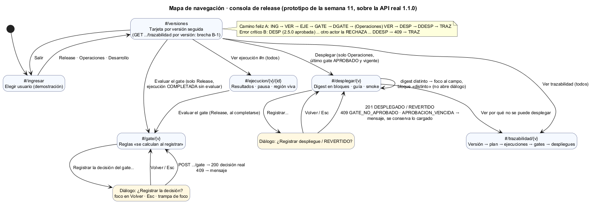

# Semana 11 — Prototipo navegable de escritorio y móvil, sobre la API real

| | |
|---|---|
| **Estudiante** | Boris Alexander Quiroa Orellana (@bquiroao) |
| **Módulo** | QA, pruebas E2E, CI y guía de despliegue final |
| **Adaptación** | Gestión de ejecuciones automatizadas y calidad de versiones |

## Entregables

| Entregable | Archivo |
|---|---|
| Prototipo navegable (escritorio y móvil) | [prototipo/](prototipo/index.html) + [servidor.php](servidor.php) |
| Camino feliz y error crítico | Sección 2 y `capturas/escritorio`, `capturas/movil` (12 pasos × 2 anchos) |
| Mapa de navegación | [semana-11-mapa-navegacion.png](diagramas/semana-11-mapa-navegacion.png) |
| Verificación automática | [recorrido.cjs](herramientas/recorrido.cjs) → [recorrido.txt](evidencia/recorrido.txt) |

## 1. Qué cambia respecto del módulo anterior: la API es la real

El prototipo **no simula la API**. `servidor.php` sirve las pantallas y la API de `micro-his-e2e` desde el mismo origen:
- `/api/...` va al front controller;
- lo demás, a `prototipo/`.

Sin CORS y sin una segunda copia de las reglas. Cada decisión que se ve en pantalla la tomó el dominio real sobre PostgreSQL:
- aprobado o rechazado;
- 409;
- REVERTIDO.

```bash
cd docs/modulos/qa-e2e-ci-despliegue/semana-11
export E2E_PERSISTENCIA=pdo E2E_DB_DSN="pgsql:host=127.0.0.1;port=55432;dbname=micro_his_qa"
php ../micro-his-e2e/bin/instalar-base.php
php -S 127.0.0.1:8092 -t prototipo servidor.php      # abrir http://127.0.0.1:8092/?versiones=2.4.1,2.5.0
```

| Ruta | Pantalla | Quién |
|---|---|---|
| `#/ingresar` | Elegir usuario (demostración; los tokens de `config.php`) | — |
| `#/versiones` | Una tarjeta por versión, con la acción que le toca al rol | Todos |
| `#/ejecucion/{v}/{id}` | Resultados, evidencia por huella, pausa y región viva | Todos |
| `#/gate/{v}` | Las 6 reglas; la decisión la devuelve el servidor | Release |
| `#/desplegar/{v}` | Digest en bloques, guía, smoke; confirmación | Operaciones |
| `#/trazabilidad/{v}` | Versión → plan → ejecuciones → gates → despliegues (incluye REVERTIDO) | Todos |



## 2. Camino feliz (A) y error crítico (B)

**El pipeline no tiene pantalla.** Sus pasos (registrar la versión, ejecutar, reportar, cerrar) los hace el recorrido directo contra la API, igual que lo haría el CI.

| # | A · camino feliz | Escritorio | Móvil |
|---|---|---|---|
| A1 | Release ve «Evaluar el gate de 2.4.1» y **no** ve «Desplegar» | [a01](capturas/escritorio/a01-versiones-release.png) | [a01](capturas/movil/a01-versiones-release.png) |
| A2 | Ejecución #1: 3 de 3 con resultado | [a02](capturas/escritorio/a02-ejecucion-completada.png) | [a02](capturas/movil/a02-ejecucion-completada.png) |
| A3 | Gate: las 6 reglas «se calculan al registrar». Diálogo con foco en Volver, fondo inerte, Tab atrapado y Esc que devuelve el foco | [a03](capturas/escritorio/a03-confirmar-gate.png) | [a03](capturas/movil/a03-confirmar-gate.png) |
| A4 | El servidor devuelve **Aprobado**; las 6 reglas con «✓ cumple» | [a04](capturas/escritorio/a04-gate-aprobado.png) | [a04](capturas/movil/a04-gate-aprobado.png) |
| A5 | Operaciones ve «Desplegar 2.4.1» con su vencimiento | [a05](capturas/escritorio/a05-versiones-ops.png) | [a05](capturas/movil/a05-versiones-ops.png) |
| A6 | Pega un digest con el último carácter cambiado: no se abre el diálogo, el foco va al campo y 1 bloque queda marcado «distinto» a la vista | [a06](capturas/escritorio/a06-digest-distinto.png) | [a06](capturas/movil/a06-digest-distinto.png) |
| A7 | Con el digest correcto: **201 DESPLEGADO** | [a07](capturas/escritorio/a07-desplegado.png) | [a07](capturas/movil/a07-desplegado.png) |
| A8 | La trazabilidad une versión, ejecución, gate y despliegue | [a08](capturas/escritorio/a08-trazabilidad.png) | [a08](capturas/movil/a08-trazabilidad.png) |

**Error crítico elegido: la aprobación se reemplaza mientras el operador instala.** Es el caso que defiende R-11 desde la semana 6: cuenta la **última** evaluación, y una posterior puede rechazar. Es concurrente, y solo se puede mostrar honestamente con el servidor real.

| # | B · error crítico y recuperación | Escritorio | Móvil |
|---|---|---|---|
| B1 | Operaciones abre «Desplegar 2.5.0» (aprobada) y pega el digest correcto | [b01](capturas/escritorio/b01-desplegar-2-5-0.png) | [b01](capturas/movil/b01-desplegar-2-5-0.png) |
| B2 | **Otros actores**, mientras tanto: el pipeline vuelve a ejecutar 2.5.0, E2E-102 FALLA y Release evalúa → **RECHAZADO** | — | — |
| B3 | Operaciones confirma → **409 `GATE_NO_APROBADO`**. El mensaje M-19 recibe el foco, el digest sigue cargado, el contexto pasa a «Sin aprobación vigente» y la acción, a «Ver por qué no se puede desplegar» | [b03](capturas/escritorio/b03-gate-no-aprobado.png) | [b03](capturas/movil/b03-gate-no-aprobado.png) |
| B4 | La trazabilidad lo explica: APROBADO, después RECHAZADO (causa E2E-102) y ningún despliegue | [b04](capturas/escritorio/b04-trazabilidad-rechazado.png) | [b04](capturas/movil/b04-trazabilidad-rechazado.png) |
| B5 | Desarrollo ve la falla de E2E-102 con su evidencia, y no ve Gate ni Desplegar | [b05](capturas/escritorio/b05-ejecucion-dev.png) | [b05](capturas/movil/b05-ejecucion-dev.png) |

## 3. Verificación automática

[recorrido.cjs](herramientas/recorrido.cjs) recrea la base y recorre A y B con clics y teclado, en 1280 px y en 390 px. En **cada paso**:
- comprueba los textos y el foco;
- toma la captura;
- corre **axe-core** (WCAG 2.0, 2.1 y 2.2, A y AA).

En móvil mide además el desbordamiento y los objetivos de 44 px.

**Resultado final: 88/88 comprobaciones y 0 violaciones de axe-core** ([recorrido.txt](evidencia/recorrido.txt)).

### 3.1 Hallazgos de esta semana

| # | Hallazgo | Quién lo encontró | Corrección |
|---|---|---|---|
| H-1 | **El gate de las semanas 8 y 10 mostraba 5 reglas; el servidor evalúa 6.** Faltaba «d · toda falla o inestable tiene evidencia confirmada» (R-05) | **Construir sobre la API real:** la respuesta trae `reglas.d_evidencia` | La pantalla lista las 6, con el nombre de cada regla del servidor. El recorrido exige 6 |
| H-2 | Cuatro Tab **salían del diálogo**: `aria-modal` + `inert` no alcanzan, porque con dos botones el foco seguía hacia la barra del navegador | El recorrido ([recorrido-1-primera.txt](evidencia/recorrido-1-primera.txt), 3 de 86 fallan) | Trampa de foco explícita (Tab y Shift+Tab rotan dentro del diálogo) |
| H-3 | Tras el 409, **el contexto seguía diciendo «Aprobada · vence el 2/11»** al lado del rechazo, y se seguía ofreciendo «Registrar despliegue…» | **Revisión visual de las capturas.** El recorrido estaba en verde: 86/86 ([recorrido-2-verde…](evidencia/recorrido-2-verde-con-contexto-contradictorio.txt)) | El contexto pasa a «Sin aprobación vigente» y la acción, a «Ver por qué…». Comprobación nueva: falla contra el código anterior ([recorrido-3](evidencia/recorrido-3-contexto-contradictorio.txt), 2 fallas) y pasa con la corrección |
| — | La comprobación de B5 buscaba el texto de la tarjeta móvil; en escritorio la evidencia está en la tabla | Error del **instrumento**, no de la interfaz | La comprobación acepta las dos formas |

**H-3 repite la lección del módulo anterior:** un recorrido en verde solo dice que se cumple lo que se comprobó. El mensaje de error era correcto, pero la pantalla se contradecía a sí misma un poco más arriba.

## 4. Backlog de la semana 9: estado

| Ítem | Estado | Evidencia |
|---|---|---|
| B-02, B-05, B-14 contraste y tokens | ✅ | Los mismos tokens de la semana 10; axe-core sin `color-contrast` en los 24 pasos |
| B-03 sin deshabilitados; foco al error | ✅ | A6 (foco y bloque a la vista) |
| B-06 pausa y región viva | ✅ implementado | m-ejecución. El anuncio de un resultado nuevo no se recorre: la ejecución ya está completa cuando se abre |
| B-07, B-08 copiar con texto; digest en bloques | ✅ | A6, B1 |
| B-09 se conserva lo cargado | ✅ | B3 (`digest` intacto tras el 409) |
| B-10 iconos con texto | ✅ | A4 («✓ cumple» × 6) |
| B-11 REVERTIDO visible en la trazabilidad | ✅ implementado | La línea de tiempo lo muestra con «volvió a…». No está en A ni en B |
| B-13 enlaces con contexto | ✅ | «Ver ejecución #1», «Ver trazabilidad de 2.4.1» |
| B-04 mensaje para `DATOS_INVALIDOS` (M-22) | ⚠️ | Está en el catálogo del cliente; ninguna pantalla del prototipo envía datos que lo produzcan |
| B-12 sin códigos a la vista | ⚠️ | Las pantallas usan palabras, pero M-19 todavía dice «(M-19)» como referencia de soporte |
| **B-01 vista previa del gate** | Pendiente | El prototipo **no anticipa** la decisión («se calcula al registrar»). La operación sin efectos es el cambio de la semana 12 |

## 5. Limitaciones

- **No hay listado de versiones (brecha B-1).** La consola sigue las versiones indicadas en `?versiones=` y lee cada una por su trazabilidad.
- **La vigencia de 72 h está duplicada en el cliente** (el contrato no la expone), igual que el riesgo de H-09 de la semana 9.
- **El ingreso es de demostración:** los tokens son los de `config.php`, y van en `sessionStorage`, nunca en la URL (R-D1, verificado).
- **El recorrido usa Chrome con emulación móvil**, no teléfonos reales.
