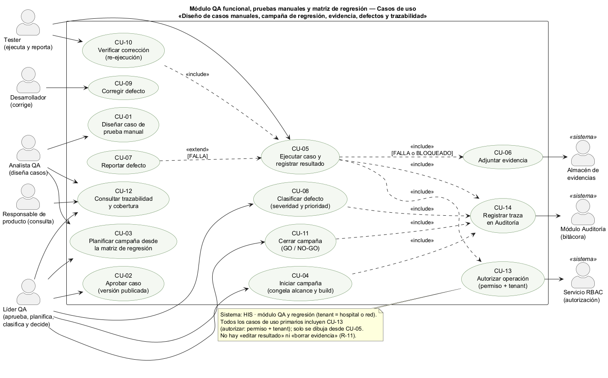
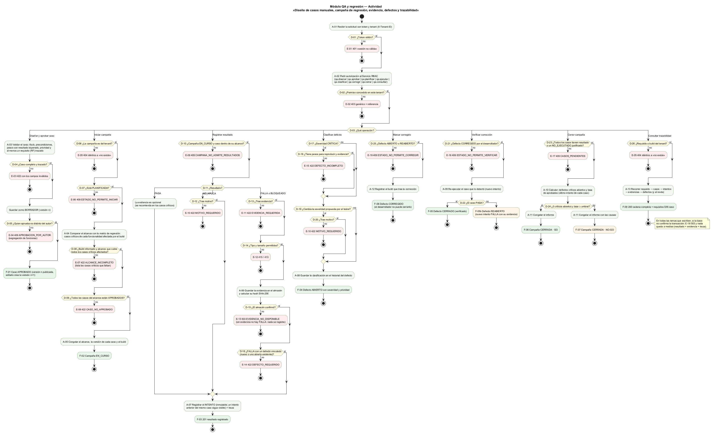
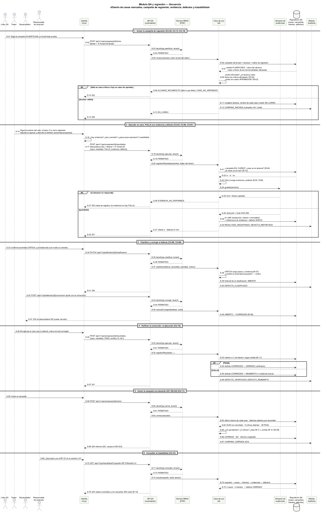

# Semana 1 — Modelado UML del proceso de campañas de regresión y defectos

| | |
|---|---|
| **Curso** | Análisis de Sistemas II — Proyecto Final 2026 |
| **Proyecto** | Sistema Hospitalario Integrado (HIS) |
| **Módulo** | QA funcional, pruebas manuales y matriz de regresión |
| **Adaptación** | Gestión de campañas de regresión y defectos |
| **Tema de la semana** | Conceptos generales, orientación a objetos y UML |
| **Proceso modelado** | «Diseño de casos manuales, campaña de regresión, evidencia, defectos y trazabilidad» |
| **Estudiante** | Boris Alexander Quiroa Orellana |
| **Fecha** | Octubre 2026 |

## Índice

1. [Introducción](#1-introducción)
2. [Narrativa de alcance](#2-narrativa-de-alcance)
3. [Actores](#3-actores)
4. [Modelo de objetos del dominio](#4-modelo-de-objetos-del-dominio)
5. [Reglas de negocio](#5-reglas-de-negocio)
6. [Diagrama de casos de uso](#6-diagrama-de-casos-de-uso)
7. [Especificación de casos de uso](#7-especificación-de-casos-de-uso)
8. [Diagrama de actividad](#8-diagrama-de-actividad)
9. [Diagrama de secuencia](#9-diagrama-de-secuencia)
10. [Matriz de trazabilidad](#10-matriz-de-trazabilidad)
11. [Conclusión](#11-conclusión)
12. [Bibliografía](#12-bibliografía)

## 1. Introducción

Una regresión es una función que **antes funcionaba** y deja de hacerlo por un cambio. En un sistema hospitalario no basta con que aparezca: tiene que aparecer **antes** de llegar a un hospital, y tiene que poder **demostrarse** después. Por ejemplo, que el cálculo de dosis se probó en la versión que se desplegó, con qué resultado y con qué evidencia.

Este módulo modela la **gestión de campañas de regresión manual**:
1. se **diseñan** casos de prueba trazados a requisitos;
2. se **seleccionan** desde una matriz de regresión para un build concreto;
3. se **ejecutan** dejando evidencia;
4. cada falla se convierte en un **defecto** con severidad;
5. la campaña se **cierra** con una decisión GO / NO-GO que se puede justificar.

**Punto de partida en el proyecto real.** El HIS ya hace regresiones, pero en texto libre. En `openspec/changes/postgresql-federated-schema-rebuild/apply-progress.md` cada PR del esquema registra a mano sus «regresiones»:
- ejemplo: «Serial H3/H2/H1 passed with 59/52/80 assertions; CENTRAL C1–C4 passed with 233 assertions»;
- esas suites son las de `tests/Database/Central` y `tests/Database/Hospital`.

Ese registro es una **matriz de regresión llevada a mano**: dice qué se volvió a correr y con qué resultado. Pero le faltan cuatro cosas, y este módulo existe para darlas:

| Lo que el registro actual no tiene | Consecuencia | Dónde lo resuelve el modelo |
|---|---|---|
| Un vínculo con los requisitos | No se puede responder «¿qué pruebas cubren el RF-07?» | R-01, R-10; CU-12 |
| Evidencia adjunta e inmutable | «Passed» es una afirmación, no una prueba | R-05, R-11; CU-06 |
| Un defecto cuando algo falla | Una falla se corrige en el mismo PR y no queda historia | R-06..R-08; CU-07..CU-10 |
| Un criterio de salida explícito | No consta por qué se decidió seguir | R-09; CU-11 |

El modelo tiene tres vistas:

| Vista | Qué muestra |
|---|---|
| Casos de uso | Quién interactúa con el módulo y con qué objetivo |
| Actividad | El flujo con sus decisiones, excepciones y resultados |
| Secuencia | Los mensajes entre participantes, las validaciones y las respuestas |

Las tres comparten identificadores para poder **trazarse** entre sí (§10):

| Prefijo | Qué identifica |
|---|---|
| CU | Caso de uso |
| A | Actividad |
| D | Decisión |
| E | Excepción |
| F | Resultado final |
| R | Regla de negocio |
| S | Mensaje de la secuencia |

## 2. Narrativa de alcance

**Objetivo del proceso.** Que cada versión del HIS que se despliega a un hospital tenga una **campaña de regresión cerrada**, con:
- los casos que correspondía ejecutar según la matriz de regresión;
- un resultado y su evidencia por caso;
- los defectos clasificados por severidad;
- una decisión GO / NO-GO que se pueda reconstruir desde cualquier requisito.

**Dentro del alcance:**

| Elemento | Detalle |
|---|---|
| Diseño de casos manuales | Pasos con resultado esperado, precondiciones, prioridad y los requisitos que verifica; versionados |
| Aprobación | Un caso entra a una campaña solo si está aprobado, y no lo aprueba su autor |
| Matriz de regresión | Relaciona cada funcionalidad con sus casos y marca los **críticos**: los que deben correr siempre que esa funcionalidad cambie |
| Campaña | Para un build concreto: alcance tomado de la matriz, congelado al iniciar |
| Ejecución | Un resultado por caso y por intento (PASA, FALLA, BLOQUEADO, NO_APLICA); los intentos no se sobrescriben |
| Evidencia | Capturas, registros o archivos guardados con su hash; obligatoria en FALLA y BLOQUEADO |
| Defectos | Reportados desde una FALLA, clasificados por severidad y prioridad, con un ciclo de vida que cierra **solo** QA, re-ejecutando |
| Cierre | GO / NO-GO según un criterio de salida explícito; el informe se congela |
| Trazabilidad | Requisito ↔ caso ↔ intento ↔ evidencia ↔ defecto, en los dos sentidos; los requisitos sin caso son visibles |
| Traza | Cada inicio, resultado, clasificación y cierre se registra en el módulo Auditoría |

**Fuera del alcance (otros módulos o fases):**
- **La ejecución automática de pruebas** (PHPUnit, las suites C1–C4 y H1–H4). El módulo podría **importar** sus resultados como evidencia, pero no las corre.
- **La gestión de requisitos:** se leen sus identificadores (RF-xx); no se editan aquí.
- **El código y los despliegues:** el build es un dato que se informa, no algo que el módulo construye.
- **La planificación de capacidad** de los testers y la estimación de esfuerzo.

**Supuestos:**
- El build bajo prueba se identifica con una versión y un commit (por ejemplo, `2.4.0+c56f169`).
- La matriz de regresión indica qué funcionalidades afecta cada build. La mantiene el Líder QA con la ayuda del registro de cambios del PR.
- La identidad y los permisos los resuelven los módulos de identidad y RBAC. El tenant es el hospital (o la red, para las campañas de la versión común).
- La evidencia vive en un almacén de archivos aparte, y la base guarda su ubicación y su hash.
- La hora se guarda en UTC y se muestra en la hora de Guatemala.

## 3. Actores

| Actor | Tipo | Objetivo |
|---|---|---|
| Analista QA | Primario | Diseñar casos manuales trazados a requisitos y proponer el alcance de una campaña |
| Líder QA | Primario | Aprobar casos, planificar e iniciar campañas, clasificar defectos y decidir GO / NO-GO |
| Tester | Primario | Ejecutar los casos, adjuntar evidencia, reportar defectos y verificar las correcciones |
| Desarrollador | Primario | Corregir los defectos e indicar en qué build está la corrección |
| Responsable de producto | Primario | Consultar la cobertura y la trazabilidad para decidir una versión |
| Servicio RBAC | Secundario (sistema) | Decidir si el usuario puede hacer la operación en ese tenant |
| Almacén de evidencias | Secundario (sistema) | Guardar los archivos de evidencia y devolver su ubicación |
| Módulo Auditoría | Secundario (sistema) | Guardar la traza de cada movimiento |

**Segregación de funciones:** el autor de un caso no lo aprueba (R-02), y el desarrollador no cierra su propio defecto (R-08). Las dos reglas existen porque el mismo rol tiene incentivos para dar por bueno lo propio.

## 4. Modelo de objetos del dominio

Antes de los diagramas, los objetos y sus responsabilidades (orientación a objetos, tema de la semana):

| Objeto | Responsabilidad | Invariante que protege |
|---|---|---|
| `CasoPrueba` | Pasos, resultado esperado, prioridad, requisitos trazados; versión y estado (BORRADOR, APROBADO, OBSOLETO) | Un caso aprobado no cambia: editarlo crea otra versión (R-02) |
| `MatrizRegresion` | Funcionalidad → casos, con la marca de **crítico** | Qué es obligatorio volver a probar cuando algo cambia (R-03) |
| `Campana` | Build, alcance, estado (PLANIFICADA, EN_CURSO, CERRADA) y decisión | El alcance y las versiones se congelan al iniciar (R-03); solo una campaña EN_CURSO admite resultados (R-04) |
| `Intento` | Un resultado de un caso dentro de una campaña, con su tester y su hora | Inmutable; un intento nuevo no borra el anterior (R-11) |
| `Evidencia` | Archivo, tipo, tamaño, ubicación y hash SHA-256 | No se edita ni se borra; el hash permite comprobar que no cambió (R-05) |
| `Defecto` | Severidad, prioridad, estado, pasos para reproducir, historial | Ciclo de vida válido; lo cierra QA re-ejecutando (R-07, R-08) |
| `CriterioSalida` | Umbral de aprobados y la condición sobre críticos | La decisión GO / NO-GO es calculable, no opinable (R-09) |

**Relaciones:**
- Un `Requisito` (externo) tiene 0..n `CasoPrueba`.
- Una `Campana` incluye 1..n versiones de casos.
- Cada caso de la campaña tiene 0..n `Intento`.
- Un `Intento` con FALLA o BLOQUEADO tiene 1..n `Evidencia`.
- Un `Intento` con FALLA se vincula a 1 `Defecto`.
- Un `Defecto` puede estar vinculado a varios intentos (el que lo detectó y los que lo verifican).

## 5. Reglas de negocio

| ID | Regla | Tipo |
|---|---|---|
| R-01 | **Caso completo y trazado:** título, precondiciones, al menos un paso, un resultado esperado por paso, prioridad y **al menos un requisito** trazado | Validación |
| R-02 | **Aprobación y versión:** solo un caso APROBADO entra a una campaña. Lo aprueba alguien distinto de su autor. Editar un caso aprobado crea una versión nueva; la anterior queda | Integridad |
| R-03 | **Alcance desde la matriz:** la campaña declara su build; su alcance debe incluir **todos los casos críticos** de las funcionalidades que ese build afecta. Al iniciar se congelan el alcance, la versión de cada caso y el build | Validación |
| R-04 | **Ejecución dentro de la campaña:** solo una campaña EN_CURSO admite resultados, y solo de casos de su alcance | Integridad |
| R-05 | **Evidencia:** FALLA y BLOQUEADO exigen al menos una evidencia de un tipo permitido (imagen, PDF, texto o registro) y un tamaño máximo. Se guarda con su hash SHA-256. Si el almacén no confirma, **no se registra el resultado**: sin evidencia no hay FALLA. NO_APLICA exige un motivo | Validación / seguridad (*fail-closed*) |
| R-06 | **Defecto obligatorio:** toda FALLA se vincula a un defecto, uno nuevo o uno abierto que ya describe esa falla | Trazabilidad |
| R-07 | **Severidad:** CRÍTICA, MAYOR, MENOR o TRIVIAL, con criterio escrito. La propone el tester y la confirma el Líder QA. Cambiarla exige un motivo, que queda en el historial. Una CRÍTICA exige pasos para reproducir y evidencia | Clasificación |
| R-08 | **Ciclo de vida del defecto:** NUEVO → ABIERTO → CORREGIDO → CERRADO, con REABIERTO si la verificación falla y RECHAZADO con motivo. El desarrollador lo marca CORREGIDO; **solo QA lo cierra**, con un intento PASA sobre el build corregido | Integridad |
| R-09 | **Criterio de salida:** se cierra cuando todos los casos tienen resultado o un NO_EJECUTADO justificado. Es **GO** si hay 0 defectos críticos abiertos y la tasa de aprobados (último intento de cada caso) es ≥ el umbral (95 % por defecto, configurable por tenant); si no, **NO-GO**. El informe se congela en los dos casos | Decisión |
| R-10 | **Trazabilidad:** requisito ↔ caso ↔ intento ↔ evidencia ↔ defecto, navegable en los dos sentidos. La cobertura muestra los requisitos **sin** caso | Trazabilidad |
| R-11 | **Inmutabilidad:** un intento y una evidencia no se editan ni se borran. Corregir un resultado equivocado es registrar otro intento con motivo; el anterior sigue visible | Integridad |
| R-12 | **Idempotencia:** registrar un resultado lleva `Idempotency-Key`. Un reintento por una red inestable no crea dos intentos | Integridad |
| R-13 | **Tenant y permisos:** `qa.disenar`, `qa.aprobar`, `qa.planificar`, `qa.ejecutar`, `qa.clasificar`, `qa.corregir`, `qa.cerrar` y `qa.consultar`, decididos por RBAC; fuera del tenant, 404 idéntico a «no existe» | Seguridad |
| R-14 | **Traza:** inicio, resultado, defecto, clasificación, verificación y cierre se registran en Auditoría con el recurso (`campana:<id>`, `defecto:<id>`) y el resultado; **no** el contenido de la evidencia | Trazabilidad |

## 6. Diagrama de casos de uso

Fuente: [semana-01-casos-de-uso.puml](diagramas/semana-01-casos-de-uso.puml)

**Decisiones visibles en el diagrama:**
- **No hay «editar resultado» ni «borrar evidencia».** Su ausencia es una decisión de diseño (R-11).
- **No hay «cerrar defecto» para el desarrollador.** CU-09 solo lo marca corregido; el cierre ocurre en CU-10, al re-ejecutar (R-08).
- **`include`:** ejecutar un caso (CU-05) incluye adjuntar evidencia (CU-06) cuando el resultado es FALLA o BLOQUEADO. Verificar una corrección (CU-10) **es** ejecutar el caso otra vez. Todos los casos de uso primarios incluyen autorizar (CU-13); los que escriben, registrar la traza (CU-14).
- **`extend`:** reportar un defecto (CU-07) extiende la ejecución solo cuando el resultado es FALLA.

## 7. Especificación de casos de uso

### CU-01 Diseñar caso de prueba manual

| Campo | Contenido |
|---|---|
| Actor principal | Analista QA |
| Objetivo | Dejar un caso reproducible por otra persona y trazado a lo que verifica |
| Precondiciones | Permiso `qa.disenar`; el requisito existe en el tenant |
| Flujo principal | 1. Escribe el título, las precondiciones y los pasos, cada uno con su resultado esperado. 2. Elige la prioridad y los requisitos. 3. El sistema valida (R-01). 4. Se guarda como BORRADOR, versión n |
| Excepción | E-03 422 con los campos inválidos (por ejemplo, un paso sin resultado esperado o ningún requisito) |
| Postcondición | Caso en BORRADOR; no puede entrar a una campaña todavía |

### CU-02 Aprobar caso

| Campo | Contenido |
|---|---|
| Actor principal | Líder QA |
| Flujo | Revisa el caso y lo aprueba; queda publicada la versión n |
| Excepción | E-04 409 `APROBACION_POR_AUTOR` si quien aprueba es el autor (R-02) |
| Postcondición | Versión n APROBADA. Una edición posterior crea la n+1 en BORRADOR, y las campañas ya iniciadas siguen con la n |

### CU-03 Planificar campaña desde la matriz de regresión

| Campo | Contenido |
|---|---|
| Actores | Líder QA, Analista QA |
| Flujo | 1. Indica el build y las funcionalidades que afecta. 2. El sistema propone, desde la matriz, los casos críticos de esas funcionalidades. 3. Se agregan otros casos según el riesgo. 4. Se guarda PLANIFICADA |
| Regla | R-03. El alcance se **valida** al iniciar (CU-04), porque hasta entonces la matriz puede cambiar |
| Postcondición | Campaña PLANIFICADA, editable |

### CU-04 Iniciar campaña

| Campo | Contenido |
|---|---|
| Actor principal | Líder QA |
| Precondiciones | Permiso `qa.planificar`; campaña del tenant y PLANIFICADA |
| Flujo | 1. Pide iniciar. 2. RBAC autoriza (CU-13). 3. Se compara el alcance con la matriz: están todos los críticos afectados (R-03). 4. Todos los casos están APROBADOS (R-02). 5. Se congelan el alcance, las versiones y el build. 6. Traza (CU-14). 7. EN_CURSO |
| Excepciones | E-05 404 · E-06 409 `ESTADO_NO_PERMITE_INICIAR` · E-07 422 `ALCANCE_INCOMPLETO` (lista los críticos que faltan) · E-08 422 `CASO_NO_APROBADO` |
| Postcondición | Campaña EN_CURSO, con el alcance que ya no cambia |

### CU-05 Ejecutar caso y registrar resultado

| Campo | Contenido |
|---|---|
| Actor principal | Tester |
| Precondiciones | Permiso `qa.ejecutar`; campaña EN_CURSO; caso en su alcance (R-04) |
| Flujo principal | 1. Sigue los pasos sobre el build de la campaña. 2. Elige el resultado. 3. Si es FALLA o BLOQUEADO, adjunta evidencia (CU-06). 4. Si es FALLA, reporta o vincula un defecto (CU-07). 5. Se envía con `Idempotency-Key` (R-12). 6. Se registra el **intento** en una transacción, con la evidencia y el defecto (R-11). 7. Traza. 8. 201 |
| Flujos alternativos | 2a. PASA: la evidencia es opcional. 2b. NO_APLICA: exige un motivo (R-05). 6a. Un reintento con la misma clave devuelve el mismo intento (R-12) |
| Excepciones | E-09 409 · E-10 422 `MOTIVO_REQUERIDO` · E-11 422 `EVIDENCIA_REQUERIDA` · E-12 415/413 · E-13 503 `EVIDENCIA_NO_DISPONIBLE` · E-14 422 `DEFECTO_REQUERIDO` · E-18 503 base |
| Postcondición | Un intento nuevo, inmutable; los anteriores del mismo caso siguen visibles |

### CU-06 Adjuntar evidencia (incluido por CU-05)

| Campo | Contenido |
|---|---|
| Actor secundario | Almacén de evidencias |
| Flujo | Se valida el tipo y el tamaño; se guarda el archivo; se calcula el hash SHA-256; se devuelve la ubicación |
| Regla | R-05. Si el almacén no confirma, el resultado **no** se registra (E-13). Un resultado FALLA sin su evidencia sería una afirmación que nadie puede revisar |

### CU-07 Reportar defecto (extiende CU-05)

| Campo | Contenido |
|---|---|
| Condición | Resultado FALLA |
| Flujo | El tester describe lo observado frente a lo esperado, los pasos para reproducir y la severidad **propuesta**; o vincula la FALLA a un defecto abierto que ya la describe |
| Regla | R-06, R-07 |
| Excepción | E-14 422 `DEFECTO_REQUERIDO` |

### CU-08 Clasificar defecto

| Campo | Contenido |
|---|---|
| Actor principal | Líder QA |
| Flujo | Confirma o ajusta la severidad y fija la prioridad. Si la cambia, escribe un motivo. Se guarda en el historial; el defecto pasa a ABIERTO |
| Excepciones | E-15 422 `DEFECTO_INCOMPLETO` (CRÍTICA sin pasos o sin evidencia) · E-10 422 (cambio sin motivo) |
| Regla | R-07 |

### CU-09 Corregir defecto

| Campo | Contenido |
|---|---|
| Actor principal | Desarrollador |
| Flujo | Marca el defecto CORREGIDO e indica el build que trae la corrección |
| Excepción | E-19 409 `ESTADO_NO_PERMITE_CORREGIR` si no está ABIERTO ni REABIERTO |
| Regla | R-08: no puede cerrarlo |

### CU-10 Verificar corrección

| Campo | Contenido |
|---|---|
| Actor principal | Tester |
| Flujo | Re-ejecuta el caso que detectó el defecto, sobre el build corregido (es CU-05). PASA → el defecto queda CERRADO. FALLA → queda REABIERTO, con la evidencia nueva |
| Excepción | E-16 409 `ESTADO_NO_PERMITE_VERIFICAR` si el defecto no está CORREGIDO |
| Regla | R-08, R-11 |

### CU-11 Cerrar campaña

| Campo | Contenido |
|---|---|
| Actor principal | Líder QA |
| Flujo | 1. Comprueba que no haya casos pendientes. 2. Calcula los críticos abiertos y la tasa de aprobados con el **último** intento de cada caso. 3. Decide GO o NO-GO según R-09. 4. Congela el informe. 5. Traza |
| Excepción | E-17 409 `CASOS_PENDIENTES` |
| Postcondición | Campaña CERRADA con su decisión, que ya no cambia; el informe dice las causas de un NO-GO |

### CU-12 Consultar trazabilidad y cobertura

| Campo | Contenido |
|---|---|
| Actores | Responsable de producto, Líder QA, Analista QA |
| Flujo | Desde un requisito: sus casos, sus intentos en un build, sus evidencias y sus defectos. Desde un defecto: el caso, el requisito y la campaña. La cobertura lista los requisitos sin caso |
| Excepción | E-05 404 si el requisito o el build no son del tenant |
| Regla | R-10 |

### CU-13 Autorizar operación · CU-14 Registrar traza

| Caso | Actor secundario | Contenido | Reglas |
|---|---|---|---|
| CU-13 | Servicio RBAC | Permiso por operación en el tenant del token (E-01 401, E-02 403) | R-13 |
| CU-14 | Módulo Auditoría | `CAMPANA_INICIADA`, `RESULTADO_REGISTRADO`, `DEFECTO_REPORTADO`, `DEFECTO_CLASIFICADO`, `DEFECTO_VERIFICADO`, `DEFECTO_REABIERTO`, `CAMPANA_CERRADA` | R-14 |

## 8. Diagrama de actividad

Fuente: [semana-01-actividad.puml](diagramas/semana-01-actividad.puml)

| Elemento pedido | Dónde está |
|---|---|
| **Decisiones** | D-01..D-26: token, permiso, operación (8 ramas) y las propias de cada operación. Entre ellas: caso completo, aprobador ≠ autor, alcance contra la matriz, resultado, evidencia, almacén, defecto vinculado, severidad crítica, estado del defecto y criterio de salida |
| **Excepciones** | E-01..E-19, en rojo, cada una con su respuesta: 401, 403, 404, 409, 413, 415, 422 o 503. E-18 (la base no confirma) aplica a toda rama que escribe y está en la nota |
| **Resultados** | F-01..F-09, en verde: caso aprobado, campaña en curso, resultado registrado, defecto abierto, corregido, cerrado (F-05) o **reabierto** (F-05b, en ámbar), campaña **GO** (F-06) o **NO-GO** (F-07, en ámbar) y trazabilidad consultada |

Cuatro decisiones de diseño se ven en el diagrama:

| Decisión | Dónde |
|---|---|
| El alcance se valida al **iniciar**, contra la matriz, y no al planificar | D-08 en la rama «Iniciar campaña». La matriz puede cambiar mientras se planifica; lo que importa es que el alcance esté completo cuando se congela |
| Sin evidencia confirmada **no hay FALLA** | D-15 → E-13: si el almacén no responde, el resultado no se registra. Un 503 obliga a reintentar; una FALLA sin evidencia sería imposible de revisar |
| El desarrollador **no cierra** | La rama «Marcar corregido» termina en F-08 CORREGIDO; solo «Verificar corrección» llega a F-05 CERRADO |
| NO-GO también es un **resultado**, no un error | F-07 está en ámbar, no en rojo: la campaña se cierra igual y su informe dice por qué no se debe desplegar |

## 9. Diagrama de secuencia

Fuente: [semana-01-secuencia.puml](diagramas/semana-01-secuencia.puml)

**Participantes:**
- personas: Líder QA, tester, desarrollador y responsable de producto;
- sistema: interfaz (Vue), API QA (controlador), Servicio RBAC (PDP), caso de uso, almacén de evidencias, repositorio QA (base del tenant) y módulo Auditoría.

| Bloque | Mensajes | Validaciones visibles | Respuestas |
|---|---|---|---|
| 1 · Iniciar campaña | S-01..S-14 | Permiso (S-03), alcance contra la matriz y casos aprobados (S-08) | 422 `ALCANCE_INCOMPLETO` · 200 EN_CURSO |
| 2 · FALLA con evidencia y defecto | S-15..S-32 | Evidencia en la interfaz (S-16), permiso (S-18), campaña, alcance e idempotencia (S-21), evidencia y defecto obligatorios (S-23), almacén (S-24..S-28), transacción (S-29) | 503 sin registrar nada · 201 |
| 3 · Clasificar y corregir | S-33..S-47 | Permisos (S-35, S-43), CRÍTICA con pasos y evidencia (S-38), transición a CORREGIDO (S-46) | 200; el desarrollador no cierra (S-47) |
| 4 · Verificar la corrección | S-48..S-57 | Permiso (S-50), intento nuevo sin borrar el anterior (S-53) | CERRADO (S-54) o REABIERTO (S-55) |
| 5 · Cierre GO / NO-GO | S-58..S-68 | Permiso (S-60), pendientes, críticos y tasa contra el umbral (S-65) | 200 con el informe congelado |
| 6 · Trazabilidad | S-69..S-76 | Permiso (S-71), tenant (S-73) | 200 con la cadena y los requisitos sin caso |

**Un ejemplo numérico** del bloque 5: 40 casos con resultado y 38 PASA dan una tasa del 95 %. Con 0 críticos abiertos y un umbral del 95 %, la decisión es GO. Con 37 PASA, la tasa sería 92,5 %: NO-GO, aunque no hubiera ningún crítico.

## 10. Matriz de trazabilidad

| Caso de uso | Actividad (nodos) | Secuencia (mensajes) | Resultado / HTTP |
|---|---|---|---|
| CU-01 Diseñar caso | A-03; D-04; E-03 | — (fuera de los bloques de la secuencia) | 201 BORRADOR / 422 |
| CU-02 Aprobar caso | D-05; E-04; F-01 | — | 200 / 409 |
| CU-03 Planificar campaña | A-04; D-08 (su alcance se valida al iniciar) | S-06..S-08 | 201 PLANIFICADA |
| CU-04 Iniciar campaña | D-06..D-09; A-05; E-05..E-08; F-02 | S-01..S-14 | 200 / 404 / 409 / 422 |
| CU-05 Ejecutar y registrar | D-10..D-12; A-07; E-09, E-10; F-03 | S-15..S-32, S-48..S-57 | 201 / 409 / 422 / 503 |
| CU-06 Adjuntar evidencia | D-13..D-15; A-06; E-11..E-13 | S-16, S-23..S-28 | 413 / 415 / 422 / 503 |
| CU-07 Reportar defecto | D-16; E-14 | S-15, S-23, S-29, S-30 | 201 / 422 |
| CU-08 Clasificar defecto | D-17..D-20; A-08; E-15; F-04 | S-33..S-41 | 200 / 422 |
| CU-09 Corregir defecto | D-25; A-12; E-19; F-08 | S-42..S-47 | 200 / 409 |
| CU-10 Verificar corrección | D-21, D-22; A-09; E-16; F-05, F-05b | S-48..S-57 | 201 / 409 |
| CU-11 Cerrar campaña | D-23, D-24; A-10, A-11; E-17; F-06, F-07 | S-58..S-68 | 200 GO / NO-GO / 409 |
| CU-12 Consultar trazabilidad | D-26; A-13; F-09 | S-69..S-76 | 200 / 404 |
| CU-13 Autorizar | A-02; D-01, D-02; E-01, E-02 | S-03/04, S-18/19, S-35/36, S-43/44, S-50/51, S-60/61, S-71/72 | PERMITIDO / 401 / 403 |
| CU-14 Registrar traza | A-05, A-07, A-08 (+ traza en cada escritura) | S-12, S-30, S-40, S-56, S-67 | Movimiento en Auditoría |

| Regla | Actividad | Secuencia |
|---|---|---|
| R-01 Caso completo y trazado | A-03, D-04; E-03 | — |
| R-02 Aprobación y versión | D-05, D-09; E-04, E-08; F-01 | S-08 |
| R-03 Alcance desde la matriz | A-04, D-08, A-05; E-07 | S-06..S-08, S-11 |
| R-04 Ejecución en la campaña | D-10; E-09 | S-21 |
| R-05 Evidencia (fail-closed) | D-12..D-15; A-06; E-10..E-13 | S-16, S-23..S-28 |
| R-06 Defecto obligatorio | D-16; E-14 | S-23, S-29 |
| R-07 Severidad | D-17..D-20; A-08; E-15 | S-33, S-38 |
| R-08 Ciclo de vida | D-21, D-22, D-25; F-05, F-05b, F-08 | S-46, S-47, S-54, S-55 |
| R-09 Criterio de salida | D-23, D-24; A-10, A-11; F-06, F-07 | S-63..S-66 |
| R-10 Trazabilidad | A-13; F-09 | S-74..S-76 |
| R-11 Inmutabilidad | A-07, A-09 | S-29, S-53 |
| R-12 Idempotencia | — (detalle del protocolo) | S-17, S-21 |
| R-13 Tenant y permisos | A-02, D-02, D-06, D-26; E-02, E-05 | S-03, S-18, S-35, S-43, S-50, S-60, S-71, S-73 |
| R-14 Traza | A-05, A-07, A-08 | S-12, S-30, S-40, S-56, S-67 |

**Lo que la matriz deja ver:**
- **Todo caso de uso tiene nodos en la actividad.**
- **Todo caso de uso tiene mensajes en la secuencia, salvo dos:** CU-01 y CU-02 (diseñar y aprobar casos). Ocurren **antes** de la campaña, y la secuencia se concentra en su ejecución.
- **R-01 aparece solo en la actividad.**
- **R-12 (idempotencia) aparece solo en la secuencia,** porque es un detalle del protocolo HTTP.

## 11. Conclusión

El modelo convierte una práctica que el proyecto ya tiene (anotar a mano qué regresiones se corrieron) en un proceso con **cuatro garantías** que hoy faltan:

| Garantía | Fallo que evita |
|---|---|
| Alcance validado contra la matriz (R-03) | Una campaña que «pasa» porque no incluyó el caso que habría fallado |
| Sin evidencia no hay FALLA, y nada se borra (R-05, R-11) | Un resultado que nadie puede revisar, o que cambia después de la decisión |
| El defecto lo cierra QA re-ejecutando (R-08) | Un defecto «corregido» que nunca se volvió a probar |
| Criterio de salida calculable (R-09) | Un GO decidido por presión de fecha y sin constancia de por qué |

Las cuatro son la misma idea: **la decisión de desplegar tiene que poder reconstruirse desde la evidencia.** En la semana 2, LSP protegerá precisamente eso. Los tipos de evidencia (captura, registro, resultado importado de PHPUnit) tendrán que ser intercambiables sin que ninguno relaje la regla de que una FALLA se puede verificar.

La autorización se delega en RBAC y la traza en Auditoría: este módulo no decide permisos ni guarda la bitácora, solo los pide.

## 12. Bibliografía

- Object Management Group. (2017). *Unified Modeling Language (UML), Version 2.5.1*. https://www.omg.org/spec/UML/2.5.1
- ISO/IEC/IEEE. (2021). *ISO/IEC/IEEE 29119-3:2021 Software and systems engineering — Software testing — Part 3: Test documentation*.
- ISTQB. (2023). *Certified Tester Foundation Level Syllabus v4.0* (regresión, ciclo de vida del defecto y criterios de salida). https://www.istqb.org
- IEEE. (2009). *IEEE 1044-2009 Standard Classification for Software Anomalies*.
- Sommerville, I. (2016). *Software Engineering* (10.ª ed.). Pearson.
- Proyecto HIS: `openspec/changes/postgresql-federated-schema-rebuild/apply-progress.md` (registro manual de regresiones C1–C4 y H1–H4) y `tests/Database/{Central,Hospital}`.
