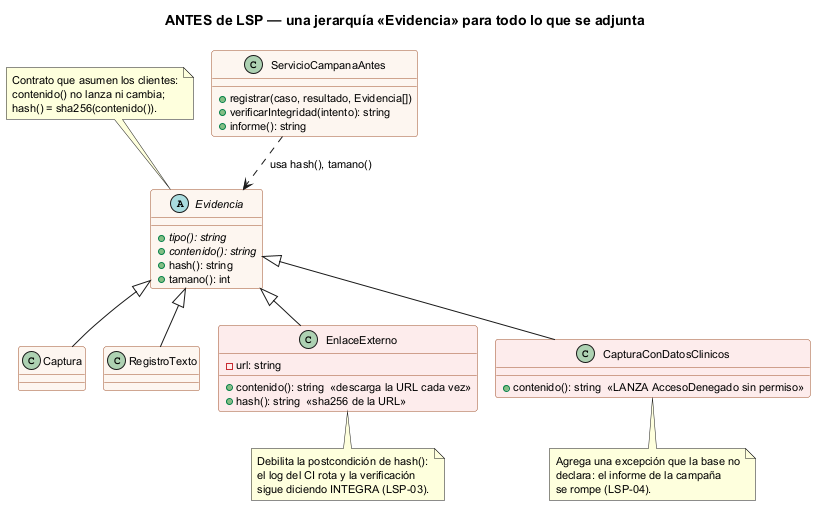
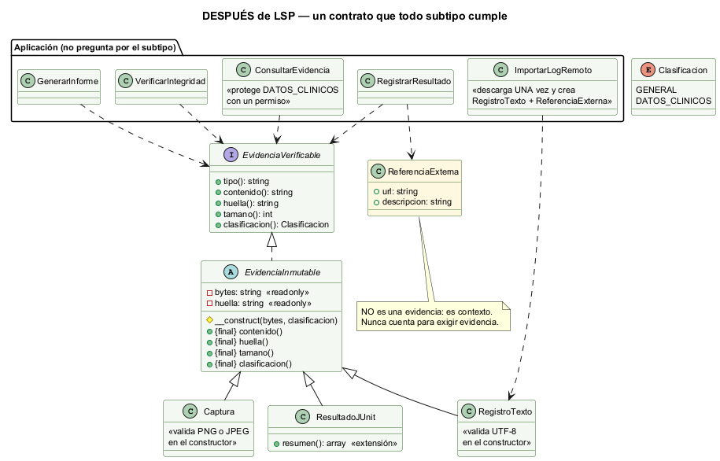

# Semana 2 — Requerimientos, criterios de aceptación y LSP en el flujo de campañas de regresión

| | |
|---|---|
| **Curso** | Análisis de Sistemas II — Proyecto Final 2026 |
| **Módulo** | QA funcional, pruebas manuales y matriz de regresión (gestión de campañas de regresión y defectos) |
| **Tema de la semana** | Proceso y modelo de diseño; principios SOLID |
| **Principio aplicado** | **LSP** — principio de sustitución de Liskov |
| **Proceso** | «Diseño de casos manuales, campaña de regresión, evidencia, defectos y trazabilidad» |
| **Estudiante** | Boris Alexander Quiroa Orellana |

## Entregables

| Pedido | Dónde |
|---|---|
| RF/RNF | §2 y §3: 14 RF y 8 RNF, trazados a las reglas R-01..R-14 de la semana 1 |
| Criterios de aceptación | §4: CA-01..CA-15, ejecutables |
| Diseño antes/después | §6 y §7, con diagramas de clases y el código de [`ejemplo-lsp/`](ejemplo-lsp/README.md) |
| Responsabilidades y dependencias | §8 |
| Evidencia verificable | §9: `verificar.php` (21 pruebas) y `mutaciones.php` (15 defectos inyectados) |

## 1. Introducción

En este módulo, **LSP decide si una FALLA se puede probar**. Lo que se adjunta a un resultado no es de un solo tipo:
- una captura de pantalla;
- un registro de consola;
- el resultado JUnit de una suite automática;
- un enlace al log del pipeline de CI.

Todos parecen «evidencia», y la tentación es ponerlos bajo una misma clase base.

Los clientes de esa clase base (registrar, verificar la integridad, armar el informe) suponen un contrato: **la huella identifica el contenido que vio el tester, y leer el contenido no falla**. Si un subtipo no cumple ese contrato, el sistema sigue funcionando, pero deja de probar lo que dice probar. Eso es exactamente lo que LSP prohíbe: un subtipo que no se puede usar donde se usa su base sin que el cliente se entere.

## 2. Requerimientos funcionales

| ID | Requerimiento | Regla (S1) |
|---|---|---|
| RF-01 | Diseñar un caso con título, pasos (cada uno con resultado esperado), prioridad y al menos un requisito trazado; si falta algo, 422 con cada campo | R-01 |
| RF-02 | Aprobar un caso solo por alguien distinto del autor; editar un caso aprobado crea la versión siguiente en borrador | R-02 |
| RF-03 | Iniciar una campaña solo con build, con todos los casos críticos que la matriz marca para las funcionalidades afectadas y con casos aprobados; congelar el alcance | R-03 |
| RF-04 | Registrar resultados solo en una campaña EN_CURSO y de casos de su alcance (409 si no) | R-04 |
| RF-05 | FALLA y BLOQUEADO exigen al menos una evidencia **verificable** de un tipo permitido y de 5 MB o menos; un enlace externo no cuenta; NO_APLICA exige motivo | R-05 |
| RF-06 | Si el almacén de evidencias no confirma, responder 503 y no registrar el resultado | R-05 |
| RF-07 | Toda FALLA se vincula a un defecto | R-06 |
| RF-08 | Clasificar severidad y prioridad; CRÍTICA exige pasos y evidencia; cambiar la severidad propuesta exige motivo | R-07 |
| RF-09 | El desarrollador marca CORREGIDO; solo una re-ejecución PASA cierra; una FALLA reabre | R-08 |
| RF-10 | Cerrar la campaña: sin pendientes; GO si hay 0 críticos abiertos y la tasa de aprobados (último intento) ≥ el umbral; si no, NO-GO con causas | R-09 |
| RF-11 | Consultar la trazabilidad requisito ↔ caso ↔ intento ↔ evidencia ↔ defecto, y los requisitos sin caso | R-10 |
| RF-12 | Los intentos no se editan ni se borran; un intento nuevo no reemplaza al anterior | R-11 |
| RF-13 | Registrar un resultado es idempotente con `Idempotency-Key` | R-12 |
| RF-14 | Cada operación exige su permiso en el tenant; se registra la traza | R-13, R-14 |

## 3. Requerimientos no funcionales

| ID | Atributo | Requerimiento medible |
|---|---|---|
| RNF-01 | **Sustituibilidad (LSP)** | Todo subtipo de evidencia pasa la **misma** suite de contrato: contenido estable y sin excepciones, huella = sha256(contenido), tamaño = strlen(contenido). Los métodos del contrato no se pueden sobrescribir |
| RNF-02 | Integridad verificable | La evidencia se guarda con su huella SHA-256; una alteración posterior en el almacén se detecta |
| RNF-03 | Seguridad (*fail-closed*) | Una falla del almacén nunca produce un resultado sin evidencia |
| RNF-04 | Protección de datos | Una evidencia con datos clínicos no aparece en el informe y su contenido exige `qa.ver_evidencia_clinica` |
| RNF-05 | Testabilidad | Todos los criterios se verifican sin base de datos |
| RNF-06 | Extensibilidad | Un tipo de evidencia nuevo no cambia ningún caso de uso (0 `instanceof` de subtipos en la Aplicación) |
| RNF-07 | Seguridad de consultas | Desde la semana 3: sentencias preparadas con PDO |
| RNF-08 | Rendimiento | El informe de una campaña de 500 casos se genera en menos de 1 s (se mide en la semana 14) |

## 4. Criterios de aceptación

Cada criterio es una prueba de [`verificar.php`](ejemplo-lsp/verificar.php):

| ID | Dado / cuando / entonces | Verifica |
|---|---|---|
| CA-01 | Un caso con un paso sin resultado esperado, prioridad «URGENTE» y requisito «req-7» → 422 con `pasos[0].esperado`, `prioridad`, `requisitos` | RF-01 |
| CA-02 | El autor aprueba su caso → `APROBACION_POR_AUTOR`; editar uno aprobado → versión 2 en borrador y la 1 sigue aprobada | RF-02 |
| CA-03 | Falta el crítico TC-007 → `ALCANCE_INCOMPLETO TC-007`; sin build → `build`; un borrador → `CASO_NO_APROBADO`; si todo está bien → EN_CURSO | RF-03 |
| CA-04 | Un caso fuera del alcance o una campaña PLANIFICADA → 409 | RF-04 |
| CA-05 | FALLA sin evidencia, o con **solo** un enlace al CI → 422; NO_APLICA sin motivo → 422; 5 MB + 1 → 413 y 5 MB exactos → 201; un PDF como captura → `TIPO_NO_PERMITIDO` | RF-05 |
| CA-06 | Almacén caído → 503 y 0 intentos | RF-06 |
| CA-07 | FALLA sin defecto → 422; con defecto → 201 y el intento lo referencia | RF-07 |
| CA-08 | CRÍTICA sin pasos o sin evidencia → `DEFECTO_INCOMPLETO`; un cambio sin motivo → `MOTIVO_REQUERIDO`; si no, queda en el historial | RF-08 |
| CA-09 | Verificar sin corregir → rechazo; CORREGIDO → FALLA → REABIERTO → CORREGIDO → PASA → CERRADO; no existe un método `cerrar()` | RF-09 |
| CA-10 | 39 de 40 → `CASOS_PENDIENTES`; 38/40 (95 % exacto) → GO; 37/40 → NO-GO 92,5 %; 40/40 con un crítico abierto → NO-GO; un caso que falla y luego pasa cuenta como PASA | RF-10 |
| CA-11 | `Intento` no tiene propiedades modificables; FALLA #1 y PASA #2 quedan los dos | RF-12 |
| CA-12 | La misma clave y contenido → la misma respuesta y 1 intento; otro contenido → `CLAVE_REUTILIZADA` | RF-13 |
| CA-13 | Sin `qa.ejecutar` → 403 y nada registrado | RF-14 |
| CA-14 | Con una captura clínica, el informe la marca «[clínica]» sin su contenido; el tester recibe 403 y el Líder QA, con permiso, 200 | RNF-04 |
| CA-15 | La evidencia guardada coincide al releerla; alterada en el almacén → ALTERADA | RNF-02 |

**RF-11 (trazabilidad)** no tiene criterio esta semana: necesita la persistencia de la semana 3 para navegar la cadena.

## 5. El principio de sustitución de Liskov (LSP)

> «Si S es un subtipo de T, los objetos de tipo T se pueden reemplazar por objetos de tipo S sin alterar ninguna de las propiedades deseables del programa.» — Liskov y Wing (1994)

En términos de contrato, un subtipo:
- **no puede reforzar las precondiciones:** no puede exigir más de lo que exige la base;
- **no puede debilitar las postcondiciones:** no puede garantizar menos;
- **no puede romper los invariantes;**
- **no puede lanzar excepciones nuevas.**

Una violación de LSP no se ve en el compilador. Se ve en un cliente que funcionaba y, con un subtipo nuevo, da un resultado **falso** sin fallar.

## 6. Diseño antes de aplicar LSP



Código: [`ejemplo-lsp/antes/Evidencias.php`](ejemplo-lsp/antes/Evidencias.php)

Una sola jerarquía `Evidencia` para todo lo que se adjunta. Dos subtipos rompen el contrato que suponen los clientes:

| Subtipo | Qué hace | Cláusula que rompe | Consecuencia medida |
|---|---|---|---|
| `EnlaceExterno` | `contenido()` descarga la URL cada vez; `hash()` se sobrescribe con el hash **de la URL** («descargar es lento») | **Debilita la postcondición** de `hash()` (ya no identifica el contenido) y rompe el invariante «el contenido no cambia» | El log del CI rota y la verificación sigue diciendo **INTEGRA**: la evidencia ya no muestra la falla y nadie se entera (LSP-03) |
| `CapturaConDatosClinicos` | `contenido()` **lanza** `AccesoDenegado` si el usuario no tiene permiso | **Agrega una excepción** que la base no declara, es decir, refuerza la precondición «tener permiso» | El informe de la campaña **no se genera** en cuanto una captura tiene datos clínicos (LSP-04) |

**Por qué el diseño invitaba a esto:**
- **`hash()` era sobrescribible**, así que cada subtipo podía decidir qué significaba.
- **La protección de los datos clínicos estaba en el objeto equivocado.** Proteger el acceso es responsabilidad de quien atiende la petición (la Aplicación, con RBAC), no de la evidencia.

## 7. Diseño después de aplicar LSP



Código: [`ejemplo-lsp/despues/`](ejemplo-lsp/despues/)

| Decisión | Cómo hace cumplir LSP |
|---|---|
| **Un contrato explícito** (`EvidenciaVerificable`) | Documenta las postcondiciones que los clientes usan |
| **Los 4 métodos del contrato son `final`** en `EvidenciaInmutable`; los bytes y la huella se capturan en el constructor y son `readonly` | Un subtipo **no puede** sobrescribir `huella()` ni hacer lanzar a `contenido()`. La violación del antes deja de ser posible, no solo de estar prohibida |
| **Las precondiciones viven solo en el constructor** (`Captura` valida la firma PNG o JPEG; `RegistroTexto`, UTF-8; `ResultadoJUnit`, el XML) | Una evidencia que existe ya es válida; los métodos no exigen nada |
| **El enlace sale de la jerarquía:** `ReferenciaExterna` no es una evidencia | Se adjunta como contexto y nunca cuenta para exigir evidencia (CA-05). Lo que antes era `EnlaceExterno` lo resuelve `ImportarLogRemoto`: descarga el log **una vez** y lo guarda como `RegistroTexto` |
| **Los datos clínicos son una clasificación, no un comportamiento** | `ConsultarEvidencia` exige `qa.ver_evidencia_clinica` y `GenerarInforme` nunca lee el contenido. Las dos clasificaciones cumplen el mismo contrato |
| **La extensión está permitida** | `ResultadoJUnit::resumen()` agrega un método propio; quien no lo conoce lo usa como cualquier evidencia (LSP-05) |

## 8. Responsabilidades y dependencias

### Responsabilidades

| Elemento | Responsabilidad única |
|---|---|
| `EvidenciaVerificable` | Declarar el contrato |
| `EvidenciaInmutable` | Garantizar el contrato: capturar los bytes y la huella, y no dejar que se cambien |
| `Captura`, `RegistroTexto`, `ResultadoJUnit` | Validar su formato al crearse; nada más |
| `ReferenciaExterna` | Apuntar a algo externo, sin pretender ser una prueba |
| `RegistrarResultado` | Aplicar las reglas R-04..R-06 y R-12 y guardar en el almacén |
| `VerificarIntegridad` | Releer del almacén y comparar con la huella |
| `GenerarInforme` | Resumir la campaña sin leer contenidos |
| `ConsultarEvidencia` | Decidir quién ve el contenido |
| `ImportarLogRemoto` | Convertir algo que cambia (una URL) en algo que no (una copia) |
| `Campana`, `Defecto`, `CasoPrueba` | Sus reglas de estado: alcance y cierre; ciclo de vida; versión y aprobación |

### Dependencias

| De | A | Por qué es correcta |
|---|---|---|
| Casos de uso | `EvidenciaVerificable` (la abstracción) | Ningún caso de uso conoce un subtipo: 0 `instanceof` (LSP-06) |
| `ImportarLogRemoto` | `RegistroTexto` (lo **crea**) | Crear un tipo concreto no es preguntar por él; es el único lugar que lo hace |
| Casos de uso | `AlmacenEvidencias`, `PoliticaAcceso`, `DescargadorRemoto` (puertos) | El almacén, RBAC y el CI son detalles que se sustituyen en las pruebas |
| `EvidenciaInmutable` | Ninguna capa | El Dominio no depende de nada |

## 9. Evidencia verificable

```bash
php docs/modulos/qa-regresion-defectos/semana-02/ejemplo-lsp/verificar.php    # 21/21
php docs/modulos/qa-regresion-defectos/semana-02/ejemplo-lsp/mutaciones.php   # 15/15 detectadas
```

**La prueba central de LSP:** la **misma** función `contrato()` se aplica a cada subtipo.

| Prueba | Sobre | Resultado |
|---|---|---|
| LSP-01 | Los 4 subtipos del ANTES | **4 violaciones** en 2 subtipos: `EnlaceExterno` (contenido que cambia, huella que no es la del contenido, tamaño distinto) y `CapturaConDatosClinicos` (lanza `AccesoDenegado`) |
| LSP-02 | Los 8 subtipos del DESPUÉS (4 tipos × 2 clasificaciones) | **0 violaciones**; los 4 métodos son `final`; `ReferenciaExterna` no implementa el contrato |
| LSP-03 | El log del CI rota | ANTES: «INTEGRA» (falso). DESPUÉS: la copia guardada sigue mostrando la falla, y una alteración real da «ALTERADA» |
| LSP-04 | Una captura con datos clínicos | ANTES: el informe lanza. DESPUÉS: se genera |
| LSP-05 | Un tipo nuevo (`ResultadoJUnit`) | Se registra, se verifica y se informa sin cambiar ningún caso de uso |
| LSP-06 | El código de la Aplicación | 0 `instanceof`, 0 menciones a `Captura` o `ResultadoJUnit` |

**Las pruebas detectan defectos** ([salida](evidencia/mutaciones.txt)): de 15 mutaciones, 15 hacen fallar al menos una prueba. Tres reintroducen la violación del antes dentro del después, y las detecta la suite de contrato:

| Mutación | La detecta |
|---|---|
| M1: `huella()` deja de ser `final` | LSP-02 |
| M2: `contenido()` lanza con datos clínicos | CA-14, LSP-02, LSP-04 |
| M3: la huella se calcula sobre otra cosa | CA-15, LSP-02, LSP-03, LSP-05 |

Salidas completas: [verificar.txt](evidencia/verificar.txt) y [mutaciones.txt](evidencia/mutaciones.txt).

## 10. Trazabilidad con la semana 1

| Semana 1 | Semana 2 |
|---|---|
| R-05 Evidencia (fail-closed) | RF-05, RF-06; RNF-01..RNF-03; CA-05, CA-06, CA-15; LSP-01..LSP-05 |
| R-06 Defecto obligatorio · R-07 Severidad · R-08 Ciclo de vida | RF-07..RF-09; CA-07..CA-09 |
| R-09 Criterio de salida | RF-10; CA-10 |
| R-11 Inmutabilidad · R-12 Idempotencia | RF-12, RF-13; CA-11, CA-12 |
| R-13 Permisos | RF-14; RNF-04; CA-13, CA-14 |
| CU-06 Adjuntar evidencia (actor: Almacén de evidencias) | `AlmacenEvidencias`, `RegistrarResultado` |
| D-15 → E-13 (almacén caído) | CA-06 y la mutación M5 |

## 11. Conclusión

En la semana 1 la conclusión fue que **la decisión de desplegar tiene que poder reconstruirse desde la evidencia**. LSP es lo que lo hace posible cuando la evidencia tiene muchas formas:

- Sin LSP, cada tipo nuevo de evidencia es un riesgo silencioso: puede que su huella no signifique lo mismo, o que rompa el informe.
- Con el contrato explícito, los métodos `final` y la suite de contrato, un tipo nuevo **o cumple o no compila ni pasa las pruebas**.

Las dos lecciones de diseño que deja el antes:
1. **Si no puede cumplir el contrato, no es un subtipo.** El enlace externo no es «una evidencia rara»; es otra cosa, y se modela aparte.
2. **El permiso no es una propiedad del objeto.** Proteger los datos clínicos lanzando desde `contenido()` mezclaba seguridad con el modelo y rompía a todos los clientes. La protección va donde se atiende la petición.

## 12. Bibliografía

- Liskov, B. y Wing, J. (1994). *A behavioral notion of subtyping*. ACM TOPLAS, 16(6), 1811–1841.
- Martin, R. C. (2017). *Clean Architecture*. Prentice Hall (cap. 9, LSP).
- Meyer, B. (1997). *Object-Oriented Software Construction* (2.ª ed.). Prentice Hall (diseño por contrato).
- ISO/IEC/IEEE 29119-3:2021. *Software testing — Test documentation*.
- JUnit XML: formato que genera PHPUnit con `--log-junit`.
