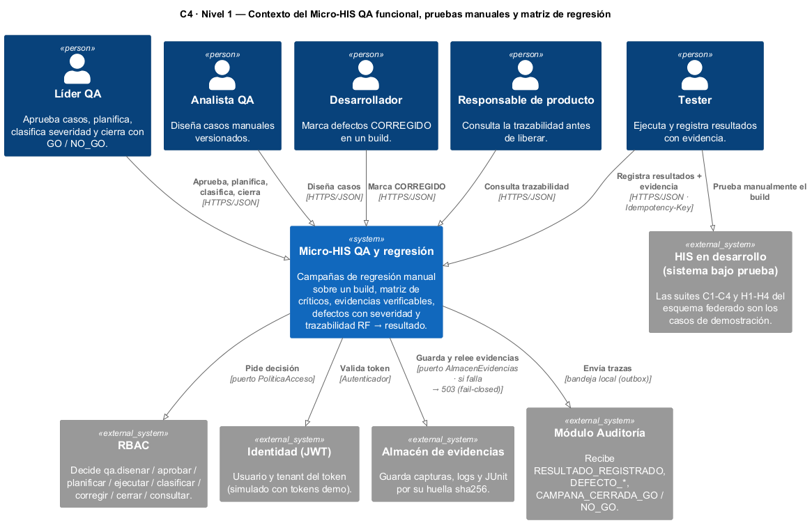
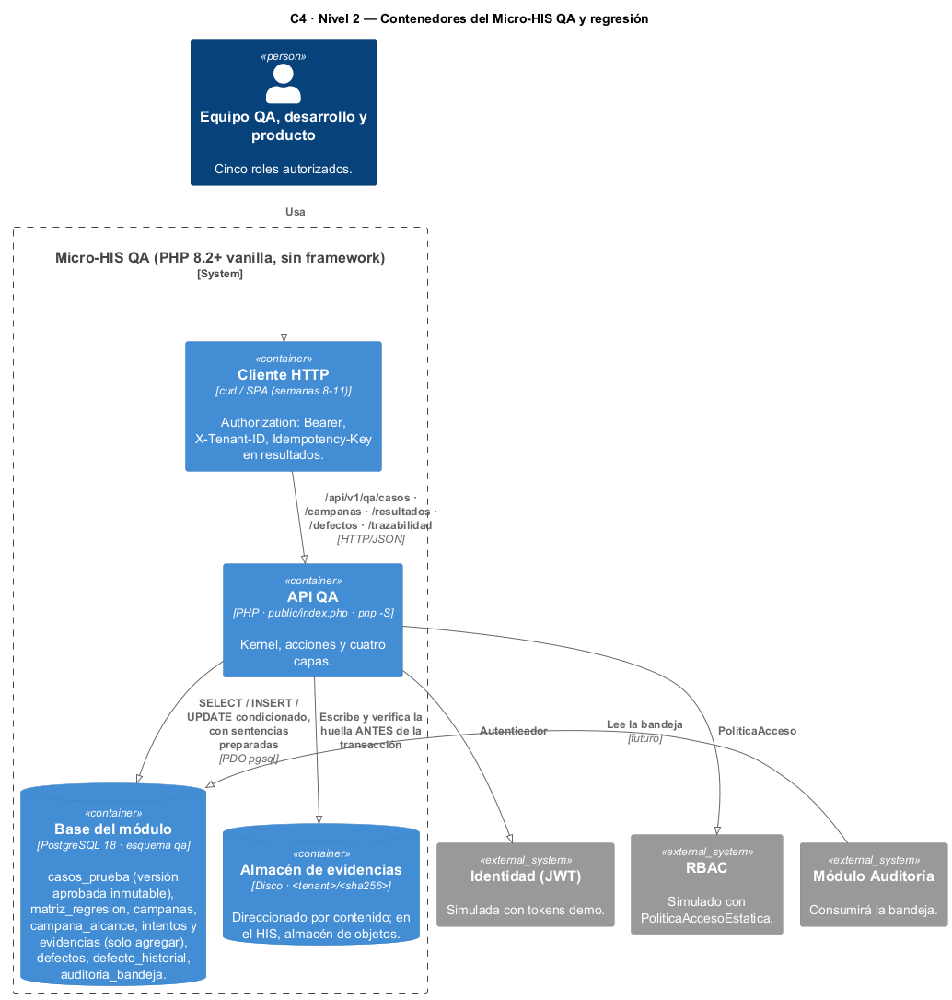
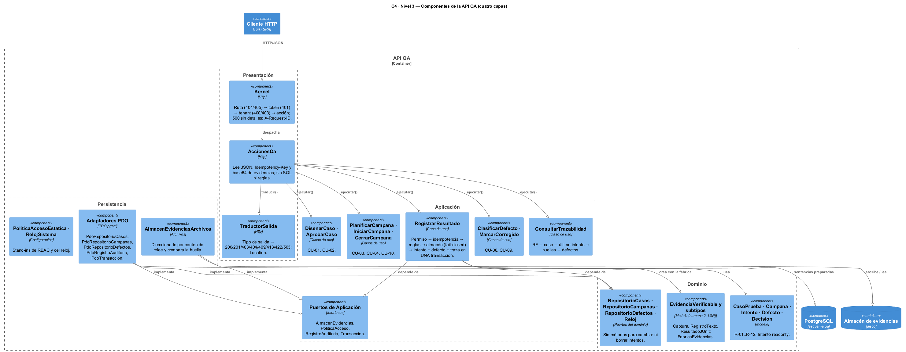
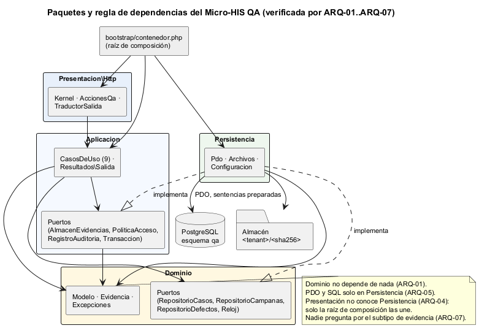
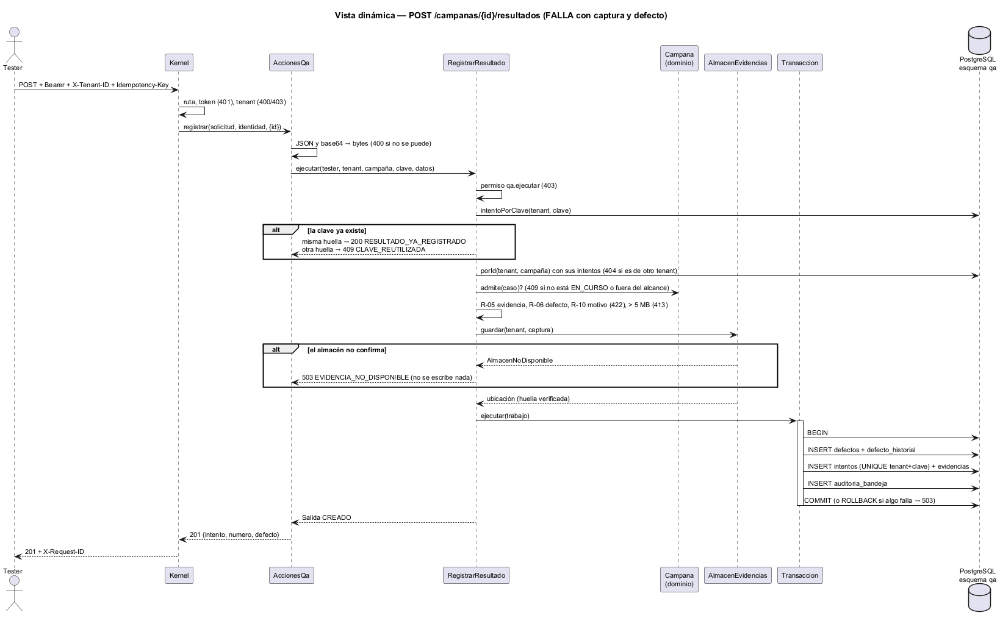

# Semana 3 — Arquitectura del Micro-HIS QA funcional, pruebas manuales y matriz de regresión

| | |
|---|---|
| **Estudiante** | Boris Alexander Quiroa Orellana |
| **Módulo** | QA funcional, pruebas manuales y matriz de regresión (adaptación: gestión de campañas de regresión y defectos) |
| **Tarea** | Iniciar el Micro-HIS en PHP 8.2+ vanilla, con las capas Presentación, Aplicación, Dominio y Persistencia separadas. Persistencia con PDO y sentencias preparadas, sin framework. Probar al menos el camino feliz, una regla de dominio y un error de persistencia |
| **Entregable** | Vista arquitectónica C4/UML del módulo y sus dependencias |
| **Código** | [micro-his-qa/](../micro-his-qa/README.md) |

## Índice

1. [Introducción](#1-introducción)
2. [Decisiones arquitectónicas](#2-decisiones-arquitectónicas)
3. [Vista de contexto (C4 nivel 1)](#3-vista-de-contexto-c4-nivel-1)
4. [Vista de contenedores (C4 nivel 2)](#4-vista-de-contenedores-c4-nivel-2)
5. [Vista de componentes (C4 nivel 3)](#5-vista-de-componentes-c4-nivel-3)
6. [Paquetes y regla de dependencias](#6-paquetes-y-regla-de-dependencias)
7. [Vista dinámica: registrar un resultado](#7-vista-dinámica-registrar-un-resultado)
8. [Responsabilidades por capa](#8-responsabilidades-por-capa)
9. [Persistencia: PDO, sentencias preparadas y el esquema](#9-persistencia-pdo-sentencias-preparadas-y-el-esquema)
10. [API HTTP](#10-api-http)
11. [Pruebas y evidencia](#11-pruebas-y-evidencia)
12. [Hallazgos](#12-hallazgos)
13. [Trazabilidad con las semanas 1 y 2](#13-trazabilidad-con-las-semanas-1-y-2)
14. [Limitaciones y trabajo siguiente](#14-limitaciones-y-trabajo-siguiente)

---

## 1. Introducción

La semana 1 modeló el proceso y la semana 2 fijó los requisitos y el contrato de la evidencia (LSP). Esta semana el proceso **corre**: el Micro-HIS registra campañas de regresión reales sobre PostgreSQL y aplica las 14 reglas de la semana 1.

El alcance es el **núcleo del flujo**, de punta a punta:

1. Diseñar y aprobar un caso.
2. Planificar una campaña desde la matriz de regresión e iniciarla sobre un build.
3. Registrar resultados con evidencia y defectos.
4. Clasificar el defecto, corregirlo y verificarlo con una re-ejecución.
5. Cerrar la campaña con GO / NO-GO y consultar la trazabilidad.

Son 9 de los 14 casos de uso de la semana 1. Los que faltan van en §14.

**Datos de demostración.** Los casos imitan las suites de regresión manual que el HIS ya ejecuta sobre su esquema federado: C1–C4 (central) y H1–H4 (hospital), tomadas de `openspec/changes/postgresql-federated-schema-rebuild/apply-progress.md`. Por ejemplo, TC-107 es «H4: una nota firmada no se edita» y TC-101 es «C1: correo nulo permitido y único sin mayúsculas».

## 2. Decisiones arquitectónicas

| # | Decisión | Por qué | Alternativa descartada |
|---|---|---|---|
| D-1 | **Cuatro capas con la regla de dependencias hacia el Dominio**. Persistencia implementa los puertos; solo la raíz de composición conoce las clases concretas | Las reglas (R-01..R-14) se prueban sin base ni HTTP, y el adaptador cambia sin tocarlas | Controladores con SQL: las reglas quedarían repartidas y sin pruebas aisladas |
| D-2 | **Repositorios como puertos del Dominio** (`RepositorioCasos`, `RepositorioCampanas`, `RepositorioDefectos`); almacén, permisos, auditoría y transacción como puertos de la Aplicación | Los repositorios hablan del modelo; los demás son servicios que solo usa la Aplicación | Todos en un solo paquete «Interfaces» |
| D-3 | **`RepositorioCampanas` no tiene métodos para cambiar ni borrar intentos**, solo `agregarIntento` | R-11 se cumple por construcción: no hay código que lo pueda violar | Un `guardar(Campana)` genérico que reescribe todo |
| D-4 | **Evidencia al almacén ANTES de la transacción, y fail-closed** | Si el almacén no confirma, no puede quedar una FALLA sin evidencia (R-05). Si la transacción falla después, queda un archivo huérfano direccionado por su huella; no se pierde nada ni se miente | Guardar la evidencia dentro de la transacción: un almacén externo no participa del COMMIT |
| D-5 | **Intento, defecto y traza en UNA transacción** (bandeja de auditoría, *outbox*) | No puede existir un intento sin su traza ni un defecto sin su intento | Llamar a Auditoría por HTTP en medio del registro |
| D-6 | **Idempotencia en dos niveles**: consulta previa por clave + `UNIQUE (tenant, idempotency_key)` | La consulta previa responde igual aunque la campaña ya esté cerrada (APP-15). La restricción cubre la carrera entre dos peticiones simultáneas | Solo la restricción: un reintento tras el cierre daría 409 (hallazgo H-2) |
| D-7 | **Cambios de estado con `UPDATE … WHERE estado = <anterior>`** | Dos cierres simultáneos no pueden dejar dos decisiones (INT-08) | Leer y escribir sin condición |
| D-8 | **Reglas críticas repetidas en el esquema**: triggers de solo agregar, versión aprobada inmutable, `CHECK aprobador <> autor`, FALLA con defecto | Una herramienta, un script o un error futuro que se salte la aplicación igual choca con la base (INT-03, INT-04) | Confiar solo en la aplicación |
| D-9 | **La Aplicación devuelve `Salida` con un tipo**, y solo la Presentación lo traduce a HTTP | Los casos de uso no conocen HTTP. Se llama `Salida` para no confundirla con el `Resultado` de un intento (PASA, FALLA…) | Lanzar excepciones HTTP desde los casos de uso |

## 3. Vista de contexto (C4 nivel 1)



- **Cinco roles** usan el módulo. El **Tester** prueba a mano el build del HIS y registra aquí lo que vio.
- **RBAC, Identidad, Almacén de evidencias y Auditoría** son otros sistemas. Cada uno queda detrás de un puerto, y esta semana se simula: tokens demo, una política estática y un almacén en disco.

## 4. Vista de contenedores (C4 nivel 2)



Hay tres contenedores propios:

- **la API**, en PHP sin framework;
- **el esquema `qa`**, en PostgreSQL 18;
- **el almacén de evidencias**, direccionado por contenido (`<tenant>/<sha256>`).

Guardar el mismo archivo dos veces no lo duplica. Una ruta manipulada (`../`) se rechaza (PER-06).

## 5. Vista de componentes (C4 nivel 3)



`RegistrarResultado` es el componente más cargado: aplica R-04, R-05, R-06, R-08, R-10, R-11 y R-12. Por eso tiene su propia vista dinámica (§7). Es el candidato natural al refactor de la semana 7.

## 6. Paquetes y regla de dependencias



La regla no es solo un dibujo: la verifican siete pruebas (`tests/Arquitectura/DependenciasPrueba.php`).

| Prueba | Verifica |
|---|---|
| ARQ-01 | El Dominio no importa nada de las otras tres capas |
| ARQ-02 | La Aplicación no importa Persistencia ni Presentación |
| ARQ-03, ARQ-04 | Persistencia no conoce la Presentación, y la Presentación no conoce la Persistencia |
| ARQ-05 | `PDO`, `SELECT`, `INSERT`, `UPDATE` y `DELETE FROM` solo aparecen en Persistencia |
| ARQ-06 | No hay `composer.json` ni namespaces de terceros |
| ARQ-07 | Fuera de la fábrica, nadie pregunta por el subtipo de evidencia (`instanceof`). Es lo que la semana 2 consiguió con LSP |

## 7. Vista dinámica: registrar un resultado



El orden importa y está probado:

1. **El permiso va primero:** quien no puede ejecutar no averigua si la campaña existe.
2. **Luego la idempotencia, antes que el estado:** un reintento tras el cierre devuelve el intento original (APP-15).
3. **Después las reglas de forma (422/413)**, que no tocan nada.
4. **Al final, el almacén:** es el único efecto fuera de la base, y si falla no se escribe nada (APP-11).
5. **Por último, la transacción:** si la traza falla, PostgreSQL deshace el defecto y el intento (INT-06).

## 8. Responsabilidades por capa

| Capa | Contiene | No contiene |
|---|---|---|
| **Presentación** (`src/Presentacion/Http`) | `Kernel` (ruta → token → tenant → acción; 500 sin detalles; `X-Request-ID`), `AccionesQa` (JSON, `Idempotency-Key`, base64 → bytes), `TraductorSalida` | SQL; reglas de QA; el tenant tomado del cuerpo |
| **Aplicación** (`src/Aplicacion`) | 9 casos de uso, `Salida`, los puertos `AlmacenEvidencias`, `PoliticaAcceso`, `RegistroAuditoria` y `Transaccion` | HTTP, PDO, rutas de archivos |
| **Dominio** (`src/Dominio`) | `CasoPrueba` (readonly, `aprobar()` devuelve otra instancia), `Campana`, `Intento` (readonly), `Defecto`, `Decision`, la evidencia de la semana 2, los repositorios y el `Reloj` | Cualquier dependencia de infraestructura |
| **Persistencia** (`src/Persistencia`) | `ConsultasPdo` (base: preparar, ejecutar, traducir errores), 3 repositorios PDO, auditoría, transacción, almacén en disco, configuración | Reglas de negocio |

## 9. Persistencia: PDO, sentencias preparadas y el esquema

- **Todas las consultas pasan por `ConsultasPdo::consulta()`**, que hace `prepare` + `execute` con parámetros.
  - Las listas (`IN (…)`) se arman con `?, ?, ?` y sus valores van como parámetros.
  - PER-05 revisa que ningún adaptador concatene datos en el SQL ni use `query()`/`exec()` con SQL.
  - PER-02 revisa que una lista vacía no llegue a la base como `IN ()`.
- **Ningún `PDOException` sale de Persistencia.** Se traduce a `ErrorPersistencia`, sin el host ni la contraseña (PER-01, PER-04).
  - Las únicas excepciones con significado son `ClaveEnUso` (violación de `intentos_clave_unica`) y `ReglaRechazada('INTENTO_CONCURRENTE')`.
- **La conexión** desactiva la emulación de sentencias preparadas y fija `search_path` en `qa` y la zona horaria en UTC.

**El esquema** ([database/schema.sql](../micro-his-qa/database/schema.sql)) tiene 11 tablas. Las reglas que también viven en la base:

| Regla | En el esquema |
|---|---|
| R-02, versión aprobada inmutable | Trigger `casos_version_inmutable`: solo deja pasar BORRADOR → APROBADO; nunca un DELETE |
| R-02, aprobador ≠ autor | `CHECK casos_aprobador_no_autor` |
| R-03, alcance congelado | `campana_alcance` con FK a (tenant, caso, **versión**) |
| R-06, FALLA con defecto | `CHECK intentos_falla_con_defecto` |
| R-07, CRÍTICA completa | `CHECK defectos_critico_completo` (pasos y evidencia) |
| R-10, NO_APLICA con motivo | `CHECK intentos_no_aplica_con_motivo` |
| R-11, solo agregar | Trigger `solo_agregar` en intentos, evidencias, referencias e historial |
| R-12, idempotencia | `UNIQUE (tenant, idempotency_key)` |
| Tenant | Toda FK compuesta incluye el tenant: un intento no puede apuntar al defecto de otro hospital |

## 10. API HTTP

| Método y ruta | Caso de uso | Permiso | Éxito |
|---|---|---|---|
| `POST /api/v1/qa/casos` | DisenarCaso (CU-01) | `qa.disenar` | 201 + Location |
| `POST /api/v1/qa/casos/{TC-n}/aprobacion` | AprobarCaso (CU-02) | `qa.aprobar` | 200 |
| `POST /api/v1/qa/campanas` | PlanificarCampana (CU-03) | `qa.planificar` | 201 + Location |
| `POST /api/v1/qa/campanas/{id}/inicio` | IniciarCampana (CU-04) | `qa.planificar` | 200 |
| `POST /api/v1/qa/campanas/{id}/resultados` | RegistrarResultado (CU-05/06/07) | `qa.ejecutar` | 201, o 200 si es repetición |
| `POST /api/v1/qa/defectos/{id}/clasificacion` | ClasificarDefecto (CU-08) | `qa.clasificar` | 200 |
| `POST /api/v1/qa/defectos/{id}/correccion` | MarcarCorregido (CU-09) | `qa.corregir` | 200 |
| `POST /api/v1/qa/campanas/{id}/cierre` | CerrarCampana (CU-10) | `qa.cerrar` | 200 con GO / NO_GO |
| `GET /api/v1/qa/campanas/{id}/trazabilidad` | ConsultarTrazabilidad (CU-11/12) | `qa.consultar` | 200 |

**Errores:**

| Código | Cuándo |
|---|---|
| 400 | Formato: JSON, base64, `Idempotency-Key`, `X-Tenant-ID` |
| 401 | Sin token válido |
| 403 | Sin permiso, o tenant distinto del del token |
| 404 | No existe en el tenant (incluye «es de otro hospital») |
| 409 | Choca con el estado |
| 413 | Evidencia de más de 5 MB |
| 422 | Datos incompletos; dice qué campos |
| 503 | Base o almacén caídos |

El contrato formal (OpenAPI) es el entregable de la semana 5.

## 11. Pruebas y evidencia

```bash
cd docs/modulos/qa-regresion-defectos/micro-his-qa
php tests/ejecutar.php                                   # 44 pruebas con dobles (9 de integración omitidas)
QA_DB_DSN="pgsql:host=127.0.0.1;port=55432;dbname=micro_his_qa" php tests/ejecutar.php   # 53, incluidas las de PostgreSQL
QA_DB_DSN=... php tests/mutaciones.php                   # 16 defectos sembrados
QA_DB_DSN=... bash bin/demo-http.sh                      # recorrido HTTP real (php -S + curl)
```

| Lo que pide la tarea | Pruebas |
|---|---|
| **Camino feliz** | APP-01 (diseñar → … → GO, con la traza de cada paso), HTTP-01, INT-01 |
| **Regla de dominio** | DOM-01..DOM-09 (R-01, R-02, R-03, R-04, R-07, R-08, R-09); APP-04..APP-08 a través de los casos de uso |
| **Error de persistencia con dobles** | APP-11 (almacén caído: nada escrito), APP-12 (la traza falla: se deshace todo), APP-13 (8 casos de uso con la base caída → 503), PER-01 (PDO caído sin filtrar secretos), PER-03 (COMMIT falla → ROLLBACK) |
| **Error de persistencia con BD de prueba** | INT-06 (ROLLBACK real), INT-03 y INT-04 (triggers), INT-05 (UNIQUE), INT-08 (concurrencia) |

| Evidencia | Resultado |
|---|---|
| [1-pruebas-dobles.txt](evidencia/1-pruebas-dobles.txt) | 44 pasan, 0 fallan, 9 omitidas (sin base) |
| [2-pruebas-postgres.txt](evidencia/2-pruebas-postgres.txt) | 9/9 de integración con PostgreSQL 18 |
| [3-mutaciones.txt](evidencia/3-mutaciones.txt) | 16/16 mutaciones detectadas: reglas, SQL sin tenant, trigger quitado, traductor equivocado |
| [4-demo-http.txt](evidencia/4-demo-http.txt) | 23 peticiones reales: NO_GO por un crítico, corrección, re-ejecución que cierra el defecto, GO |
| [5-hallazgos-en-rojo.txt](evidencia/5-hallazgos-en-rojo.txt) | Las fallas reales antes de corregir (§12) |
| [capturas/](evidencia/capturas/) | Las cinco salidas como imagen |

## 12. Hallazgos

| # | Hallazgo | Quién lo encontró | Corrección |
|---|---|---|---|
| H-1 | `["RF-07","RF-07"]` se rechazaba: el dominio comparaba la cantidad de requisitos válidos **después** de deduplicar | DOM-01 en rojo | Se decide con los válidos sin deduplicar; se deduplica al construir |
| H-2 | Quitar la consulta previa de idempotencia no rompía ninguna prueba: la restricción UNIQUE la tapaba | Mutación M11 sobrevivía | APP-15: un reintento después del cierre debe devolver el intento original. Ahora M11 se detecta |
| H-3 | Todo cuerpo con acentos daba `JSON_INVALIDO` | El recorrido HTTP real | Era el script: Git Bash pasaba los argumentos a curl en ANSI. El cuerpo va ahora por stdin. El servidor tenía razón en rechazar |
| H-4 | «1 defectos críticos abiertos» | El recorrido HTTP real | Singular y plural en `Campana::cerrar()` |

H-2 es el más útil: **una mutación que sobrevive no siempre es una prueba que falta; a veces es un comportamiento que nadie había especificado.** «¿Qué pasa con un reintento después del cierre?» no estaba en las reglas de la semana 1.

## 13. Trazabilidad con las semanas 1 y 2

| Regla (semana 1) | Dónde vive | Prueba |
|---|---|---|
| R-01 caso completo | `CasoPrueba::disenar` | DOM-01, HTTP-05 |
| R-02 aprobador ≠ autor, versión inmutable | `CasoPrueba::aprobar` + CHECK + trigger | DOM-02, APP-07, INT-04 |
| R-03 alcance desde la matriz | `Campana::iniciar` + `RepositorioCasos::criticosDe` | DOM-03, APP-06, INT-02 |
| R-04 solo EN_CURSO y alcance | `Campana::admite` | DOM-04, APP-07 |
| R-05 evidencia fail-closed | `RegistrarResultado` (almacén antes de la transacción) | APP-04, APP-11 |
| R-06 FALLA → defecto | `RegistrarResultado` + CHECK | APP-05 |
| R-07 severidad | `Defecto::clasificar` + CHECK | DOM-07 |
| R-08 solo QA cierra | `Defecto::marcarCorregido` / `verificar` | DOM-08, APP-08 |
| R-09 GO / NO-GO | `Campana::cerrar` | DOM-05, DOM-06, APP-01, INT-01 |
| R-10 NO_APLICA con motivo | `RegistrarResultado` + CHECK | APP-05 |
| R-11 intentos inmutables | `Intento` readonly + triggers | INT-03 |
| R-12 idempotencia | consulta previa + UNIQUE | APP-03, APP-15, INT-05 |
| R-13 datos clínicos protegidos | La trazabilidad solo da huellas | APP-02 (la consulta del contenido es la semana 4) |
| Contrato `EvidenciaVerificable` (semana 2) | `src/Dominio/Evidencia`, sin cambios | DOM-09, ARQ-07 |

## 14. Limitaciones y trabajo siguiente

- **Faltan 5 casos de uso:** CU-13 (consultar el contenido de una evidencia con `qa.ver_evidencia_clinica`), CU-14 (verificar integridad), nueva versión de un caso, mantener la matriz y anular una campaña.
- **Semana 4.** `AccionesQa` mezcla la lectura de la entrada, la decodificación base64 y la respuesta en una sola clase. La semana 4 la separa en MVC (controlador, formularios, vistas) y agrega adaptadores InMemory detrás de los mismos repositorios.
- **Identidad y permisos simulados:** tokens demo y una política estática.
- **El almacén en disco** puede dejar un archivo huérfano si la transacción falla después de guardarlo (D-4). Es aceptable, porque el contenido no se pierde ni cambia, pero conviene una limpieza periódica.
- **No hay paginación** en la trazabilidad: una campaña de cientos de casos devuelve todo junto.
