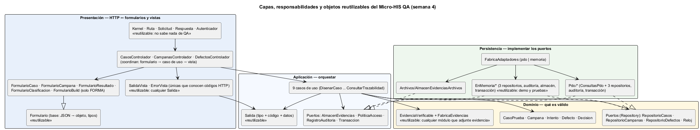
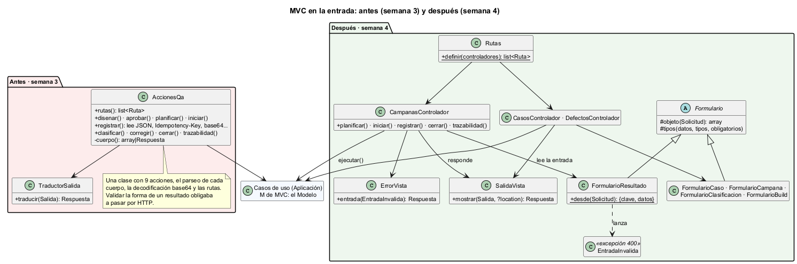
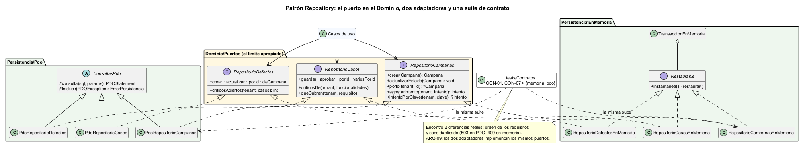
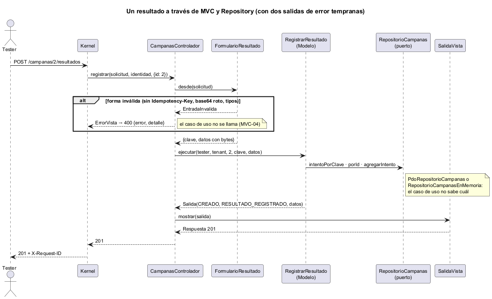
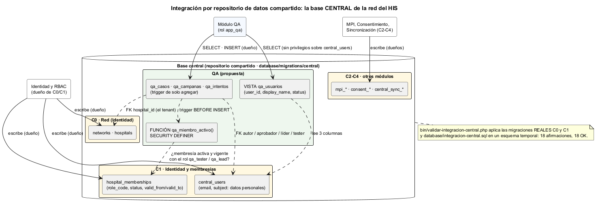

# Semana 4 — Arquitectura en capas, MVC y patrón Repository

| | |
|---|---|
| **Estudiante** | Boris Alexander Quiroa Orellana |
| **Módulo** | QA funcional, pruebas manuales y matriz de regresión (adaptación: gestión de campañas de regresión y defectos) |
| **Tarea** | Continuar el Micro-HIS: MVC en la entrada, una interfaz Repository en el límite apropiado con adaptadores PDO e InMemory, y un controlador sin SQL ni reglas de negocio. Analizar y diagramar cómo se integraría el módulo en un repositorio de datos compartido |
| **Entregable** | Capas, responsabilidades y objetos reutilizables |
| **Código** | [micro-his-qa/](../micro-his-qa/README.md) |

## Índice

1. [Qué cambió respecto de la semana 3](#1-qué-cambió-respecto-de-la-semana-3)
2. [Capas, responsabilidades y objetos reutilizables](#2-capas-responsabilidades-y-objetos-reutilizables)
3. [MVC en la entrada](#3-mvc-en-la-entrada)
4. [Patrón Repository](#4-patrón-repository)
5. [Vista dinámica](#5-vista-dinámica)
6. [Integración con un repositorio de datos compartido](#6-integración-con-un-repositorio-de-datos-compartido)
7. [Hallazgos](#7-hallazgos)
8. [Evidencia](#8-evidencia)
9. [Limitaciones y trabajo siguiente](#9-limitaciones-y-trabajo-siguiente)

---

## 1. Qué cambió respecto de la semana 3

| Semana 3 | Semana 4 | Por qué |
|---|---|---|
| `AccionesQa`: 9 acciones, rutas, parseo del JSON y base64 en una clase | 5 **formularios**, 3 **controladores**, 2 **vistas** y `Rutas` | Cada cosa cambia por un motivo distinto. La forma de un resultado se prueba sin HTTP (MVC-02) |
| `TraductorSalida` | `SalidaVista` (misma tabla de estados) | Es la V: lo único que conoce los códigos HTTP |
| Repositorios en memoria solo como dobles de prueba (`tests/Dobles`) | **Adaptadores de producción** en `src/Persistencia/EnMemoria`. En `tests/` quedan solo decoradores que fallan a pedido | El modo `QA_PERSISTENCIA=memoria` sirve para demos y desarrollo sin base, y es reutilizable por las pruebas de otros módulos |
| Sin forma de saber si los dos adaptadores se comportan igual | **Suite de contrato**: CON-01..07 corren contra los dos | Encontró 2 diferencias reales (§7) |
| — | `FabricaAdaptadores` (`pdo` o `memoria`) | La raíz de composición elige el adaptador por configuración |
| — | `integracion-central.sql` + validador sobre las migraciones reales | La pregunta del repositorio compartido, respondida con evidencia (§6) |

**Lo que no cambió, a propósito.** Los 9 casos de uso, el dominio y las rutas siguen igual. El recorrido HTTP real da los mismos 23 códigos que la semana 3 ([7-demo-http.txt](evidencia/7-demo-http.txt)). El refactor no cambió el comportamiento.

## 2. Capas, responsabilidades y objetos reutilizables



| Capa | Responsabilidad | Clases | Reutilizable (y por quién) |
|---|---|---|---|
| **Presentación** | Traducir HTTP ↔ datos. Forma de la entrada (400); código HTTP de la salida | `Kernel`, `Ruta`, `Solicitud`, `Respuesta`, `Autenticador`; `Formulario` + 5 formularios; 3 controladores; `SalidaVista`, `ErrorVista`; `Rutas` | `Kernel`…`Respuesta` no mencionan QA: son los mismos de Prescripciones. `Formulario` (JSON → objeto + tipos) sirve a cualquier endpoint. `SalidaVista` traduce cualquier `Salida` |
| **Aplicación** | Orquestar: permiso → reglas → efectos en una transacción → `Salida` | 9 casos de uso; `Salida`; 4 puertos | `Salida` (tipo + código + datos). Los puertos `Transaccion`, `RegistroAuditoria` y `PoliticaAcceso` son genéricos |
| **Dominio** | Qué es válido: R-01..R-12, la decisión GO / NO-GO y la evidencia verificable | `CasoPrueba`, `Campana`, `Intento`, `Defecto`, `Decision`; `EvidenciaVerificable` y subtipos; 3 repositorios + `Reloj` | **`EvidenciaVerificable` + `FabricaEvidencias`**: cualquier módulo que adjunte evidencia (Laboratorio con PDF de resultados, Expediente con imágenes) gana huella, inmutabilidad y clasificación clínica |
| **Persistencia** | Implementar los puertos | `ConsultasPdo` + 3 repositorios PDO, auditoría, transacción; 3 repositorios **EnMemoria**, auditoría, almacén, transacción, `Restaurable`; almacén en disco; `FabricaAdaptadores` | `ConsultasPdo` (preparar, ejecutar, traducir el error sin filtrar secretos). `TransaccionEnMemoria` + `Restaurable` dan un ROLLBACK en memoria para cualquier conjunto de repositorios |

**Responsabilidad, en una línea por clase de la entrada:**

| Clase | Hace | No hace |
|---|---|---|
| `FormularioResultado` | Exige `Idempotency-Key`; comprueba tipos; decodifica base64 | Decidir si la captura es PNG o si pesa más de 5 MB (dominio y caso de uso) |
| `CampanasControlador` | Llama al formulario, al caso de uso y a la vista | SQL, `Salida::`, comparar estados, lanzar reglas (ARQ-08 lo verifica) |
| `SalidaVista` | `Salida` → 200/201/403/404/409/413/422/503 + `Location` | Conocer QA |

## 3. MVC en la entrada



- **M (Modelo):** los casos de uso con el dominio. Es el único lugar con reglas.
- **V (Vista):** `SalidaVista` y `ErrorVista`. Como la salida es JSON, la vista decide el código de estado y la forma del cuerpo (`codigo` en los éxitos, `error` y `detalle` en los errores).
- **C (Controlador):** cada acción hace siempre tres pasos: **formulario → caso de uso → vista**.

**Dos clases de error, en dos lugares:**

| | Quién | Código | Ejemplo |
|---|---|---|---|
| **Forma** | Formulario | 400 | `resultado` es una lista; falta la `Idempotency-Key`; base64 roto |
| **Regla** | Dominio / caso de uso | 422 o 409 | Título vacío; FALLA sin evidencia; campaña no EN_CURSO |

MVC-01 lo deja explícito: un título vacío **pasa** el formulario y lo rechaza el dominio. Si el formulario validara reglas, habría dos lugares que las mantienen.

**El controlador no tiene SQL ni reglas.** No es una promesa: ARQ-08 lee los controladores y falla si importan algo que no sea un caso de uso o una clase de Presentación, o si contienen `SELECT`, `throw new ReglaRechazada`, `Salida::`, `Resultado::`, `Severidad::` o `->estado()`. MVC-04 comprueba que con una entrada mal formada el caso de uso **no se llama**: no se escribe ni se traza nada. La mutación M22 lo rompe y se detecta.

## 4. Patrón Repository



### 4.1 El límite apropiado

Las interfaces `RepositorioCasos`, `RepositorioCampanas` y `RepositorioDefectos` están en **`Dominio\Puertos`**, no en Persistencia ni en Aplicación:

- Hablan **en términos del modelo** (`Campana`, `Intento`, `Defecto`), no de filas ni de SQL.
- **Expresan reglas por omisión.** `RepositorioCampanas` no tiene `actualizarIntento` ni `borrarIntento`: R-11 se cumple porque no existe el método.
- **Dependencia hacia adentro:** Persistencia depende del Dominio, nunca al revés (ARQ-01, ARQ-03).

Los puertos de servicios que solo usa la Aplicación (`AlmacenEvidencias`, `Transaccion`, `RegistroAuditoria`, `PoliticaAcceso`) quedan en `Aplicacion\Puertos`.

### 4.2 Dos adaptadores por puerto

| Puerto | PDO (PostgreSQL) | InMemory |
|---|---|---|
| `RepositorioCasos` | `PdoRepositorioCasos` | `RepositorioCasosEnMemoria` (+ `marcarEnMatriz`) |
| `RepositorioCampanas` | `PdoRepositorioCampanas` (`UPDATE … WHERE estado = <anterior>`) | `RepositorioCampanasEnMemoria` (la misma condición) |
| `RepositorioDefectos` | `PdoRepositorioDefectos` | `RepositorioDefectosEnMemoria` |
| `RegistroAuditoria` | `PdoRegistroAuditoria` (bandeja) | `RegistroAuditoriaEnMemoria` |
| `Transaccion` | `PdoTransaccion` (BEGIN/COMMIT/ROLLBACK) | `TransaccionEnMemoria` (instantánea y restauración de cada `Restaurable`) |
| `AlmacenEvidencias` | `AlmacenEvidenciasArchivos` (disco) | `AlmacenEvidenciasEnMemoria` |

El adaptador en memoria guarda **copias serializadas**: quien recibe una campaña no puede alterar lo guardado modificando el objeto, igual que con una fila de la base. Sin eso, un caso de uso podría «guardar» sin llamar al repositorio y el defecto solo aparecería con PDO.

### 4.3 Contrato: la misma suite para los dos

`tests/Contratos/ContratoRepositoriosPrueba.php` define 7 pruebas y las corre por adaptador (CON-nn-MEM y CON-nn-PDO):

| Prueba | Contrato |
|---|---|
| CON-01 | Lo guardado vuelve igual (pasos, requisitos **en el mismo orden**); otro tenant no lo ve |
| CON-02 | Versión duplicada → `CASO_EXISTENTE`; doble aprobación → `ESTADO_NO_PERMITE_APROBAR` |
| CON-03 | Críticos de la matriz: sin repetir, ordenados; lista vacía → `[]` |
| CON-04 | El estado de la campaña solo avanza desde el anterior; la decisión persiste |
| CON-05 | Intentos en orden con evidencias y referencias; clave única por tenant (`ClaveEnUso`); número único (`INTENTO_CONCURRENTE`) |
| CON-06 | Defectos: estado, severidad y prioridad persisten; un crítico sin clasificar no cuenta |
| CON-07 | Si el trabajo lanza dentro de la transacción, no queda nada |

ARQ-09 completa la suite: los dos adaptadores de cada repositorio implementan **exactamente los mismos puertos**.

**Una asimetría aceptada.** El adaptador en memoria no repite los `CHECK` de PostgreSQL. Por ejemplo, acepta guardar una FALLA sin defecto si se le pasa directamente. La regla vive en el dominio y la base la repite como red de seguridad (D-8, semana 3). Repetirla en memoria sería una tercera copia de la regla.

## 5. Vista dinámica



## 6. Integración con un repositorio de datos compartido



### 6.1 Qué es y cuál le corresponde a QA

Un **repositorio de datos compartido** es un estilo arquitectónico: los componentes se integran a través de un almacén común en lugar de llamarse entre sí.

El HIS tiene dos: la **base central** de la red (`database/migrations/central`) y la **base de cada hospital** (`database/migrations/hospital`). Para QA corresponde la **central**:

| Criterio | Base central | Base de hospital |
|---|---|---|
| ¿Qué datos de otros necesita QA? | Hospitales, usuarios y **membresías con su rol** (C0, C1) | Ninguno: QA no lee pacientes ni episodios |
| ¿Datos clínicos? | No. QA guarda **huellas** de evidencias; el contenido va al almacén | Sí, y QA no los necesita |
| ¿Dónde se decide quién es tester o líder? | `hospital_memberships.role_code` | — |
| Escala | Una campaña puede repetirse en varios hospitales de la red con el mismo build | Una por hospital |

### 6.2 Correspondencia con el Micro-HIS

| Micro-HIS (`schema.sql`) | Repositorio compartido ([`integracion-central.sql`](../micro-his-qa/database/integracion-central.sql)) | Diferencia |
|---|---|---|
| `tenant text` | `hospital_id uuid` FK a `hospitals` | El tenant es una entidad real de la red |
| `autor`, `aprobador`, `tester`, `creada_por` como texto | `*_id uuid` FK a `central_users` | Referencias reales a personas |
| Permisos en `config.php` (`PoliticaAccesoEstatica`) | Trigger que consulta `hospital_memberships`: activa, vigente y con `qa_tester` / `qa_lead` | La regla de identidad del HIS, no una lista propia del módulo |
| — | Vista `qa_usuarios`: `user_id`, `display_name`, `status` | El módulo no ve correo ni `subject` |
| `bigserial` | `uuid` | Convención de claves del HIS |

### 6.3 Opciones de integración

| Opción | Cómo | Ventajas | Riesgos | Decisión |
|---|---|---|---|---|
| A · Tablas libres | QA lee y escribe en `central_users` y `hospital_memberships` | Simple | Un módulo de QA podría cambiar roles: escalamiento de privilegios | **Descartada** |
| B · **Repositorio compartido con propiedad de datos** | QA escribe solo `qa_*`; lee personas por una vista; la membresía la consulta un trigger con `SECURITY DEFINER` | FK reales (no hay intentos de usuarios inexistentes); quitar una membresía corta el acceso **en la misma base y en el mismo instante**; un solo respaldo | Acoplamiento al esquema C1; migraciones coordinadas con Identidad | **Recomendada** |
| C · Base propia + API de Identidad | QA consulta `GET /identidad/membresias` | Desacople total | Una llamada remota por resultado registrado; una membresía revocada sigue sirviendo hasta que caduque la caché | Para cuando QA se separe (semana 5 evalúa esa frontera) |

**Por qué B:** la decisión de acceso más delicada de QA es «este tester **ya no** pertenece al hospital». En la misma base, la revocación vale para el siguiente INSERT. Con una API y caché hay una ventana en la que el acceso revocado sigue funcionando.

### 6.4 Afirmaciones verificadas

[`bin/validar-integracion-central.php`](../micro-his-qa/bin/validar-integracion-central.php) hace lo siguiente:

1. **Extrae el SQL de las migraciones reales C0 y C1** del proyecto; no lo copia a mano.
2. Lo aplica en un esquema temporal, con `integracion-central.sql` encima.
3. Crea datos mínimos y comprueba ([salida](evidencia/5-integracion-central.txt)):

| Afirmación | Resultado |
|---|---|
| Las tablas `qa_*` tienen 6 FK reales a `hospitals` y `central_users` | OK |
| El autor no puede ser su propio aprobador; un `qa_analyst` no puede aprobar | OK |
| Un `qa_lead` activo planifica; un tester no | OK |
| Un tester con membresía `qa_tester` activa registra un intento | OK |
| Un tester de **otro** hospital, una membresía **revocada** o una **vencida** no sirven (42501) | OK |
| Un usuario central **inactivo** pierde el acceso aunque su membresía siga activa | OK |
| La misma `Idempotency-Key` en el mismo hospital se rechaza (23505) | OK |
| Los intentos no se modifican ni se borran | OK |
| El rol del módulo lee personas por la vista, **no** lee `central_users` y **no** modifica membresías (42501) | OK |
| El rol del módulo registra intentos por sí mismo (el trigger usa `SECURITY DEFINER`) | OK |
| `PUBLIC` no tiene privilegios sobre `qa_*` | OK |

**18 de 18.** El validador crea un rol `NOLOGIN` temporal y lo borra al terminar, junto con el esquema.

**Un error que el validador encontró en el SQL de integración.** La primera versión del trigger usaba `IF TG_TABLE_NAME = 'qa_intentos' AND NOT … NEW.tester_id …`. PL/pgSQL no corta el `AND`: al insertar en `qa_campanas` evaluaba `NEW.tester_id`, que esa tabla no tiene, y fallaban 11 de 18 afirmaciones. Se corrigió con `IF` anidados.

### 6.5 Ventajas y riesgos para este módulo

| Ventaja | Riesgo | Mitigación |
|---|---|---|
| La revocación de una membresía vale de inmediato | Acoplamiento a `hospital_memberships` | Solo a través de `qa_miembro_activo()`: si Identidad cambia la tabla, ajusta la función |
| FK reales: no hay intentos de personas u hospitales inexistentes | Migraciones coordinadas con Identidad | El slice QA depende de C1 y se despliega después |
| QA no ve datos personales (correo, `subject`) | Una función `SECURITY DEFINER` mal escrita da más de lo debido | Devuelve solo un booleano, con `search_path` fijo; el validador prueba que el rol no lee `central_users` |
| Un solo respaldo de la red | Un mal `GRANT` afecta a todos | Roles por módulo; `PUBLIC` sin privilegios (verificado) |

## 7. Hallazgos

| # | Hallazgo | Quién lo encontró | Corrección |
|---|---|---|---|
| H-1 | Los requisitos volvían en distinto orden según el adaptador (memoria: el de entrada; PDO: ordenados) | CON-01-MEM en rojo | El **dominio** fija el orden canónico al diseñar el caso |
| H-2 | Un caso duplicado daba 503 con PDO (violación de PK) y 409 `CASO_EXISTENTE` en memoria | CON-02-PDO en rojo | `PdoRepositorioCasos` comprueba la clave y lanza la misma regla |
| H-3 | El trigger de membresía fallaba en `qa_campanas` | El validador del repositorio compartido | `IF` anidados (§6.4) |
| H-4 | ARQ-08 marcó al controlador porque `FormularioResultado::` contiene `Resultado::` | ARQ-08 en rojo (falso positivo) | Regex con límite de palabra (`\bResultado::`) |

La primera corrida de la suite de contrato dio **6 fallas**: 2 reales (H-1, H-2) y 4 errores de la propia prueba. Están en [6-contrato-en-rojo.txt](evidencia/6-contrato-en-rojo.txt). Que una suite nueva falle por errores propios es esperable; lo que importa es separar unos de otros y no «arreglar» el código para que una prueba equivocada pase.

## 8. Evidencia

```bash
cd docs/modulos/qa-regresion-defectos/micro-his-qa
php tests/ejecutar.php                     # 75 pruebas: 58 sin base; 17 de PDO/integración se omiten
QA_DB_DSN=... php tests/ejecutar.php       # 75/75
QA_DB_DSN=... php tests/mutaciones.php     # 22/22
php bin/demo.php                           # flujo completo en memoria, sin base
QA_DB_DSN=... php bin/validar-integracion-central.php   # 18/18
QA_DB_DSN=... bash bin/demo-http.sh        # MVC + PDO con servidor real
```

| Evidencia | Resultado |
|---|---|
| [1-pruebas-sin-base.txt](evidencia/1-pruebas-sin-base.txt) | 58 pasan, 0 fallan, 17 omitidas |
| [2-pruebas-postgres.txt](evidencia/2-pruebas-postgres.txt) | 75/75, incluidas CON-nn-PDO e INT-10 (datos-demo.php = datos-demo.sql) |
| [3-mutaciones.txt](evidencia/3-mutaciones.txt) | 22/22. Nuevas: M17 (memoria sin tenant), M18 (memoria sin ROLLBACK), M19 y M20 (contrato roto), M21 (formulario), M22 (controlador que ignora el formulario) |
| [4-demo-sin-base.txt](evidencia/4-demo-sin-base.txt) | NO_GO por un crítico, en memoria |
| [5-integracion-central.txt](evidencia/5-integracion-central.txt) | 18/18 sobre las migraciones reales C0 y C1 |
| [6-contrato-en-rojo.txt](evidencia/6-contrato-en-rojo.txt) | La primera corrida del contrato y su diagnóstico |
| [7-demo-http.txt](evidencia/7-demo-http.txt) | Los mismos 23 códigos que la semana 3 |
| [capturas/](evidencia/capturas/) | Las salidas como imagen |

**Trazabilidad con la tarea:**

| Pide | Dónde |
|---|---|
| MVC en la entrada | §3; `src/Presentacion/Http/{Formularios,Controladores,Vistas}`; MVC-01..05 |
| Repository en el límite apropiado | §4.1; `src/Dominio/Puertos` |
| Adaptadores PDO e InMemory | §4.2; `src/Persistencia/{Pdo,EnMemoria}`; CON-01..07 × 2; ARQ-09 |
| Controlador sin SQL ni reglas | ARQ-08, MVC-04, M22 |
| Repositorio de datos compartido | §6; `integracion-central.sql`; validador 18/18 |
| Capas, responsabilidades y objetos reutilizables | §2 y su diagrama |

## 9. Limitaciones y trabajo siguiente

- **La integración central es una propuesta verificada, no una migración del HIS.** Solo cubre `qa_casos`, `qa_campanas` y `qa_intentos`, lo necesario para probar las afirmaciones. Defectos y evidencias seguirían el mismo patrón.
- **El modo memoria no persiste entre peticiones de `php -S`.** Por eso existe `bin/demo.php`, que corre en un solo proceso.
- **Semana 5:** contrato OpenAPI de estas rutas y evaluación de si QA debería ser un servicio aparte (la opción C de §6.3).
