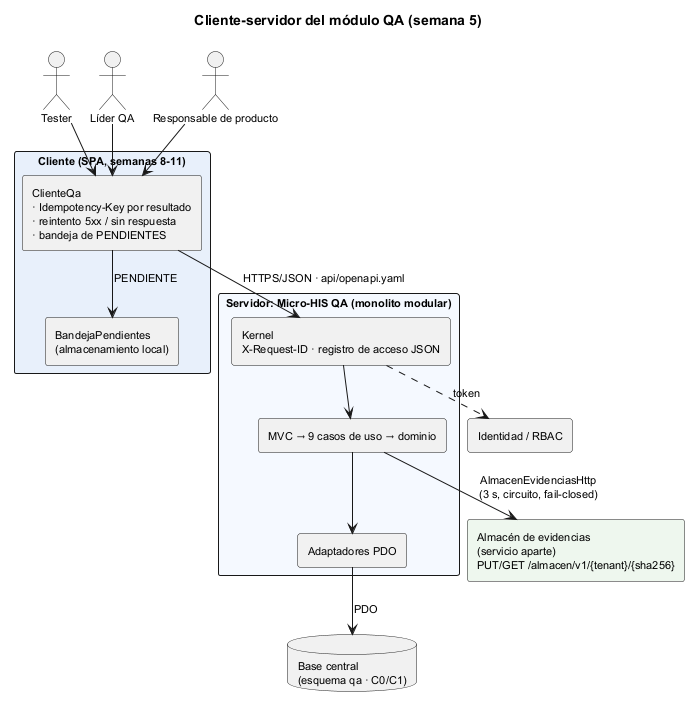
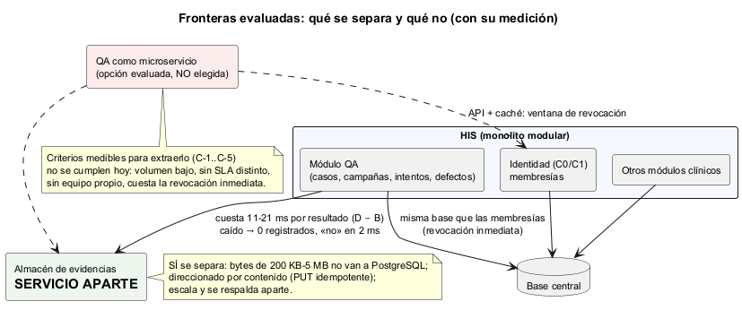
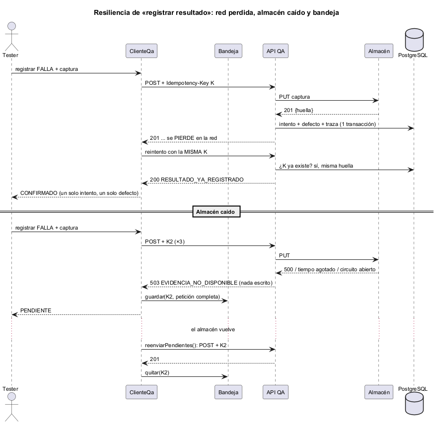
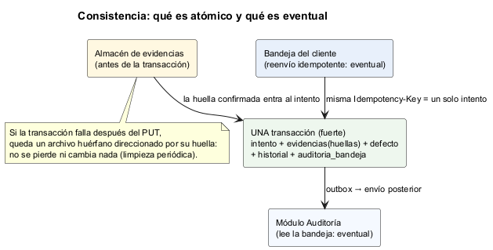
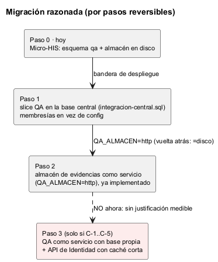
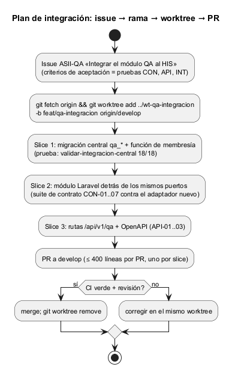

# Semana 5 — Cliente-servidor, contrato API y frontera de microservicio evaluada

| | |
|---|---|
| **Estudiante** | Boris Alexander Quiroa Orellana |
| **Módulo** | QA funcional, pruebas manuales y matriz de regresión (adaptación: gestión de campañas de regresión y defectos) |
| **Tarea** | Diseñar el módulo como cliente-servidor y evaluar una frontera de microservicio: contrato API, propiedad de datos, comunicación, seguridad, resiliencia, observabilidad y consistencia. Diagramas y migración razonada. No dividir el sistema sin una justificación medible |
| **Entregable** | Contrato API + plan de issue, rama, worktree y PR |
| **Código** | [micro-his-qa/](../micro-his-qa/README.md) · contrato: [api/openapi.yaml](../micro-his-qa/api/openapi.yaml) |

## Índice

1. [Decisión en una página](#1-decisión-en-una-página)
2. [Qué se construyó](#2-qué-se-construyó)
3. [Diseño cliente-servidor](#3-diseño-cliente-servidor)
4. [Contrato API](#4-contrato-api)
5. [Evaluación de la frontera](#5-evaluación-de-la-frontera)
6. [Propiedad de los datos](#6-propiedad-de-los-datos)
7. [Comunicación](#7-comunicación)
8. [Seguridad](#8-seguridad)
9. [Resiliencia](#9-resiliencia)
10. [Observabilidad](#10-observabilidad)
11. [Consistencia](#11-consistencia)
12. [Migración razonada](#12-migración-razonada)
13. [Plan de issue, rama, worktree y PR](#13-plan-de-issue-rama-worktree-y-pr)
14. [Evidencia](#14-evidencia)
15. [Limitaciones](#15-limitaciones)

---

## 1. Decisión en una página

Se evaluaron **dos** fronteras posibles, y la respuesta es distinta para cada una:

| Frontera | Decisión | Por qué, con números |
|---|---|---|
| **Almacén de evidencias** como servicio aparte | **Sí** (ya implementado: `QA_ALMACEN=http`) | Cuesta 11–21 ms por resultado (D − B). Saca de PostgreSQL bytes de 200 KB a 5 MB, y el PUT por huella es idempotente. Con el almacén caído, el fail-closed responde «no» en 2 ms y el cliente deja el resultado PENDIENTE |
| **El módulo QA** como microservicio | **No, por ahora** | No se cumple ninguno de los criterios C-1..C-5 (§5.3). Separarlo obliga a consultar las membresías por API con caché, y se pierde la revocación inmediata que justificó la base central en la semana 4 |

`QA_DB_DSN=… php bin/medir.php 100` registra resultados FALLA con defecto y una captura de 200 KB ([salida](evidencia/1-medicion-frontera.txt)):

| Escenario | p50 | p95 | Registrados |
|---|---|---|---|
| A · en proceso, memoria | 0,84 ms | 1,06 ms | 100/100 |
| B · en proceso, PostgreSQL + almacén en disco (hoy) | **7,8 ms** | 12,4 ms | 100/100 |
| C · por HTTP (`php -S`) + PostgreSQL, con `ClienteQa` | 118 ms | 230 ms | 100/100 |
| D · en proceso + PostgreSQL, **almacén remoto** por HTTP | 18,9 ms | 37,4 ms | 100/100 |
| E · como D, con el **almacén caído** | 1,9 ms | 3,3 ms | **0/100** |
| F · como C, con una captura de **2 MB** | 253 ms | 390 ms | 20/20 |

**Cómo leer los números.**
- La latencia de C y F está inflada por `php -S`, que abre un proceso y una conexión por petición.
- Aun así, un tester registra un resultado cada varios minutos: 250 ms no son un problema para una persona.
- **La latencia no decide aquí.** Deciden el volumen (bajo), la disponibilidad (QA no está en el camino clínico) y la coherencia de los permisos.

**Lo que distingue a QA de Prescripciones.**
- En Prescripciones, una dependencia remota en el camino crítico bloquea la atención (fail-closed).
- En QA, la dependencia remota (el almacén) también es fail-closed. Pero un resultado no registrado **puede esperar**: ya ocurrió, y la bandeja del cliente lo reenvía con su clave.
- Por eso aquí sí conviene separar el almacén.

## 2. Qué se construyó

| Pieza | Dónde | Para qué |
|---|---|---|
| Contrato OpenAPI 3.1: 9 operaciones, `x-permiso`, enum de 41 códigos de error | `api/openapi.yaml` | Fuente de verdad de la API; lint de Redocly sin errores ni advertencias ([evidencia](evidencia/2-lint-openapi.txt)) |
| Conformidad API-01..03 | `tests/Api/ContratoApiPrueba.php` | Contrato = código: operaciones, permisos, y los estados y códigos de 33 escenarios reales (29 códigos distintos) |
| Cliente `ClienteQa` + `BandejaPendientes` | `src/Cliente/` | Reintento con la misma `Idempotency-Key`; resultados CONFIRMADO / RECHAZADO / **PENDIENTE** / INCIERTO |
| Almacén remoto | `src/Persistencia/Http/AlmacenEvidenciasHttp` + `CircuitoInterruptor` | La frontera elegida: 3 s de límite, huella verificada en la ida y en la vuelta, circuito |
| Almacén simulado | `bin/almacen-simulado.php` | Un `php -S` que responde, tarda, falla o confirma mal a pedido. **No** es infraestructura de producción |
| Observabilidad | `Kernel` + `Observabilidad/RegistroAccesoJson` | `X-Request-ID` en toda respuesta; una línea JSON por petición con el código de la salida, sin datos |
| Medición | `bin/medir.php` | La justificación medible (§1) |
| Plan | [`plan/issue-integracion-qa.md`](plan/issue-integracion-qa.md), [`plan/rama-worktree-pr-qa.md`](plan/rama-worktree-pr-qa.md) | Issue, rama, worktree y PR |

## 3. Diseño cliente-servidor

| Rol | Quién | Qué hace |
|---|---|---|
| **Cliente de registro** | La SPA del Tester con `ClienteQa` | Registra resultados con evidencia; si no se confirman, los guarda en su bandeja y los reenvía |
| **Cliente de gestión** | Líder QA y Desarrollador | Planifica, inicia, clasifica, corrige y cierra: operaciones de un solo intento |
| **Cliente de lectura** | Responsable de producto | Consulta la trazabilidad (GET, reintentable) |
| **Servidor** | Micro-HIS: Kernel → MVC → casos de uso → adaptadores | Único que decide. El cliente no valida reglas: solo arma la petición |

El cliente se programa **contra el contrato**. ARQ-10 impide que `src/Cliente` importe cualquier capa del servidor, y que alguna capa importe el cliente.

## 4. Contrato API

[`api/openapi.yaml`](../micro-his-qa/api/openapi.yaml), OpenAPI 3.1, versión 1.0.0:

| Método y ruta | operationId | `x-permiso` | Éxito |
|---|---|---|---|
| `POST /api/v1/qa/casos` | `disenarCaso` | `qa.disenar` | 201 + Location |
| `POST /api/v1/qa/casos/{casoId}/aprobacion` | `aprobarCaso` | `qa.aprobar` | 200 |
| `POST /api/v1/qa/campanas` | `planificarCampana` | `qa.planificar` | 201 + Location |
| `POST /api/v1/qa/campanas/{campanaId}/inicio` | `iniciarCampana` | `qa.planificar` | 200 |
| `POST /api/v1/qa/campanas/{campanaId}/resultados` + `Idempotency-Key` | `registrarResultado` | `qa.ejecutar` | 201, o 200 en una repetición |
| `POST /api/v1/qa/campanas/{campanaId}/cierre` | `cerrarCampana` | `qa.cerrar` | 200 con GO / NO_GO |
| `GET /api/v1/qa/campanas/{campanaId}/trazabilidad` | `consultarTrazabilidad` | `qa.consultar` | 200 |
| `POST /api/v1/qa/defectos/{defectoId}/clasificacion` | `clasificarDefecto` | `qa.clasificar` | 200 |
| `POST /api/v1/qa/defectos/{defectoId}/correccion` | `marcarCorregido` | `qa.corregir` | 200 |

**Decisiones del contrato:**

| Decisión | Por qué |
|---|---|
| **Las transiciones son sub-recursos con POST** (`/aprobacion`, `/inicio`, `/cierre`, `/clasificacion`, `/correccion`) y no `PATCH estado` | Cada transición tiene su permiso, sus reglas y su traza. Un `PATCH {estado: CERRADA}` mezclaría «quién puede» con «qué cambia» |
| **Sin `PUT`, `PATCH` ni `DELETE`** | Un resultado no se cambia ni se borra (R-11): se corrige con otro intento. Se ve en el contrato |
| **`Idempotency-Key` solo en `registrarResultado`** | Es la única operación que el cliente reintenta y reenvía. Las demás son transiciones de estado: repetirlas a ciegas daría 409 o duplicaría |
| **Evidencias en base64 dentro del JSON** | Una sola petición atómica (resultado + evidencia + defecto). Su costo está medido (F − C ≈ 134 ms por 2 MB). Si el volumen creciera, el paso siguiente es subir la evidencia directo al almacén y mandar solo la huella (§12) |
| **Dos 503 distintos** | `EVIDENCIA_NO_DISPONIBLE`: no se registró nada. `ERROR_PERSISTENCIA`: reintentar con la misma clave. El cliente trata los dos como PENDIENTE: reenviar es seguro en ambos |
| **Un `enum` de 41 códigos de error y `detalle` con nombres de campos** | Los clientes programan contra códigos, no contra textos. El detalle nunca trae el valor recibido |
| **`x-permiso` por operación** | El permiso es parte del contrato. API-01 verifica que sea la constante `PERMISO` de cada caso de uso |

**Conformidad (no solo documentación):**

| Prueba | Verifica | Mutación que la rompe |
|---|---|---|
| API-01 | Las 9 operaciones del contrato son las 9 rutas del código, y cada `x-permiso` es `<CasoDeUso>::PERMISO` | M23 (otro permiso en el YAML) |
| API-02 | Cada operación documenta un 2xx y 400, 401, 403, 500 y 503 | — |
| API-03 | En 33 escenarios reales, cada estado está documentado en **su** operación, cada código está en el enum y toda respuesta trae `X-Request-ID` | M24 (quitar el 413 de `registrarResultado`) |

## 5. Evaluación de la frontera

### 5.1 ¿Es QA un buen candidato a microservicio?

| A favor de separar | En contra |
|---|---|
| Sus datos (`qa_*`) solo los escribe él; no lee datos clínicos | Lee **en cada operación** la membresía del usuario (Identidad, C1). En la misma base, una revocación vale para el siguiente INSERT; por API con caché, hay una ventana |
| **No está en el camino clínico**: si QA cae, nadie deja de atender | Volumen bajo: una campaña son decenas o cientos de resultados por build, con pocos builds por semana |
| Una herramienta de QA no debería caerse con el build que está probando | Ese riesgo se mitiga sin separar: QA corre sobre la última versión **liberada** del HIS, no sobre el build bajo prueba |
| Contrato y cliente ya definidos | Sin SLA distinto, sin equipo propio, sin ritmo de despliegue distinto |

### 5.2 Medición: qué cuesta cada frontera

| Costo (p50) | Valor | Lectura |
|---|---|---|
| La base (B − A) | 7,0 ms | Lo que hoy cuesta un resultado completo con PostgreSQL |
| La API por HTTP (C − B) | 110 ms | Inflado por `php -S`; irrelevante para una persona |
| **El almacén remoto (D − B)** | **11 ms** | El precio de la frontera elegida |
| 2 MB por la API (F − C) | 134 ms | Lo que motivaría subir la evidencia directo al almacén |
| Almacén caído (E) | 0 de 100 registrados; el «no» llega en < 2 ms gracias al circuito | Fail-closed correcto; el cliente lo deja PENDIENTE |

### 5.3 Criterios medibles para extraer el módulo QA

| ID | Criterio | Cómo se mide | Hoy |
|---|---|---|---|
| C-1 | Más de 5 resultados/s sostenidos durante una campaña | Conteo por minuto en `qa_intentos` | Decenas por hora |
| C-2 | p95 de `registrarResultado` > 500 ms en producción | Registro de acceso (`duracion_ms`) | B: 12 ms |
| C-3 | QA no disponible por despliegues del HIS más de 1 vez al mes | Registro de acceso: 5xx durante despliegues | Sin datos: se empieza a medir con OBS |
| C-4 | Un segundo consumidor de campañas (p. ej. CI automático) con su propio ritmo | Pedido formal | No |
| C-5 | Identidad ofrece revocación por evento (push) en menos de 5 s | Contrato de Identidad | No (solo base compartida) |

Mientras ninguno se cumpla, separar QA solo agrega red, despliegues y una ventana de revocación.

## 6. Propiedad de los datos

| Dato | Dueño | Acceso de QA |
|---|---|---|
| `qa_casos`, `qa_campanas`, `qa_intentos`, defectos, historial | **QA** | Lectura y escritura (solo agregar en intentos e historial) |
| Contenido de las evidencias | **Almacén de evidencias** | PUT y GET por huella; QA guarda solo huella, tamaño y clasificación |
| `hospitals`, `central_users`, `hospital_memberships` | Identidad (C0, C1) | Solo a través de la vista `qa_usuarios` y la función `qa_miembro_activo()` (semana 4) |
| `auditoria_bandeja` | QA escribe; **Auditoría** consume | Outbox |
| Requisitos RF-xx | El documento de requisitos de cada módulo (`openspec`) | Referencia por código; no hay FK |

## 7. Comunicación

| Entre | Estilo | Por qué |
|---|---|---|
| SPA → API QA | HTTP/JSON síncrono | El tester necesita la respuesta (CONFIRMADO o RECHAZADO con el motivo) |
| API QA → almacén | HTTP síncrono, **antes** de la transacción | Sin evidencia confirmada no hay FALLA (R-05) |
| API QA → Auditoría | **Asíncrono**, outbox en la misma transacción | Auditoría caída no debe impedir registrar; la traza no puede perderse |
| API QA → Identidad | Misma base (función) | Revocación inmediata (§5.1) |
| Cliente → API, sin respuesta | Reenvío diferido desde la bandeja | El resultado ya ocurrió; la clave hace seguro el reenvío |

## 8. Seguridad

| Amenaza | Control | Verificado por |
|---|---|---|
| Suplantar el tenant | El tenant sale del token; `X-Tenant-ID` debe coincidir (403) | HTTP-02 |
| Ver datos de otro hospital | 404 igual que un inexistente; FK compuestas con el tenant | APP-09, INT-07 |
| Escalar privilegios desde QA | El rol del módulo no lee `central_users` ni modifica membresías | Validador de la semana 4 |
| Filtrar datos clínicos de una evidencia | La trazabilidad da solo huellas; el registro de acceso no guarda el cuerpo | APP-02, OBS-02, M29 |
| Una evidencia alterada en el almacén | Se verifica la huella al confirmar y al leer | AHT-02, AHT-04, M27 |
| Inyección de cabeceras con `X-Request-ID` | Solo `[A-Za-z0-9-]{8,64}`; si no, uno generado | OBS-01 |
| Secretos en errores | `ErrorPersistencia` sin DSN ni contraseña; 500 sin detalles | PER-01, PER-04, HTTP-06 |

## 9. Resiliencia

| Falla | Qué pasa | Prueba |
|---|---|---|
| La red cae antes del servidor | El cliente reintenta (×3, espera 200/400 ms) con la misma clave | CLI-01 |
| La respuesta se pierde después de registrar | El reintento recibe 200 RESULTADO_YA_REGISTRADO; un intento y un defecto | CLI-02 |
| Sin respuesta en todos los intentos | PENDIENTE en la bandeja; el reenvío lo resuelve sin duplicar | CLI-03 |
| Almacén caído | 503, nada escrito; PENDIENTE; cuando vuelve, se registra una vez | CLI-05, APP-11 |
| Almacén lento | Se corta a los 3 s (≈ 3 s medido con un servidor real) | AHT-04 |
| Almacén caído de forma sostenida | Circuito: tras 3 fallas no se llama durante 30 s; luego un intento | AHT-03, M28 |
| El pendiente llega después del cierre | 409 CAMPANA_NO_ADMITE_RESULTADOS; sale de la bandeja y el tester se entera | CLI-06 |
| Una operación sin clave pierde la respuesta | INCIERTO, sin reintento; consultar la trazabilidad lo resuelve | CLI-07 |
| Un 4xx | No se reintenta ni se encola | CLI-04, M25 |

## 10. Observabilidad

- **`X-Request-ID`** en toda respuesta. El cliente manda el suyo y lo repite en cada reintento (CLI-01), así que un reintento se puede seguir de punta a punta.
- **Una línea JSON por petición** (`RegistroAccesoJson`, en stderr) con `request_id`, `metodo`, `ruta`, `estado`, `codigo`, `duracion_ms`, `usuario` y `tenant`. Nunca lleva token, cuerpo ni evidencias (OBS-02).
  - Con `codigo` se cuentan, por ejemplo, los `EVIDENCIA_NO_DISPONIBLE` por hora.
  - Con `duracion_ms`, el p95 del criterio C-2.
- **Si el registro falla, la respuesta no cambia** (OBS-03).

## 11. Consistencia

| Qué | Garantía |
|---|---|
| Intento + huellas + defecto + historial + traza | **Atómico** (una transacción; INT-06) |
| Evidencia en el almacén frente al intento | El almacén va **antes**: puede quedar un archivo huérfano, nunca un intento sin evidencia |
| Traza en Auditoría | **Eventual** (outbox) |
| Resultado del tester frente al servidor | **Eventual y exactamente una vez**: bandeja + `Idempotency-Key` + `UNIQUE (tenant, clave)` |
| Doble cierre concurrente | Uno solo escribe (`UPDATE … WHERE estado = <anterior>`; INT-08) |

## 12. Migración razonada

| Paso | Qué | Reversible con |
|---|---|---|
| 0 | Hoy: Micro-HIS con el esquema `qa` y el almacén en disco | — |
| 1 | Slice QA en la base central (`integracion-central.sql`, semana 4) | El rollback de la migración |
| 2 | Almacén como servicio (`QA_ALMACEN=http`), **ya implementado y medido** | `QA_ALMACEN=disco` |
| 2b | Si F (2 MB) llegara a ser un problema: la SPA sube la evidencia directo al almacén (PUT por huella) y manda solo la huella | La API sigue aceptando base64 |
| 3 | QA como servicio con base propia: **solo si se cumple algún C-1..C-5** | — |

## 13. Plan de issue, rama, worktree y PR

- [Issue propuesto](plan/issue-integracion-qa.md): 5 slices, cada uno con su criterio de aceptación verificable con una prueba existente:
  - el validador de la semana 4;
  - la suite de contrato;
  - API-01..03;
  - AHT.
- [Rama, worktree y PR](plan/rama-worktree-pr-qa.md):
  - un worktree por slice, desde `origin/develop`;
  - las dependencias entre slices;
  - PR de 400 líneas como máximo con la plantilla ASII;
  - limpieza del worktree después del merge.

## 14. Evidencia

| Evidencia | Resultado |
|---|---|
| [1-medicion-frontera.txt](evidencia/1-medicion-frontera.txt) | Los 6 escenarios de §1 |
| [2-lint-openapi.txt](evidencia/2-lint-openapi.txt) | Redocly 1.34.3: válido, sin advertencias |
| [3-pruebas-sin-base.txt](evidencia/3-pruebas-sin-base.txt) | 94 pruebas: 77 pasan, 17 omitidas (PDO e integración) |
| [4-pruebas-postgres.txt](evidencia/4-pruebas-postgres.txt) | 94/94 |
| [5-mutaciones.txt](evidencia/5-mutaciones.txt) | 29/29. Nuevas: M23–M24 (contrato), M25–M26 (cliente), M27–M28 (almacén y circuito), M29 (observabilidad) |
| [capturas/](evidencia/capturas/) | Las salidas como imagen |

## 15. Limitaciones

- **El almacén simulado no es un almacén de objetos real.** El adaptador habla un protocolo mínimo (PUT/GET por huella); un S3 o MinIO necesitaría su propio adaptador detrás del mismo puerto.
- **La bandeja del cliente vive en memoria.** En la SPA sería el almacenamiento local del navegador, cifrado si la evidencia es `DATOS_CLINICOS` (semana 8).
- **El criterio C-3 todavía no tiene datos.** La observabilidad de esta semana es la que permitirá medirlo.
