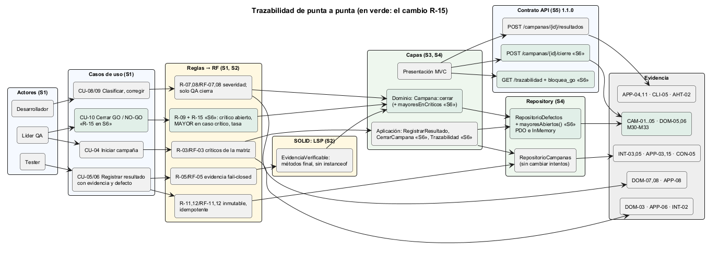
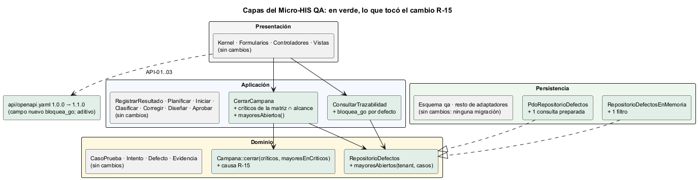

# Semana 6 — Primera evaluación parcial: defensa de la arquitectura

| | |
|---|---|
| **Estudiante** | Boris Alexander Quiroa Orellana |
| **Módulo** | QA funcional, pruebas manuales y matriz de regresión (adaptación: gestión de campañas de regresión y defectos) |
| **Tarea** | Defender la arquitectura conectando actores, UML, RF/RNF, el principio SOLID, las capas, el Repository y el contrato API, y responder un cambio práctico sobre campañas, matriz, defectos, severidad, evidencia y trazabilidad |
| **Entregable** | 6–8 diapositivas, un diagrama trazable, una matriz decisión→evidencia y el registro del cambio práctico |

## Entregables

| Entregable | Archivo |
|---|---|
| Presentación (8 diapositivas, con notas del orador) | [semana-06-defensa-qa-regresion.pptx](presentacion/semana-06-defensa-qa-regresion.pptx) · [PDF](presentacion/semana-06-defensa-qa-regresion.pdf) |
| Diagrama trazable | [semana-06-trazabilidad.png](diagramas/semana-06-trazabilidad.png) ([fuente](diagramas/semana-06-trazabilidad.puml)) |
| Matriz decisión → evidencia (23 decisiones) | [matriz-decision-evidencia.md](matriz-decision-evidencia.md) |
| Registro del cambio práctico (R-15) | [registro-cambio-practico.md](registro-cambio-practico.md) |
| Capas con lo que tocó el cambio | [semana-06-capas.png](diagramas/semana-06-capas.png) |

## 1. La arquitectura en una página

| Pieza | Semana | Qué decide | Cómo se verifica |
|---|---|---|---|
| **Actores y UML** | 1 | 5 roles; 14 casos de uso; sin «editar resultado», «borrar evidencia» ni «el desarrollador cierra su defecto» | DOM-08, INT-03 |
| **RF/RNF y SOLID (LSP)** | 2 | 14 RF y 8 RNF; contrato `EvidenciaVerificable` con métodos `final` | DOM-09, ARQ-07; 4 → 0 violaciones |
| **Capas** | 3 | Presentación → Aplicación → Dominio ← Persistencia; PDO con sentencias preparadas; reglas críticas también en la base | ARQ-01..06, PER-05, INT-03/04 |
| **MVC y Repository** | 4 | Formularios (forma), controladores (sin SQL ni reglas), vistas (HTTP); puertos en el Dominio con adaptadores PDO e InMemory | ARQ-08/09, MVC-01..05, CON-01..07 × 2 |
| **Repositorio compartido** | 4 | La base central; acceso por membresía activa | Validador sobre C0 y C1: 18/18 |
| **Contrato API y frontera** | 5 | OpenAPI de 9 operaciones; se separa el almacén de evidencias, no el módulo | API-01..03, AHT-01..04, `bin/medir.php` |
| **Cambio práctico** | 6 | R-15: un MAYOR abierto en un caso crítico bloquea el GO | CAM-01..05; M30–M33 |



## 2. El cambio práctico defendido

**Pedido:** la versión 1.4.0 salió con GO aunque había un defecto **MAYOR** abierto sobre **TC-107**, un caso crítico para el expediente. Pasó porque otro tester re-ejecutó el caso sin indicar que verificaba el defecto: el último intento fue PASA y no había críticos abiertos.

**Respuesta (R-15):** tampoco hay GO si existe un defecto MAYOR **no CERRADO** sobre un caso que la matriz marca **crítico** para las funcionalidades de la campaña. La trazabilidad lo marca **antes** de cerrar con `bloquea_go`.

| Tema | Efecto |
|---|---|
| Campañas | `Campana::cerrar(críticos, mayoresEnCriticos)` y una causa nueva en la decisión |
| Matriz | Se usa `criticosDe()` ∩ alcance. El mismo caso puede ser crítico para una funcionalidad y no para otra |
| Defectos | Un método nuevo en el puerto, `mayoresAbiertos()`, en los dos adaptadores |
| Severidad | Cuenta la **clasificada**; un CORREGIDO sin verificar sigue contando |
| Evidencia | Sin cambios: el MAYOR nace de una FALLA, que ya exige evidencia |
| Trazabilidad | `bloquea_go` por defecto; OpenAPI 1.0.0 → 1.1.0 (aditivo) |

**Proceso.**
1. Primero las pruebas, en rojo: **5 de 5** fallaban.
2. Después la implementación, en verde: 5 de 5, y **99 de 99** en total con PostgreSQL.
3. La primera corrida de mutaciones dejó viva **M32**, que era un hueco real. Que un MAYOR CORREGIDO siga bloqueando solo se probaba en memoria, y una consulta SQL que lo excluyera habría pasado. Se agregó ese caso a la prueba que corre con PostgreSQL. Resultado: **33 de 33**.

El detalle completo está en el [registro](registro-cambio-practico.md).



## 3. Estado verificable

| | Valor | Evidencia |
|---|---|---|
| Pruebas | 99/99 con PostgreSQL 18 | [cambio-3-suite-completa.txt](evidencia/cambio-3-suite-completa.txt) |
| Pruebas del cambio | 0/5 antes → 5/5 después | [cambio-1-antes-rojo.txt](evidencia/cambio-1-antes-rojo.txt), [cambio-2-despues-verde.txt](evidencia/cambio-2-despues-verde.txt) |
| Mutaciones | 33/33 (primera corrida: 31/33) | [mutaciones.txt](evidencia/mutaciones.txt), [mutaciones-1-m32-sobrevive.txt](evidencia/mutaciones-1-m32-sobrevive.txt) |
| Contrato | OpenAPI 1.1.0 válido | [lint-openapi.txt](evidencia/lint-openapi.txt) |
| Demostración | NO_GO por R-15 → corrección → verificación → GO | [demo-r15.txt](evidencia/demo-r15.txt) |

## 4. Cómo verificarlo en vivo

```bash
cd docs/modulos/qa-regresion-defectos/micro-his-qa
php tests/ejecutar.php --solo=CAM
QA_DB_DSN="pgsql:host=127.0.0.1;port=55432;dbname=micro_his_qa" php tests/ejecutar.php
QA_DB_DSN=... php tests/mutaciones.php
php bin/demo-r15.php
npx @redocly/cli@1.34.3 lint api/openapi.yaml
```
