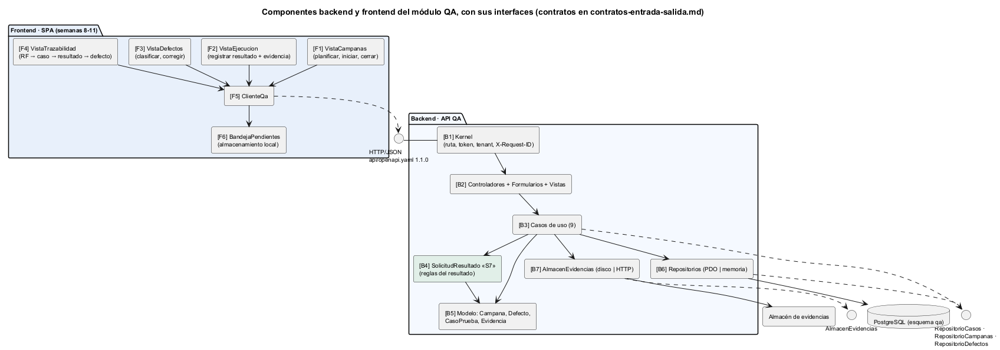
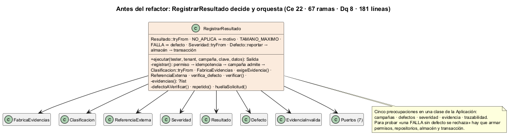
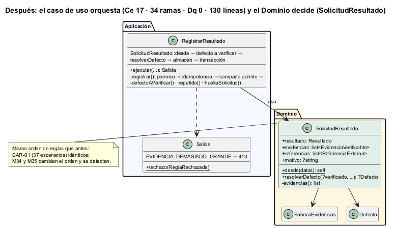

# Semana 7 — Componentes backend y frontend, y refactor del punto más acoplado

| | |
|---|---|
| **Estudiante** | Boris Alexander Quiroa Orellana |
| **Módulo** | QA funcional, pruebas manuales y matriz de regresión (adaptación: gestión de campañas de regresión y defectos) |
| **Tarea** | Identificar los componentes backend y frontend, y refactorizar conceptualmente el punto más acoplado sin ampliar el módulo |
| **Entregable** | Diagrama de componentes, contratos de entrada/salida y un refactor antes/después concreto, con justificación |

## 1. Componentes



| Lado | Componentes |
|---|---|
| **Frontend** | 4 vistas (F1–F4), que se construyen en las semanas 8–11; el cliente (F5) y la bandeja (F6), que ya existen desde la semana 5 |
| **Backend** | Kernel (B1), MVC (B2), casos de uso (B3), **SolicitudResultado (B4, nuevo)**, modelo (B5), repositorios (B6) y almacén (B7) |

El contrato de cada componente (entrada, salida, lo que nunca hace y la prueba que lo fija) está en [contratos-entrada-salida.md](contratos-entrada-salida.md).

## 2. ¿Cuál es el punto más acoplado? Medido, no supuesto

`php bin/acoplamiento.php` mide por clase lo siguiente:
- acoplamiento eferente (Ce) y aferente (Ca);
- ramas;
- **decisiones de QA** (Dq): preguntar si un resultado exige evidencia, comparar con FALLA o NO_APLICA, el tamaño máximo, `tryFrom` sobre un enum de reglas;
- cuántas de las **seis preocupaciones** de la tarea mezcla (campañas, matriz, defectos, severidad, evidencia, trazabilidad);
- líneas.

[Antes](evidencia/acoplamiento-1-antes.txt):

| Clase | Capa | Ce | Ramas | Dq | Líneas | Preocupaciones |
|---|---|---|---|---|---|---|
| **RegistrarResultado** | Aplicación | **22** | **67** | **8** | **181** | 5 |
| CerrarCampana | Aplicación | 9 | 4 | 0 | 56 | 5 |
| ConsultarTrazabilidad | Aplicación | 9 | 14 | 0 | 78 | 5 |

`RegistrarResultado` es el punto más acoplado por cualquier medida: casi el doble de dependencias que el siguiente, 5 veces más ramas, y es el único que toma decisiones de QA fuera del Dominio.

`CerrarCampana` y `ConsultarTrazabilidad` también mezclan 5 preocupaciones, pero solo **coordinan** (Dq = 0). Esa mezcla es la naturaleza de un cierre y de una trazabilidad, no acoplamiento accidental.

## 3. El refactor

| | Antes | Después |
|---|---|---|
| Diagrama |  |  |
| Código | [refactor/antes/RegistrarResultado.php](refactor/antes/RegistrarResultado.php) | [RegistrarResultado.php](../micro-his-qa/src/Aplicacion/CasosDeUso/RegistrarResultado.php) + [SolicitudResultado.php](../micro-his-qa/src/Dominio/Modelo/SolicitudResultado.php) |

**Qué se movió.** Las reglas del resultado pasaron del caso de uso a un objeto del Dominio, `SolicitudResultado`:
- R-10: NO_APLICA exige motivo;
- el tamaño máximo;
- la clasificación;
- la construcción de las evidencias con la fábrica (semana 2);
- R-05: FALLA o BLOQUEADO exige evidencia, y una referencia no cuenta;
- las referencias externas;
- R-06: una FALLA nueva exige un defecto, con su severidad;
- R-08: la verificación de un defecto CORREGIDO.

**Qué quedó en el caso de uso:** el **orden de los efectos**, que es lo que le corresponde. Permiso → idempotencia → la campaña admite el caso → reglas (Dominio) → buscar el defecto a verificar (puerto) → almacén → transacción.

**Por qué este corte y no otro:**

| Alternativa | Por qué no |
|---|---|
| Meter las reglas en `Campana` | `Campana` no conoce evidencias ni defectos nuevos. Le agregaría dos preocupaciones y la haría el nuevo punto acoplado |
| Un «servicio de dominio» con dependencias inyectadas | Las reglas no necesitan ningún puerto. Un objeto de valor inmutable se prueba sin dobles |
| Separar en varias clases (ValidadorEvidencias, ValidadorDefecto…) | Agrega clases y archivos, y el orden entre ellas importa (§4). La tarea pide no ampliar el módulo |

## 4. El comportamiento no cambió (demostrado)

El riesgo de mover reglas es **cambiar su orden**. Por ejemplo, si el tamaño se revisa después de construir la evidencia, un archivo grande e inválido pasa de 413 a 422.

1. **Caracterización.** Antes de tocar el código, `bin/caracterizar.php` grabó **37 escenarios** (`tests/Caracterizacion/esperado.json`): salida, intentos, defectos, archivos en el almacén y trazas. Incluye los casos de orden fino, como «grande después de una inválida», «verifica de otro caso» y «traza que falla, que deja un archivo huérfano». CAR-01 los compara después del refactor: **idénticos**.
2. **Mutaciones que cambian el orden.** M34 (el tamaño después de construir) y M35 (buscar el defecto a verificar después de las reglas del defecto nuevo) se **detectan**. CAR-01 no pasa por casualidad.
3. **Demos.** `demo-r15.php` y `demo.php` dan **exactamente** la misma salida que en las semanas 6 y 4 ([demos-sin-cambios.txt](evidencia/demos-sin-cambios.txt)).
4. **Suite completa:** 99 → **100 de 100** con PostgreSQL (se suma CAR-01). **35/35** mutaciones; las cinco que apuntaban al código movido (M3–M6, M11) se reubicaron con la misma semántica.

## 5. Resultado medido

[Después](evidencia/acoplamiento-2-despues.txt):

| Métrica | Antes | Después | Cambio |
|---|---|---|---|
| `RegistrarResultado` · Ce | 22 | 17 | −23 % |
| `RegistrarResultado` · ramas | 67 | 34 | −49 % |
| `RegistrarResultado` · decisiones de QA | 8 | **0** | — |
| `RegistrarResultado` · líneas | 181 | 130 | −28 % |
| `RegistrarResultado` · preocupaciones | 5 | 4 | severidad pasó al Dominio |
| Decisiones de QA en Aplicación y Presentación (todo el módulo) | 9 | 1 | La que queda es `Severidad::tryFrom` en `ClasificarDefecto` |
| **Líneas de `src/`** | 3310 | 3347 | **+37 (+1,1 %)**: la clase nueva y su comentario |
| Ce total | 282 | 286 | +4 (la clase nueva usa 9; el caso de uso dejó 5) |

**¿Se amplió el módulo?** No en funcionalidad: no hay operación, regla, tabla ni ruta nueva. En tamaño, +1,1 %: el costo de dar nombre a un concepto que antes estaba disuelto en un método privado. Lo que sí bajó es lo que la tarea busca: el acoplamiento **del punto caliente**.

## 6. Evidencia

| Archivo | Qué muestra |
|---|---|
| [acoplamiento-1-antes.txt](evidencia/acoplamiento-1-antes.txt) / [acoplamiento-2-despues.txt](evidencia/acoplamiento-2-despues.txt) | La medición |
| [pruebas-1-antes.txt](evidencia/pruebas-1-antes.txt) | 99/99 antes de tocar nada |
| [pruebas-2-despues.txt](evidencia/pruebas-2-despues.txt) · [pruebas-3-postgres.txt](evidencia/pruebas-3-postgres.txt) | 83 + 17 omitidas sin base · 100/100 con PostgreSQL |
| [mutaciones.txt](evidencia/mutaciones.txt) | 35/35, incluidas M34 y M35 |
| [demos-sin-cambios.txt](evidencia/demos-sin-cambios.txt) | Las dos demos, idénticas |

```bash
cd docs/modulos/qa-regresion-defectos/micro-his-qa
php bin/acoplamiento.php
php tests/ejecutar.php --solo=CAR
```
