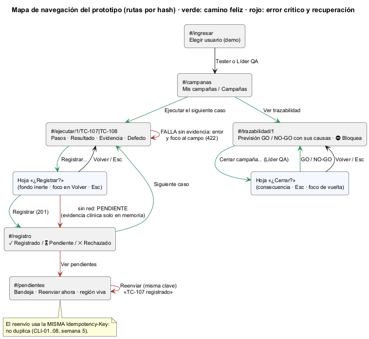

# Semana 11 — Prototipo navegable de escritorio y móvil

| | |
|---|---|
| **Estudiante** | Boris Alexander Quiroa Orellana |
| **Módulo** | QA funcional, pruebas manuales y matriz de regresión (adaptación: gestión de campañas de regresión y defectos) |
| **Tarea** | Construir un prototipo navegable de escritorio y móvil con el camino feliz y un error crítico |
| **Entregable** | Mapa de navegación y capturas de escritorio y móvil |

## Entregables

| Pedido | Dónde |
|---|---|
| Prototipo navegable | [prototipo/index.html](prototipo/index.html): se abre en el navegador, sin servidor. La API es [api-simulada.js](prototipo/api-simulada.js), con los mismos estados y códigos del contrato 1.1.0 |
| Mapa de navegación | [semana-11-mapa-navegacion.png](diagramas/semana-11-mapa-navegacion.png) |
| Capturas de escritorio y móvil | [capturas/escritorio/](capturas/escritorio/) (1280 px) y [capturas/movil/](capturas/movil/) (360 px): **19 pasos cada una**, tomadas por el recorrido automático |



## 1. Qué se puede recorrer

| Ruta | Pantalla | Quién |
|---|---|---|
| `#/ingresar` | Elegir usuario (demostración) | — |
| `#/campanas` | Campañas: avance y [Ejecutar el siguiente caso] / [Ver trazabilidad] | Tester, Líder QA |
| `#/ejecutar/1/TC-107` | Pasos, resultado, evidencia (foto), clasificación clínica, defecto | Tester |
| `#/registro` | Registrado / pendiente / rechazado | Tester |
| `#/pendientes` | Bandeja y [Reenviar ahora] | Tester |
| `#/trazabilidad/1` | Previsión de GO/NO-GO con sus causas, casos y defectos con ⛔ Bloquea, [Cerrar campaña…] | Líder QA (cierra), Tester (lee) |

## 2. Camino feliz (A) y error crítico (B)

| # | A · camino feliz | Escritorio | Móvil |
|---|---|---|---|
| A1–A2 | El tester entra y ve «Regresión H4 · 0 de 2 con resultado» | [a02](capturas/escritorio/a02-campanas-tester.png) | [a02](capturas/movil/a02-campanas-tester.png) |
| A3 | TC-107 con versión, build y «crítico» fijos arriba | [a03](capturas/escritorio/a03-ejecutar-tc107.png) | [a03](capturas/movil/a03-ejecutar-tc107.png) |
| A4 | Confirmación: el foco en [Volver]; Tab no sale del diálogo | [a04](capturas/escritorio/a04-confirmar.png) | [a04](capturas/movil/a04-confirmar.png) |
| A5–A7 | Registra TC-107 y TC-108 (Pasa) | [a05](capturas/escritorio/a05-registrado-tc107.png) | [a07](capturas/movil/a07-registrado-tc108.png) |
| A8 | El Líder QA: «Hoy daría Liberar (GO)» | [a08](capturas/escritorio/a08-trazabilidad-lider.png) | [a08](capturas/movil/a08-trazabilidad-lider.png) |
| A9–A10 | Cierra: «Cerrada: ✓ Liberar (GO)» | [a10](capturas/escritorio/a10-cerrada-go.png) | [a10](capturas/movil/a10-cerrada-go.png) |

**Error crítico elegido:** una **FALLA con evidencia clínica y sin red**. Es el caso donde se cruzan las tres reglas más delicadas del módulo: sin evidencia no hay FALLA (R-05), nada se registra dos veces (R-12) y la evidencia clínica no queda en un equipo compartido (B-01).

| # | B · error crítico y recuperación | Escritorio | Móvil |
|---|---|---|---|
| B1–B2 | FALLA sin foto → «Falta la evidencia», con el foco en el botón de adjuntar | [b02](capturas/escritorio/b02-falta-evidencia-422.png) | [b02](capturas/movil/b02-falta-evidencia-422.png) |
| B3 | Foto con datos clínicos, defecto; la confirmación lo resume | [b03](capturas/escritorio/b03-confirmar-clinica.png) | [b03](capturas/movil/b03-confirmar-clinica.png) |
| B4 | **Se cae la red:** 3 intentos con la misma clave → «Pendiente» y «No cierre esta pestaña». Se verifica que **no** hay nada en `localStorage` ni en `sessionStorage` | [b04](capturas/escritorio/b04-pendiente-sin-red.png) | [b04](capturas/movil/b04-pendiente-sin-red.png) |
| B5–B6 | Vuelve la red → [Reenviar ahora] → la región viva anuncia «TC-107 registrado» | [b06](capturas/escritorio/b06-reenviado.png) | [b06](capturas/movil/b06-reenviado.png) |
| B7 | El Líder QA: «Hoy daría No liberar (NO-GO) · 2 causas»: MAYOR en caso crítico (R-15) y tasa de 50 % | [b07](capturas/escritorio/b07-trazabilidad-bloquea.png) | [b07](capturas/movil/b07-trazabilidad-bloquea.png) |
| B8–B9 | Esc cierra el diálogo y devuelve el foco; luego «Cerrar con No liberar» → «Cerrada: ⛔ No liberar (NO-GO)» | [b09](capturas/escritorio/b09-cerrada-nogo.png) | [b09](capturas/movil/b09-cerrada-nogo.png) |

## 3. Verificación automática

[herramientas/recorrido.cjs](herramientas/recorrido.cjs) recorre A y B con clics y teclado en los dos anchos. En **cada paso**:
- comprueba los textos y el foco esperados;
- toma la captura;
- corre **axe-core** (WCAG 2.0, 2.1 y 2.2, A y AA).

En móvil además mide el desbordamiento y los objetivos de 44 px. Suma comprobaciones propias: fondo inerte, nada clínico en el almacenamiento, región viva, y Esc con retorno del foco.

**Resultado final:** **46/46 comprobaciones y 0 violaciones de axe-core** ([recorrido.txt](evidencia/recorrido.txt)).

### 3.1 Hallazgos de esta semana

| # | Hallazgo | Quién lo encontró | Corrección |
|---|---|---|---|
| H-1 | Con el diálogo de confirmación abierto, los radios del formulario quedaban **tapados pero activos**. axe-core marcó `target-size` (4 nodos, solo en escritorio). `aria-modal` no vuelve inerte el fondo, así que Tab también podía salir del diálogo | axe-core ([recorrido-1-primera.txt](evidencia/recorrido-1-primera.txt)) | Al abrir un diálogo, cabecera, contenido, navegación y aviso de red pasan a `inert`. Comprobación nueva: 4 Tab no salen del diálogo |
| H-2 | Los radios medían 22 px: cumplían 2.5.8 solo gracias a su etiqueta | La misma corrida | 24 px |
| H-3 | **La previsión decía «1 causa» y el cierre daba 2.** La previsión solo contaba defectos y no la tasa | **Revisión visual de las capturas.** El recorrido pasaba porque solo buscaba «Hoy daría No liberar» ([recorrido-2-pasaba-con-prevision-incompleta.txt](evidencia/recorrido-2-pasaba-con-prevision-incompleta.txt)) | Una sola función calcula las causas para la previsión y para el cierre. El recorrido ahora exige «2 causas» y las dos frases |

H-3 es el que más enseña: **una comprobación en verde solo dice que se cumple lo que se comprobó.** «Hoy daría No liberar» era cierto y estaba incompleto. La regla R-09/R-15 se escribió dos veces (previsión y cierre), y la segunda copia divergió. Es el mismo riesgo que la semana 6 evitó en el servidor calculando `bloquea_go` junto al cierre.

## 4. Backlog de la semana 9: estado final

| Ítem | Estado |
|---|---|
| B-01..B-11 | ✅ (semana 10). B-03, B-07 y B-08 se verifican de nuevo aquí, en una navegación real |
| B-12 todos los colores como tokens | ✅ **Cerrado**: 0 colores (de 3 o 6 dígitos) fuera de `:root` en [estilos.css](prototipo/estilos.css) |
| Medir con axe-core | ✅ 0 violaciones en 38 capturas |

## 5. Cómo verificarlo

```bash
# abrir prototipo/index.html en el navegador, o:
cd docs/modulos/qa-regresion-defectos/semana-11
node herramientas/recorrido.cjs "$PWD/capturas"      # 46/46, 0 violaciones (requiere puppeteer-core y axe-core)
```

## 6. Limitaciones

- **La API es simulada**, aunque con los códigos del contrato. La integración con el Micro-HIS por HTTP real ya está probada por el cliente PHP (semana 5).
- **La bandeja vive en memoria.** En el producto, los resultados **sin** evidencia clínica irían también al almacenamiento local para sobrevivir a un cierre.
- **El inicio de sesión es de demostración:** elegir usuario reemplaza al JWT del HIS.
- **No hubo prueba con usuarios ni con lectores de pantalla reales.**
