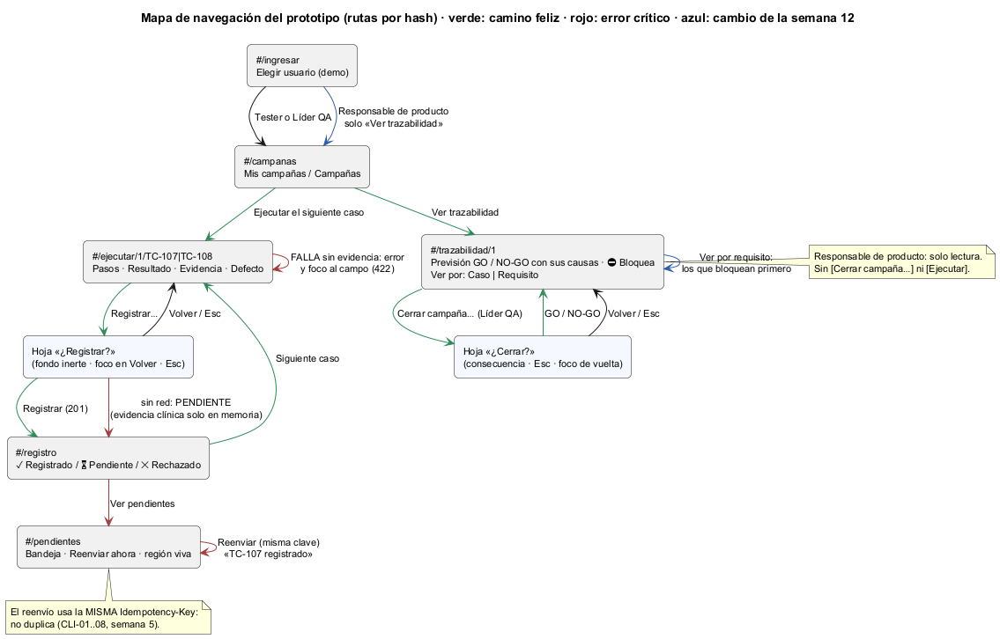

# Semana 12 — Segunda evaluación parcial

| | |
|---|---|
| **Estudiante** | Boris Alexander Quiroa Orellana |
| **Módulo** | QA funcional, pruebas manuales y matriz de regresión (adaptación: gestión de campañas de regresión y defectos) |
| **Tarea** | Defender las decisiones de componentes, UX, accesibilidad y movilidad, y demostrar con el prototipo cómo el flujo trata roles, estados, errores y riesgos |
| **Entregable** | Presentación breve, recorrido navegable, matriz decisión → RF/RNF → evidencia y respuesta documentada a un cambio solicitado |

## Entregables

| Pedido | Dónde |
|---|---|
| Presentación breve | [semana-12-evaluacion-qa-regresion.pptx](presentacion/semana-12-evaluacion-qa-regresion.pptx) ([PDF](presentacion/semana-12-evaluacion-qa-regresion.pdf)): 6 diapositivas con notas del orador, unos 10 minutos |
| Recorrido navegable | [prototipo/index.html](prototipo/index.html), con el guion de la sección 2. Lo repite el [recorrido automático](herramientas/recorrido.cjs): 3 flujos × 2 anchos, 44 capturas en [capturas/](capturas/) |
| Matriz decisión → RF/RNF → evidencia | [matriz-decision-requisito-evidencia.md](matriz-decision-requisito-evidencia.md): 17 decisiones (U-01..U-17) enlazadas con D-01..D-23 de la semana 6 |
| Cambio solicitado | [registro-cambio-solicitado.md](registro-cambio-solicitado.md): trazabilidad **por requisito** para el Responsable de producto, en solo lectura. Rojo → verde |
| Mapa de navegación | [semana-12-mapa-navegacion.png](diagramas/semana-12-mapa-navegacion.png); en azul, el cambio |



## 1. Decisiones que se defienden

| Área | Decisión | Por qué | Evidencia |
|---|---|---|---|
| **Componentes** | Las reglas del resultado viven en el Dominio (`SolicitudResultado`) y el caso de uso solo orquesta | Era el punto más acoplado (Ce 22, 67 ramas). Tras el refactor: Ce −23 % y 8 → 0 decisiones de QA fuera del Dominio | Semana 7: 37 escenarios de caracterización idénticos |
| **Componentes** | La interfaz no recalcula el GO: muestra `bloquea_go` y las causas que da el servidor | Cuando la regla se escribe dos veces, una copia diverge: la semana 11 lo vio en la previsión con una causa menos (H-3) | U-09 y U-16 |
| **UX** | Un resultado se **confirma** antes de registrar, porque no se puede editar | RF-12: los intentos son inmutables. Es más barato prevenir que corregir con un intento nuevo | U-01 |
| **UX** | Cada rol ve solo sus acciones; el de solo lectura **lo dice** | RF-14. Un botón oculto sin explicación parece un error | U-11, U-17 |
| **Accesibilidad** | Foco al campo que falta, fondo inerte, región viva y contraste AA | Evaluación de la semana 9 y axe-core en cada paso | U-03, U-12..U-15: 0 violaciones |
| **Movilidad** | 360 px primero, objetivos de 44 px, caso y build fijos arriba | El tester ejecuta junto al equipo, de pie y con el teléfono | U-07, U-13 |
| **Movilidad** | Sin red: PENDIENTE con la misma clave; la evidencia clínica no queda en el teléfono | RF-13 y RNF-04. Los equipos son compartidos | U-05, U-06 |

## 2. Recorrido navegable (guion de la demostración)

Se abre `prototipo/index.html` en 360 px (o en escritorio). Los pasos son los que repite el recorrido automático; cada uno tiene su captura.

| # | Acción | Qué se ve | Qué demuestra | Captura |
|---|---|---|---|---|
| 1 | Entrar como Tito · Tester | «Regresión H4 · 0 de 2 con resultado» | Rol y estado de la campaña | [a02](capturas/movil/a02-campanas-tester.png) |
| 2 | Ejecutar → Falla → Registrar, sin foto | «Falta la evidencia» con el foco en [📷 Tomar foto o adjuntar] | **Error** 422 recuperable (RF-05) | [b02](capturas/movil/b02-falta-evidencia-422.png) |
| 3 | Foto clínica y defecto MAYOR → Registrar… | Diálogo con el resumen y el fondo inerte | **Riesgo**: lo registrado no se edita | [b03](capturas/movil/b03-confirmar-clinica.png) |
| 4 | Cortar la red → Registrar | «⏳ Pendiente» y «No cierre esta pestaña» | **Estado** PENDIENTE; nada clínico en el teléfono | [b04](capturas/movil/b04-pendiente-sin-red.png) |
| 5 | Restablecer → Pendientes → Reenviar | «TC-107 registrado» anunciado | Misma clave, sin duplicar (RF-13) | [b06](capturas/movil/b06-reenviado.png) |
| 6 | Entrar como Líder QA → Trazabilidad | «Hoy daría No liberar · 2 causas», ⛔ Bloquea | **Riesgo** visible antes de cerrar (R-15) | [b07](capturas/movil/b07-trazabilidad-bloquea.png) |
| 7 | Cerrar campaña… → Esc → Cerrar con No liberar | La consecuencia; Esc devuelve el foco | **Estado** final irreversible | [b09](capturas/movil/b09-cerrada-nogo.png) |
| 8 | Entrar como Responsable de producto | «Solo lectura», sin [Cerrar…] | **Rol** de lectura (cambio) | [c01](capturas/movil/c01-producto-por-caso.png) |
| 9 | Ver por: Requisito | RF-07 primero: «⛔ 1 defecto bloquea» | Trazabilidad desde el requisito (RF-11) | [c02](capturas/movil/c02-por-requisito.png) |

El camino feliz completo (dos PASA y un cierre con GO) está en las capturas `a01..a10`.

## 3. Cómo el prototipo trata roles, estados, errores y riesgos

| Aspecto | Qué hace | Dónde se ve |
|---|---|---|
| **Roles** | Tester: ejecuta y reenvía. Líder QA: lee y cierra. Responsable de producto: solo lee, por caso o por requisito. La navegación y los botones dependen del rol; el servidor lo vuelve a comprobar (APP-09) | a02, a08, c01 |
| **Estados de la campaña** | En curso → cerrada con GO o NO-GO; una vez cerrada no se registra nada | a10, b09 |
| **Estados del resultado** | Registrado / pendiente / rechazado; el pendiente se reenvía con la misma clave | a05, b04, b06 |
| **Estados del caso** | Pasa, falla, bloqueado, no aplica, pendiente; ★ si es crítico en la matriz | a08, c01 |
| **Errores** | En el prototipo: 422 sin evidencia (foco al campo) y sin red (pendiente). La API simulada también responde 409 (campaña cerrada, clave reutilizada, casos pendientes), pero el recorrido no los cubre. 413 (evidencia grande) solo existe en el servidor (APP-10) y en el catálogo de mensajes | b02, b04; catálogo M-01..M-23 de la semana 8 |
| **Riesgos** | Defecto MAYOR en caso crítico (⛔ bloquea), tasa bajo el umbral, evidencia clínica en un equipo compartido, cierre irreversible | b07, b04, b08 |

## 4. Cambio solicitado (resumen)

El Responsable de producto pidió ver **qué requisito queda en riesgo** antes de liberar, sin poder cerrar nada. El detalle completo está en [registro-cambio-solicitado.md](registro-cambio-solicitado.md).
- **Prueba primero:** el flujo C del recorrido en rojo ([cambio-1-antes-rojo.txt](evidencia/cambio-1-antes-rojo.txt)).
- **Implementación:** rol de solo lectura y «Ver por: Caso | Requisito», con el foco conservado; los requisitos que bloquean van primero. `app.js` +33 −8, `api-simulada.js` +3 −1, `estilos.css` +5.
- **Verde:** 56/56 y 0 violaciones de axe-core ([cambio-2-despues-verde.txt](evidencia/cambio-2-despues-verde.txt)). Los flujos A y B siguen con sus 46 comprobaciones.
- **Sin cambios en el servidor ni en el contrato:** la trazabilidad ya devolvía `requisitos` y el permiso `qa.consultar` ya existía.

## 5. Hallazgos de esta semana

| # | Hallazgo | Quién lo encontró | Estado |
|---|---|---|---|
| H-1 | En 360 px el rol no se veía (la etiqueta de la barra está oculta). Para un rol sin botones, nada le explicaba por qué no podía cerrar | El recorrido (1 de 56) | ✅ La vista dice «Solo lectura · Responsable de producto» |
| H-2 | RF-11 se cumplía en el servidor pero no en la interfaz: nunca se mostró la trazabilidad desde el requisito | La matriz | ⚠️ A medias: falta mostrar los requisitos **sin** caso. Va a la semana 13 |
| H-3 | El mapa de la semana 11 decía «1. /ingresar»: PlantUML toma `#` al inicio como lista numerada | Revisión visual del mapa nuevo | ✅ Corregido en los dos mapas |
| H-4 | Cinco decisiones de accesibilidad no tienen un requisito que las pida | La matriz | Propuestos RNF-09 (WCAG 2.2 AA) y RNF-10 (móvil) |

Cada hallazgo lo encontró un instrumento distinto. Si esta semana solo hubiera corrido el recorrido, H-2, H-3 y H-4 seguirían ahí.

## 6. Cómo verificarlo

```bash
cd docs/modulos/qa-regresion-defectos/semana-12
# abrir prototipo/index.html en el navegador (sin servidor), o:
node herramientas/recorrido.cjs "$PWD/capturas"     # 56/56, 0 violaciones (requiere puppeteer-core y axe-core)
```

## 7. Limitaciones

- **La API sigue siendo simulada**, aunque con los códigos y la forma del contrato 1.1.0.
- **El Responsable de producto entra desde la pantalla de demostración**, no con el JWT del HIS. Que no pueda cerrar lo garantiza el servidor (APP-09), no el botón oculto.
- **No hubo prueba con usuarios.** Que «⛔ 1 defecto bloquea» le baste al Responsable de producto es una hipótesis.
- **Los requisitos sin caso** (H-2) no se pueden mostrar con los datos actuales.
