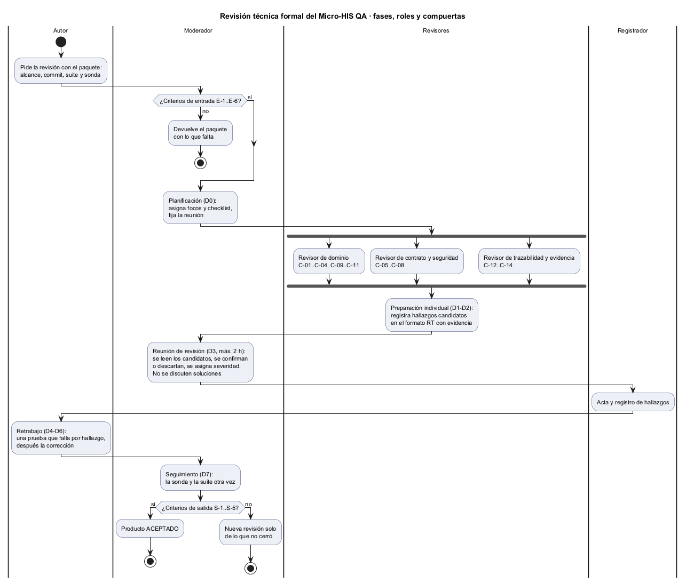

# Semana 13 — Revisión técnica formal

| | |
|---|---|
| **Estudiante** | Boris Alexander Quiroa Orellana |
| **Módulo** | QA funcional, pruebas manuales y matriz de regresión (adaptación: gestión de campañas de regresión y defectos) |
| **Tarea** | Preparar una revisión técnica formal enfocada en reglas de dominio, contrato API, permisos y tenant, integridad de campañas, matriz, defectos, severidad, evidencia, trazabilidad y dependencias |
| **Entregable** | Plan de revisión, checklist de 12–15 ítems, roles de autor, moderador y revisores, criterios de entrada y salida, y formato de hallazgos |

## Entregables

| Pedido | Dónde |
|---|---|
| Plan de revisión | Este documento, secciones 1 a 5, y el [diagrama del proceso](diagramas/semana-13-proceso-revision.png) |
| Checklist de 12–15 ítems | [checklist-revision.md](checklist-revision.md): **14 ítems**, cada uno con su forma de verificarlo |
| Roles | Sección 2 |
| Criterios de entrada y salida | Sección 3 |
| Formato de hallazgos | [registro-hallazgos.md](registro-hallazgos.md) §1 |
| Además: la revisión piloto | [registro-hallazgos.md](registro-hallazgos.md) §2 y §3: **7 hallazgos y 1 observación**, reproducibles con [sonda-revision.php](herramientas/sonda-revision.php) |



## 1. Objetivo y alcance

**Objetivo:** encontrar defectos en las reglas que deciden si un build se libera, **antes** de que lleguen a una campaña real. Una regresión mal cerrada libera un build del HIS con un defecto clínico.

| Incluido | Líneas | Por qué |
|---|---|---|
| `src/Dominio/` | 998 | Las reglas R-01..R-15 |
| `src/Aplicacion/` | 763 | Permisos, orden de las operaciones y lo que cada caso de uso suma para decidir |
| `src/Persistencia/Pdo/` | 428 | Tenant en cada consulta, conteos que alimentan el GO |
| `database/schema.sql` | 184 | Triggers de solo agregar, restricciones |
| `api/openapi.yaml` | 823 | Contrato: operaciones, permisos, errores |
| `Kernel.php`, `AutenticadorTokenDemo.php` | 123 | De dónde salen el usuario y el tenant |
| **Total** | **3 319** | |

**Fuera de alcance**, con su motivo:
- `Persistencia/EnMemoria`: lo cubre la suite de contrato, idéntica a la de PDO.
- Formularios, controladores y vistas: revisados por ARQ-08 y MVC-01..05.
- Cliente y bandeja: semana 5.
- El prototipo: no es el producto.
- Módulos ajenos: el expediente o el HIS central solo se miran en el punto de contacto (`validar-integracion-central.php`).

## 2. Roles

| Rol | Quién | Responsabilidad | Lo que **no** hace |
|---|---|---|---|
| **Autor** | Boris Quiroa | Arma el paquete de entrada; responde preguntas de hecho; hace el retrabajo | No modera ni decide severidades; no defiende el código en la reunión |
| **Moderador** | Un compañero de otro módulo con experiencia en revisiones | Comprueba la entrada, planifica, conduce la reunión, decide la severidad si no hay acuerdo, verifica la salida | No revisa el código él mismo, para mantenerse neutral |
| **Revisor de dominio** | Un compañero que conozca QA de regresión | C-01..C-04, C-09..C-11: reglas, límites, ciclo del defecto | — |
| **Revisor de contrato y seguridad** | Un compañero que haya trabajado con APIs o con multi-tenant | C-05..C-08: contrato, criterios de aceptación, permisos, tenant | — |
| **Revisor de trazabilidad y evidencia** | Un compañero del módulo de expediente o de auditoría | C-12..C-14: lo que ve el Líder QA, evidencia, dependencias | — |
| **Registrador** | Uno de los revisores, por turno | Acta y registro de hallazgos en el formato RT durante la reunión | — |

**Por qué tres revisores con focos distintos:** cada ítem del checklist tiene un dueño, así nada queda «para el otro». Los focos se cruzan en C-12 (trazabilidad frente a cierre), el ítem que más encontró en el piloto.

## 3. Criterios de entrada y de salida

### Entrada (el moderador los comprueba antes de convocar)

| # | Criterio | Cómo se comprueba | Piloto |
|---|---|---|---|
| E-1 | Hay un commit concreto y el alcance (sección 1) está congelado en él | Hash en el acta | ✅ `develop` después del PR #395 |
| E-2 | La suite completa pasa con PostgreSQL | `php tests/ejecutar.php` con `QA_DB_DSN` | ✅ 100/100 ([entrada-1-suite.txt](evidencia/entrada-1-suite.txt)) |
| E-3 | Las mutaciones se detectan todas | `php tests/mutaciones.php` | ✅ 35/35 ([entrada-2-mutaciones.txt](evidencia/entrada-2-mutaciones.txt)) |
| E-4 | Requisitos, criterios de aceptación y la matriz de decisiones están disponibles | Semanas 2, 6 y 12 | ✅ |
| E-5 | El autor entrega el checklist y la sonda vacía para que los revisores la amplíen | Este paquete | ✅ |
| E-6 | Cada revisor tiene al menos 2 h de preparación agendadas | Calendario | Piloto: no aplica (sección 5) |

### Salida (en el seguimiento)

| # | Criterio |
|---|---|
| S-1 | **0 hallazgos críticos** sin corregir. RT-01 tiene que estar corregido y verificado |
| S-2 | Cada hallazgo mayor está corregido o tiene responsable, fecha y la decisión firmada por el moderador |
| S-3 | Cada corrección entra con una prueba que fallaba antes de corregir. La sonda deja de reproducirlo |
| S-4 | La suite y las mutaciones siguen en verde |
| S-5 | El acta tiene los tiempos de preparación y de reunión, para las métricas |

**Resultado de la revisión piloto: NO ACEPTADO.** S-1 no se cumple (RT-01 abierto). Correcciones agendadas para la semana 15, con la prueba primero ([registro-hallazgos.md §2](registro-hallazgos.md#responsables-y-fechas)).

## 4. Calendario y tiempos

| Día | Fase | Tiempo |
|---|---|---|
| D0 | Planificación: el moderador comprueba E-1..E-6 y reparte los focos | 30 min |
| D1–D2 | Preparación individual, a unas 300 líneas por hora: cada revisor cubre su tercio (~1 100 líneas) | 3–4 h por revisor |
| D3 | Reunión. Lectura de candidatos por ítem del checklist | Máx. 2 h |
| D4–D6 | Retrabajo del autor | Según el registro |
| D7 | Seguimiento: sonda, suite y mutaciones. Decisión de salida | 30 min |

**Métricas que se registran:** tiempo de preparación por revisor, tiempo de reunión, hallazgos por severidad, densidad por cada 1 000 líneas y porcentaje de candidatos descartados. Si se descartan más del 30 %, el checklist es ambiguo. Estas métricas alimentan el plan de SQA de la semana 14.

## 5. La revisión piloto: qué se hizo y qué no

Para probar el plan, la revisión se ejecutó una vez sobre el código actual.
- **Lo que se hizo:** recorrer los 14 ítems del checklist leyendo el código del alcance. Cada «no» se convirtió en un escenario de la [sonda](herramientas/sonda-revision.php), que lo reproduce con los adaptadores de producción en memoria y muestra lo esperado frente a lo observado ([sonda-1-hallazgos.txt](evidencia/sonda-1-hallazgos.txt)).
- **Lo que no se hizo:** la reunión con otras personas. Los cinco roles los cubrió el autor, y eso **rompe la independencia** que da sentido a una revisión formal. El autor encuentra lo que sabe buscar. Los 7 hallazgos son un piso, no un techo.

| Resultado | |
|---|---|
| Hallazgos | **7**: 1 crítico (RT-01), 3 mayores (RT-02, RT-04, RT-05), 3 menores (RT-03, RT-06, RT-07) |
| Observaciones | 1 (O-1) |
| Ítems con «no» | 6 de 14 |
| Detectados antes por las pruebas o las mutaciones | **0 de 7** |

**El hallazgo crítico.** Un tester registra una FALLA y propone severidad CRÍTICA. Si el Líder QA cierra la campaña antes de clasificar el defecto, el cierre **no lo cuenta**: solo mira la severidad clasificada. La campaña sale con GO, y la trazabilidad muestra «CRITICA» con `bloquea_go: false`. La regla R-09 protege exactamente de esto, y la protección dependía de que alguien hiciera un paso a tiempo.

**El patrón.** RT-02 repite, en el servidor, el error que la semana 11 encontró en el prototipo (H-3): dos lugares calculan lo mismo y divergen. La regla de la semana 11, «una sola fuente para lo que bloquea el GO», se aplicó al cliente y no se buscó en el servidor. Por eso el ítem C-12 pregunta exactamente eso.

## 6. Cómo verificarlo

```bash
cd docs/modulos/qa-regresion-defectos/semana-13
php herramientas/sonda-revision.php          # 6 de 6 escenarios se reproducen (código de salida 6)
cd ../micro-his-qa
php tests/ejecutar.php                       # 100/100: ninguna prueba detecta los hallazgos
```
