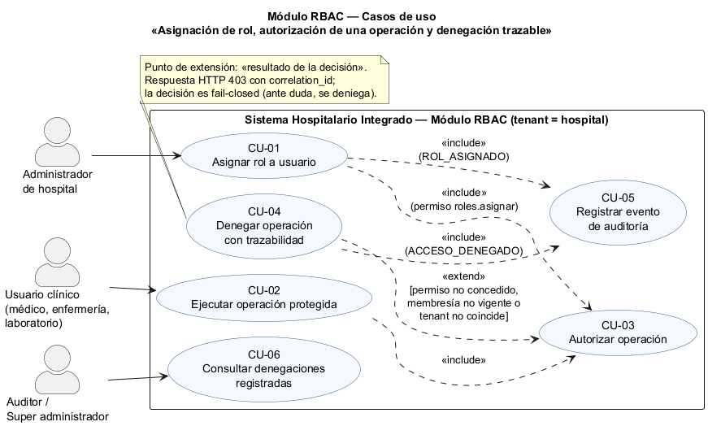
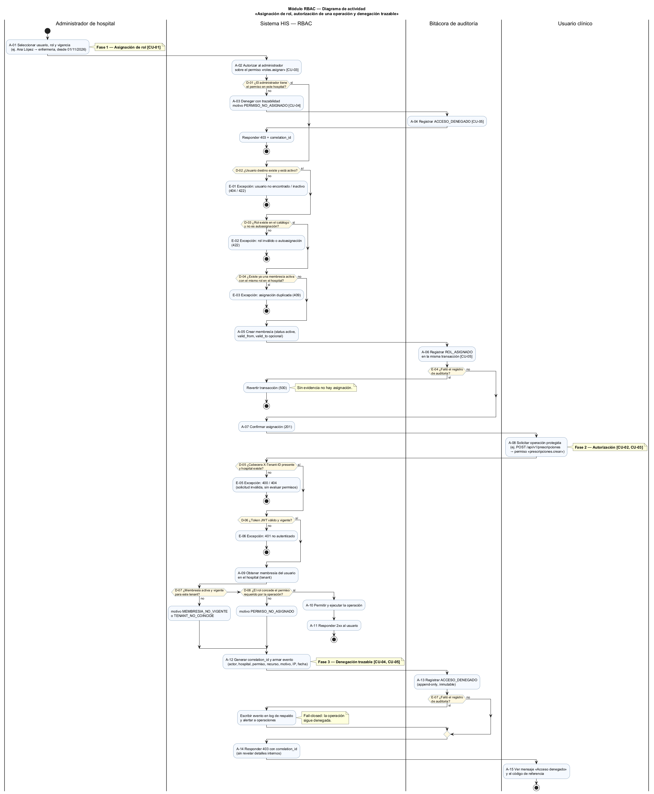
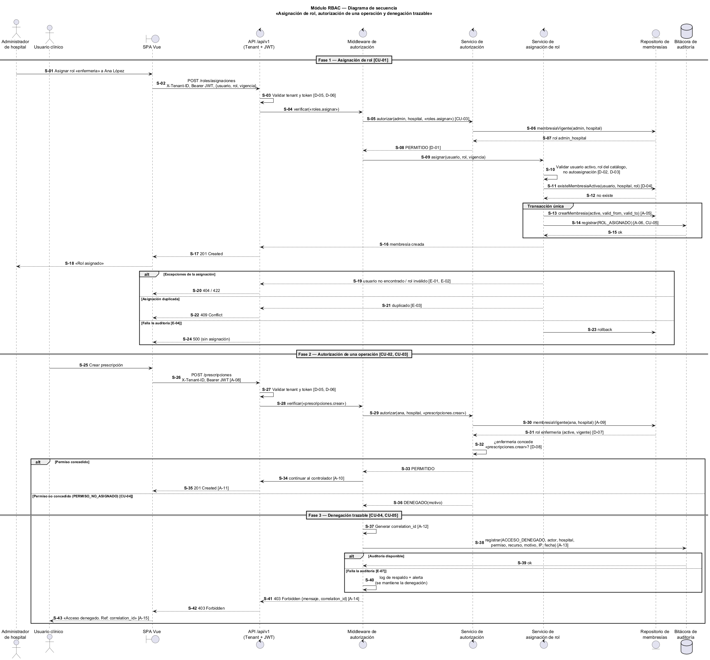

# Semana 1 — Modelado UML del proceso RBAC

| | |
|---|---|
| **Curso** | Análisis de Sistemas II — Proyecto Final 2026 |
| **Proyecto** | Sistema Hospitalario Integrado (HIS) |
| **Módulo** | RBAC: roles, permisos y protección de rutas |
| **Tema de la semana** | Conceptos generales, orientación a objetos y UML |
| **Proceso modelado** | «Asignación de rol, autorización de una operación y denegación trazable» |
| **Estudiante** | Boris Alexander Quiroa Orellana |
| **Fecha** | Octubre 2026 |

## Índice

1. [Introducción](#1-introducción)
2. [Narrativa de alcance](#2-narrativa-de-alcance)
3. [Actores](#3-actores)
4. [Diagrama de casos de uso](#4-diagrama-de-casos-de-uso)
5. [Especificación de casos de uso](#5-especificación-de-casos-de-uso)
6. [Diagrama de actividad](#6-diagrama-de-actividad)
7. [Diagrama de secuencia](#7-diagrama-de-secuencia)
8. [Matriz de trazabilidad](#8-matriz-de-trazabilidad)
9. [Conclusión](#9-conclusión)
10. [Bibliografía](#10-bibliografía)

## 1. Introducción

En un sistema hospitalario, cada operación sobre datos clínicos debe ejecutarla solo quien tiene la responsabilidad de hacerlo. Por ejemplo, una enfermera registra signos vitales, pero no emite prescripciones. El control de acceso basado en roles (RBAC) resuelve esto en dos pasos: primero se asignan **roles** a los usuarios y luego se asocian **permisos** a esos roles. Así, la decisión de autorizar depende de un rol vigente y no de cada persona.

Este documento modela con UML el proceso central del módulo RBAC del HIS en tres vistas complementarias:

- **Casos de uso:** delimitan actores y objetivos.
- **Actividad:** describe el flujo, con sus decisiones, excepciones y resultados.
- **Secuencia:** muestra cómo colaboran los participantes, con mensajes, validaciones y respuestas.

Las tres vistas comparten identificadores, de modo que cada elemento se puede rastrear de un diagrama a otro (sección 8).

Todos los datos de ejemplo son ficticios.

## 2. Narrativa de alcance

**Objetivo del proceso.** Garantizar que solo los usuarios con un rol vigente en un hospital puedan ejecutar las operaciones que ese rol permite. Cada asignación de rol y cada acceso denegado deben quedar registrados en una bitácora inmutable, con evidencia suficiente para investigarlos después.

**Escenario de referencia.** El administrador del *Hospital Regional de Oriente* (dato ficticio) asigna el rol `enfermeria` a la usuaria Ana López, vigente desde el 01/11/2026. Más tarde, Ana intenta crear una prescripción (`POST /api/v1/prescripciones`), una operación que exige el permiso `prescripciones.crear`. Su rol no concede ese permiso, así que el sistema deniega la operación con HTTP 403 y devuelve un `correlation_id`. Además, registra el evento `ACCESO_DENEGADO` en la bitácora, y un auditor puede consultarlo después con ese mismo identificador.

**Reglas que rigen el proceso:**

| Código | Regla |
|---|---|
| R-01 | El hospital es el tenant: toda solicitud debe incluir la cabecera `X-Tenant-ID`, y los roles solo valen dentro del hospital donde se asignaron. |
| R-02 | Un rol se asigna mediante una **membresía** (usuario + hospital + rol) con estado (`active`, `inactive`, `revoked`) y un periodo de vigencia (`valid_from`, `valid_to`). Esto se corresponde con la tabla `hospital_memberships` del esquema CENTRAL. |
| R-03 | No puede haber dos membresías activas abiertas con el mismo usuario, hospital y rol. El índice único `hospital_memberships_active_open_unique` ya lo garantiza. |
| R-04 | Asignar roles es una operación protegida más: exige el permiso `roles.asignar`. Ningún usuario puede asignarse roles a sí mismo. |
| R-05 | La autorización es *fail-closed*: si falta información o algo falla, se deniega. |
| R-06 | Toda denegación genera un evento `ACCESO_DENEGADO` en una bitácora *append-only* con actor, hospital, permiso, recurso, motivo, IP, fecha y `correlation_id`. |
| R-07 | Una asignación y su evento `ROL_ASIGNADO` se guardan en la misma transacción: si no hay evidencia, no hay asignación. |
| R-08 | La respuesta 403 no revela detalles internos (ni qué rol tiene el usuario ni qué permiso le falta). Solo incluye un mensaje genérico y el `correlation_id`. |

**Motivos de denegación tipificados:** `PERMISO_NO_ASIGNADO`, `MEMBRESIA_NO_VIGENTE` (inactiva, revocada o fuera de vigencia) y `TENANT_NO_COINCIDE`.

**Dentro del alcance:**

- asignación de un rol a un usuario dentro de un hospital;
- autorización de una operación protegida según la membresía vigente y los permisos del rol;
- denegación con registro trazable;
- consulta de las denegaciones registradas.

**Fuera del alcance (otros módulos o semanas posteriores):**

- **Inicio de sesión y emisión del JWT:** módulo de usuarios y autenticación. Aquí solo se valida el token.
- **Revocación y vencimiento de roles:** se modelarán como una extensión de CU-01 en semanas posteriores.
- **Administración del catálogo de permisos por rol:** se toma como dato existente (`admin_hospital`, `medico`, `enfermeria`, `laboratorio`).
- **Interfaz completa de auditoría y sus filtros:** módulo de gobernanza y auditoría. Este módulo solo produce los eventos.
- **Accesos entre hospitales y *break-glass*:** tienen su propio modelo en `cross_hospital_access_grants`.
- **Sincronización de membresías hacia la réplica local:** `local_user_refs` en la base HOSPITAL.

**Supuestos:**

- Cada operación protegida declara un único permiso requerido.
- El catálogo de roles y permisos se gestiona con Spatie Laravel Permission, que ya está instalado en el proyecto.
- La bitácora concreta será la tabla `local_access_audit` de la base HOSPITAL, planificada en el esquema federado; mientras tanto se usará la tabla del módulo de auditoría.

## 3. Actores

| Actor | Tipo | Objetivo en el proceso |
|---|---|---|
| Administrador de hospital | Primario | Asignar roles a los usuarios de su hospital para habilitar sus funciones. |
| Usuario clínico (médico, enfermería, laboratorio) | Primario | Ejecutar las operaciones de su trabajo diario; el sistema las autoriza o deniega. |
| Auditor / Super administrador | Secundario | Consultar las denegaciones registradas para investigar incidentes o intentos de acceso indebido. |

La bitácora de auditoría y el repositorio de membresías son componentes internos del sistema y no actores. Por eso aparecen en los diagramas de actividad y de secuencia, pero no en el de casos de uso.

## 4. Diagrama de casos de uso

Fuente editable: [diagramas/semana-01-casos-de-uso.puml](diagramas/semana-01-casos-de-uso.puml)

**Relaciones:**

- **CU-01 incluye a CU-03:** asignar roles exige autorización (R-04).
- **CU-02 incluye a CU-03:** toda operación protegida pasa por la autorización.
- **CU-04 extiende a CU-03:** la denegación ocurre solo bajo una condición, cuando la decisión es negativa.
- **CU-01 y CU-04 incluyen a CU-05:** tanto la asignación como la denegación dejan evidencia.

## 5. Especificación de casos de uso

### CU-01 Asignar rol a usuario

| Campo | Descripción |
|---|---|
| Actor | Administrador de hospital |
| Objetivo | Crear una membresía activa que otorgue un rol a un usuario dentro del hospital. |
| Precondiciones | El administrador está autenticado (JWT válido) y la solicitud trae el `X-Tenant-ID` de su hospital. |
| Flujo básico | 1. El administrador selecciona usuario, rol y vigencia (A-01). 2. El sistema verifica el permiso `roles.asignar` (A-02, CU-03). 3. El sistema valida que el usuario destino existe y está activo (D-02), que el rol existe y no es una autoasignación (D-03) y que no hay duplicados (D-04). 4. El sistema crea la membresía (A-05) y registra `ROL_ASIGNADO` (A-06, CU-05) en una sola transacción. 5. El sistema confirma con 201 (A-07). |
| Flujos alternos / excepciones | E-01: usuario inexistente o inactivo → 404/422. E-02: rol inválido o autoasignación → 422. E-03: membresía duplicada → 409. E-04: falla de auditoría → se revierte la transacción y se responde 500. Si el administrador no tiene el permiso → CU-04 (403). |
| Postcondición | La membresía queda activa y el evento `ROL_ASIGNADO` queda en la bitácora; ninguna de las dos existe sin la otra. |

### CU-02 Ejecutar operación protegida

| Campo | Descripción |
|---|---|
| Actor | Usuario clínico |
| Objetivo | Realizar una operación del sistema, por ejemplo crear una prescripción. |
| Precondiciones | El usuario tiene sesión iniciada. |
| Flujo básico | 1. El usuario solicita la operación (A-08). 2. El sistema la autoriza (CU-03). 3. Si se permite, la ejecuta y responde 2xx (A-10, A-11). |
| Excepciones | E-05: falta el tenant o el tenant no existe → 400/404. E-06: token inválido → 401. Si la autorización es negativa → CU-04. |
| Postcondición | La operación se ejecutó o quedó denegada con trazabilidad. |

### CU-03 Autorizar operación

| Campo | Descripción |
|---|---|
| Actor | Ninguno directo (lo incluyen CU-01 y CU-02). |
| Objetivo | Decidir PERMITIDO o DENEGADO para la combinación usuario + hospital + permiso. |
| Flujo básico | 1. Validar el tenant y el token (D-05, D-06). 2. Obtener la membresía del usuario en el hospital (A-09). 3. Verificar que esté activa y vigente (D-07). 4. Verificar que el rol conceda el permiso (D-08). 5. Devolver PERMITIDO. |
| Punto de extensión | «Resultado de la decisión»: si D-07 o D-08 resultan negativos, se activa CU-04. |

### CU-04 Denegar operación con trazabilidad

| Campo | Descripción |
|---|---|
| Actor | Ninguno directo (extiende a CU-03). |
| Condición de extensión | Permiso no concedido, membresía no vigente o tenant que no coincide. |
| Flujo básico | 1. Generar el `correlation_id` y armar el evento (A-12). 2. Registrar `ACCESO_DENEGADO` (A-13, CU-05). 3. Responder 403 con el `correlation_id` (A-14). 4. El usuario ve «Acceso denegado» y el código de referencia (A-15). |
| Excepción | E-07: si falla la bitácora, el evento se escribe en un log de respaldo, se alerta a operaciones y **la operación sigue denegada**. |
| Postcondición | La operación no se ejecutó y existe evidencia de la denegación. |

### CU-05 Registrar evento de auditoría

| Campo | Descripción |
|---|---|
| Objetivo | Persistir un evento inmutable (`ROL_ASIGNADO` o `ACCESO_DENEGADO`) con todos sus datos de contexto. |
| Regla | La bitácora es *append-only*: no admite modificaciones ni borrados. |

### CU-06 Consultar denegaciones registradas

| Campo | Descripción |
|---|---|
| Actor | Auditor / Super administrador |
| Objetivo | Buscar eventos `ACCESO_DENEGADO` por usuario, módulo, rango de fechas o `correlation_id`. |
| Nota | La interfaz pertenece al módulo de gobernanza y auditoría. Este módulo garantiza que los datos existan y sean consultables. |

## 6. Diagrama de actividad

Fuente editable: [diagramas/semana-01-actividad.puml](diagramas/semana-01-actividad.puml)

El diagrama se organiza en cuatro carriles: Administrador, Sistema HIS — RBAC, Bitácora de auditoría y Usuario clínico. Recorre tres fases:

1. **Asignación de rol:** A-01 a A-07, con las decisiones D-01 a D-04 y las excepciones E-01 a E-04.
2. **Autorización:** A-08 a A-11, con las decisiones D-05 a D-08 y las excepciones E-05 y E-06.
3. **Denegación trazable:** A-12 a A-15, con la excepción E-07.

**Resultados posibles:**

| Resultado | Dónde termina |
|---|---|
| Rol asignado (201) | A-07 |
| Operación permitida (2xx) | A-11 |
| Operación denegada con evidencia (403) | A-14 y A-15 |
| Solicitud rechazada antes de evaluar permisos (400/401/404) | E-05 y E-06 |
| Error de validación o conflicto en la asignación (404/409/422/500) | E-01 a E-04 |

## 7. Diagrama de secuencia

Fuente editable: [diagramas/semana-01-secuencia.puml](diagramas/semana-01-secuencia.puml)

| Participante | Estereotipo | Responsabilidad |
|---|---|---|
| SPA Vue | «boundary» | Interfaz del usuario; envía `X-Tenant-ID` y `Bearer JWT`. |
| API /api/v1 (Tenant + JWT) | «control» | Valida el tenant y el token; corresponde a los middleware existentes `TenantMiddleware` y `JwtAuth`. |
| Middleware de autorización | «control» | Declara el permiso que requiere cada ruta, aplica la decisión y, si es negativa, emite la denegación trazable. |
| Servicio de autorización | «control» | Decide PERMITIDO o DENEGADO a partir de la membresía y los permisos del rol. |
| Servicio de asignación de rol | «control» | Aplica las reglas de negocio de la asignación (D-02 a D-04). |
| Repositorio de membresías | «entity» | Lee y escribe las membresías (`hospital_memberships`). |
| Bitácora de auditoría | «database» | Almacena los eventos de forma *append-only*. |

Los mensajes están numerados de S-01 a S-43. Entre corchetes, cada mensaje indica la actividad, la decisión o el caso de uso con el que se corresponde.

## 8. Matriz de trazabilidad

| Caso de uso | Actividad (nodos) | Secuencia (mensajes) | Resultado / HTTP |
|---|---|---|---|
| CU-01 Asignar rol | A-01, A-02, D-02, D-03, D-04, A-05, A-07; E-01 a E-04 | S-01 a S-24 | 201 / 404 / 409 / 422 / 500 |
| CU-02 Ejecutar operación protegida | A-08, A-10, A-11; E-05, E-06 | S-25 a S-28, S-33 a S-35 | 2xx / 400 / 401 / 404 |
| CU-03 Autorizar operación | A-02, D-01 (asignación); A-09, D-05 a D-08 (operación) | S-03 a S-08, S-27 a S-32 | PERMITIDO / DENEGADO |
| CU-04 Denegar con trazabilidad | A-03, A-12, A-14, A-15; E-07 | S-36 a S-43 | 403 + `correlation_id` |
| CU-05 Registrar evento | A-04, A-06, A-13 | S-14, S-15, S-38, S-39 | `ROL_ASIGNADO`, `ACCESO_DENEGADO` |
| CU-06 Consultar denegaciones | Consume lo registrado en A-13 | Fuera del diagrama (búsqueda por `correlation_id` de S-41) | Consulta del auditor |

| Regla | Dónde se aplica |
|---|---|
| R-01 Tenant obligatorio | D-05 · S-03, S-27 |
| R-02 Membresía con vigencia | A-05, D-07 · S-13, S-31 |
| R-03 Sin duplicados | D-04 · S-11, S-12 |
| R-04 `roles.asignar` y no autoasignación | A-02, D-01, D-03 · S-05, S-10 |
| R-05 *Fail-closed* | E-07 · S-40 |
| R-06 Denegación registrada | A-13 · S-38 |
| R-07 Asignación + evidencia atómicas | A-06, E-04 · S-13 a S-15, S-23 |
| R-08 403 sin detalles internos | A-14 · S-41 |

## 9. Conclusión

Modelar el proceso en tres vistas deja claro que la autorización es un caso de uso compartido (CU-03) y no una función aislada de cada pantalla. Tanto la asignación de roles como las operaciones clínicas pasan por el mismo punto de decisión. La denegación, que suele tratarse como un simple error, se modeló como un caso de uso con su propio resultado y su propia evidencia, porque en un entorno hospitalario un acceso denegado es información de seguridad relevante.

Los identificadores compartidos (CU, A, D, E, S y R) permiten verificar que cada regla de negocio aparezca tanto en el flujo como en las interacciones. Esa base servirá para definir los requerimientos y aplicar SOLID en la semana 2.

## 10. Bibliografía

- Object Management Group. (2017). *Unified Modeling Language (UML), Version 2.5.1*. https://www.omg.org/spec/UML/2.5.1
- Sandhu, R., Ferraiolo, D. y Kuhn, R. (2000). The NIST model for role-based access control: towards a unified standard. *Proceedings of the 5th ACM Workshop on Role-Based Access Control*, 47–63.
- Ferraiolo, D. F., Kuhn, D. R. y Chandramouli, R. (2007). *Role-Based Access Control* (2.ª ed.). Artech House.
- OWASP Foundation. (2024). *Authorization Cheat Sheet*. https://cheatsheetseries.owasp.org/cheatsheets/Authorization_Cheat_Sheet.html
- OWASP Foundation. (2024). *Logging Cheat Sheet*. https://cheatsheetseries.owasp.org/cheatsheets/Logging_Cheat_Sheet.html
- Spatie. (2025). *Laravel Permission — Documentation*. https://spatie.be/docs/laravel-permission
- Larman, C. (2004). *Applying UML and Patterns* (3.ª ed.). Prentice Hall.
