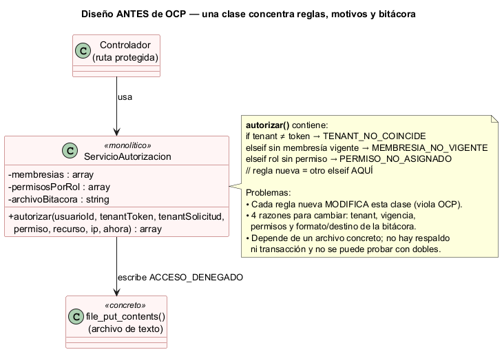
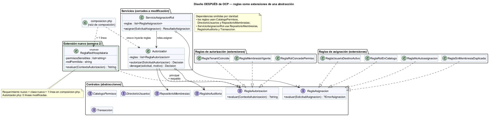

# Semana 2 — Requerimientos, criterios de aceptación y aplicación de OCP

| | |
|---|---|
| **Curso** | Análisis de Sistemas II — Proyecto Final 2026 |
| **Proyecto** | Sistema Hospitalario Integrado (HIS) |
| **Módulo** | RBAC: roles, permisos y protección de rutas |
| **Tema de la semana** | Proceso y modelo de diseño; principios SOLID |
| **Flujo de diseño** | «Asignación de rol, autorización de una operación y denegación trazable» |
| **Principio aplicado** | OCP — Principio abierto/cerrado |
| **Estudiante** | Boris Alexander Quiroa Orellana |
| **Fecha** | Octubre 2026 |

## Índice

1. [Introducción](#1-introducción)
2. [Requerimientos funcionales](#2-requerimientos-funcionales)
3. [Requerimientos no funcionales](#3-requerimientos-no-funcionales)
4. [Criterios de aceptación](#4-criterios-de-aceptación)
5. [El principio abierto/cerrado (OCP)](#5-el-principio-abiertocerrado-ocp)
6. [Diseño antes de aplicar OCP](#6-diseño-antes-de-aplicar-ocp)
7. [Diseño después de aplicar OCP](#7-diseño-después-de-aplicar-ocp)
8. [Responsabilidades y dependencias](#8-responsabilidades-y-dependencias)
9. [Demostración: extensión sin modificación](#9-demostración-extensión-sin-modificación)
10. [Evidencia verificable](#10-evidencia-verificable)
11. [Trazabilidad con la semana 1](#11-trazabilidad-con-la-semana-1)
12. [Conclusión](#12-conclusión)
13. [Bibliografía](#13-bibliografía)

## 1. Introducción

En la semana 1 se modeló el proceso del módulo RBAC con tres diagramas UML (casos de uso, actividad y secuencia) y ocho reglas de negocio (R-01 a R-08). Esta semana se pasa del **qué** al **cómo**: se formalizan los requerimientos funcionales y no funcionales, se escriben criterios de aceptación verificables y se diseña la solución aplicando el **principio abierto/cerrado (OCP)** de SOLID.

Elegimos OCP porque el control de acceso es, por naturaleza, una lista de reglas que **crece**. Hoy se valida el tenant, la vigencia de la membresía y el permiso del rol. Mañana, en un hospital, se pedirán otras reglas: restringir por red, por turno, por tipo de paciente o por consentimiento. Si cada regla nueva obliga a editar la clase que decide, cada cambio pone en riesgo las reglas que ya funcionaban.

La evidencia es un ejemplo ejecutable en PHP 8.2+ sin framework, con el diseño **antes** y **después**, y un script que ejecuta 18 pruebas: los criterios de aceptación, la verificación de OCP y la paridad de comportamiento entre ambos diseños.

## 2. Requerimientos funcionales

| ID | Requerimiento | Origen (semana 1) |
|---|---|---|
| RF-01 | El sistema debe permitir que un administrador de hospital asigne un rol del catálogo a un usuario dentro de su hospital, con fecha de inicio y fecha de fin opcional. | CU-01, A-01, A-05 |
| RF-02 | El sistema debe exigir el permiso `roles.asignar` para asignar roles y debe impedir que un usuario se asigne roles a sí mismo. | CU-01, D-01, D-03, R-04 |
| RF-03 | El sistema debe validar que el usuario destino exista y esté activo, que el rol exista en el catálogo y que no haya una membresía activa duplicada. | D-02, D-03, D-04, R-03 |
| RF-04 | El sistema debe registrar el evento `ROL_ASIGNADO` en la misma transacción que la membresía; si el registro falla, no se crea la membresía. | A-06, E-04, R-07 |
| RF-05 | El sistema debe autorizar cada operación protegida según el permiso que esa operación declara. | CU-02, CU-03 |
| RF-06 | El sistema debe denegar la operación si el hospital del token no coincide con la cabecera `X-Tenant-ID`. | D-05, R-01 |
| RF-07 | El sistema debe considerar solo las membresías con estado `active` y dentro de su vigencia (`valid_from` ≤ ahora < `valid_to`). | D-07, R-02 |
| RF-08 | Ante una denegación, el sistema debe responder HTTP 403 con un `correlation_id` y un mensaje genérico. | CU-04, A-14, R-08 |
| RF-09 | Toda denegación debe registrar `ACCESO_DENEGADO` con actor, hospital, permiso, recurso, motivo, IP, fecha y `correlation_id`. | A-13, R-06 |
| RF-10 | El auditor debe poder localizar un evento por su `correlation_id`. | CU-06 |

## 3. Requerimientos no funcionales

| ID | Atributo | Requerimiento | Cómo se verifica |
|---|---|---|---|
| RNF-01 | Seguridad | **Fail-closed:** ante falta de reglas, error de una regla o error al leer membresías, la decisión es DENEGADO. | CA-13 |
| RNF-02 | Disponibilidad de la evidencia | Si la bitácora principal falla, la denegación se escribe en un registro de respaldo y la operación sigue denegada. | CA-12 |
| RNF-03 | Integridad | La bitácora es *append-only*: el contrato `RegistroAuditoria` solo expone `registrar()`. | Revisión del contrato |
| RNF-04 | Confidencialidad | La respuesta 403 no revela el rol del usuario ni el permiso faltante; esos datos quedan solo en la bitácora. | CA-09 (los datos están en el evento) |
| RNF-05 | **Extensibilidad (OCP)** | Agregar una regla de autorización o de asignación no debe requerir modificar `Autorizador` ni `ServicioAsignacionRol`: se agrega una clase nueva y se registra en la raíz de composición. | OCP-01, OCP-02, OCP-03 |
| RNF-06 | Mantenibilidad | Cada regla vive en su propia clase, con una sola condición y un solo motivo de denegación. | Estructura de `src/Reglas/` |
| RNF-07 | Testabilidad | Las dependencias externas (membresías, catálogo, bitácora, transacción) se reciben como interfaces y se prueban con dobles en memoria. | Todo `verificar.php` |
| RNF-08 | Aislamiento multi-tenant | Una membresía solo otorga permisos en su propio hospital. | CA-10 |
| RNF-09 | Rendimiento | La autorización debe resolverse en menos de 50 ms (p95), sin contar la red. | Pendiente: se medirá en la semana 15 con la base de datos real. |

## 4. Criterios de aceptación

Formato *Dado / Cuando / Entonces*. Cada criterio tiene una prueba automática con el mismo ID en [`ejemplo-ocp/verificar.php`](ejemplo-ocp/verificar.php).

| ID | RF/RNF | Dado | Cuando | Entonces |
|---|---|---|---|---|
| CA-01 | RF-01, RF-04 | un administrador con `roles.asignar` y un usuario activo | asigna el rol `laboratorio` | responde 201, la membresía queda activa y se registra `ROL_ASIGNADO` con el administrador como actor |
| CA-02 | RF-02 | la enfermera Ana, sin `roles.asignar` | intenta asignar un rol | responde 403 `PERMISO_NO_ASIGNADO`, no se crea la membresía y se registra `ACCESO_DENEGADO` |
| CA-03 | RF-02 | un administrador | intenta asignarse un rol a sí mismo | responde 422 `AUTOASIGNACION` |
| CA-04 | RF-03 | un usuario destino inexistente o inactivo | se le intenta asignar un rol | responde 404 o 422 según el caso |
| CA-05 | RF-03 | un rol que no existe en el catálogo | se intenta asignar | responde 422 `ROL_INVALIDO` |
| CA-06 | RF-03 | Ana ya tiene `enfermeria` activa | se le asigna `enfermeria` otra vez | responde 409 `ASIGNACION_DUPLICADA` |
| CA-07 | RF-04 | la bitácora no está disponible | se asigna un rol válido | responde 500 y **no** queda ninguna membresía nueva |
| CA-08 | RF-05, RF-07 | Ana con `enfermeria` vigente | registra signos vitales | se permite (200) y no se registra ninguna denegación |
| CA-09 | RF-08, RF-09 | Ana con `enfermeria` | intenta `prescripciones.crear` | responde 403 con `correlation_id` y el evento guarda actor, hospital, permiso, recurso, motivo e IP |
| CA-10 | RF-06, RNF-08 | un token del Hospital de Oriente | la solicitud llega con `X-Tenant-ID` del Hospital del Norte | responde 403 `TENANT_NO_COINCIDE` |
| CA-11 | RF-07 | una membresía vencida, revocada, futura o inexistente | se intenta cualquier operación | responde 403 `MEMBRESIA_NO_VIGENTE` |
| CA-12 | RNF-02 | la bitácora principal caída | se deniega una operación | sigue siendo 403 y el evento queda en el respaldo; si el respaldo también falla, sigue siendo 403 |
| CA-13 | RNF-01 | un autorizador sin reglas, o con una regla que lanza una excepción | se pide autorización | se deniega (`SIN_REGLAS_CONFIGURADAS` / `ERROR_EVALUACION`) |
| CA-14 | RF-10 | una denegación ya ocurrida | el auditor busca por el `correlation_id` que vio el usuario | encuentra el evento con su motivo |

## 5. El principio abierto/cerrado (OCP)

La fuente obligatoria del curso, *Principios básicos del diseño de software* de MVP Cluster, lo define así:

> «No se debe modificar el código de una clase o entidad, sino que estas deben de ser extendidas.»
> «La forma más común para cumplir con este principio es el uso de la herencia y/o el de las interfaces.»

El artículo lo ilustra con ofertas comerciales: cada tipo de servicio hereda de `Oferta` y define su propio `GenerarOferta`, de modo que para agregar un servicio nuevo basta con crear una subclase, sin tocar `RealizarOferta`. Además señala que cumplir SRP ayuda a cumplir OCP, pero no lo garantiza.

**Aplicado a este módulo:**

- **Abierto a extensión:** se pueden agregar reglas de autorización y de asignación nuevas.
- **Cerrado a modificación:** `Autorizador` y `ServicioAsignacionRol`, las clases que *aplican* las reglas, no se editan cuando aparece una regla nueva.
- **Mecanismo:** interfaces (`ReglaAutorizacion`, `ReglaAsignacion`). Se prefieren a la herencia porque las reglas no comparten estado ni comportamiento, solo un contrato.

## 6. Diseño antes de aplicar OCP



Código: [`ejemplo-ocp/antes/ServicioAutorizacion.php`](ejemplo-ocp/antes/ServicioAutorizacion.php)

```php
if ($tenantToken !== $tenantSolicitud) {
    $motivo = 'TENANT_NO_COINCIDE';
} else {
    // ...filtrar membresías vigentes...
    if ($vigentes === []) {
        $motivo = 'MEMBRESIA_NO_VIGENTE';
    } elseif (!$concede) {
        $motivo = 'PERMISO_NO_ASIGNADO';
    }
}
// Una regla nueva sería otro elseif aquí.
file_put_contents($this->archivoBitacora, json_encode([...]), FILE_APPEND);
```

**Problemas del diseño:**

| Problema | Consecuencia |
|---|---|
| Las reglas están en una cadena de `if/elseif` dentro de `autorizar()`. | Cada regla nueva **modifica** la clase: viola OCP y obliga a volver a probar todas las reglas. |
| La clase tiene cuatro razones para cambiar: tenant, vigencia, permisos y bitácora. | Baja cohesión; también viola SRP. |
| Escribe la bitácora con `file_put_contents` en un archivo concreto. | No se puede cambiar el destino (base de datos, cola) sin editarla, no hay respaldo y no se puede simular una falla en las pruebas. |
| No contempla la asignación de roles ni la transacción. | RF-01 a RF-04 quedarían en otra clase con el mismo problema. |
| Si algo falla al escribir la bitácora, el error se ignora en silencio. | No cumple RNF-02. |

## 7. Diseño después de aplicar OCP



Código: [`ejemplo-ocp/despues/`](ejemplo-ocp/despues/)

El núcleo del cambio es invertir quién conoce las reglas. Antes, la clase **contenía** las reglas. Ahora **recibe** una lista de objetos que cumplen un contrato:

```php
interface ReglaAutorizacion
{
    public function evaluar(ContextoAutorizacion $contexto): ?string; // null = cumple; string = motivo
}

final class Autorizador
{
    public function __construct(iterable $reglas, RepositorioMembresias $membresias,
        RegistroAuditoria $auditoria, RegistroAuditoria $auditoriaRespaldo, \Closure $generarCorrelacion) { /* ... */ }

    public function autorizar(SolicitudAutorizacion $solicitud): Decision
    {
        foreach ($this->reglas as $regla) {
            $motivo = $regla->evaluar($contexto);   // no sabe QUÉ regla es
            if ($motivo !== null) {
                return $this->denegar($solicitud, $motivo);
            }
        }
        return Decision::permitir();
    }
}
```

Las reglas concretas solo se conocen en la **raíz de composición** ([`composicion.php`](ejemplo-ocp/despues/composicion.php)):

```php
function reglasDeAutorizacion(CatalogoPermisos $catalogo): array
{
    return [
        new ReglaTenantCoincide(),
        new ReglaMembresiaVigente(),
        new ReglaRolConcedePermiso($catalogo),
        new ReglaRedHospitalaria(['prescripciones.crear'], '10.20.0.0/16'), // extensión
    ];
}
```

El mismo patrón se aplicó a la asignación de roles con `ReglaAsignacion`: usuario activo, rol en catálogo, sin autoasignación y sin duplicados.

## 8. Responsabilidades y dependencias

### Responsabilidades

| Clase / interfaz | Responsabilidad única | Razón para cambiar |
|---|---|---|
| `Autorizador` | Recorrer las reglas y, si una falla, denegar con trazabilidad (correlation_id, bitácora, respaldo). | Solo si cambia la **política** de decisión, por ejemplo pasar de «la primera falla deniega» a otra estrategia. |
| `ServicioAsignacionRol` | Coordinar la asignación: autorizar `roles.asignar`, aplicar las reglas y guardar membresía + evento en una transacción. | Solo si cambia el **proceso** de asignación. |
| `ReglaTenantCoincide` | R-01: el tenant del token es el de la solicitud. | Cambio en la política de tenant. |
| `ReglaMembresiaVigente` | R-02: existe al menos una membresía activa y vigente. | Cambio en la definición de vigencia. |
| `ReglaRolConcedePermiso` | D-08: algún rol vigente concede el permiso. | Cambio en cómo se resuelven los permisos. |
| `ReglaUsuarioDestinoActivo`, `ReglaRolEnCatalogo`, `ReglaNoAutoasignacion`, `ReglaSinMembresiaDuplicada` | Una validación de asignación cada una (D-02 a D-04). | El cambio de su propia regla. |
| `ReglaRedHospitalaria` *(extensión)* | Los permisos sensibles solo se ejercen desde la red interna. | El cambio de esa política. |
| `Membresia` | Saber si está vigente en un momento dado. | Cambio en el modelo de membresía. |
| `RepositorioMembresias`, `CatalogoPermisos`, `DirectorioUsuarios`, `RegistroAuditoria`, `Transaccion` | Contratos hacia la persistencia y la infraestructura. | Solo si cambia lo que el dominio necesita de ellas. |
| `composicion.php` | Crear las instancias concretas y conectarlas. | Cada vez que se agrega o quita una regla: **es el único lugar que cambia**. |

### Dependencias

| Quién | Depende de | Tipo | Justificación |
|---|---|---|---|
| `Autorizador` | `ReglaAutorizacion` (lista) | Abstracción | Permite agregar reglas sin modificarlo (OCP). |
| `Autorizador` | `RegistroAuditoria` ×2 | Abstracción | Principal + respaldo (RNF-02); en pruebas se usan dobles. |
| `Autorizador` | `RepositorioMembresias` | Abstracción | Hoy en memoria; en el HIS será `hospital_memberships` en PostgreSQL. |
| `ServicioAsignacionRol` | `Autorizador` | Concreta | Reutiliza la misma autorización para `roles.asignar` (R-04). Es una dependencia estable dentro del mismo módulo. |
| `ServicioAsignacionRol` | `ReglaAsignacion`, `RepositorioMembresias`, `RegistroAuditoria`, `Transaccion` | Abstracciones | Extensibilidad y atomicidad (RF-04) sin acoplarse a una base de datos. |
| Reglas concretas | `CatalogoPermisos`, `DirectorioUsuarios`, `RepositorioMembresias` | Abstracciones | Cada regla pide solo lo que necesita. |
| `composicion.php` | Todas las clases concretas | Concreta | Es el único punto acoplado a implementaciones, a propósito. |

**Sentido de las dependencias:** los servicios dependen de interfaces, y las reglas y adaptadores implementan esas interfaces. Ninguna clase del núcleo importa una regla concreta; la prueba OCP-02 lo verifica leyendo el código fuente.

## 9. Demostración: extensión sin modificación

**Requerimiento nuevo (ficticio):** «Por política de seguridad del hospital, el permiso `prescripciones.crear` solo puede ejercerse desde la red interna 10.20.0.0/16.»

| | Diseño ANTES | Diseño DESPUÉS |
|---|---|---|
| ¿Qué se hace? | Agregar otro `elseif` dentro de `ServicioAutorizacion::autorizar()` y un parámetro de configuración en el constructor. | Crear [`extension/ReglaRedHospitalaria.php`](ejemplo-ocp/despues/extension/ReglaRedHospitalaria.php) y agregar **una línea** en `composicion.php`. |
| ¿Se modifica la clase que decide? | **Sí.** | **No:** `Autorizador.php` queda intacto. |
| ¿Se pueden romper las reglas existentes? | Sí, porque comparten el mismo método. | No, porque cada regla es una clase separada. |
| ¿Cómo se prueba? | Hay que volver a probar todo `autorizar()`. | Prueba aislada de la regla nueva (OCP-01) + paridad del resto (PAR-01). |
| ¿Cómo se revierte? | Hay que editar otra vez la clase. | Se quita la línea de `composicion.php` (OCP-03). |

## 10. Evidencia verificable

**Ejecución:** con PHP 8.2 o superior, desde la raíz del repositorio:

```bash
php docs/modulos/rbac/semana-02/ejemplo-ocp/verificar.php
```

**Resultado obtenido** (archivo completo en [`evidencia/salida-verificar.txt`](evidencia/salida-verificar.txt)):

```
RBAC semana 2 - verificacion OCP (PHP 8.4.26)
------------------------------------------------------------------------------
[PASA] CA-01   Asignación válida crea membresía activa y registra ROL_ASIGNADO (201)
[PASA] CA-02   Usuario sin «roles.asignar» recibe 403 y se registra ACCESO_DENEGADO
[PASA] CA-03   Autoasignación de rol se rechaza (422)
[PASA] CA-04   Usuario destino inexistente (404) o inactivo (422)
[PASA] CA-05   Rol que no existe en el catálogo se rechaza (422)
[PASA] CA-06   Membresía activa duplicada se rechaza (409)
[PASA] CA-07   Si la bitácora falla, la asignación se revierte (500, sin membresía)
[PASA] CA-08   Operación permitida por el rol vigente (200) sin registrar denegación
[PASA] CA-09   Permiso no asignado: 403 + correlation_id + evento con todos los campos
[PASA] CA-10   Tenant del token distinto al de la solicitud: 403 TENANT_NO_COINCIDE
[PASA] CA-11   Membresía vencida, revocada, futura o inexistente: MEMBRESIA_NO_VIGENTE
[PASA] CA-12   Bitácora caída al denegar: sigue 403 y el evento va al respaldo (fail-closed)
[PASA] CA-13   Fail-closed: sin reglas o con una regla que lanza excepción, se deniega
[PASA] CA-14   El auditor encuentra la denegación con el correlation_id que vio el usuario
[PASA] OCP-01  Regla nueva (red hospitalaria) funciona sin modificar el Autorizador
[PASA] OCP-02  Autorizador y ServicioAsignacionRol no dependen de reglas concretas
[PASA] OCP-03  Quitar la extensión no exige cambios: con las 3 reglas base se permite desde fuera
[PASA] PAR-01  Antes y después producen la misma decisión en 7 escenarios
------------------------------------------------------------------------------
Total: 18  Pasan: 18  Fallan: 0
```

**Qué demuestra cada grupo de pruebas:**

| Grupo | Demuestra |
|---|---|
| CA-01 a CA-14 | Que el diseño cumple los requerimientos funcionales y no funcionales. |
| OCP-01 | Que la regla nueva funciona: deniega fuera de la red, permite dentro de ella y no afecta a los permisos no sensibles. |
| OCP-02 | Que los servicios no importan ni crean reglas concretas (análisis del código fuente) y que reciben las reglas como `iterable`. |
| OCP-03 | Que quitar la extensión no exige tocar el `Autorizador`. |
| PAR-01 | Que la refactorización no cambió el comportamiento: antes y después dan el mismo HTTP y el mismo motivo en 7 escenarios. |

**Cómo comprobarlo a mano:** la regla de red hospitalaria vive en su propio archivo (`extension/ReglaRedHospitalaria.php`). Para desactivarla basta con comentar su línea en `composicion.php` y volver a ejecutar `verificar.php`. Ese cambio no toca `Autorizador.php`, y OCP-01 pasa a fallar porque la regla ya no se aplica.

## 11. Trazabilidad con la semana 1

| Semana 1 | Semana 2: requerimiento | Semana 2: clase | Prueba |
|---|---|---|---|
| CU-01, R-04 | RF-01, RF-02 | `ServicioAsignacionRol`, `ReglaNoAutoasignacion` | CA-01, CA-02, CA-03 |
| D-02, D-03, D-04, R-03 | RF-03 | `ReglaUsuarioDestinoActivo`, `ReglaRolEnCatalogo`, `ReglaSinMembresiaDuplicada` | CA-04, CA-05, CA-06 |
| A-06, E-04, R-07 | RF-04 | `ServicioAsignacionRol` + `Transaccion` | CA-07 |
| CU-02, CU-03 | RF-05 | `Autorizador` | CA-08 |
| D-05, R-01 | RF-06 | `ReglaTenantCoincide` | CA-10 |
| D-07, R-02 | RF-07 | `ReglaMembresiaVigente`, `Membresia::estaVigenteEn()` | CA-11 |
| D-08 | RF-05 | `ReglaRolConcedePermiso` | CA-09 |
| CU-04, A-12 a A-14, R-06, R-08 | RF-08, RF-09 | `Autorizador::denegar()` | CA-09 |
| E-07, R-05 | RNF-01, RNF-02 | `Autorizador` (respaldo, fail-closed) | CA-12, CA-13 |
| CU-06 | RF-10 | `RegistroAuditoriaEnMemoria::buscarPorCorrelacion()` | CA-14 |

## 12. Conclusión

Aplicar OCP cambió la pregunta de diseño de «¿dónde agrego el próximo `if`?» a «¿qué contrato debe cumplir la próxima regla?». El `Autorizador` quedó reducido a una política estable: recorrer reglas y, si una falla, denegar con evidencia. Lo que cambia con el negocio, que son las reglas, quedó en clases pequeñas e independientes.

La evidencia lo respalda de tres formas:

1. Se agregó un requerimiento nuevo (red hospitalaria) sin modificar el `Autorizador`.
2. Un análisis del código confirma que los servicios no conocen reglas concretas.
3. Una prueba de paridad confirma que la refactorización no alteró el comportamiento.

Como señala la fuente del curso, aplicar OCP también favoreció SRP: cada regla tiene una sola razón para cambiar. Este diseño es la base del micro-HIS en PHP vanilla por capas de la semana 3.

## 13. Bibliografía

- Rodríguez González, L. M. (s. f.). *Principios básicos del diseño de software* [SOLID]. MVP Cluster. https://mvpcluster.com/diseno-de-software-2/ *(fuente obligatoria del curso)*
- Martin, R. C. (2018). *Clean Architecture: A Craftsman's Guide to Software Structure and Design*. Prentice Hall. Cap. 8: «OCP: The Open-Closed Principle».
- Meyer, B. (1988). *Object-Oriented Software Construction*. Prentice Hall.
- Martin, R. C. (2003). *Agile Software Development: Principles, Patterns, and Practices*. Prentice Hall.
- Sommerville, I. (2016). *Software Engineering* (10.ª ed.). Pearson. Cap. 4: «Requirements engineering».
- OWASP Foundation. (2024). *Authorization Cheat Sheet*. https://cheatsheetseries.owasp.org/cheatsheets/Authorization_Cheat_Sheet.html
- The PHP Group. (2026). *PHP Manual — Interfaces de objetos*. https://www.php.net/manual/es/language.oop5.interfaces.php
