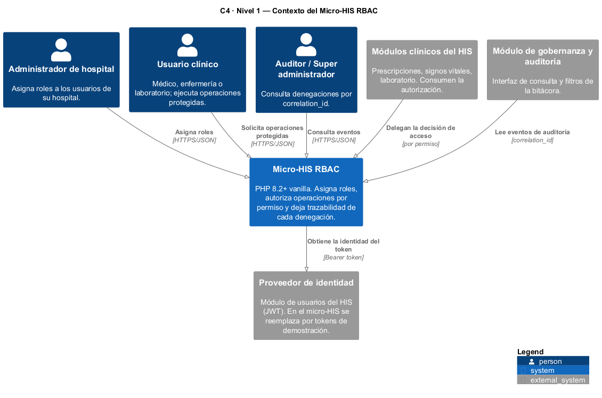
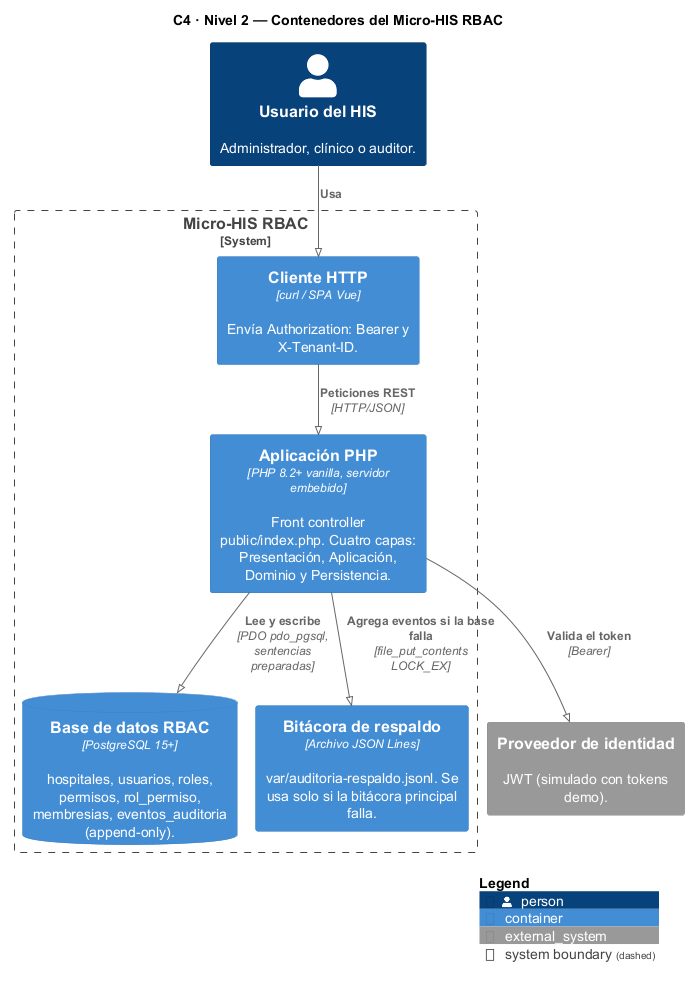
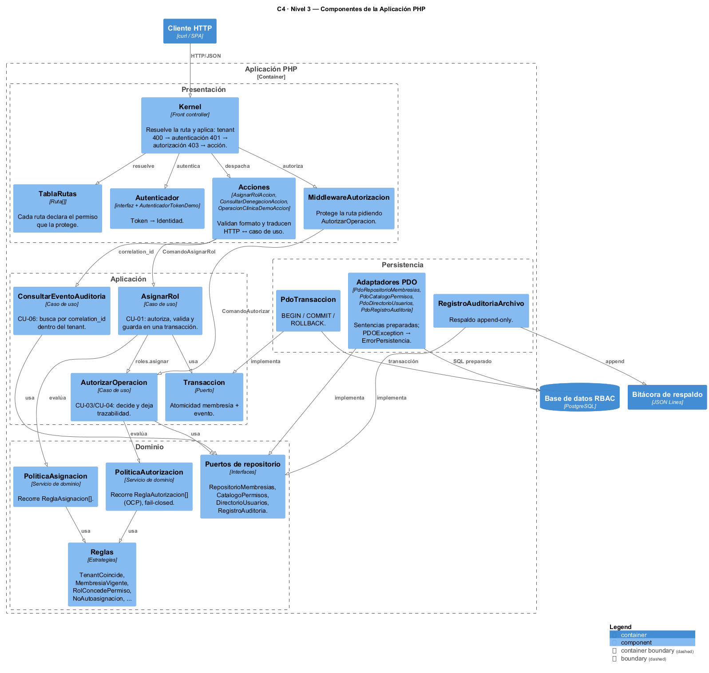
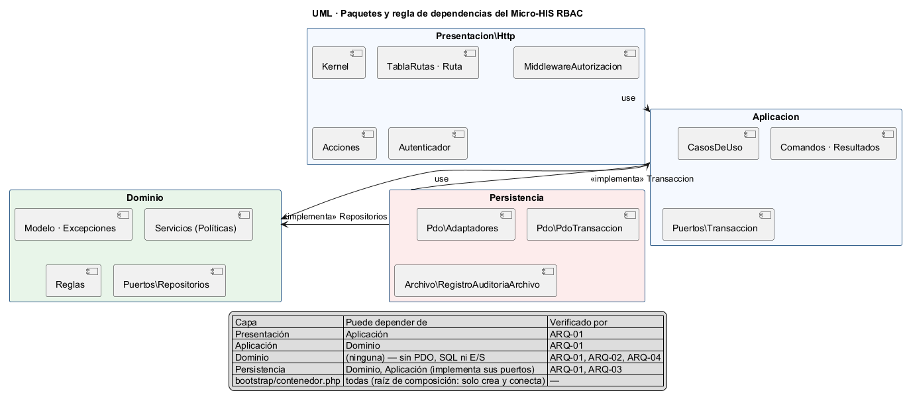
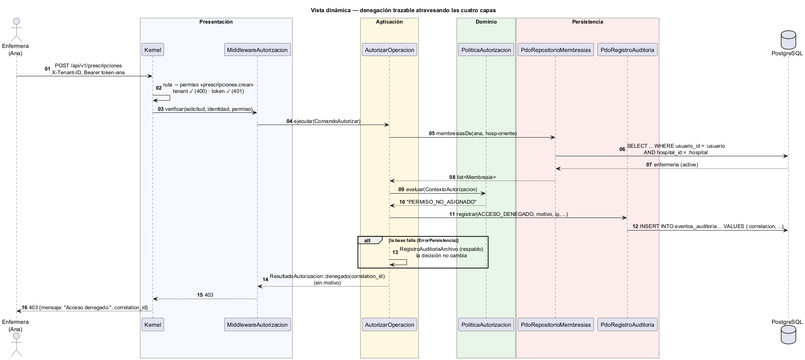

# Semana 3 — Arquitectura del Micro-HIS RBAC: vistas, capas y patrones

| | |
|---|---|
| **Curso** | Análisis de Sistemas II — Proyecto Final 2026 |
| **Proyecto** | Sistema Hospitalario Integrado (HIS) |
| **Módulo** | RBAC: roles, permisos y protección de rutas |
| **Tema de la semana** | Diseño arquitectónico, vistas y patrones |
| **Flujo implementado** | «Asignación de rol, autorización de una operación y denegación trazable» |
| **Estudiante** | Boris Alexander Quiroa Orellana |
| **Fecha** | Octubre 2026 |

## Índice

1. [Introducción](#1-introducción)
2. [Decisiones y restricciones arquitectónicas](#2-decisiones-y-restricciones-arquitectónicas)
3. [Vista de contexto (C4 nivel 1)](#3-vista-de-contexto-c4-nivel-1)
4. [Vista de contenedores (C4 nivel 2)](#4-vista-de-contenedores-c4-nivel-2)
5. [Vista de componentes (C4 nivel 3)](#5-vista-de-componentes-c4-nivel-3)
6. [Vista de paquetes y regla de dependencias](#6-vista-de-paquetes-y-regla-de-dependencias)
7. [Vista dinámica: denegación a través de las capas](#7-vista-dinámica-denegación-a-través-de-las-capas)
8. [Responsabilidades por capa](#8-responsabilidades-por-capa)
9. [Persistencia con PDO y sentencias preparadas](#9-persistencia-con-pdo-y-sentencias-preparadas)
10. [Patrones aplicados](#10-patrones-aplicados)
11. [Estrategia de pruebas y evidencia](#11-estrategia-de-pruebas-y-evidencia)
12. [Trazabilidad con las semanas 1 y 2](#12-trazabilidad-con-las-semanas-1-y-2)
13. [Limitaciones y trabajo siguiente](#13-limitaciones-y-trabajo-siguiente)
14. [Conclusión](#14-conclusión)
15. [Bibliografía](#15-bibliografía)

## 1. Introducción

Esta semana se inicia el **Micro-HIS RBAC**, un micro-proyecto en PHP 8.2+ sin framework que ejecuta de punta a punta el flujo modelado en la semana 1 y diseñado con OCP en la semana 2.

La tarea exige cuatro capas separadas (Presentation, Application, Domain, Persistence), PDO con sentencias preparadas, y pruebas de al menos el camino feliz, una regla de dominio y un error de persistencia.

El entregable principal es la **arquitectura**, documentada con el modelo C4 en tres niveles (contexto, contenedores y componentes) y con dos vistas UML: paquetes con la regla de dependencias y una vista dinámica de la denegación. La evidencia de que la arquitectura **se cumple en el código**, y no solo en el diagrama, es un conjunto de pruebas automáticas que revisan las dependencias entre capas leyendo el código fuente.

Código: [`../micro-his-rbac/`](../micro-his-rbac/README.md)

## 2. Decisiones y restricciones arquitectónicas

| ID | Decisión | Motivo | Alternativa descartada |
|---|---|---|---|
| DA-01 | Arquitectura en **4 capas** con la regla de dependencias Presentación → Aplicación → Dominio ← Persistencia. | La pide la tarea; además deja el dominio (las reglas de acceso) independiente de HTTP y de la base de datos. | Capas clásicas con Dominio → Persistencia: el dominio quedaría atado a PDO y no se podría probar sin base. |
| DA-02 | Las **interfaces de repositorio viven en el Dominio** (puertos) y la Persistencia las implementa. | Inversión de dependencias: el dominio dice qué necesita y la persistencia se adapta. Es lo que permite usar dobles en las pruebas. | Repositorios concretos usados directamente por los casos de uso. |
| DA-03 | **PDO + `pdo_pgsql`** con `ATTR_EMULATE_PREPARES = false` y solo sentencias preparadas con parámetros con nombre. | Lo exige la tarea; elimina la inyección SQL y usa la misma base que el HIS (PostgreSQL). | `query()` con concatenación; SQLite (no está habilitado en el entorno). |
| DA-04 | **Front controller** único (`public/index.php`) con una tabla de rutas donde **cada ruta declara su permiso**. | La protección de rutas es explícita y revisable en un solo archivo (`TablaRutas`). | Verificar permisos dentro de cada acción: es fácil olvidarlo. |
| DA-05 | La Presentación **solo** conoce comandos y resultados de la Aplicación; `ResultadoAutorizacion` **no tiene campo de motivo**. | R-08 (no revelar detalles internos) se garantiza por diseño, no por disciplina. | Devolver el objeto de dominio a la capa HTTP. |
| DA-06 | **Raíz de composición** (`bootstrap/contenedor.php`) como único lugar que conoce todas las clases concretas. | Las pruebas arman el mismo sistema con dobles usando las mismas funciones (`construirCasosDeUso`, `construirKernel`). | Un contenedor de inyección de dependencias de terceros: está prohibido usar framework. |
| DA-07 | **Fail-closed** en todas las capas: error al leer → 403; error al auditar → respaldo en archivo y la operación sigue denegada; error inesperado → 500 genérico. | Requisitos RNF-01 y RNF-02 de la semana 2. | Propagar la excepción hasta el usuario. |
| DA-08 | Autenticación **simulada** con tokens de demostración detrás de la interfaz `Autenticador`. | Emitir JWT es responsabilidad del módulo de usuarios; aquí solo hace falta una identidad. | Implementar JWT, que está fuera del alcance de RBAC. |

## 3. Vista de contexto (C4 nivel 1)



El Micro-HIS RBAC tiene tres tipos de usuario: administrador, usuario clínico y auditor. Se relaciona con tres sistemas externos del HIS:

- **Proveedor de identidad:** le entrega la identidad del token.
- **Módulos clínicos:** le delegan la decisión de acceso.
- **Módulo de gobernanza:** lee la bitácora.

Fuente: [`diagramas/semana-03-c4-contexto.puml`](diagramas/semana-03-c4-contexto.puml)

## 4. Vista de contenedores (C4 nivel 2)



| Contenedor | Tecnología | Responsabilidad |
|---|---|---|
| Cliente HTTP | curl / SPA Vue | Envía `Authorization: Bearer` y `X-Tenant-ID`. |
| Aplicación PHP | PHP 8.2+ vanilla, servidor embebido (`php -S`) | Atiende la API REST; contiene las cuatro capas. |
| Base de datos RBAC | PostgreSQL 15+ | Membresías con vigencia, catálogo de roles y permisos, y bitácora append-only (protegida por trigger). |
| Bitácora de respaldo | Archivo JSON Lines | Recibe los eventos de denegación solo si la bitácora principal falla. |

Fuente: [`diagramas/semana-03-c4-contenedores.puml`](diagramas/semana-03-c4-contenedores.puml)

## 5. Vista de componentes (C4 nivel 3)



Fuente: [`diagramas/semana-03-c4-componentes.puml`](diagramas/semana-03-c4-componentes.puml)

## 6. Vista de paquetes y regla de dependencias



| Capa | Puede depender de | No puede depender de | Prueba que lo verifica |
|---|---|---|---|
| Presentación | Aplicación | Dominio, Persistencia | ARQ-01 |
| Aplicación | Dominio | Presentación, Persistencia | ARQ-01 |
| Dominio | — | Todas; tampoco PDO, SQL ni E/S | ARQ-01, ARQ-02, ARQ-04 |
| Persistencia | Dominio y Aplicación (implementa sus puertos) | Presentación | ARQ-01, ARQ-03 |
| `bootstrap/` | Todas | — | No aplica: solo crea y conecta |

**Por qué la Persistencia «apunta hacia arriba»:** la Persistencia no es la base sobre la que se apoya el dominio, sino un **detalle** que implementa las interfaces que el dominio define. Por eso la flecha va de Persistencia hacia Dominio (implementa) y no al revés. Este es el principio de inversión de dependencias aplicado a la arquitectura.

Fuente: [`diagramas/semana-03-paquetes-dependencias.puml`](diagramas/semana-03-paquetes-dependencias.puml)

## 7. Vista dinámica: denegación a través de las capas



El mismo escenario de la semana 1 (Ana, enfermera, intenta crear una prescripción), ahora mostrando **qué capa hace cada paso**:

1. **Presentación:** resuelve la ruta, valida el tenant y el token, y pide la autorización.
2. **Aplicación:** carga las membresías, consulta al dominio y, como la decisión es negativa, registra el evento.
3. **Dominio:** decide `PERMISO_NO_ASIGNADO` sin saber nada de HTTP ni de SQL.
4. **Persistencia:** ejecuta el `SELECT` y el `INSERT` con sentencias preparadas.

La respuesta 403 llega a la usuaria **sin el motivo**, solo con el `correlation_id`.

Fuente: [`diagramas/semana-03-dinamica-denegacion.puml`](diagramas/semana-03-dinamica-denegacion.puml)

## 8. Responsabilidades por capa

| Capa | Clases principales | Responsabilidad | Lo que NO hace |
|---|---|---|---|
| **Presentación** | `Kernel`, `TablaRutas`, `Ruta`, `MiddlewareAutorizacion`, `AsignarRolAccion`, `ConsultarDenegacionAccion`, `AutenticadorTokenDemo`, `Solicitud`, `Respuesta` | Traducir HTTP ↔ comandos; aplicar la cadena tenant (400) → autenticación (401) → autorización (403) → acción; validar el **formato** de la entrada (422 `DATOS_INVALIDOS`). | No contiene SQL ni reglas de negocio, y no conoce el motivo de una denegación. |
| **Aplicación** | `AutorizarOperacion`, `AsignarRol`, `ConsultarEventoAuditoria`, `ComandoAutorizar`, `ComandoAsignarRol`, `ResultadoAutorizacion`, `ResultadoAsignacion`, puerto `Transaccion` | Orquestar los casos de uso: cargar datos, pedir la decisión al dominio, registrar la auditoría (con respaldo) y delimitar transacciones. | No decide reglas de negocio ni sabe si los datos vienen de PostgreSQL o de memoria. |
| **Dominio** | `Membresia`, `PoliticaAutorizacion`, `PoliticaAsignacion`, reglas (`ReglaTenantCoincide`, `ReglaMembresiaVigente`, `ReglaRolConcedePermiso`, `ReglaNoAutoasignacion`, `ReglaVigenciaValida`, `ReglaRolEnCatalogo`, `ReglaUsuarioDestinoActivo`, `ReglaSinMembresiaDuplicada`), puertos de repositorio, `ErrorPersistencia`, `MembresiaDuplicada` | Las **reglas de acceso** del hospital y los contratos que necesita para evaluarlas. | No hace E/S: ni HTTP, ni archivos, ni base de datos. |
| **Persistencia** | `RepositorioPdo`, `PdoRepositorioMembresias`, `PdoCatalogoPermisos`, `PdoDirectorioUsuarios`, `PdoRegistroAuditoria`, `PdoTransaccion`, `FabricaConexion`, `RegistroAuditoriaArchivo` | Guardar y leer con PDO usando sentencias preparadas; traducir `PDOException` a `ErrorPersistencia` (y el SQLSTATE `23505` a `MembresiaDuplicada`). | No decide si algo se permite ni arma respuestas HTTP. |

**Ubicación de cada validación:**

| Validación | Capa | Por qué ahí |
|---|---|---|
| ¿El JSON trae `usuario_id`? ¿`valido_desde` es una fecha? | Presentación | Es formato de la entrada HTTP, no regla de negocio. |
| ¿El rol existe? ¿Es autoasignación? ¿La vigencia es válida? ¿Hay duplicado? | Dominio | Son reglas del hospital, independientes de cómo llegue la petición. |
| ¿Dos solicitudes simultáneas crearon un duplicado? | Persistencia (índice único) → Aplicación (409) | Solo la base de datos puede garantizarlo ante concurrencia. |

## 9. Persistencia con PDO y sentencias preparadas

Toda consulta pasa por `RepositorioPdo::ejecutar()`:

```php
protected function ejecutar(string $sql, array $parametros = []): \PDOStatement
{
    try {
        $sentencia = $this->pdo->prepare($sql);   // sentencia preparada en el servidor
        $sentencia->execute($parametros);         // valores enviados por separado
        return $sentencia;
    } catch (\PDOException $e) {
        throw new ErrorPersistencia('Error de base de datos', self::sqlState($e), $e);
    }
}
```

Ejemplo de uso:

```php
$this->ejecutar(
    'SELECT usuario_id, hospital_id, rol_codigo, estado, valido_desde, valido_hasta
       FROM membresias
      WHERE usuario_id = :usuario AND hospital_id = :hospital',
    ['usuario' => $usuarioId, 'hospital' => $hospitalId],
);
```

**Garantías:**

- **Sentencias preparadas reales:** `FabricaConexion` desactiva la emulación (`ATTR_EMULATE_PREPARES = false`), así que PostgreSQL prepara cada sentencia en el servidor.
- **Sin SQL armado a mano:** la prueba ARQ-03 analiza el código con el tokenizador de PHP y falla si encuentra `query()`, `exec()` o un literal SQL concatenado o interpolado.
- **Errores encapsulados:** ninguna `PDOException` sale de la Persistencia. Las capas superiores solo conocen `ErrorPersistencia` y `MembresiaDuplicada`, que son excepciones del Dominio.
- **Integridad en la base:** el esquema ([`schema.sql`](../micro-his-rbac/database/schema.sql)) aplica las reglas también en PostgreSQL:
  - índice único parcial de membresía activa abierta (R-03);
  - `CHECK` de vigencia (R-02);
  - trigger que impide `UPDATE` y `DELETE` en `eventos_auditoria` (R-06, append-only).

## 10. Patrones aplicados

| Patrón | Dónde | Para qué |
|---|---|---|
| **Arquitectura en capas** (con dependencias invertidas, estilo puertos y adaptadores) | Toda la estructura de `src/` | Separar responsabilidades y aislar el dominio. |
| **Front Controller** | `public/index.php` + `Kernel` | Un único punto de entrada aplica a todas las rutas la misma cadena de seguridad. |
| **Cadena de responsabilidad / Middleware** | `Kernel` → `MiddlewareAutorizacion` | Tenant, autenticación y autorización se aplican en orden antes de la acción. |
| **Command** | `ComandoAutorizar`, `ComandoAsignarRol` | Entrada explícita e inmutable de cada caso de uso. |
| **Strategy** | `ReglaAutorizacion` / `ReglaAsignacion` + reglas concretas | OCP de la semana 2: reglas intercambiables y extensibles. |
| **Servicio de dominio** | `PoliticaAutorizacion`, `PoliticaAsignacion` | Lógica de decisión que no pertenece a una sola entidad. |
| **Repository** (puerto) + **Adapter** | Puertos en `Dominio/Puertos`, adaptadores en `Persistencia/Pdo` | El dominio no depende de PDO. *(Se profundiza en la semana 4.)* |
| **Unit of Work** simplificado | Puerto `Transaccion` + `PdoTransaccion` | Membresía y evento se guardan juntos o no se guarda ninguno (R-07). |
| **Raíz de composición** / inyección por constructor | `bootstrap/contenedor.php` | Un solo lugar para conectar todo; las pruebas lo reutilizan con dobles. |
| **Value Object / DTO inmutable** | `Membresia`, `SolicitudAutorizacion`, `EventoAuditoria`, resultados | Propiedades `readonly`: nadie altera un dato después de crearlo. |
| **Exception translation** | `RepositorioPdo` | Convierte errores técnicos de PDO en errores del dominio. |

## 11. Estrategia de pruebas y evidencia

```bash
cd docs/modulos/rbac/micro-his-rbac
php tests/ejecutar.php
```

| Grupo | IDs | Qué cubre | Requisito de la tarea |
|---|---|---|---|
| Reglas de dominio | DOM-01 a DOM-04 | Vigencia de la membresía, política de autorización, fail-closed y reglas de asignación, sin base ni HTTP. | **Regla de dominio** |
| Casos de uso | APP-01 a APP-06 | Asignación (201) y autorización permitida; denegación trazable; reglas desde el caso de uso; aislamiento por tenant. | **Camino feliz** |
| Errores de persistencia | PER-01 a PER-10 | Dobles de PDO (`PdoQueFalla` con SQLSTATE 08006 y 23505, `PdoEspia` de transacciones); rollback; carrera de duplicados; fail-closed con la base caída; respaldo en archivo. | **Error de persistencia mediante dobles** |
| Presentación HTTP | HTTP-01 a HTTP-08 | Cadena 400/401/403/404/405, respuesta 403 sin detalles, validación 422 y error inesperado (500 genérico). | Camino feliz de punta a punta |
| Arquitectura | ARQ-01 a ARQ-04 | Regla de dependencias, PDO/SQL solo en Persistencia, solo sentencias preparadas y dominio sin E/S. | **Vista arquitectónica y dependencias** verificadas en el código |
| Integración | INT-01 a INT-05 | PostgreSQL real: asignación y denegación persistidas, `23505` real, trigger append-only y rollback real. | Base de prueba (opcional) |

**Resultado obtenido** (archivo completo en [`evidencia/salida-pruebas.txt`](evidencia/salida-pruebas.txt)):

```
Total: 33  Pasan: 32  Fallan: 0  Omitidas: 1
```

La prueba omitida es la de integración con PostgreSQL, que solo se ejecuta si se definen las credenciales en `MICROHIS_DB_DSN`. Las instrucciones están en el [README del micro-HIS](../micro-his-rbac/README.md).

**Verificación de las pruebas de arquitectura:** para confirmar que ARQ-01 a ARQ-03 no pasan por accidente, se inyectaron violaciones de forma temporal y luego se revirtieron:

- un `use Rbac\Persistencia\…` dentro del Dominio;
- un `use Rbac\Presentacion\…` dentro de la Aplicación;
- un literal SQL en una acción HTTP;
- una consulta concatenada en un repositorio.

Las tres pruebas fallaron señalando el archivo exacto. Al revertir los cambios, el resultado volvió a 32/0/1.

**Prueba manual del front controller:** con `php -S` y sin credenciales de base de datos, la API respondió `503 {"mensaje":"Servicio no disponible: no hay conexión con la base de datos."}`, sin exponer detalles técnicos.

## 12. Trazabilidad con las semanas 1 y 2

| Semana 1 / 2 | Semana 3: dónde vive | Prueba |
|---|---|---|
| CU-01 Asignar rol · RF-01 a RF-04 | `Aplicacion/CasosDeUso/AsignarRol` | APP-01, APP-04, APP-05, HTTP-01 |
| CU-02 / CU-03 Autorizar · RF-05 | `Aplicacion/CasosDeUso/AutorizarOperacion` + `MiddlewareAutorizacion` + `TablaRutas` | APP-02, HTTP-04 |
| CU-04 Denegar con trazabilidad · RF-08, RF-09 | `AutorizarOperacion::denegar()` + `PdoRegistroAuditoria` | APP-03, HTTP-03 |
| CU-06 Consultar · RF-10 | `ConsultarEventoAuditoria` + `ConsultarDenegacionAccion` | APP-06, HTTP-06 |
| R-01 Tenant | `ReglaTenantCoincide`, `Kernel` (400) | DOM-02, HTTP-02, HTTP-07 |
| R-02 Vigencia | `Membresia::estaVigenteEn`, `ReglaVigenciaValida`, `CHECK` SQL | DOM-01, DOM-04 |
| R-03 Sin duplicados | `ReglaSinMembresiaDuplicada` + índice único parcial | APP-05, PER-02, PER-07, INT-03 |
| R-04 `roles.asignar` y no autoasignación | `AsignarRol` + `ReglaNoAutoasignacion` | APP-04, DOM-04 |
| R-05 Fail-closed | `PoliticaAutorizacion`, `AutorizarOperacion`, `Kernel` | DOM-03, PER-08, PER-10, HTTP-08 |
| R-06 Bitácora append-only | Puerto `RegistroAuditoria` (sin update/delete) + trigger SQL | INT-04 |
| R-07 Asignación + evidencia atómicas | `Transaccion` / `PdoTransaccion` | PER-04, PER-06, INT-05 |
| R-08 403 sin detalles | `ResultadoAutorizacion` sin motivo | APP-03, HTTP-03 |
| OCP (semana 2) | `PoliticaAutorizacion` / `PoliticaAsignacion` reciben `iterable` de reglas | DOM-02 |

## 13. Limitaciones y trabajo siguiente

- **Integración con PostgreSQL pendiente:** las pruebas de integración están escritas pero no se ejecutaron en esta entrega, porque requieren las credenciales locales de PostgreSQL. La evidencia del error de persistencia se obtuvo con dobles, que es una de las dos opciones que admite la tarea.
- **Autenticación simulada:** la identidad viene de tokens de demostración. En el HIS se conectará a `JwtAuth` a través de la interfaz `Autenticador`.
- **Operaciones clínicas simuladas:** `prescripciones` y `signos-vitales` solo existen para demostrar la protección de rutas.
- **Semana 4:** reorganizar la entrada con MVC, formalizar la interfaz Repository con adaptadores PDO e InMemory y analizar un repositorio de datos compartido.
- **Semana 5:** evaluar la frontera cliente-servidor y de microservicio.

## 14. Conclusión

El Micro-HIS RBAC demuestra que la arquitectura se puede **verificar** y no solo dibujar. Cada vista C4 y UML de este documento se corresponde con una carpeta y con clases concretas. La regla de dependencias entre capas está protegida por pruebas que fallan si alguien la rompe.

La decisión de mayor impacto fue poner las interfaces de repositorio en el Dominio. Gracias a eso, las reglas de acceso del hospital se prueban sin base de datos y la falla de persistencia se simula con dobles de PDO. Además, el comportamiento fail-closed se pudo comprobar en todas las capas, desde una regla rota hasta una base de datos caída.

## 15. Bibliografía

- Brown, S. (2018). *The C4 model for visualising software architecture*. https://c4model.com
- Martin, R. C. (2018). *Clean Architecture: A Craftsman's Guide to Software Structure and Design*. Prentice Hall. Caps. 22 («The Clean Architecture») y 17 («Boundaries»).
- Fowler, M. (2002). *Patterns of Enterprise Application Architecture*. Addison-Wesley. (Front Controller, Repository, Unit of Work, Service Layer).
- Cockburn, A. (2005). *Hexagonal architecture (Ports and Adapters)*. https://alistair.cockburn.us/hexagonal-architecture/
- Bass, L., Clements, P. y Kazman, R. (2021). *Software Architecture in Practice* (4.ª ed.). Addison-Wesley.
- Kruchten, P. (1995). The 4+1 View Model of Architecture. *IEEE Software*, 12(6), 42–50.
- The PHP Group. (2026). *PHP Manual — PDO: sentencias preparadas*. https://www.php.net/manual/es/pdo.prepared-statements.php
- OWASP Foundation. (2024). *SQL Injection Prevention Cheat Sheet*. https://cheatsheetseries.owasp.org/cheatsheets/SQL_Injection_Prevention_Cheat_Sheet.html
- C4-PlantUML. (2024). *C4-PlantUML stdlib*. https://github.com/plantuml-stdlib/C4-PlantUML
