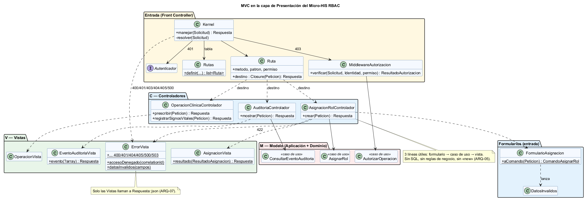
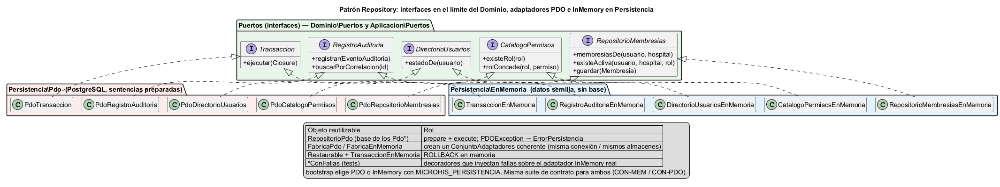
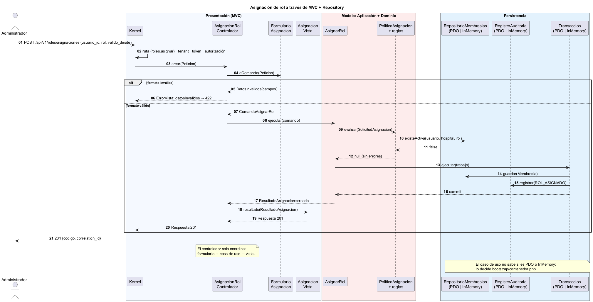
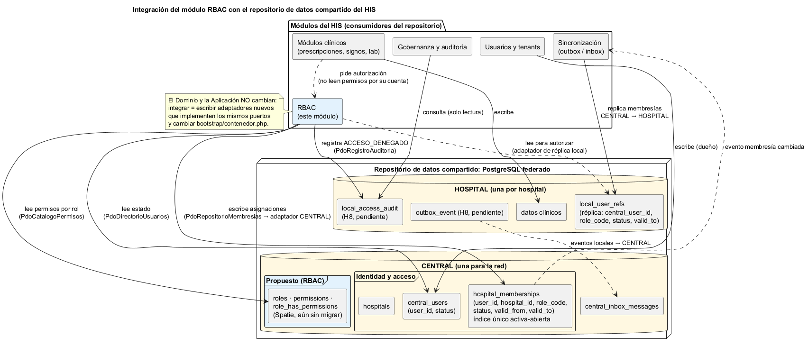

# Semana 4 — Arquitectura en capas, MVC y patrón Repository

| | |
|---|---|
| **Curso** | Análisis de Sistemas II — Proyecto Final 2026 |
| **Proyecto** | Sistema Hospitalario Integrado (HIS) |
| **Módulo** | RBAC: roles, permisos y protección de rutas |
| **Tema de la semana** | Arquitectura en capas y patrón repositorio |
| **Flujo** | «Asignación de rol, autorización de una operación y denegación trazable» |
| **Código** | [`micro-his-rbac/`](../micro-his-rbac/README.md) — el MISMO proyecto de la semana 3 |
| **Estudiante** | Boris Alexander Quiroa Orellana |
| **Fecha** | Octubre 2026 |

## Índice

1. [Introducción](#1-introducción)
2. [Qué cambió respecto de la semana 3](#2-qué-cambió-respecto-de-la-semana-3)
3. [Capas y responsabilidades](#3-capas-y-responsabilidades)
4. [MVC en la entrada](#4-mvc-en-la-entrada)
5. [Patrón Repository](#5-patrón-repository)
6. [Objetos reutilizables](#6-objetos-reutilizables)
7. [Vista dinámica: una petición a través de MVC y Repository](#7-vista-dinámica-una-petición-a-través-de-mvc-y-repository)
8. [Integración con un repositorio de datos compartido](#8-integración-con-un-repositorio-de-datos-compartido)
9. [Evidencia](#9-evidencia)
10. [Trazabilidad](#10-trazabilidad)
11. [Limitaciones y trabajo siguiente](#11-limitaciones-y-trabajo-siguiente)
12. [Conclusión](#12-conclusión)
13. [Bibliografía](#13-bibliografía)

## 1. Introducción

Esta semana continúa el **mismo** Micro-HIS RBAC con cuatro objetivos:

1. **Organizar la entrada HTTP con MVC:** controladores sin SQL ni reglas de negocio, vistas que dan formato a la respuesta, y el Modelo formado por las capas de Aplicación y Dominio.
2. **Formalizar el patrón Repository:** interfaces en el límite del dominio, con **dos adaptadores por puerto**, uno PDO (PostgreSQL) y otro InMemory.
3. **Identificar los objetos reutilizables.**
4. **Analizar y diagramar** cómo se integra este módulo con el **repositorio de datos compartido** del HIS, es decir, el PostgreSQL federado CENTRAL/HOSPITAL.

Como en la semana 3, cada regla de arquitectura se verifica con una prueba que lee el código, y se comprobó que cada prueba falla si se rompe la regla.

## 2. Qué cambió respecto de la semana 3

| Aspecto | Semana 3 | Semana 4 |
|---|---|---|
| Entrada HTTP | `Accion` por ruta: validaba, llamaba al caso de uso y armaba el JSON | **MVC:** `Controlador` (coordina) + `Formulario` (valida formato) + `Vista` (da formato) |
| Rutas | `TablaRutas` → objeto `Accion` | `Rutas` → método de controlador (`$controlador->crear(...)`) con su permiso |
| Formato de respuesta | Repartido entre `Kernel` y acciones | Solo en `Vistas/` (ARQ-07) |
| Adaptadores de persistencia | Solo PDO; los dobles en memoria vivían en `tests/` | **PDO e InMemory de producción** en `src/Persistencia/`, elegibles con `MICROHIS_PERSISTENCIA` |
| Dobles de prueba | Copias en memoria de cada repositorio | **Decoradores** (`*ConFallas`) sobre el adaptador InMemory real: no se duplica lógica |
| Garantía de intercambiabilidad | — | **Suite de contrato** que corre igual contra InMemory y PDO |
| Ejecución sin base de datos | Solo pruebas | API con `MICROHIS_PERSISTENCIA=memoria` y demo `php bin/demo.php` |
| Validación de fechas | `new DateTimeImmutable($texto)` | ISO-8601 estricto (ver hallazgo en §9.4) |

Dominio y Aplicación **no cambiaron**. La reorganización de la Presentación y la Persistencia no obligó a tocar ninguna regla de negocio, que es justamente lo que promete la arquitectura en capas.

## 3. Capas y responsabilidades

| Capa | Carpeta | Responsabilidad | Clases | Puede depender de |
|---|---|---|---|---|
| **Presentación** (V + C de MVC) | `src/Presentacion/Http` | Recibir HTTP, aplicar la cadena tenant → identidad → permiso, validar el **formato** de la entrada, delegar en el Modelo y dar formato a la respuesta. | `Kernel`, `Rutas`, `Ruta`, `MiddlewareAutorizacion`, `Peticion`, controladores (3), formularios (2), vistas (4), `Autenticador` | Aplicación |
| **Aplicación** (M de MVC) | `src/Aplicacion` | Casos de uso: orquestar, delimitar transacciones, registrar auditoría con respaldo. | `AutorizarOperacion`, `AsignarRol`, `ConsultarEventoAuditoria`, comandos, resultados, puerto `Transaccion` | Dominio |
| **Dominio** (M de MVC) | `src/Dominio` | Reglas del hospital y contratos de los repositorios. | `Membresia`, reglas (8), `PoliticaAutorizacion`, `PoliticaAsignacion`, puertos (4), excepciones | — |
| **Persistencia** | `src/Persistencia` | Implementar los puertos: PDO (PostgreSQL) e InMemory; traducir errores técnicos. | `Pdo*` (5) + `RepositorioPdo`, `*EnMemoria` (5) + `Restaurable`, fábricas, `ConjuntoAdaptadores`, `RegistroAuditoriaArchivo` | Dominio, Aplicación |
| **Composición** | `bootstrap/` | Crear y conectar objetos; elegir PDO o InMemory. | `contenedor.php` | Todas |

**Por qué Aplicación y Dominio forman el «Modelo» de MVC:** en MVC, el Modelo es todo lo que el usuario no ve, es decir, los datos y las reglas. Separarlo en Aplicación (orquestación) y Dominio (reglas) es la arquitectura en capas aplicada *dentro* del Modelo. El controlador solo ve los casos de uso y nunca toca el Dominio (ARQ-01).

## 4. MVC en la entrada



Fuente: [`diagramas/semana-04-mvc.puml`](diagramas/semana-04-mvc.puml)

| Pieza | Clases | Hace | No hace |
|---|---|---|---|
| **Front Controller** | `Kernel`, `Rutas`, `Ruta`, `MiddlewareAutorizacion` | Resuelve la ruta, aplica 400/401/403 y llama al controlador. | No conoce casos de uso concretos, salvo la autorización. |
| **C — Controlador** | `AsignacionRolControlador`, `AuditoriaControlador`, `OperacionClinicaControlador` | Coordina: formulario → caso de uso → vista. | No tiene SQL ni reglas de negocio, no crea objetos (`new`) y no arma JSON. |
| **Formulario** | `FormularioAsignacion`, `DatosInvalidos` | Valida el **formato** (campos presentes, fechas ISO-8601) y construye el comando. | No decide si el rol existe ni si hay duplicados: eso es del Dominio. |
| **V — Vista** | `AsignacionVista`, `EventoAuditoriaVista`, `OperacionVista`, `ErrorVista` | Es la **única** que define el formato y los textos de la respuesta. | No consulta datos. |
| **M — Modelo** | Casos de uso + Dominio | Decide y persiste. | No sabe nada de HTTP. |

El controlador completo de la asignación:

```php
public function crear(Peticion $peticion): Respuesta
{
    try {
        $comando = FormularioAsignacion::aComando($peticion);   // formato
    } catch (DatosInvalidos $e) {
        return ErrorVista::datosInvalidos($e->campos);         // 422
    }

    return AsignacionVista::resultado($this->asignarRol->ejecutar($comando));  // Modelo → Vista
}
```

**Reglas del controlador y cómo se verifican:**

| Regla | Prueba |
|---|---|
| Sin SQL ni PDO | ARQ-02 |
| No depende del Dominio ni de la Persistencia | ARQ-01 |
| Solo recibe casos de uso en el constructor; no usa `new`; no contiene códigos de negocio (`'medico'`, `'PERMISO_NO_ASIGNADO'`, `'roles.asignar'`, …) | ARQ-05 |
| No da formato a la respuesta (`Respuesta::json` solo en Vistas) | ARQ-07 |
| Funciona sin Kernel: se puede probar solo | MVC-03 |

## 5. Patrón Repository



Fuente: [`diagramas/semana-04-repositorio.puml`](diagramas/semana-04-repositorio.puml)

### 5.1 El límite apropiado de la interfaz

Las interfaces (`RepositorioMembresias`, `CatalogoPermisos`, `DirectorioUsuarios`, `RegistroAuditoria`) están en **`Dominio/Puertos`**. `Transaccion` está en **`Aplicacion/Puertos`**.

| Opción | Consecuencia | Decisión |
|---|---|---|
| Interfaz en Persistencia, junto a los adaptadores | El Dominio tendría que depender de la Persistencia para conocerla: se invierte mal la flecha. | ✗ |
| Sin interfaz (los casos de uso usan `PdoRepositorioMembresias`) | El dominio queda atado a PostgreSQL y no se puede probar sin base. | ✗ |
| **Interfaz en el Dominio** (quien la necesita la define) | La Persistencia se adapta al Dominio; se pueden tener N adaptadores. | ✓ |
| `Transaccion` en Aplicación | Delimitar una transacción es una decisión de orquestación del caso de uso, no una regla del hospital. | ✓ |

Las interfaces hablan el idioma del dominio (`existeActiva`, `membresiasDe`) y no el de la base de datos (`findBy`, `query`). Los errores también son del dominio: `ErrorPersistencia` y `MembresiaDuplicada`.

### 5.2 Dos adaptadores por puerto

| Puerto | Adaptador PDO | Adaptador InMemory |
|---|---|---|
| `RepositorioMembresias` | `PdoRepositorioMembresias` (índice único → SQLSTATE 23505 → `MembresiaDuplicada`) | `RepositorioMembresiasEnMemoria` (misma regla de unicidad en código) |
| `CatalogoPermisos` | `PdoCatalogoPermisos` | `CatalogoPermisosEnMemoria` |
| `DirectorioUsuarios` | `PdoDirectorioUsuarios` | `DirectorioUsuariosEnMemoria` |
| `RegistroAuditoria` | `PdoRegistroAuditoria` (append-only por trigger) | `RegistroAuditoriaEnMemoria` (sin métodos para editar ni borrar) |
| `Transaccion` | `PdoTransaccion` (BEGIN/COMMIT/ROLLBACK) | `TransaccionEnMemoria` (instantánea y restauración de los almacenes `Restaurable`) |

ARQ-06 verifica por reflexión que **cada uno** de los 5 puertos tenga un adaptador en `Persistencia\Pdo` y otro en `Persistencia\EnMemoria`.

**Selección:** `bootstrap/contenedor.php` crea un `ConjuntoAdaptadores` con `FabricaPdo` o con `FabricaEnMemoria`, según `MICROHIS_PERSISTENCIA=pdo|memoria`. Ningún caso de uso, regla, controlador ni vista sabe cuál se eligió.

### 5.3 Contrato: la misma suite para los dos adaptadores

[`tests/Contratos/ContratoRepositoriosPrueba.php`](../micro-his-rbac/tests/Contratos/ContratoRepositoriosPrueba.php) define la función `contratoRepositorios($prefijo, $adaptadores)` con 6 verificaciones:

1. filtro y vigencia de `membresiasDe`;
2. semántica de `existeActiva`;
3. guardar y rechazar el duplicado;
4. catálogo y directorio;
5. ida y vuelta de un evento de auditoría;
6. commit y rollback de la transacción.

Se ejecuta como `CON-MEM-*` sobre InMemory y como `CON-PDO-*` sobre PostgreSQL, este último solo si hay credenciales. Si ambos adaptadores pasan el mismo contrato, son **sustituibles** (principio de sustitución de Liskov): el sistema funciona igual con cualquiera.

## 6. Objetos reutilizables

| Objeto | Capa | Reutilizado por | Por qué es reutilizable |
|---|---|---|---|
| `RepositorioPdo::ejecutar()` | Persistencia | Los 4 repositorios PDO | Concentra `prepare` + `execute` + traducción de `PDOException`. Un repositorio nuevo hereda la seguridad sin repetirla. |
| `FabricaConexion` | Persistencia | API, pruebas de integración | Configura PDO una sola vez (excepciones, sin emulación de prepares). |
| `FabricaPdo` / `FabricaEnMemoria` → `ConjuntoAdaptadores` | Persistencia | API, demo, pruebas, contrato | Entregan siempre un conjunto coherente (misma conexión o mismos almacenes), así que la transacción abarca a todos. |
| `Restaurable` + `TransaccionEnMemoria` | Persistencia | Cualquier almacén en memoria | Cualquier almacén nuevo obtiene ROLLBACK con solo implementar 2 métodos. |
| `Membresia::estaVigenteEn()` | Dominio | `ContextoAutorizacion`, reglas | Una sola definición de «vigente» para todo el módulo. |
| `PoliticaAutorizacion` / `PoliticaAsignacion` + reglas | Dominio | API, demo, cualquier otro canal de entrada (CLI, cola) | No dependen de HTTP. Una regla nueva es una clase (OCP, semana 2). |
| `AutorizarOperacion` | Aplicación | `MiddlewareAutorizacion` (rutas) y `AsignarRol` (`roles.asignar`) | Un único punto de decisión y de trazabilidad. |
| `ErrorPersistencia` / `MembresiaDuplicada` | Dominio | Todos los adaptadores y casos de uso | Errores comunes, independientes de la tecnología. |
| `Kernel`, `Ruta`, `Peticion`, `Solicitud`, `Respuesta` | Presentación | Cualquier controlador nuevo | Proteger una ruta nueva es una línea en `Rutas::definir()`. |
| `ErrorVista` | Presentación | `Kernel`, controladores, otras vistas | Mensajes de error idénticos en toda la API; el 403 siempre sin detalles. |
| `FormularioAsignacion` / `DatosInvalidos` | Presentación | Controlador, pruebas MVC | Validación de formato separada y probada aparte (MVC-01). |
| `construirCasosDeUso()` / `construirKernel()` | bootstrap | API, demo, todas las pruebas | La misma composición en producción y en pruebas: lo que se prueba es lo que corre. |
| `RepositorioMembresiasConFallas`, `RegistroAuditoriaConFallas` | tests | Pruebas de error | Decoradores: reutilizan el adaptador real y solo agregan la falla. |
| `contratoRepositorios()` | tests | InMemory, PDO y futuros adaptadores (§8) | Cualquier adaptador nuevo se valida corriendo la misma función. |

## 7. Vista dinámica: una petición a través de MVC y Repository



Fuente: [`diagramas/semana-04-secuencia-mvc.puml`](diagramas/semana-04-secuencia-mvc.puml)

## 8. Integración con un repositorio de datos compartido

### 8.1 Qué es y cuál es el del HIS

En el estilo **repositorio de datos compartido** (*shared data*), varios componentes independientes se comunican leyendo y escribiendo un almacén común, en lugar de llamarse entre sí. En el HIS ese repositorio ya existe: es el **PostgreSQL federado** del proyecto principal. Tiene dos partes:

- **CENTRAL**, una para toda la red: identidad, membresías, MPI, consentimientos y sincronización.
- **HOSPITAL**, una por hospital: réplica local de usuarios, datos clínicos y auditoría local.

Varios módulos lo usan a la vez: usuarios, RBAC, clínicos, gobernanza y sincronización.



Fuente: [`diagramas/semana-04-repositorio-compartido.puml`](diagramas/semana-04-repositorio-compartido.puml)

### 8.2 Correspondencia entre el Micro-HIS y el repositorio compartido

| Micro-HIS (puerto → tabla local) | Repositorio compartido del HIS | Compatibilidad |
|---|---|---|
| `RepositorioMembresias` → `membresias` | CENTRAL `hospital_memberships` (`user_id`, `hospital_id`, `role_code`, `status`, `valid_from`, `valid_to`) | **Directa.** Mismos estados (`active`/`inactive`/`revoked`), misma vigencia y **mismo índice único parcial** de membresía activa abierta (`hospital_memberships_active_open_unique`). Solo cambian los nombres de las columnas y el tipo de id (`uuid`). |
| `DirectorioUsuarios` → `usuarios` | CENTRAL `central_users` (`user_id`, `status`) | **Directa.** Mismos estados `active`/`inactive`. |
| `CatalogoPermisos` → `roles`, `permisos`, `rol_permiso` | Tablas de Spatie (`roles`, `permissions`, `role_has_permissions`), configuradas en `config/permission.php` | **Brecha:** esas tablas **no existen todavía** en el esquema federado. Hay que migrarlas en CENTRAL para que el catálogo sea único en la red. |
| `RegistroAuditoria` → `eventos_auditoria` | HOSPITAL `local_access_audit` (entidad H8 del esquema) | **Brecha:** H8 está **pendiente** de migrar. Mientras tanto, se puede usar la tabla del módulo de gobernanza. |
| Lectura para autorizar | HOSPITAL `local_user_refs` (réplica: `central_user_id`, `role_code`, `status`, `valid_to`) | **Brecha:** `local_user_refs` es **única por usuario** (`UNIQUE (central_user_id)`), así que la réplica solo guarda **un rol por usuario y hospital**. El dominio de RBAC admite varios roles (DOM-02, «varios roles»). |

### 8.3 Cómo se integraría

El diseño del Micro-HIS hace que la integración sea **solo de Persistencia y composición**:

1. **Escritura (asignar rol) en CENTRAL.** Un adaptador `PdoRepositorioMembresiasCentral implements RepositorioMembresias` usa las mismas sentencias preparadas con los nombres del HIS:

   ```sql
   SELECT user_id, hospital_id, role_code, status, valid_from, valid_to
     FROM hospital_memberships
    WHERE user_id = :usuario AND hospital_id = :hospital

   INSERT INTO hospital_memberships (user_id, hospital_id, role_code, status, valid_from, valid_to)
   VALUES (:usuario, :hospital, :rol, :estado, :desde, :hasta)
   ```

   El índice único del HIS produce el mismo SQLSTATE 23505, que se traduce a `MembresiaDuplicada`, igual que hoy.
2. **Lectura para autorizar en la réplica local HOSPITAL.** Un adaptador de solo lectura sobre `local_user_refs` hace que cada hospital pueda autorizar **aunque CENTRAL no esté disponible**. Sin esto, una caída de CENTRAL, con fail-closed, denegaría todo en todos los hospitales.
3. **Sincronización.** Al cambiar `hospital_memberships`, el canal outbox/inbox del HIS replica el cambio a `local_user_refs`. RBAC no escribe en la réplica: la escribe el módulo de sincronización.
4. **Auditoría local.** `PdoRegistroAuditoria` apunta a `local_access_audit`, que debe tener el mismo trigger append-only que ya usa `cross_hospital_access_audits`.
5. **Composición.** Solo se cambia `crearAdaptadores()` en `bootstrap/contenedor.php`. **Dominio, Aplicación y Presentación no se tocan.**
6. **Validación.** Cada adaptador nuevo debe pasar `contratoRepositorios()` (§5.3) antes de usarse.

### 8.4 Ventajas y riesgos del repositorio compartido para RBAC

| | Detalle | Mitigación |
|---|---|---|
| ✓ Fuente única de verdad | Un rol asignado se ve en toda la red sin integraciones punto a punto. | — |
| ✓ Integridad en la base | El índice único y los `CHECK` de vigencia protegen incluso frente a otros módulos que escriban. | — |
| ✓ Auditoría centralizable | Gobernanza consulta los eventos sin depender de la API de RBAC. | — |
| ✗ Acoplamiento al esquema | Si el módulo de usuarios cambia `central_users`, RBAC puede romperse. | El acceso pasa **solo** por adaptadores, y la suite de contrato detecta el cambio. Acordar el esquema mediante migraciones revisadas. |
| ✗ Propiedad difusa de los datos | ¿Quién es dueño de `hospital_memberships`? | Definir que **RBAC escribe** `hospital_memberships` y **Usuarios escribe** `central_users`; los demás solo leen. |
| ✗ Privilegios excesivos | Un módulo con permisos totales sobre la base es un riesgo. | Rol de base de datos por módulo con mínimo privilegio. RBAC: `SELECT` en `central_users`; `SELECT, INSERT, UPDATE (status, valid_to)` en `hospital_memberships`; `SELECT, INSERT` en `local_access_audit`; **nunca** `DELETE`. |
| ✗ Disponibilidad | CENTRAL caído + fail-closed = nadie puede trabajar. | Autorizar con la réplica local `local_user_refs` (§8.3, paso 2). |
| ✗ Consistencia eventual | Un rol revocado en CENTRAL tarda en llegar a la réplica. | Monitorear el retraso con `sync_checkpoints.lag_seconds`, que ya existe en CENTRAL. Para revocaciones críticas, consultar CENTRAL en la siguiente operación sensible. |
| ✗ Contención | Muchas lecturas de autorización sobre la misma tabla. | Leer de la réplica local; índices `(usuario, hospital)` en ambos lados. |

### 8.5 Decisión recomendada

Integrar RBAC al repositorio compartido con **separación lectura/escritura**:

- **Escribe** en CENTRAL (`hospital_memberships`), que es la fuente de verdad.
- **Lee para autorizar** de la réplica HOSPITAL (`local_user_refs`), por disponibilidad y rendimiento.
- **Registra** en la auditoría local (`local_access_audit`).

Para hacerlo, antes hay que resolver tres brechas del esquema compartido:

1. migrar el catálogo de Spatie a CENTRAL;
2. migrar H8 (`local_access_audit`, `outbox_event`);
3. permitir varios roles por usuario en `local_user_refs`.

La frontera de servicio y la comunicación se evaluarán en la semana 5.

## 9. Evidencia

### 9.1 Pruebas

```bash
cd docs/modulos/rbac/micro-his-rbac
php tests/ejecutar.php
```

Salida completa en [`evidencia/salida-pruebas.txt`](evidencia/salida-pruebas.txt):

```
Total: 46  Pasan: 44  Fallan: 0  Omitidas: 2
```

| Grupo | IDs | Novedad de la semana 4 |
|---|---|---|
| Reglas de dominio | DOM-01 a DOM-04 | Sin cambios: el dominio no se tocó. |
| Casos de uso | APP-01 a APP-06 | Ahora corren sobre el adaptador InMemory **de producción**. |
| Errores de persistencia | PER-01 a PER-10 | Usan decoradores `*ConFallas` y `FabricaPdo`. |
| **Contrato Repository** | **CON-MEM-01 a 06**, CON-PDO | **Nuevo:** misma suite para InMemory y PDO. |
| Presentación | HTTP-01 a 08, **MVC-01 a 03** | **Nuevo:** formulario, vista y controlador probados por separado. |
| Arquitectura | ARQ-01 a 04, **ARQ-05 a 07** | **Nuevo:** reglas del controlador MVC, dos adaptadores por puerto, formato solo en Vistas. |
| Integración | INT-00 | Requiere PostgreSQL. |

Las 2 pruebas omitidas (CON-PDO e INT-00) necesitan credenciales de PostgreSQL en `MICROHIS_DB_DSN`.

### 9.2 Las pruebas de arquitectura detectan violaciones reales

Se inyectaron violaciones temporales y luego se revirtieron:

| Violación inyectada | Resultado |
|---|---|
| En `OperacionClinicaControlador`: `new \DateTimeImmutable()`, una comparación con `'medico'` y un `Respuesta::json(...)` | ARQ-05 falló («crea objetos con new», «contiene códigos de reglas de negocio») y ARQ-07 falló («formato de respuesta fuera de las vistas»). |
| `DirectorioUsuariosEnMemoria` sin `implements DirectorioUsuarios` | ARQ-06 falló: «DirectorioUsuarios sin adaptador EnMemoria». PHP también rechazó el tipo al construir `ConjuntoAdaptadores`. |

Al restaurar, el resultado volvió a 44/0/2.

### 9.3 Demostración de punta a punta sin base de datos

`php bin/demo.php` ejecuta el flujo completo con los mismos controladores, casos de uso y reglas sobre InMemory. Salida completa en [`evidencia/salida-demo.txt`](evidencia/salida-demo.txt):

```
▶ 1. El administrador asigna el rol «laboratorio» a un usuario nuevo       ← 201 ROL_ASIGNADO
▶ 2. La enfermera registra signos vitales (permitido)                      ← 201
▶ 3. La enfermera intenta crear una prescripción                           ← 403 {mensaje, correlation_id}
▶ 4. El administrador consulta la denegación por su correlation_id         ← 200 … "motivo":"PERMISO_NO_ASIGNADO"
▶ 5. La enfermera intenta asignarse un rol                                 ← 403
```

También se probó la API real con `MICROHIS_PERSISTENCIA=memoria php -S 127.0.0.1:8099 -t public`:

| Petición | Respuesta |
|---|---|
| Enfermera crea prescripción | 403 + `correlation_id` |
| Médica crea prescripción | 201 |
| Administrador asigna rol | 201 |
| Fecha `"x"` | 422 `DATOS_INVALIDOS` |

### 9.4 Hallazgo: validación de fechas demasiado permisiva

Al escribir MVC-01, la prueba falló porque el formulario aceptaba `"valido_hasta": "x"` como fecha válida. `new DateTimeImmutable('x')` no lanza error: interpreta `x` como la zona horaria militar «X-ray». Este bug también existía en la `AsignarRolAccion` de la semana 3.

Se corrigió exigiendo formato ISO-8601 (`2026-11-15` o `2026-11-15T00:00:00-06:00`) antes de construir la fecha. Es un ejemplo de por qué conviene separar la validación de formato en un objeto propio que se pueda probar aislado.

## 10. Trazabilidad

| Requisito de la tarea | Dónde | Evidencia |
|---|---|---|
| Continuar el MISMO micro-HIS y flujo | `micro-his-rbac/` (Dominio y Aplicación intactos) | DOM-*, APP-* sin cambios funcionales |
| Organizar la entrada con MVC | `Presentacion/Http/{Controladores,Vistas,Formularios}` | MVC-01 a 03, HTTP-01 a 08, ARQ-07 |
| Interfaz Repository en el límite apropiado | `Dominio/Puertos`, `Aplicacion/Puertos` | §5.1, ARQ-01 |
| Adaptadores PDO e InMemory | `Persistencia/Pdo`, `Persistencia/EnMemoria` | ARQ-06, CON-MEM-*, (CON-PDO-*) |
| Controlador sin SQL ni reglas de negocio | `Controladores/*` | ARQ-02, ARQ-05, MVC-03 |
| Analizar y diagramar el repositorio de datos compartido | §8 y diagrama | Correspondencia de tablas, riesgos, decisión |
| Capas, responsabilidades y objetos reutilizables | §3 y §6 | — |

## 11. Limitaciones y trabajo siguiente

- **Pruebas sin PostgreSQL:** `CON-PDO` e `INT-*` están escritas, pero se omitieron por falta de credenciales en el entorno de desarrollo.
- **Memoria por petición:** en modo `memoria`, cada petición HTTP a `php -S` arranca con los datos semilla. Por eso el recorrido completo se demuestra con `bin/demo.php`, que corre en un solo proceso.
- **Adaptadores al esquema compartido:** los adaptadores de §8.3 están diseñados pero no implementados, porque dependen de las tres brechas del esquema.
- **Semana 5:** cliente-servidor y evaluación de la frontera de microservicio (contrato API, propiedad de datos, resiliencia).

## 12. Conclusión

La arquitectura en capas cumplió su promesa: se reorganizó por completo la entrada (MVC) y se agregó un segundo mecanismo de persistencia (InMemory) **sin modificar una sola regla de negocio**.

El patrón Repository, con las interfaces en el límite del dominio y validado por una suite de contrato común, hace que los adaptadores sean intercambiables. Esa misma propiedad hace viable integrar el módulo al repositorio de datos compartido del HIS: el análisis mostró que `hospital_memberships` ya tiene la misma semántica que el modelo de RBAC, y dejó identificadas las tres brechas del esquema que hay que resolver primero.

## 13. Bibliografía

- Fowler, M. (2002). *Patterns of Enterprise Application Architecture*. Addison-Wesley. (Repository, Model View Controller, Front Controller, Service Layer, Unit of Work).
- Evans, E. (2003). *Domain-Driven Design: Tackling Complexity in the Heart of Software*. Addison-Wesley. Cap. 6 («Repositories»).
- Martin, R. C. (2018). *Clean Architecture*. Prentice Hall. Caps. 17 («Boundaries») y 22 («The Clean Architecture»).
- Bass, L., Clements, P. y Kazman, R. (2021). *Software Architecture in Practice* (4.ª ed.). Addison-Wesley. (Estilo *shared-data / repository*).
- Shaw, M. y Garlan, D. (1996). *Software Architecture: Perspectives on an Emerging Discipline*. Prentice Hall. (Repositorios y pizarras).
- Richardson, C. (2018). *Microservices Patterns*. Manning. Cap. 2 (patrón *Shared database* y sus riesgos).
- Krasner, G. y Pope, S. (1988). A cookbook for using the model-view controller user interface paradigm in Smalltalk-80. *Journal of Object-Oriented Programming*, 1(3), 26–49.
- The PHP Group. (2026). *PHP Manual — DateTimeImmutable::__construct y formatos admitidos*. https://www.php.net/manual/es/datetime.formats.php
