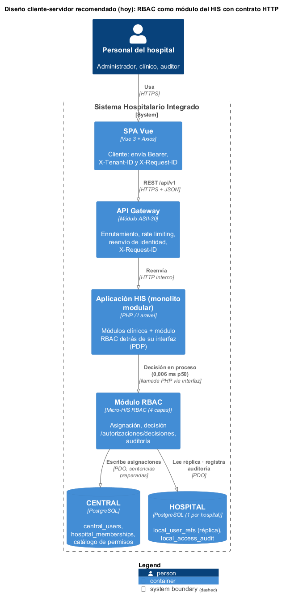
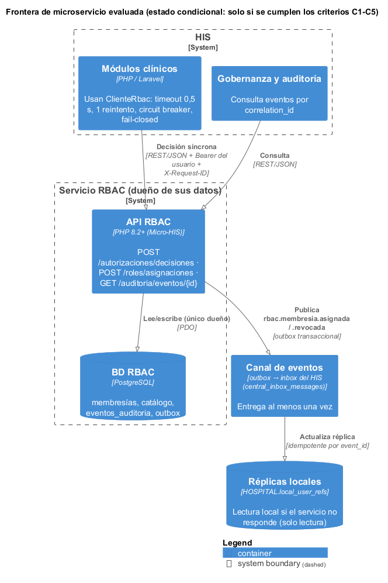
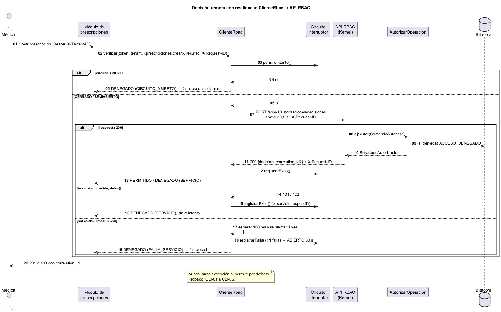
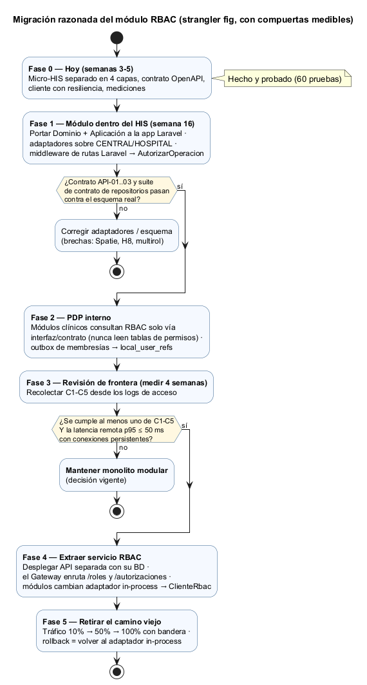
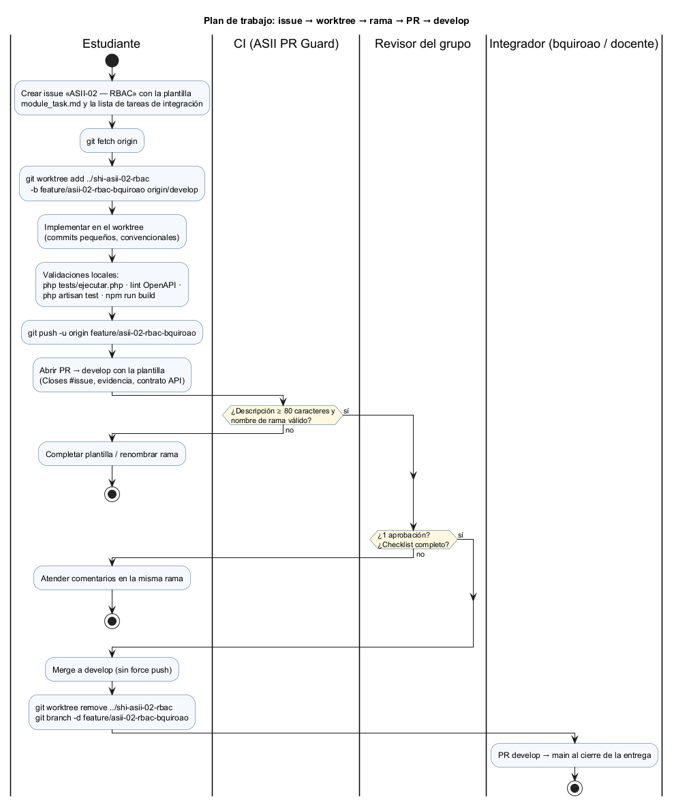

# Semana 5 — Cliente-servidor, API REST, frontera de microservicio e integración

| | |
|---|---|
| **Curso** | Análisis de Sistemas II — Proyecto Final 2026 |
| **Proyecto** | Sistema Hospitalario Integrado (HIS) |
| **Módulo** | RBAC: roles, permisos y protección de rutas |
| **Tema de la semana** | Cliente-servidor, API REST, microservicios e integración |
| **Flujo** | «Asignación de rol, autorización de una operación y denegación trazable» |
| **Código** | [`micro-his-rbac/`](../micro-his-rbac/README.md) — el MISMO proyecto de las semanas 3 y 4 |
| **Contrato** | [`micro-his-rbac/api/openapi.yaml`](../micro-his-rbac/api/openapi.yaml) (OpenAPI 3.1) |
| **Estudiante** | Boris Alexander Quiroa Orellana |
| **Fecha** | Octubre 2026 |

## Índice

1. [Introducción y decisión](#1-introducción-y-decisión)
2. [Qué se construyó esta semana](#2-qué-se-construyó-esta-semana)
3. [Diseño cliente-servidor](#3-diseño-cliente-servidor)
4. [Contrato API](#4-contrato-api)
5. [Evaluación de la frontera de microservicio](#5-evaluación-de-la-frontera-de-microservicio)
6. [Propiedad de los datos](#6-propiedad-de-los-datos)
7. [Comunicación](#7-comunicación)
8. [Seguridad](#8-seguridad)
9. [Resiliencia](#9-resiliencia)
10. [Observabilidad](#10-observabilidad)
11. [Consistencia](#11-consistencia)
12. [Migración razonada](#12-migración-razonada)
13. [Plan de issue, rama, worktree y PR](#13-plan-de-issue-rama-worktree-y-pr)
14. [Evidencia](#14-evidencia)
15. [Limitaciones](#15-limitaciones)
16. [Conclusión](#16-conclusión)
17. [Bibliografía](#17-bibliografía)

## 1. Introducción y decisión

Esta semana el Micro-HIS RBAC evoluciona hacia un diseño **cliente-servidor**:

- expone un **contrato REST** formal (OpenAPI 3.1);
- agrega un **endpoint de decisión** para que otros módulos del HIS pregunten «¿puede este usuario hacer esto?»;
- incluye una **librería cliente** con las protecciones que necesita una llamada por red.

Con esa base se **evalúa con datos medidos** si conviene separar RBAC como microservicio.

> **Decisión:** **no dividir el sistema todavía.** RBAC queda como **módulo del HIS (monolito modular)**, con una frontera explícita (contrato API + interfaz de decisión) que permite extraerlo más adelante sin rediseño. La extracción queda condicionada a criterios medibles (C1–C5, §5.3).

Motivo, con datos medidos:

| Forma de llamar a RBAC | Costo por decisión (p50) |
|---|---|
| Dentro del proceso | **0,006 ms** |
| Por red local | entre **33 y 62 ms** según la corrida |

Separar RBAC haría que cada operación protegida del HIS pague ese salto de red, sin que hoy exista ninguna necesidad que lo justifique: no hay otro consumidor, ni un volumen alto, ni un equipo separado.

## 2. Qué se construyó esta semana

| Pieza | Archivo | Propósito |
|---|---|---|
| Contrato OpenAPI 3.1 | `api/openapi.yaml` | Las 5 operaciones con permisos (`x-permiso`), cabeceras, esquemas, ejemplos y errores. Validado con Redocly. |
| Endpoint de decisión (PDP) | `AutorizacionControlador`, `FormularioDecision`, `DecisionVista`, ruta `POST /api/v1/autorizaciones/decisiones` | Punto único de decisión para otros módulos. |
| Librería cliente | `src/Cliente/*` (`ClienteRbac`, `CircuitoInterruptor`, `TransporteHttpStream`, …) | Lo que usaría un módulo consumidor: timeout, reintento, circuit breaker, fail-closed. |
| Observabilidad | `Kernel` (X-Request-ID + registro de acceso), `Respuesta` con cabeceras | Trazar una petición entre módulos sin registrar secretos. |
| Pruebas de contrato API | `tests/Contratos/ContratoApiPrueba.php` (API-01 a 03) | El YAML y el código no pueden divergir. |
| Pruebas cliente-servidor | `tests/Cliente/ClienteRbacPrueba.php` (CLI-01 a 07) | Resiliencia y comunicación cliente ↔ servidor. |
| Pruebas de observabilidad | `tests/Presentacion/ObservabilidadPrueba.php` (OBS-01 a 03) | Trazabilidad y logs sin tokens. |
| Reglas de arquitectura | ARQ-01 (capa `Cliente` aislada), ARQ-08 | El cliente no conoce el servidor; solo una ruta sin permiso. |
| Medición | `bin/medir.php` | Datos para decidir la frontera. |

**Dominio, Aplicación y Persistencia no cambiaron.** El endpoint de decisión reutiliza el caso de uso `AutorizarOperacion` de las semanas 3 y 4.

## 3. Diseño cliente-servidor



Fuente: [`diagramas/semana-05-cliente-servidor.puml`](diagramas/semana-05-cliente-servidor.puml)

| Rol | Quién | Responsabilidad |
|---|---|---|
| **Cliente de usuario** | SPA Vue | Presentar la interfaz; enviar `Authorization: Bearer`, `X-Tenant-ID` y `X-Request-ID`. No decide permisos: solo oculta botones para mejorar la experiencia, y el servidor vuelve a verificar. |
| **Cliente de servicio** | Módulos clínicos (prescripciones, laboratorio…) | Antes de ejecutar una operación, preguntan a RBAC con `ClienteRbac` reenviando el token del usuario. |
| **Intermediario** | API Gateway (módulo ASII-30) | Enrutamiento, TLS, rate limiting y propagación de `X-Request-ID`. |
| **Servidor** | Módulo RBAC | Decide, asigna roles y audita. Es el **único** que conoce las reglas de acceso. |
| **Datos** | PostgreSQL CENTRAL/HOSPITAL | Persistencia (semana 4, §8). |

**Principios del diseño:**

1. **Servidor sin estado.** Cada petición trae su identidad (token) y su contexto (tenant), así que el servidor se puede escalar horizontalmente.
2. **La decisión vive en el servidor.** Ningún cliente lee tablas de permisos (patrón PDP/PEP: el cliente *aplica* la decisión que el servidor *toma*).
3. **Contrato primero.** El cliente se programa contra `openapi.yaml`, no contra las clases del servidor. ARQ-01 impide que `Rbac\Cliente` importe clases del servidor.

## 4. Contrato API

Contrato completo: [`api/openapi.yaml`](../micro-his-rbac/api/openapi.yaml). Validado con `npx @redocly/cli lint` («Your API description is valid»). Evidencia en [`evidencia/salida-lint-openapi.txt`](evidencia/salida-lint-openapi.txt).

### 4.1 Operaciones

| Método | Ruta | `x-permiso` | Respuestas | Caso de uso |
|---|---|---|---|---|
| POST | `/api/v1/roles/asignaciones` | `roles.asignar` | 201 · 400 · 401 · 403 · 404 · 409 · 422 · 500 | CU-01 |
| POST | `/api/v1/autorizaciones/decisiones` | — (solo autenticación) | 200 · 400 · 401 · 422 · 500 | CU-02/03 (PDP) |
| GET | `/api/v1/auditoria/eventos/{correlationId}` | `auditoria.consultar` | 200 · 400 · 401 · 403 · 404 · 500 | CU-06 |
| POST | `/api/v1/prescripciones` | `prescripciones.crear` | 201 · 400 · 401 · 403 · 500 | demo |
| POST | `/api/v1/signos-vitales` | `signos_vitales.registrar` | 201 · 400 · 401 · 403 · 500 | demo |

### 4.2 Endpoint de decisión

Petición:

```http
POST /api/v1/autorizaciones/decisiones
Authorization: Bearer <token del usuario final>
X-Tenant-ID: hosp-oriente
X-Request-ID: traza-modulo-0002

{"permiso": "prescripciones.crear", "recurso": "POST /api/v1/prescripciones"}
```

Respuestas:

```json
200 {"decision": "PERMITIDO"}
200 {"decision": "DENEGADO", "correlation_id": "6f0b0f8e-…"}
```

| Decisión de diseño | Motivo |
|---|---|
| **200 también al denegar** | La consulta se atendió bien. El 403 queda para «no puedes usar este recurso»; aquí el recurso *es* la pregunta. Así el cliente distingue «la respuesta es no» de «falló la llamada». |
| **Sin `usuario_id` en el cuerpo** | El cliente solo puede preguntar por el **dueño del token**. Evita el problema del «diputado confundido»: un módulo no puede consultar los permisos de otra persona. |
| **Sin permiso propio** (`x-permiso: null`) | Protegerlo con otro permiso sería circular. Exige autenticación (401) y tenant (400). ARQ-08 garantiza que es la **única** ruta sin permiso. |
| **Toda denegación se audita** | Aunque la respuesta sea 200, el evento `ACCESO_DENEGADO` queda registrado con el motivo (CLI-07). |

### 4.3 Reglas transversales del contrato

- **Errores:** formato fijo, definido por `ErrorVista`. El 403 es siempre `{"mensaje":"Acceso denegado.","correlation_id":"…"}`, sin motivo.
- **Cabeceras:** `X-Tenant-ID` obligatoria; `X-Request-ID` opcional y validada con `^[A-Za-z0-9-]{8,64}$`; `X-Request-ID` en todas las respuestas.
- **Versionado:**
  - versión mayor en la ruta (`/api/v1`);
  - los campos opcionales nuevos no cambian la versión;
  - un cambio incompatible crea `/api/v2`, y `/v1` se mantiene un semestre con aviso.
- **Conformidad comprobada por pruebas:**
  - **API-01:** mismas operaciones y permisos en el YAML y en `Rutas::definir()`.
  - **API-02:** toda operación documenta 400, 401 y 500, y las protegidas también 403.
  - **API-03:** 15 escenarios reales y cada código devuelto está documentado.

## 5. Evaluación de la frontera de microservicio



Fuente: [`diagramas/semana-05-frontera-microservicio.puml`](diagramas/semana-05-frontera-microservicio.puml)

### 5.1 ¿RBAC es un buen candidato a servicio?

| Criterio de frontera | Evaluación |
|---|---|
| Contexto acotado propio (DDD) | ✓ Vocabulario y reglas propias (membresía, permiso, decisión). |
| Datos propios | ✓ Membresías, catálogo y bitácora de accesos. |
| Interfaz estrecha | ✓ Una operación de lectura muy usada (decidir), dos de escritura (asignar, consultar). |
| Acoplamiento con otros módulos | ✗ **Alto en tiempo de ejecución:** *todas* las operaciones protegidas lo necesitan. Si RBAC cae, con fail-closed nada funciona. |
| Sensibilidad a la latencia | ✗ Está en el camino crítico de cada petición. |

RBAC tiene una buena frontera **lógica**, que ya está implementada como capas y contrato. Separarlo **físicamente** cambia una llamada de microsegundos por una dependencia de red en el camino crítico de todo el HIS.

### 5.2 Medición

`php bin/medir.php 5000 300`, adaptadores InMemory, PHP 8.4.26, Windows. Salida en [`evidencia/salida-medicion.txt`](evidencia/salida-medicion.txt):

| Escenario | n | p50 | p95 | p99 | Veces el p50 de A |
|---|---:|---:|---:|---:|---:|
| A) Módulo en proceso (llamada PHP) | 5000 | 0,006 ms | 0,007 ms | 0,010 ms | 1× |
| B) API HTTP en proceso (Kernel completo, sin red) | 5000 | 0,016 ms | 0,028 ms | 0,052 ms | 3× |
| C) Servicio separado por red local (`php -S` + `ClienteRbac`) | 300 | 32,9 ms | 73,9 ms | 85,7 ms | ≈5 500× |
| C0) Control: petición mínima (404) por la misma red | 300 | 22,7 ms | 42,6 ms | 49,4 ms | ≈3 800× |

En las 300 decisiones por red hubo 0 decisiones incorrectas.

**Lectura de los datos:**

- **El costo de RBAC no es su lógica.** El Kernel completo con HTTP en proceso (B) cuesta 0,016 ms. El ≈70 % del costo remoto (C0 frente a C) es el **salto de red más el arranque por petición**, y aparece aunque la petición no haga nada.
- **Impacto en el HIS:** si una pantalla clínica dispara 5 operaciones protegidas, el diseño remoto agrega entre 5 × 33 ms ≈ **165 ms** (p50) y 5 × 74 ms ≈ **370 ms** (p95) por pantalla. El monolito modular agrega menos de 0,1 ms.
- **Honestidad del dato:** `php -S` es un servidor de desarrollo de un proceso y en Windows. Una primera corrida dio p50 = 62 ms. En producción, con PHP-FPM y conexiones persistentes, la cifra bajaría, pero el salto de red no desaparece. Por eso la compuerta de §5.3 exige volver a medir en condiciones reales.

### 5.3 Criterios medibles para extraer el servicio

RBAC se extrae **solo si** se cumple al menos uno de C1–C5 **y** la latencia remota medida (p95) es de 50 ms o menos con conexiones persistentes.

| ID | Criterio | Cómo se mide | Umbral | Valor hoy |
|---|---|---|---|---|
| C1 | Consumidores fuera de la app principal (otro lenguaje o despliegue) | Inventario de integraciones | ≥ 1 | 0 |
| C2 | Carga de decisiones que exige escalar RBAC por separado | Registro de acceso: peticiones por segundo a `/autorizaciones/decisiones` | > 200 req/s sostenidas | No medible aún (prototipo); estimado < 5 req/s |
| C3 | Cadencia de despliegue distinta del resto del HIS | Historial de git: releases solo de RBAC | > 2 por semana durante 1 mes | 1 por semana, junto con el resto |
| C4 | Requisito de disponibilidad mayor que el del monolito | SLO acordado | SLO de RBAC > SLO del HIS | No definido (mismo SLO) |
| C5 | Equipo propio que mantenga el servicio | Personas asignadas | ≥ 2 | 1 |

**Resultado: no se cumple ningún criterio.** Dividir el sistema hoy no tiene justificación medible, que es justo lo que la tarea pide no hacer.

## 6. Propiedad de los datos

| Dato | Dueño (único que escribe) | Cómo lo usa RBAC | Cómo lo usan los demás |
|---|---|---|---|
| `central_users` (identidad, estado) | Módulo de usuarios | Lee el estado (`DirectorioUsuarios`) | Leen |
| `hospital_memberships` (rol + vigencia) | **RBAC** | Lee y escribe (`RepositorioMembresias`) | No escriben. Consultan vía API o reciben eventos. |
| Catálogo de roles y permisos | **RBAC** | Lee (`CatalogoPermisos`) | No leen: preguntan al PDP |
| Eventos `ROL_ASIGNADO` / `ACCESO_DENEGADO` | **RBAC** (append-only) | Escribe | Gobernanza lee (API o solo lectura) |
| `local_user_refs` (réplica por hospital) | Módulo de sincronización | Lee para autorizar en local (§9) | Leen |

**Regla:** ningún otro módulo escribe en las tablas de RBAC ni toma decisiones de acceso por su cuenta. En el monolito, esta regla se aplica con roles de base de datos de mínimo privilegio (semana 4, §8.4). Si RBAC se extrae, se convierte en una frontera física: base de datos propia.

## 7. Comunicación

| Interacción | Estilo | Por qué |
|---|---|---|
| Decidir un permiso | **Síncrona** (REST hoy; llamada en proceso en el monolito) | La operación clínica no puede seguir sin la respuesta. |
| Asignar un rol | **Síncrona** (REST) | El administrador necesita la confirmación (201/409/422). |
| Propagar un cambio de membresía a las réplicas | **Asíncrona** (outbox → inbox del HIS) | Los hospitales no deben depender de que CENTRAL responda en ese momento. |
| Consultar la auditoría | **Síncrona** (REST) | Consulta puntual del auditor. |

**Evento propuesto** (contrato asíncrono, versionado):

```json
{
  "event_id": "uuid",
  "event_type": "rbac.membresia.asignada",
  "schema_version": 1,
  "occurred_at": "2026-11-15T10:00:00-06:00",
  "hospital_id": "hosp-oriente",
  "user_id": "nuevo-01",
  "role_code": "laboratorio",
  "valid_from": "2026-11-15T00:00:00-06:00",
  "valid_to": null,
  "correlation_id": "uuid del ROL_ASIGNADO"
}
```

El evento se escribe en una tabla `outbox` **en la misma transacción** que la membresía y el `ROL_ASIGNADO` (R-07), y un proceso aparte lo entrega a `central_inbox_messages`. El consumidor es idempotente por `event_id`. También existe `rbac.membresia.revocada`.

## 8. Seguridad

| Amenaza (OWASP API Top 10, 2023) | Control | Evidencia |
|---|---|---|
| API1 — Autorización a nivel de objeto (BOLA) | El tenant del token debe coincidir con `X-Tenant-ID`; la auditoría solo devuelve eventos del propio hospital. | HTTP-07, HTTP-06, CLI-07 |
| API2 — Autenticación rota | 401 sin token o con token inválido; el PDP solo decide sobre el dueño del token. | HTTP-02, CLI-05 |
| API3 — Exposición de propiedades | El 403 y la decisión DENEGADO no revelan el motivo ni el rol. | HTTP-03, CLI-07, MVC-02 |
| API4 — Consumo sin límite | Rate limiting por usuario y tenant en el API Gateway; `recurso` ≤ 200 caracteres. | Diseño (Gateway), `FormularioDecision` |
| API5 — Autorización a nivel de función | Cada ruta declara su permiso; solo el PDP no lo tiene. | ARQ-08, API-01 |
| API8 — Mala configuración de seguridad | 500 genérico sin trazas; credenciales en variables de entorno. | HTTP-08, `config.php` |
| Inyección (SQL / logs) | Sentencias preparadas; `X-Request-ID` con lista blanca (un valor como `<script>` no se refleja); permiso validado con regex. | ARQ-03, OBS-01, CLI-07 |
| Fuga de secretos en logs | El registro de acceso nunca incluye tokens ni el motivo. | OBS-02 |

**Entre servicios** (solo si se extrae RBAC):

- TLS obligatorio;
- autenticación del módulo llamador (mTLS o token de servicio) **además** del token del usuario;
- *allowlist* de módulos que pueden consultar el PDP.

## 9. Resiliencia



Fuente: [`diagramas/semana-05-secuencia-resiliencia.puml`](diagramas/semana-05-secuencia-resiliencia.puml)

| Mecanismo | Implementación | Prueba |
|---|---|---|
| Timeout | `ClienteRbac` con 0,5 s por defecto | CLI-06 (servidor inalcanzable → respuesta en menos de 5 s) |
| Reintento acotado | 1 reintento con espera de 100 ms, **solo** ante falla de red o 5xx | CLI-02, CLI-03 |
| Sin reintento ante 4xx | Un 401/422 es una respuesta válida del servicio | CLI-05 |
| Circuit breaker | `CircuitoInterruptor`: 3 fallas → ABIERTO 30 s → SEMIABIERTO → CERRADO | CLI-04 |
| Fail-closed | Cualquier falla devuelve `DENEGADO` con `origen` (`FALLA_SERVICIO` / `CIRCUITO_ABIERTO`); nunca permite por defecto ni lanza excepción | CLI-03, CLI-04, CLI-06 |
| Respaldo de auditoría | Si la bitácora cae, el evento va a un archivo y la operación sigue denegada | PER-09 (semana 3) |
| Degradación controlada (fase 4) | Si el servicio no responde, autorizar contra la réplica local `local_user_refs` | Diseño |

**Sobre la caché de decisiones:** **no se usa.** Guardar un `PERMITIDO` en caché retrasaría el efecto de una revocación, y en un hospital eso es un riesgo clínico y legal. Si en el futuro hiciera falta, se usaría un TTL ≤ 30 s, solo para permisos no críticos, e invalidado por el evento `rbac.membresia.revocada`.

**Reintentos y auditoría:** si un reintento ocurre después de que el servidor ya procesó una denegación, el `ACCESO_DENEGADO` puede quedar dos veces, con distintos `correlation_id`. Es aceptable: sobra evidencia en lugar de faltar, y el `X-Request-ID` común permite agruparlos.

## 10. Observabilidad

| Señal | Implementación | Para qué |
|---|---|---|
| **`X-Request-ID`** | El Kernel respeta el id recibido (validado) o genera un UUID; lo devuelve en **toda** respuesta. `ClienteRbac` lo reenvía. | Seguir una operación clínica desde el Gateway hasta RBAC (CLI-01, OBS-01). |
| **`correlation_id`** | Uno por evento de auditoría (semanas 1 a 4). | Enlazar lo que vio el usuario con el registro del auditor. |
| **Registro de acceso estructurado** | Una línea JSON por petición: `request_id`, `metodo`, `ruta`, `estado`, `duracion_ms`, `usuario`, `tenant`, `correlation_id`. Sin tokens, cuerpos ni motivos. | Métricas y diagnóstico (OBS-02). Si el log falla, la respuesta no cambia (OBS-03). |
| **Métricas derivadas** | De los registros de acceso: tasa de 403 por tenant y usuario, latencia p95 por ruta, peticiones por segundo al PDP (criterio C2). | Alertas y la revisión de frontera (§5.3). |
| **Alertas propuestas** | (1) Pico de `ACCESO_DENEGADO` de un mismo usuario: posible exploración de permisos. (2) Cualquier escritura en la bitácora de respaldo: la base de auditoría está caída. (3) Circuito abierto en un módulo cliente. | Respuesta a incidentes. |
| **Trazas distribuidas** (futuro) | Migrar `X-Request-ID` al estándar W3C `traceparent` con OpenTelemetry si se extrae el servicio. | — |

Registro real emitido por `php -S` al consultar el PDP con `X-Request-ID: traza-modulo-0002` (archivo [`evidencia/salida-registro-acceso.txt`](evidencia/salida-registro-acceso.txt)):

```json
{"tipo":"acceso","request_id":"traza-modulo-0002","metodo":"POST","ruta":"/api/v1/autorizaciones/decisiones","estado":200,"duracion_ms":4.137,"usuario":"ana","tenant":"hosp-oriente","correlation_id":"d4924168-98b7-4683-8ad8-5203f71cd2bc"}
```

## 11. Consistencia

| Dónde | Modelo | Mecanismo |
|---|---|---|
| Membresía + `ROL_ASIGNADO` (+ outbox) | **Fuerte (ACID)** | Una sola transacción (`Transaccion`); INT-05 y PER-06 prueban el rollback. |
| Unicidad de la membresía activa | **Fuerte** | Índice único parcial; una carrera entre dos solicitudes termina en 409 (PER-07, INT-03). |
| CENTRAL → réplicas `local_user_refs` | **Eventual** | Outbox + inbox, idempotente por `event_id`; retraso visible en `sync_checkpoints.lag_seconds`. |
| Revocación de un rol | Eventual con **límite** | Objetivo: retraso ≤ 60 s. Para permisos críticos (`roles.asignar`, `prescripciones.crear`) se consulta la fuente (CENTRAL), no la réplica. |
| Idempotencia de la asignación | Natural | Repetir la misma asignación devuelve 409, no duplica. Propuesta: cabecera `Idempotency-Key` si el Gateway reintenta un POST. |

## 12. Migración razonada



Fuente: [`diagramas/semana-05-migracion.puml`](diagramas/semana-05-migracion.puml)

| Fase | Qué se hace | Compuerta para avanzar | Cómo se vuelve atrás |
|---|---|---|---|
| 0 — Hoy | Micro-HIS en capas, contrato, cliente, mediciones | 60 pruebas, 0 fallas | — |
| 1 — Módulo en el HIS (sem. 16) | Portar Dominio + Aplicación a Laravel; adaptadores sobre CENTRAL/HOSPITAL; middleware de rutas → `AutorizarOperacion` | API-01 a 03 y `contratoRepositorios()` pasan contra el esquema real | Revertir el PR |
| 2 — PDP interno | Los módulos clínicos solo consultan RBAC por su interfaz; outbox → `local_user_refs` | Ningún módulo lee tablas de permisos (búsqueda en el código) | Revertir el PR |
| 3 — Revisión de frontera | 4 semanas de registros de acceso para medir C1–C5 | ¿Algún C1–C5 se cumple **y** p95 remoto ≤ 50 ms? | — |
| 4 — Extraer servicio *(condicional)* | API separada con su base de datos; el Gateway enruta; los módulos cambian el adaptador en proceso por `ClienteRbac` | Mismas pruebas de contrato contra el servicio | Volver al adaptador en proceso (bandera) |
| 5 — Retirar el camino viejo | Tráfico 10 % → 50 % → 100 % | Errores y p95 dentro del objetivo en cada paso | Bajar el porcentaje |

Es el patrón *strangler fig*: el sistema nuevo crece alrededor del viejo y lo reemplaza de a poco, siempre con vuelta atrás. Las fases 1–2 se justifican por sí mismas, porque mejoran el monolito aunque nunca se llegue a la fase 4.

## 13. Plan de issue, rama, worktree y PR



Fuente: [`diagramas/semana-05-flujo-issue-pr.puml`](diagramas/semana-05-flujo-issue-pr.puml)

El plan sigue el flujo obligatorio del README del repositorio para integrar el módulo al HIS (fases 1 y 2):

1. **Issue:** crear «ASII-02 — RBAC: roles, permisos y protección de rutas» con la plantilla `module_task.md`. Texto listo para pegar en [`plan/issue-asii-02-rbac.md`](plan/issue-asii-02-rbac.md).
2. **Worktree y rama** desde `origin/develop`:

   ```bash
   git fetch origin
   git worktree add ../shi-asii-02-rbac -b feature/asii-02-rbac-bquiroao origin/develop
   cd ../shi-asii-02-rbac
   ```

3. **Commits pequeños y convencionales**, uno por tarea del issue: `feat(rbac): …`, `test(rbac): …`, `docs(rbac): …`.
4. **Validaciones locales** antes del PR:

   ```bash
   php docs/modulos/rbac/micro-his-rbac/tests/ejecutar.php
   npx @redocly/cli lint docs/modulos/rbac/micro-his-rbac/api/openapi.yaml
   php artisan test
   php artisan route:list --path=api
   npm run build
   ```

5. **PR hacia `develop`** con la plantilla del repositorio, `Closes #<issue>` y la evidencia. Borrador en [`plan/pr-integracion-rbac.md`](plan/pr-integracion-rbac.md).
6. **Revisión:** 1 aprobación (protección de `develop`) y el check «ASII PR Guard» en verde (descripción ≥ 80 caracteres, rama `feature/asii-02-…`).
7. **Cierre:** después del merge, `git worktree remove ../shi-asii-02-rbac` y `git branch -d feature/asii-02-rbac-bquiroao`. La integración `develop → main` la hace el responsable de integración del grupo.

| Tarea del issue | Rama sugerida | Semana del plan del curso |
|---|---|---|
| Migrar el catálogo Spatie y H8 (`local_access_audit`) en CENTRAL/HOSPITAL | `feature/asii-02-rbac-esquema-bquiroao` | 16 |
| Portar Dominio + Aplicación y adaptadores sobre `hospital_memberships` | `feature/asii-02-rbac-bquiroao` | 16 |
| Middleware Laravel de rutas → `AutorizarOperacion`; endpoint PDP | `feature/asii-02-rbac-pdp-bquiroao` | 16 |
| Outbox `rbac.membresia.*` → `local_user_refs` | `feature/asii-02-rbac-eventos-bquiroao` | 16–17 |
| Pruebas de permisos y amenazas | `test/asii-02-rbac-seguridad-bquiroao` | 17 |

Nota: las entregas semanales del curso usan la convención del grupo (`semana-N-rbac`). El plan de integración usa la convención oficial del README (`feature/asii-XX-…` + worktree), que es la que valida el CI.

## 14. Evidencia

| Evidencia | Resultado | Archivo |
|---|---|---|
| Suite completa | **60 pruebas: 58 pasan, 0 fallan, 2 omitidas** (las omitidas requieren PostgreSQL) | [`evidencia/salida-pruebas.txt`](evidencia/salida-pruebas.txt) |
| Lint OpenAPI (Redocly 1.34.3) | «Your API description is valid» | [`evidencia/salida-lint-openapi.txt`](evidencia/salida-lint-openapi.txt) |
| Medición de latencia | Tabla de §5.2 | [`evidencia/salida-medicion.txt`](evidencia/salida-medicion.txt) |
| Servidor real (`php -S`) consultado por HTTP | 200 `DENEGADO` + `X-Request-ID` devuelto + registro de acceso estructurado | [`evidencia/salida-registro-acceso.txt`](evidencia/salida-registro-acceso.txt) |

**Pruebas nuevas de la semana 5:** API-01 a 03, CLI-01 a 07, OBS-01 a 03 y ARQ-08. ARQ-01 se amplió con la capa `Cliente`.

**Detección comprobada:** se inyectaron violaciones temporales y luego se revirtieron. El resultado volvió a 58/0/2.

| Violación inyectada | Prueba que la detectó |
|---|---|
| `use Rbac\Presentacion\Http\Kernel` dentro de `ClienteRbac` | ARQ-01 («Cliente → Presentacion») |
| `x-permiso` de prescripciones cambiado en el YAML | API-01 |
| Respuesta 409 eliminada del YAML | API-03 («POST /api/v1/roles/asignaciones → 409») |

## 15. Limitaciones

- Las cifras de red vienen de `php -S` en Windows (servidor de desarrollo, un proceso). Sirven para comparar órdenes de magnitud, no como dato de producción. La compuerta de la fase 3 exige volver a medir.
- `CON-PDO` e `INT-*` siguen omitidas por falta de credenciales de PostgreSQL en el entorno.
- El outbox, los eventos y la autenticación entre servicios están **diseñados** pero no construidos: la tarea pide no construir infraestructura de producción.
- El rate limiting depende del módulo API Gateway (ASII-30) y debe coordinarse con ese equipo.

## 16. Conclusión

El Micro-HIS RBAC ya funciona como un **servidor con contrato**: OpenAPI validado, conformidad entre contrato y código probada automáticamente, un endpoint de decisión para otros módulos y un cliente que falla de forma segura.

La pregunta «¿microservicio?» se respondió con datos y no con preferencias. La lógica de RBAC cuesta microsegundos; separarla agrega decenas de milisegundos a cada operación protegida, y hoy no se cumple ninguno de los cinco criterios que justificarían ese costo.

La decisión es mantener RBAC como **módulo con frontera explícita**. Así se obtiene la ventaja principal de los microservicios, que es la independencia del diseño, sin su costo. La migración queda planificada por fases, con compuertas medibles y vuelta atrás en cada paso.

## 17. Bibliografía

- Newman, S. (2021). *Building Microservices* (2.ª ed.). O'Reilly. Caps. 1–3 (fronteras, cuándo no usar microservicios) y 12 (resiliencia).
- Newman, S. (2019). *Monolith to Microservices*. O'Reilly. (Strangler fig, migración incremental).
- Richardson, C. (2018). *Microservices Patterns*. Manning. (API Gateway, Circuit Breaker, Transactional Outbox, Database per Service).
- Fowler, M. (2015). *MonolithFirst*. https://martinfowler.com/bliki/MonolithFirst.html
- Nygard, M. (2018). *Release It!* (2.ª ed.). Pragmatic Bookshelf. (Timeouts, Circuit Breaker, Fail Fast).
- Fielding, R. T. (2000). *Architectural Styles and the Design of Network-based Software Architectures* (tesis doctoral, cap. 5: REST). University of California, Irvine.
- OpenAPI Initiative. (2021). *OpenAPI Specification v3.1.0*. https://spec.openapis.org/oas/v3.1.0
- OWASP Foundation. (2023). *OWASP API Security Top 10 — 2023*. https://owasp.org/API-Security/editions/2023/en/0x11-t10/
- NIST. (2014). *SP 800-162: Guide to Attribute Based Access Control* (modelo PDP/PEP).
- W3C. (2021). *Trace Context*. https://www.w3.org/TR/trace-context/
- Evans, E. (2003). *Domain-Driven Design*. Addison-Wesley. (Bounded contexts).
