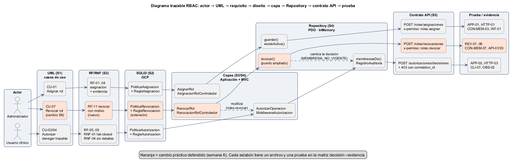
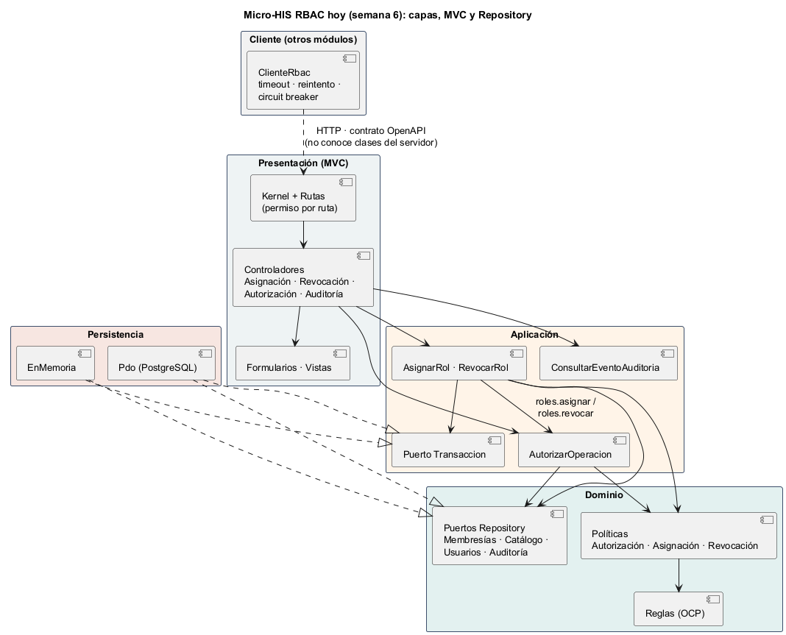

# Semana 6 — Primera evaluación parcial: defensa de la arquitectura RBAC

| | |
|---|---|
| **Curso** | Análisis de Sistemas II — Proyecto Final 2026 |
| **Módulo** | RBAC: roles, permisos y protección de rutas |
| **Proceso defendido** | «Asignación de rol, autorización de una operación y denegación trazable» |
| **Estudiante** | Boris Alexander Quiroa Orellana |
| **Fecha** | Octubre 2026 |

## Entregables

| Entregable pedido | Archivo |
|---|---|
| Presentación de 6–8 diapositivas | [`presentacion/semana-06-defensa-rbac.pptx`](presentacion/semana-06-defensa-rbac.pptx): **8 diapositivas** con notas del orador. Copia en PDF: [`presentacion/semana-06-defensa-rbac.pdf`](presentacion/semana-06-defensa-rbac.pdf) |
| Diagrama trazable | [`diagramas/semana-06-trazabilidad.png`](diagramas/semana-06-trazabilidad.png) (fuente [`.puml`](diagramas/semana-06-trazabilidad.puml)) |
| Matriz decisión → evidencia | [`matriz-decision-evidencia.md`](matriz-decision-evidencia.md): 17 decisiones |
| Registro del cambio práctico defendido | [`registro-cambio-practico.md`](registro-cambio-practico.md): «Revocar un rol», con pruebas primero (rojo → verde) |

Complementos:

- [`diagramas/semana-06-capas.png`](diagramas/semana-06-capas.png): la arquitectura tal como está hoy.
- [`evidencia/`](evidencia/): salidas reales de las pruebas, del lint y de la demo.
- [`DECLARACION_IA.md`](DECLARACION_IA.md) y [`GUIA_DEFENSA_ORAL.md`](GUIA_DEFENSA_ORAL.md).

## 1. El hilo de la defensa

La arquitectura se defiende como **una sola cadena**: cada eslabón justifica al siguiente y termina en una prueba que se puede ejecutar.



| Eslabón | Qué aporta | Dónde |
|---|---|---|
| **Actores** | Administrador (asigna y revoca), usuario clínico (opera) y auditor (consulta). | Semana 1, §3 |
| **UML** | CU-01..06 (+ CU-07 hoy), actividad con decisiones D-01..08 y excepciones E-01..07, secuencia S-01..43, todos con identificadores compartidos. La denegación es un caso de uso (CU-04 «extend»). | [Semana 1](../semana-01/semana-01-uml-proceso-rbac.md) |
| **RF/RNF** | RF-01..10 (+ RF-11..14 hoy), RNF-01..09, CA-01..14 en formato Dado/Cuando/Entonces. | [Semana 2](../semana-02/semana-02-ocp-requerimientos-diseno.md) |
| **SOLID (OCP)** | Reglas como extensiones de una interfaz: el decisor no cambia cuando aparece una regla nueva. | Semana 2, §5–9 |
| **Capas** | Presentación (MVC) → Aplicación → Dominio ← Persistencia, verificado por ARQ-01..08. | [Semana 3](../semana-03/semana-03-arquitectura-micro-his.md), [Semana 4](../semana-04/semana-04-capas-mvc-repositorio.md) |
| **Repository** | 5 puertos en el Dominio × 2 adaptadores (PDO e InMemory) con una suite de contrato común. | Semana 4, §5 |
| **Contrato API** | OpenAPI 3.1 (hoy v1.1.0) con `x-permiso` por operación, verificado contra el código (API-01..03); frontera de servicio decidida con mediciones. | [Semana 5](../semana-05/semana-05-cliente-servidor-microservicios.md) |
| **Pruebas** | 67 pruebas: 65 pasan, 0 fallan, 2 omitidas (requieren PostgreSQL). | `php tests/ejecutar.php` |

## 2. Arquitectura vigente



## 3. Cambio práctico defendido

**Revocar un rol.** Un administrador revoca un rol con motivo; la revocación y el evento `ROL_REVOCADO` se guardan en una sola transacción, y desde ese momento las operaciones de ese rol se deniegan (`MEMBRESIA_NO_VIGENTE`), con la denegación auditada.

| | |
|---|---|
| Ruta protegida nueva | `POST /api/v1/roles/revocaciones` — `x-permiso: roles.revocar` |
| Diseño | Extensión OCP: `PoliticaRevocacion` + 3 reglas; el puerto `RepositorioMembresias` gana `revocar()` en sus dos adaptadores |
| Lo que **no** cambió | `AutorizarOperacion`, `PoliticaAutorizacion`, reglas de autorización, `Kernel`, middleware, transacciones, cliente |
| Pruebas | REV-01..06, CON-MEM-07 y API-01/03: 8 fallas en rojo → 0 fallas en verde |

Detalle completo, decisiones y evidencias: [`registro-cambio-practico.md`](registro-cambio-practico.md).

## 4. Cómo verificar en vivo

```bash
cd docs/modulos/rbac/micro-his-rbac
php tests/ejecutar.php                          # 67 pruebas: 65 pasan, 0 fallan, 2 omitidas
php bin/demo.php                                # pasos 6–8: revocar → denegado → motivo en la bitácora
npx @redocly/cli@1.34.3 lint api/openapi.yaml   # contrato v1.1.0 válido
```
