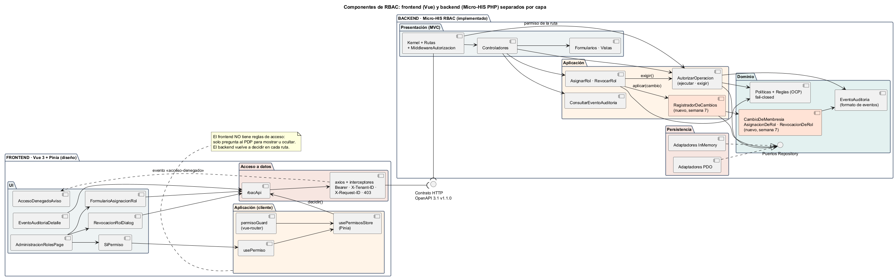
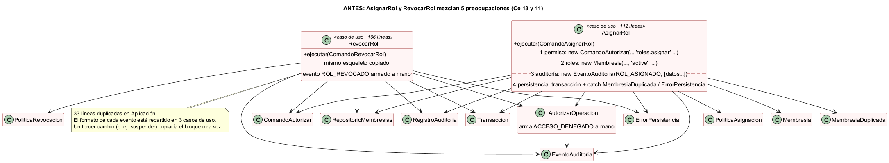
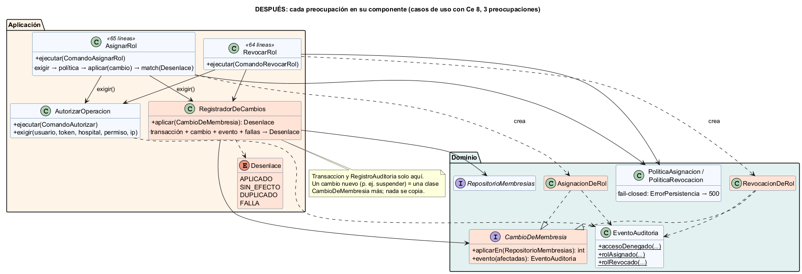

# Semana 7 — Diseño de componentes y refactorización

| | |
|---|---|
| **Curso** | Análisis de Sistemas II — Proyecto Final 2026 |
| **Módulo** | RBAC: roles, permisos y protección de rutas |
| **Flujo** | «Asignación de rol, autorización de una operación y denegación trazable» |
| **Código** | [`micro-his-rbac/`](../micro-his-rbac/README.md) — el MISMO proyecto de las semanas 3 a 6 |
| **Estudiante** | Boris Alexander Quiroa Orellana |
| **Fecha** | Octubre 2026 |

## Índice

1. [Resumen](#1-resumen)
2. [Diagrama de componentes](#2-diagrama-de-componentes)
3. [Contratos de entrada/salida](#3-contratos-de-entradasalida)
4. [Cómo se eligió el punto a refactorizar](#4-cómo-se-eligió-el-punto-a-refactorizar)
5. [Refactor: antes](#5-refactor-antes)
6. [Refactor: después](#6-refactor-después)
7. [Comparación medida](#7-comparación-medida)
8. [Justificación](#8-justificación)
9. [Prueba de que no se amplió el módulo](#9-prueba-de-que-no-se-amplió-el-módulo)
10. [Costos y límites del refactor](#10-costos-y-límites-del-refactor)
11. [Conclusión](#11-conclusión)
12. [Bibliografía](#12-bibliografía)

## 1. Resumen

- **Componentes:** se diseñaron los componentes propios de RBAC en **backend**, ya implementados en el Micro-HIS, y en **frontend**, en Vue 3 + Pinia, como diseño alineado con lo que ya existe en `resources/js`. Los dos lados se separan en UI, aplicación, dominio y acceso a datos, y se comunican **solo** por el contrato OpenAPI.
- **Punto a refactorizar:** se eligió **midiendo** con `bin/acoplamiento.php`. Los casos de uso `AsignarRol` y `RevocarRol` mezclaban **5 de las 6 preocupaciones** de RBAC (roles, permisos, decisión, auditoría y persistencia), con Ce 13 y 11, y repetían el mismo bloque de transacción, evento y manejo de errores.
- **Refactor:** se separaron esas preocupaciones en piezas cohesivas, sin agregar funcionalidad:
  - en el **Dominio**, `CambioDeMembresia` y el formato de eventos en `EventoAuditoria`;
  - en la **Aplicación**, `RegistradorDeCambios`, que es el único que maneja transacción y evidencia;
  - además, las políticas pasaron a ser fail-closed y se agregó un atajo de autorización.
- **Resultado:**

  | | Antes | Después |
  |---|---|---|
  | Ce de cada caso de uso | 13 y 11 | 8 |
  | Preocupaciones por caso de uso | 5 | 3 |
  | Líneas de los dos casos de uso | 218 | 129 |
  | Clases con 4 o más preocupaciones | 3 | 1 |

  Las **70 pruebas** dan el mismo resultado antes y después: 68 pasan, 0 fallan y 2 se omiten.

## 2. Diagrama de componentes



Fuente: [`diagramas/semana-07-componentes.puml`](diagramas/semana-07-componentes.puml)

| Capa | Backend (implementado) | Frontend (diseño) |
|---|---|---|
| **UI / Presentación** | `Kernel` + `Rutas` + `MiddlewareAutorizacion`, controladores, formularios, vistas | `AdministracionRolesPage`, `FormularioAsignacionRol`, `RevocacionRolDialog`, `SiPermiso`, `AccesoDenegadoAviso`, `EventoAuditoriaDetalle` |
| **Aplicación** | `AutorizarOperacion`, `AsignarRol`, `RevocarRol`, `ConsultarEventoAuditoria`, **`RegistradorDeCambios`** | `usePermisosStore` (Pinia), `usePermiso`, `permisoGuard` |
| **Dominio** | Políticas + reglas (OCP), **`CambioDeMembresia`**, `EventoAuditoria`, puertos Repository | **No hay**: el frontend no contiene reglas de acceso, solo muestra decisiones |
| **Persistencia / acceso a datos** | Adaptadores PDO e InMemory | `rbacApi` + interceptores de axios (Bearer, `X-Tenant-ID`, `X-Request-ID`, 403) |

Decisiones de diseño del frontend:

1. **El frontend no autoriza: pregunta.** `usePermiso` consulta el PDP (`/autorizaciones/decisiones`) solo para mostrar u ocultar botones. Cada operación vuelve a pasar por la autorización del backend, así que manipular el frontend no da acceso a nada.
2. **Fail-closed también en la UI.** Si la consulta falla, `permitido = false`.
3. **El 403 se muestra sin motivo.** `AccesoDenegadoAviso` enseña solo el `correlation_id` y permite copiarlo para soporte, igual que el backend (R-08).
4. **Diseño sin implementación.** Se reutiliza lo que ya existe (`plugins/axios.js`, `stores/auth.js`, `router/guards.js`) y se agrega `modules/rbac/`. Esos archivos son compartidos con otros módulos (por ejemplo, el de UI/UX base), así que su implementación se coordinará con ese equipo.

## 3. Contratos de entrada/salida

Detalle completo, componente por componente: **[contratos-entrada-salida.md](contratos-entrada-salida.md)**. Incluye lo que cada componente recibe, devuelve y cómo falla, en backend y frontend, y las reglas que cruzan ambos lados.

## 4. Cómo se eligió el punto a refactorizar

`php bin/acoplamiento.php` analiza las 91 clases de `src/` con el tokenizador de PHP y calcula para cada una:

- **Ce:** a cuántas clases del proyecto depende.
- **Ca:** cuántas clases del proyecto dependen de ella.
- **P:** cuántas de las **6 preocupaciones** que nombra la tarea mezcla: roles, permisos, rutas, decisión, auditoría y persistencia.

Salida **antes** ([`evidencia/acoplamiento-1-antes.txt`](evidencia/acoplamiento-1-antes.txt)):

```
Clase                          Capa            Ce   Ca  P   Preocupaciones RBAC que mezcla
AsignarRol                     Aplicacion      13    1  5   roles · permisos · decision · auditoria · persistencia
RevocarRol                     Aplicacion      11    1  5   roles · permisos · decision · auditoria · persistencia
ConjuntoAdaptadores            Persistencia     5    2  4   roles · permisos · auditoria · persistencia
AutorizarOperacion             Aplicacion       8    4  3   roles · decision · auditoria
Líneas duplicadas entre archivos de Aplicación: 33
```

Los dos primeros son el punto de mayor acoplamiento: **cinco de las seis preocupaciones en una sola clase**, repetidas en dos clases.

`ConjuntoAdaptadores` aparece con 4, pero es solo un contenedor de composición con las cinco implementaciones de los puertos, sin lógica. Es esperable que toque varias preocupaciones.

## 5. Refactor: antes



Copia del código anterior: [`refactor/antes/`](refactor/antes/). Este es el bloque que estaba **copiado** en `AsignarRol` y en `RevocarRol`, con sus variantes:

```php
// AsignarRol (antes) — el caso de uso sabía de transacciones, del formato del evento y de excepciones técnicas
try {
    $this->transaccion->ejecutar(function () use ($comando, $ahora, $correlationId): void {
        $this->membresias->guardar(new Membresia(
            $comando->usuarioDestinoId, $comando->hospitalId, $comando->rol, 'active',
            $comando->validoDesde, $comando->validoHasta,
        ));
        $this->auditoria->registrar(new EventoAuditoria(
            EventoAuditoria::ROL_ASIGNADO, $correlationId, $comando->adminId, $comando->hospitalId,
            ['usuario_destino' => …, 'rol' => …, 'valido_desde' => …, 'valido_hasta' => …, 'ip' => …],
            $ahora,
        ));
    });
} catch (MembresiaDuplicada) {
    return ResultadoAsignacion::rechazado('ASIGNACION_DUPLICADA', 409);
} catch (\Throwable) {
    return ResultadoAsignacion::errorPersistencia();
}
```

**Problemas:**

| Problema | Consecuencia |
|---|---|
| Un caso de uso con **5 razones para cambiar**: el permiso, las reglas de roles, el formato del evento, la estrategia de transacción y los errores técnicos | Viola SRP; cualquier cambio en la auditoría obliga a tocar casos de uso. |
| El **formato de los eventos** repartido en `AsignarRol`, `RevocarRol` y `AutorizarOperacion` | Para agregar un campo a los eventos hay que tocar 3 clases, y es fácil que queden inconsistentes. |
| El **bloque transacción + evento + errores copiado** | Un tercer cambio (por ejemplo, suspender un rol) lo copiaría otra vez. Una corrección en un lado podía olvidarse en el otro. |
| **Errores de persistencia de las políticas** atrapados en cada caso de uso | `PoliticaAutorizacion` ya era fail-closed por dentro, pero las otras dos políticas no: tres comportamientos para la misma idea. |
| Armado manual de `ComandoAutorizar` (8 líneas) en cada operación administrativa | Ruido repetido alrededor de la decisión. |

## 6. Refactor: después



```php
// AsignarRol (después) — solo orquesta: decidir → validar → aplicar
$autorizacion = $this->autorizar->exigir($comando->adminId, $comando->tenantToken, $comando->hospitalId, self::PERMISO_REQUERIDO, $comando->ip);
if (!$autorizacion->permitido) {
    return ResultadoAsignacion::denegado($autorizacion->correlationId);
}
$solicitud = new SolicitudAsignacion(…, ($this->reloj)());
$error = $this->politica->evaluar($solicitud); // fail-closed dentro del Dominio
if ($error !== null) {
    return ResultadoAsignacion::rechazado($error->codigo, $error->codigoHttp);
}
$correlationId = ($this->generarCorrelacion)();

return match ($this->cambios->aplicar(new AsignacionDeRol($solicitud, $correlationId, $comando->ip))) {
    Desenlace::APLICADO => ResultadoAsignacion::creado($correlationId),
    Desenlace::DUPLICADO => ResultadoAsignacion::rechazado('ASIGNACION_DUPLICADA', 409),
    Desenlace::SIN_EFECTO, Desenlace::FALLA => ResultadoAsignacion::errorPersistencia(),
};
```

| Responsabilidad | Antes estaba en | Ahora está en | Capa |
|---|---|---|---|
| Qué se cambia en las membresías (alta o revocación) | `AsignarRol`, `RevocarRol` | `AsignacionDeRol`, `RevocacionDeRol` (implementan `CambioDeMembresia`) | Dominio |
| Formato de cada evento de auditoría | 3 casos de uso | `EventoAuditoria::rolAsignado / rolRevocado / accesoDenegado` | Dominio |
| Fail-closed ante fallas de lectura en las reglas | Cada caso de uso | `PoliticaAsignacion` y `PoliticaRevocacion`, igual que `PoliticaAutorizacion` | Dominio |
| Transacción + cambio + evento + traducción de fallas técnicas | Copiado en 2 casos de uso | `RegistradorDeCambios` → `Desenlace` | Aplicación |
| Armar la consulta de autorización | Cada caso de uso | `AutorizarOperacion::exigir()` | Aplicación |
| Orquestar el flujo y traducir el `Desenlace` a la respuesta de **su** caso | Casos de uso | Casos de uso (es lo único que les queda) | Aplicación |

Archivos del refactor:

- **Nuevos:**
  - `src/Dominio/Cambios/{CambioDeMembresia, AsignacionDeRol, RevocacionDeRol}.php`
  - `src/Aplicacion/Servicios/{RegistradorDeCambios, Desenlace}.php`
- **Modificados:**
  - `AsignarRol`, `RevocarRol`, `AutorizarOperacion`
  - `EventoAuditoria`, `PoliticaAsignacion`, `PoliticaRevocacion`
  - `bootstrap/contenedor.php`
- **Sin cambios:** Presentación (controladores, vistas, rutas), Persistencia (adaptadores), puertos y contrato API.

## 7. Comparación medida

Mismo instrumento antes y después ([antes](evidencia/acoplamiento-1-antes.txt) · [después](evidencia/acoplamiento-2-despues.txt)):

| Métrica | Antes | Después | Cambio |
|---|---:|---:|---|
| Ce de `AsignarRol` | 13 | **8** | −38 % |
| Ce de `RevocarRol` | 11 | **8** | −27 % |
| Preocupaciones de `AsignarRol` / `RevocarRol` | 5 / 5 | **3 / 3** | Salen auditoría y persistencia |
| Líneas de `AsignarRol` + `RevocarRol` | 112 + 106 = 218 | 65 + 64 = **129** | −89 líneas |
| Clases que mezclan ≥ 4 preocupaciones | 3 | **1** | Solo queda `ConjuntoAdaptadores` (composición) |
| Dependencias constructor de `AsignarRol` | 7 | **5** | — |
| Bloques transacción + evento + errores | 2 copias | **1** (`RegistradorDeCambios`) | — |
| Lugares que definen el formato de un evento | 3 | **1** (`EventoAuditoria`) | — |
| Líneas duplicadas en Aplicación (detector simple) | 33 | 29 | Ver §10 |
| Pruebas | 67 → 70 (+3 de caracterización) | **70: 68 pasan, 0 fallan** | Mismo comportamiento |

Las tres preocupaciones que quedan en los casos de uso son **las que les corresponden**:

- **Roles:** construyen la solicitud y llaman a la política.
- **Permisos:** declaran qué permiso exigen.
- **Decisión:** piden la autorización.

## 8. Justificación

| Principio | Cómo lo cumple el refactor |
|---|---|
| **SRP** | Cada caso de uso pasa de 5 razones para cambiar a una sola: el flujo de su operación. El formato de eventos, la transacción y el manejo de fallas tienen cada uno un único dueño. |
| **OCP** (semana 2) | `CambioDeMembresia` es un punto de extensión nuevo. Un tercer tipo de cambio, como suspender un rol, sería **una clase**, y `RegistradorDeCambios` no cambiaría. Antes había que copiar el bloque. |
| **DIP** | Los casos de uso ya no dependen de `Transaccion` ni de `RegistroAuditoria`. Dependen de un servicio de aplicación, que depende de los puertos. |
| **Alta cohesión / bajo acoplamiento** | Medido en §7: Ce de 13/11 a 8/8; preocupaciones de 5 a 3. |
| **Separación de capas** (pedido de la tarea) | El conocimiento de dominio (qué es un cambio y qué evento produce) bajó al Dominio. El conocimiento técnico (transacción y fallas) quedó en un servicio de Aplicación. La UI y la Persistencia no se tocaron. |
| **R-07** (asignación + evidencia atómicas) | Ahora vive en **un** lugar (`RegistradorDeCambios`) y no en dos copias que podían divergir. |
| **Fail-closed coherente** | Las tres políticas se comportan igual ante una falla de lectura. |

**Alternativas descartadas:**

| Alternativa | Motivo para descartarla |
|---|---|
| Clase base abstracta `OperacionAdministrativa` (Template Method) para `AsignarRol` y `RevocarRol` | Acopla por herencia. Cada caso de uso tiene su propio comando y resultado, así que la base necesitaría tipos genéricos que PHP no ofrece. La composición, con un servicio más un objeto de cambio, es más simple de probar. |
| Quitar la autorización del caso de uso, porque la ruta ya la exige | Quitaría la defensa en profundidad (R-04): un caso de uso invocado desde otro canal, como CLI o eventos, quedaría sin protección. Además, cambiaría el comportamiento observable de REV-03 y APP-04. |
| Mover la transacción al controlador | El controlador quedaría con persistencia, lo que viola ARQ-05 y la separación que pide la tarea. |

## 9. Prueba de que no se amplió el módulo

1. **Línea base:** antes de tocar el código, 67 pruebas: 65 pasan, 0 fallan ([`pruebas-1-antes.txt`](evidencia/pruebas-1-antes.txt)).
2. **Pruebas de caracterización** REF-01..03, que fijan el comportamiento que el refactor iba a mover:
   - **REF-01 y REF-02:** falla de lectura en una regla de asignación o revocación → 500 `ERROR_PERSISTENCIA`, sin cambios en los datos.
   - **REF-03:** campos y orden exactos de los tres eventos de auditoría.

   Se ejecutaron **sobre el código anterior** al refactor, extraído con `git archive HEAD`, y pasaron ([`caracterizacion-sobre-codigo-anterior.txt`](evidencia/caracterizacion-sobre-codigo-anterior.txt)).
3. **Después del refactor:** 70 pruebas: 68 pasan, 0 fallan ([`pruebas-2-despues.txt`](evidencia/pruebas-2-despues.txt)). Siguieron verdes:
   - las pruebas de arquitectura (ARQ-01..08);
   - las de contrato (API-01..03, CON-MEM-01..07);
   - y todas las funcionales.
4. **Sin funcionalidad nueva:** no hay rutas nuevas, el contrato OpenAPI sigue en v1.1.0 sin cambios y los resultados HTTP son los mismos. `AutorizarOperacion::exigir()` es un atajo interno de `ejecutar()`, no una capacidad nueva.

## 10. Costos y límites del refactor

- **Más clases:** el Ce **total** del proyecto sube de 224 a 237, por 5 clases nuevas pequeñas. Es el costo esperado de repartir responsabilidades: el acoplamiento baja **donde estaba concentrado**, en los casos de uso, y queda distribuido en piezas cohesivas con 3 preocupaciones o menos.
- **La duplicación «textual» bajó poco (33 → 29).** El detector cuenta líneas idénticas, y las que quedan son **estructurales**: firmas de constructores, propiedades `readonly` de los DTO y las 3 líneas del esqueleto de orquestación (`exigir`, `evaluar`, `if (!$autorizacion->permitido)`), que se mantienen explícitas a propósito para que cada caso de uso se lea de arriba abajo. La **lógica** duplicada (transacción, evento, errores) sí desapareció. Se reporta tal cual para no presentar como mejora algo que el instrumento no muestra.
- **Frontend no implementado:** el diseño Vue queda listo para implementarse en la semana 16, coordinando los archivos compartidos.

## 11. Conclusión

El punto con mayor acoplamiento de RBAC no estaba donde uno pensaría, en la decisión de autorización, sino en los **casos de uso que modifican roles**: ahí se cruzaban roles, permisos, decisión, auditoría y persistencia. Medirlo permitió elegirlo con datos y demostrar la mejora con el mismo instrumento: Ce 13 → 8 y 5 → 3 preocupaciones.

El refactor no agregó funcionalidad. Lo garantizan las pruebas existentes más tres pruebas de caracterización, verificadas también sobre el código anterior. El diseño de componentes deja claro que el frontend no decide nada: pregunta, muestra y nunca revela el motivo.

## 12. Bibliografía

- Fowler, M. (2018). *Refactoring: Improving the Design of Existing Code* (2.ª ed.). Addison-Wesley. (Extract Class, Move Function, Replace Conditional with Polymorphism).
- Feathers, M. (2004). *Working Effectively with Legacy Code*. Prentice Hall. Cap. 13 (*characterization tests*).
- Martin, R. C. (2003). *Agile Software Development: Principles, Patterns, and Practices*. Prentice Hall. (Métricas Ca/Ce; SRP, OCP, DIP).
- Martin, R. C. (2018). *Clean Architecture*. Prentice Hall. Caps. 13–14 (principios de componentes).
- Evans, E. (2003). *Domain-Driven Design*. Addison-Wesley. (Domain Events, Application Services).
- Rodríguez González, L. M. (s. f.). *Principios básicos del diseño de software*. MVP Cluster. https://mvpcluster.com/diseno-de-software-2/
- Vue.js. (2026). *Composables* y *Pinia — Defining a Store*. https://vuejs.org/guide/reusability/composables.html · https://pinia.vuejs.org/
