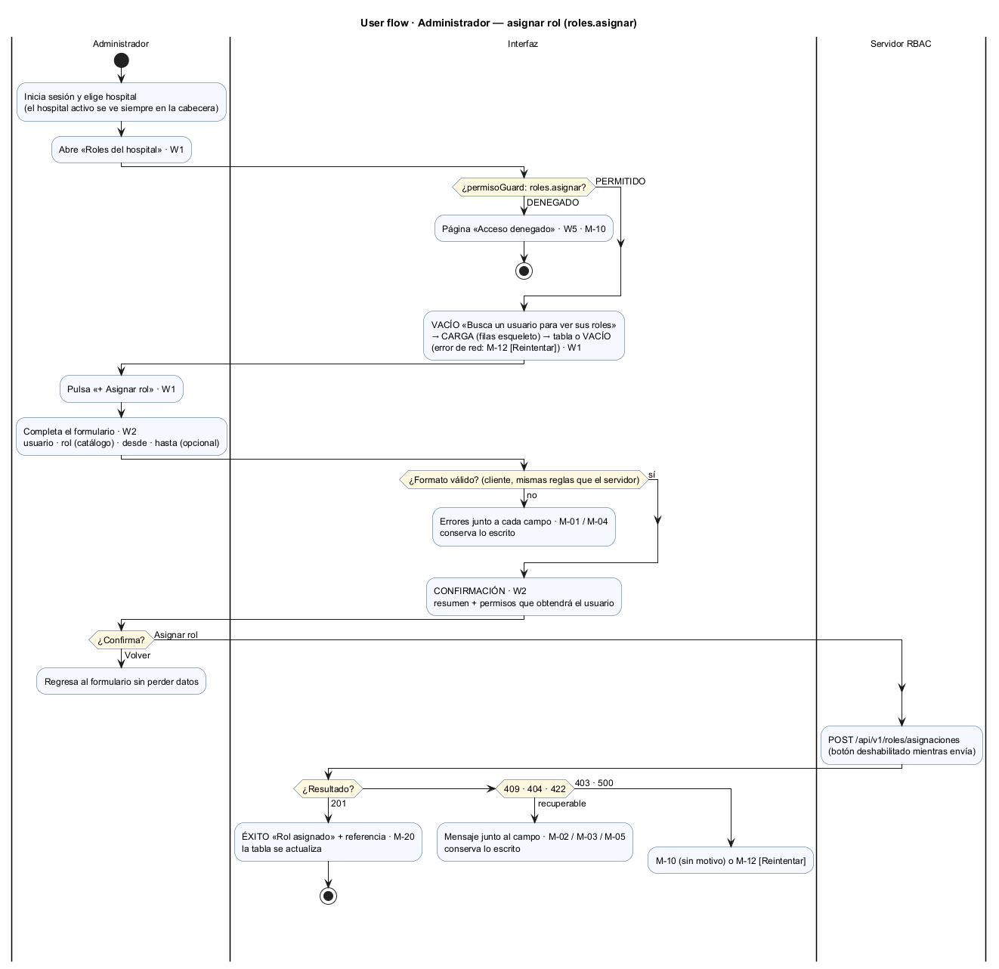
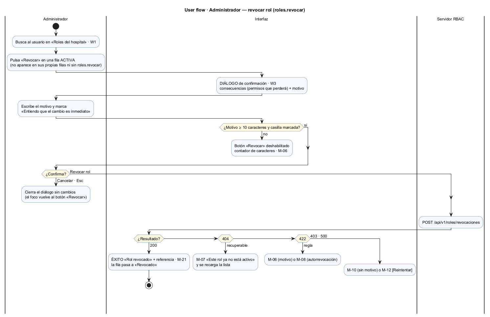
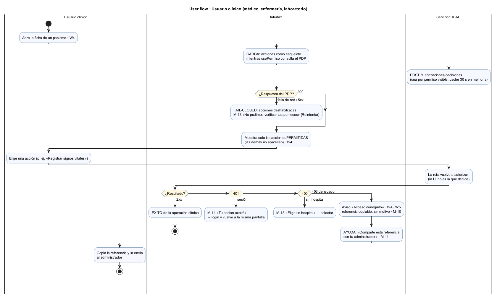
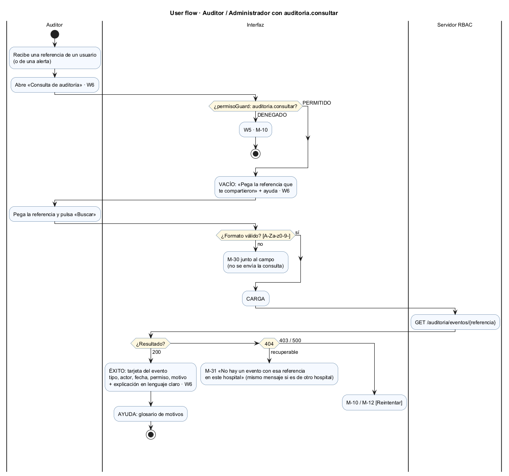
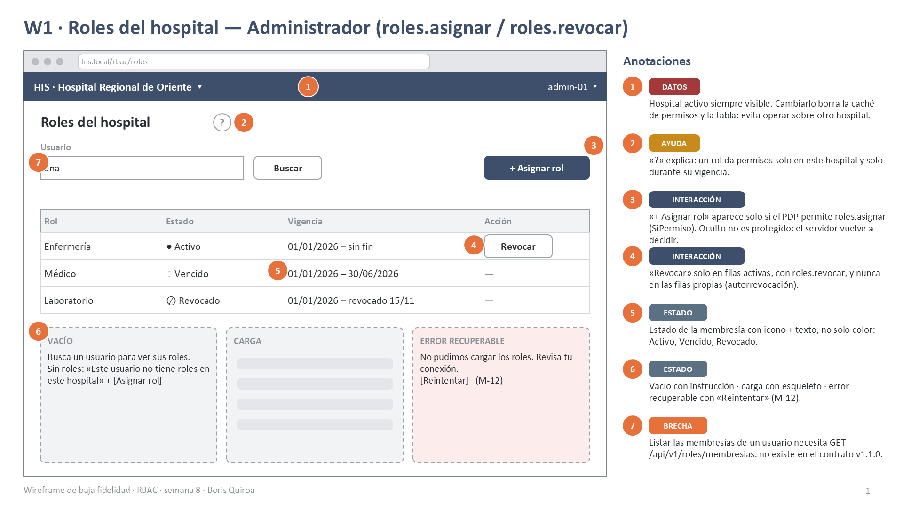
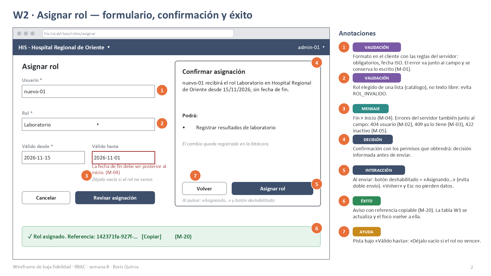
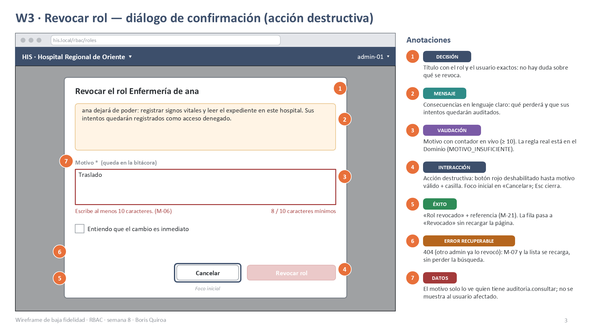
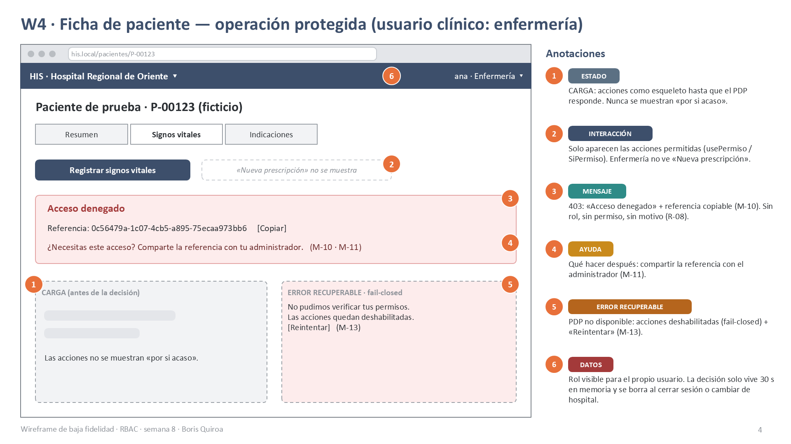
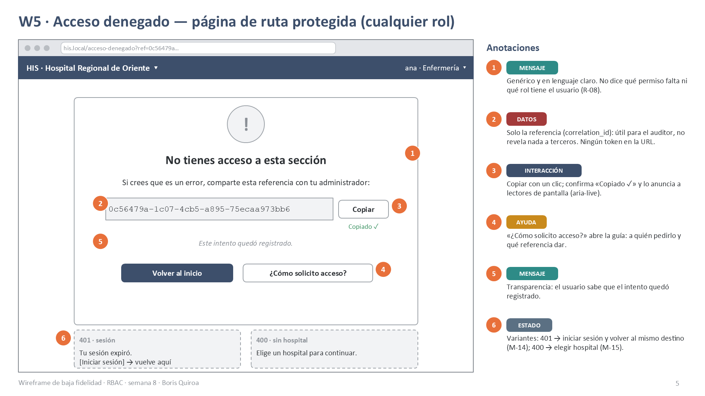
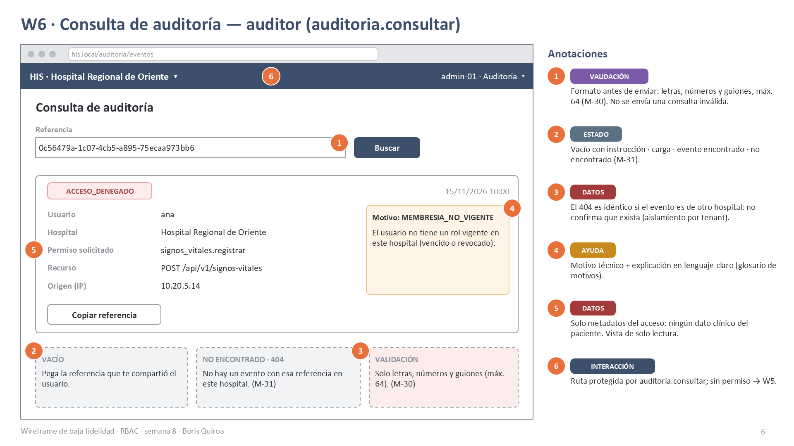

# Semana 8 — Diseño de experiencia de usuario del módulo RBAC

**Estudiante:** Boris Alexander Quiroa Orellana · **Módulo:** RBAC: roles, permisos y protección de rutas

**Proceso:** «asignación de rol, autorización de una operación y denegación trazable»

**Entregables:**
- user flow por rol (4 diagramas) en [diagramas/](diagramas/);
- 6 wireframes anotados en [wireframes/semana-08-wireframes-rbac.pptx](wireframes/semana-08-wireframes-rbac.pptx), con versión [PDF](wireframes/semana-08-wireframes-rbac.pdf) y PNG.

## 1. Alcance y punto de partida

Este documento diseña la experiencia de uso. **No** implementa pantallas.

Parte de lo que ya existe:

| Origen | Qué aporta a esta semana |
|---|---|
| Semana 1 (UML) | Casos de uso CU-01..CU-06 y reglas R-01..R-08 |
| Semana 2 (RF/RNF) | RF-01..RF-10 y RNF-01..RNF-09; la semana 6 agrega RF-11..RF-14 y CU-07 (revocar) |
| Semana 5 (contrato) | [openapi.yaml](../micro-his-rbac/api/openapi.yaml) v1.1.0: rutas, códigos HTTP, formatos (`motivo` 10–500, `correlationId` `^[A-Za-z0-9-]{1,64}$`) |
| Semana 7 (componentes) | Componentes Vue diseñados: `usePermiso`, `SiPermiso`, `permisoGuard`, `AccesoDenegadoAviso`, `EventoAuditoriaDetalle`, `AdministracionRolesPage`, `FormularioAsignacionRol`, `RevocacionRolDialog` |

Cada mensaje y cada validación de este diseño sale de un código real del backend (§6). Así la interfaz no promete nada que el servidor no haga.

## 2. Roles autorizados y lo que ve cada uno

Los permisos son los del catálogo del Micro-HIS (datos de demostración).

| Perfil de UX | Rol(es) del catálogo | Permisos RBAC | Pantallas | User flow |
|---|---|---|---|---|
| **Administrador de hospital** | `admin_hospital` | `roles.asignar`, `roles.revocar`, `auditoria.consultar` | W1, W2, W3, W6 | [asignar](diagramas/semana-08-flujo-admin-asignar.png), [revocar](diagramas/semana-08-flujo-admin-revocar.png) |
| **Usuario clínico** | `medico`, `enfermeria`, `laboratorio` | `prescripciones.crear`, `signos_vitales.registrar`, `expediente.leer`, `resultados.registrar` (según el rol) | W4, W5 | [clínico](diagramas/semana-08-flujo-clinico.png) |
| **Auditor** | Cualquier rol con `auditoria.consultar` (hoy solo `admin_hospital`) | `auditoria.consultar` | W6 | [auditor](diagramas/semana-08-flujo-auditor.png) |
| **Cualquier usuario sin permiso** | — | — | W5 | Rama «DENEGADO» de todos los flujos |

El «auditor» es un **perfil de uso**, no un rol nuevo. Se diseña por permiso (`auditoria.consultar`) para que, si mañana se crea un rol `auditor`, la pantalla no cambie (OCP, semana 2).

## 3. Principios de diseño

| # | Principio | Cómo se ve en las pantallas |
|---|---|---|
| P-1 | **La interfaz no decide; el servidor sí.** | Ocultar un botón es comodidad, no seguridad. Toda acción vuelve a autorizarse en el servidor (W4 ②). |
| P-2 | **Fail-closed también en la UI.** | Si no se puede consultar el PDP, las acciones quedan deshabilitadas, no visibles «por si acaso» (W4 ①⑤). |
| P-3 | **Denegar sin revelar** (R-08, RNF-04). | El 403 muestra un mensaje genérico y la referencia, nunca el rol ni el permiso que falta (W4 ③, W5 ①). |
| P-4 | **Toda denegación deja un camino.** | Referencia copiable + «comparte con tu administrador» + «¿Cómo solicito acceso?» (W5 ③④). |
| P-5 | **Confirmar lo que cambia permisos.** | Asignar muestra los permisos que se otorgan (W2); revocar exige motivo y casilla (W3). |
| P-6 | **El contexto siempre visible.** | El hospital activo (tenant) y el usuario con su rol están fijos en la cabecera de todas las pantallas. |
| P-7 | **Los errores se recuperan sin perder trabajo.** | Lo escrito se conserva; el mensaje va junto al campo; hay «Reintentar» en errores de red. |

## 4. User flows por rol

Los cuatro diagramas son de actividad UML con carriles *Usuario · Interfaz · Servidor RBAC*. Cada uno muestra:

- el **inicio**;
- las **decisiones** (rombos);
- la **confirmación**;
- los estados **vacío, carga y éxito**;
- los **errores recuperables** (`detach`: el usuario vuelve a intentar);
- la **ayuda**.

Las fuentes `.puml` están junto a cada imagen.

### 4.1 Administrador — asignar rol



| Elemento pedido | Dónde está |
|---|---|
| Inicio | Inicia sesión y elige hospital → «Roles del hospital» |
| Decisión | `permisoGuard` (`roles.asignar`) · validación en el cliente · «¿Confirma?» · resultado HTTP |
| Confirmación | Resumen con los permisos que obtendrá el usuario (W2) |
| Vacío / carga / éxito | «Busca un usuario…» → filas esqueleto → 201 M-20 |
| Errores recuperables | M-01/M-04 (cliente); 404 M-02, 409 M-03, 422 M-05 (servidor); 500 M-12 |
| Ayuda | Texto de ayuda de cada campo y la lista de permisos del rol |

### 4.2 Administrador — revocar rol



- **Confirmación más fuerte que al asignar.** Revocar tiene efecto inmediato sobre el trabajo clínico.
- **Botón «Revocar» oculto en las filas propias.** El servidor igual responde `AUTORREVOCACION`; ocultarlo evita llegar a ese error.
- **Si el rol ya no está activo** (404, por ejemplo porque otro administrador lo revocó antes), se muestra M-07 y la lista se recarga.

### 4.3 Usuario clínico — operación protegida



Este flujo es el corazón del proceso: **autorizar una operación y, si se deniega, hacerlo de forma trazable**. Tiene dos momentos:

1. **Al cargar la pantalla**, para decidir qué acciones mostrar, con caché de 30 s.
2. **Al ejecutar la acción**, cuando el servidor vuelve a autorizar.

Si los permisos cambiaron entre esos dos momentos, el usuario recibe el 403 trazable igual. Es el caso de un rol revocado mientras la pantalla seguía abierta.

### 4.4 Auditor — localizar la denegación



El flujo cierra el ciclo:

1. El usuario denegado comparte la referencia.
2. El auditor la pega en W6.
3. W6 muestra el evento con el motivo técnico y su explicación.

Si la referencia es de otro hospital, la respuesta es **la misma** que si no existiera: M-31.

## 5. Wireframes anotados

Son de baja fidelidad: marco de navegador, cabecera con el hospital activo, callouts naranjas numerados y una leyenda «Anotaciones». Cada anotación lleva una etiqueta:

- `ESTADO`, `MENSAJE`, `VALIDACIÓN`, `INTERACCIÓN`;
- `DATOS`, `AYUDA`, `ÉXITO`, `DECISIÓN`;
- `ERROR RECUPERABLE`, `BRECHA`.

| # | Pantalla | Rol | Ruta de UI → endpoint | Imagen |
|---|---|---|---|---|
| W1 | Roles del hospital | Administrador | `/admin/roles` → *(sin endpoint, ver §11)* | [PNG](wireframes/semana-08-w1-roles-del-hospital.png) |
| W2 | Asignar rol (formulario + confirmación + éxito) | Administrador | `/admin/roles/asignar` → `POST /api/v1/roles/asignaciones` | [PNG](wireframes/semana-08-w2-asignar-rol.png) |
| W3 | Revocar rol (diálogo destructivo) | Administrador | diálogo sobre W1 → `POST /api/v1/roles/revocaciones` | [PNG](wireframes/semana-08-w3-revocar-rol.png) |
| W4 | Ficha de paciente con operación protegida | Clínico | `/pacientes/:id` → `POST /api/v1/autorizaciones/decisiones` + operación clínica | [PNG](wireframes/semana-08-w4-operacion-protegida.png) |
| W5 | Acceso denegado | Cualquiera | `/acceso-denegado?ref=…` (sin llamada; solo muestra) | [PNG](wireframes/semana-08-w5-acceso-denegado.png) |
| W6 | Consulta de auditoría | Auditor | `/auditoria/eventos` → `GET /api/v1/auditoria/eventos/{correlationId}` | [PNG](wireframes/semana-08-w6-consulta-auditoria.png) |

### W1 · Roles del hospital


### W2 · Asignar rol


### W3 · Revocar rol


### W4 · Operación protegida


### W5 · Acceso denegado


### W6 · Consulta de auditoría


## 6. Catálogo de mensajes

Cada mensaje tiene un identificador que aparece en los flujos y en los wireframes. El texto es en lenguaje claro y en segunda persona, y siempre dice qué hacer después.

| ID | Texto para el usuario | Origen (HTTP · código del backend) | Dónde | Acción de recuperación |
|---|---|---|---|---|
| M-01 | «Este campo es obligatorio.» / «Usa el formato AAAA-MM-DD.» | Cliente (mismas reglas que `FormularioAsignacion`) · 422 `DATOS_INVALIDOS` | W2, junto al campo | Corregir el campo; lo demás se conserva |
| M-02 | «No encontramos a ese usuario en este hospital.» | 404 `USUARIO_NO_ENCONTRADO` | W2, campo usuario | Revisar el usuario |
| M-03 | «Este usuario ya tiene ese rol activo.» | 409 `ASIGNACION_DUPLICADA` | W2, campo rol | Elegir otro rol o cancelar |
| M-04 | «La fecha de fin debe ser posterior al inicio.» | Cliente · 422 `VIGENCIA_INVALIDA` | W2, campo fecha | Corregir la fecha |
| M-05 | «Este usuario está inactivo; no se le pueden asignar roles.» | 422 `USUARIO_INACTIVO` | W2, campo usuario | Activar la cuenta antes (fuera de RBAC) |
| M-06 | «Escribe al menos 10 caracteres.» (contador «n / 10 caracteres mínimos») | Cliente · 422 `MOTIVO_INSUFICIENTE` | W3, campo motivo | Completar el motivo |
| M-07 | «Este rol ya no está activo. Actualizamos la lista.» | 404 `MEMBRESIA_NO_ENCONTRADA` | W3 → W1 | La lista se recarga sola |
| M-08 | «No puedes revocar tus propios roles. Pide a otro administrador.» | 422 `AUTORREVOCACION` | W3 | Pedírselo a otro administrador |
| M-09 | «Ese rol no existe en el catálogo.» | 422 `ROL_INVALIDO` (o `AUTOASIGNACION`: «No puedes asignarte roles a ti mismo.») | W2 | Elegir de la lista (no debería ocurrir con un `select`) |
| M-10 | «Acceso denegado. Referencia: `<correlation_id>` [Copiar]» | 403 · cualquier motivo de denegación | W4 (aviso), W5 (página) | Copiar la referencia |
| M-11 | «¿Necesitas este acceso? Comparte la referencia con tu administrador.» | Acompaña a M-10 | W4, W5 | Enlace «¿Cómo solicito acceso?» |
| M-12 | «No pudimos completar la operación. Revisa tu conexión. [Reintentar]» | Red · 500 `ERROR_PERSISTENCIA` | W1, W2, W3, W6 | Reintentar; lo escrito se conserva |
| M-13 | «No pudimos verificar tus permisos. Las acciones quedan deshabilitadas. [Reintentar]» | PDP sin respuesta (`CIRCUITO_ABIERTO`, timeout, 5xx) | W4 | Reintentar; fail-closed mientras tanto |
| M-14 | «Tu sesión expiró. [Iniciar sesión]» | 401 | W5 (variante) | Login y volver a la misma ruta |
| M-15 | «Elige un hospital para continuar.» | 400 (falta `X-Tenant-ID`) | W5 (variante) | Selector de hospital |
| M-20 | «✓ Rol asignado. Referencia: … [Copiar]» | 201 | W2 | — (éxito; el foco vuelve a la tabla) |
| M-21 | «✓ Rol revocado. Referencia: … [Copiar]» | 200 | W3 → W1 | — (éxito; la fila pasa a «Revocado») |
| M-30 | «Solo letras, números y guiones (máx. 64).» | Cliente (`pattern` del contrato) · 400 | W6 | Corregir; no se envía |
| M-31 | «No hay un evento con esa referencia en este hospital.» | 404 (no existe **o** es de otro hospital) | W6 | Revisar la referencia |

M-09 no aparece en los wireframes: con un `select` alimentado por el catálogo, el usuario no puede escribir un rol inválido. Se cataloga porque el servidor sí puede devolverlo.

**Lo que ningún mensaje dice:**
- el motivo de una denegación (`MEMBRESIA_NO_VIGENTE`, `PERMISO_NO_ASIGNADO`, `TENANT_NO_COINCIDE`, …);
- el rol del usuario;
- el permiso que le falta.

Eso solo lo ve el auditor en W6 (R-08).

### 6.1 Glosario de motivos (solo W6)

| Código | Explicación en W6 |
|---|---|
| `PERMISO_NO_ASIGNADO` | Ningún rol vigente del usuario incluye este permiso. |
| `MEMBRESIA_NO_VIGENTE` | El usuario no tiene un rol vigente en este hospital (vencido o revocado). |
| `TENANT_NO_COINCIDE` | La sesión es de un hospital distinto al de la solicitud. |
| `SIN_REGLAS_CONFIGURADAS` / `ERROR_EVALUACION` | El sistema no pudo evaluar y denegó por seguridad (fail-closed). |

## 7. Reglas de interacción

| ID | Regla | Pantallas | Por qué |
|---|---|---|---|
| I-01 | El botón de envío se deshabilita y muestra «Asignando…» o «Revocando…» desde el clic hasta la respuesta. | W2, W3 | Evita el doble envío. El servidor igual devolvería 409 en una asignación duplicada. |
| I-02 | La validación del cliente usa **las mismas** reglas del contrato: obligatorios, fecha ISO, motivo de 10 a 500 caracteres, `correlationId` de 1 a 64 caracteres. | W2, W3, W6 | El usuario se entera antes, y el servidor sigue siendo la autoridad. |
| I-03 | Los errores aparecen junto al campo, al salir del campo o al enviar, nunca mientras se escribe. Lo escrito se conserva. | W2, W3, W6 | No interrumpir; no hacer repetir trabajo. |
| I-04 | Asignar pasa por una tarjeta de confirmación con los permisos que se otorgan. «Volver» regresa sin perder datos. | W2 | Hace visible el efecto real del rol. |
| I-05 | Revocar abre un diálogo modal. El foco inicial está en «Cancelar». «Revocar rol» (rojo) solo se habilita con motivo ≥ 10 y la casilla marcada. `Esc` cierra sin cambios y el foco vuelve al botón que lo abrió. | W3 | Acción destructiva: el camino seguro es el más fácil. |
| I-06 | Los avisos de éxito y error se anuncian con `aria-live="polite"`; la denegación (403) con `role="alert"`. | Todas | Accesibilidad: lectores de pantalla. |
| I-07 | «Copiar» la referencia muestra «Copiado ✓» durante 2 s y lo anuncia con `aria-live`. | W2, W3, W4, W5, W6 | Confirma la acción sin cambiar de pantalla. |
| I-08 | Las acciones protegidas se muestran **solo** si el PDP respondió PERMITIDO. Mientras carga se ve un esqueleto; si falla, se deshabilitan (M-13). | W4 | P-1 y P-2. |
| I-09 | Ante un 401, se guarda la ruta destino y, tras el login, se vuelve a ella. | W5 | No perder el contexto. |
| I-10 | Al cambiar de hospital desde la cabecera, se vacía la caché de permisos y se recarga la pantalla actual. Si el rol nuevo no da acceso, se va a W5. | Todas | Los permisos son por hospital (R-01). |
| I-11 | Tras asignar o revocar, la tabla W1 se actualiza sin recargar y el foco vuelve a la fila afectada. | W1–W3 | Retroalimentación inmediata. |

## 8. Matriz de estados por pantalla

| Pantalla | Vacío | Carga | Éxito | Error recuperable | Denegado |
|---|---|---|---|---|---|
| W1 Roles | «Busca un usuario para ver sus roles» / «Este usuario no tiene roles en este hospital. [+ Asignar rol]» | Filas esqueleto | Tabla con estado (Activo · Vencido · Revocado) | M-12 [Reintentar] | W5 (sin `roles.asignar`) |
| W2 Asignar | Formulario vacío con ayudas | Botón «Asignando…» (I-01) | M-20 + tabla actualizada | M-01..M-05, M-09, M-12 | M-10 |
| W3 Revocar | Motivo vacío, botón deshabilitado | Botón «Revocando…» | M-21 + fila «Revocado» | M-06, M-07, M-08, M-12 | M-10 |
| W4 Operación | — (la ficha siempre tiene contenido) | Acciones como esqueleto | Acción ejecutada (fuera de RBAC) | M-13 (fail-closed) | Aviso M-10 + M-11 |
| W5 Denegado | — | — | «Copiado ✓» | Variantes M-14 / M-15 | Es la propia pantalla |
| W6 Auditoría | «Pega la referencia que te compartió el usuario» | Tarjeta esqueleto | Tarjeta del evento + explicación | M-30, M-31, M-12 | W5 (sin `auditoria.consultar`) |

## 9. Ayuda contextual

| Lugar | Ayuda | Tipo |
|---|---|---|
| W1, título | Icono «?»: un rol da permisos solo en este hospital y solo durante su vigencia. | Información emergente |
| W2, campo «Rol» | Lista de permisos que concede el rol elegido, que se actualiza al cambiar el `select`. | En línea |
| W2, campo «Válido hasta» | «Déjalo vacío si el rol no vence.» | Texto de ayuda |
| W3 | «Qué pasará»: pierde los permisos X, Y desde ahora; queda registrado con tu nombre y el motivo. | Consecuencias |
| W3, motivo | Contador «n / 10 caracteres mínimos» y la etiqueta «(queda en la bitácora)». | Texto de ayuda |
| W4, aviso 403 | «¿Necesitas este acceso? Comparte la referencia con tu administrador.» (M-11) | Siguiente paso |
| W5 | Botón «¿Cómo solicito acceso?»: a quién pedirlo (administrador del hospital activo) y qué darle (la referencia). | Guía |
| W6 | Glosario de motivos (§6.1) junto al código técnico. | Explicación |
| Cabecera | Hospital activo con menú para cambiarlo; usuario con su rol. | Contexto permanente |

## 10. Protección de datos

| ID | Regla | Dato que protege | Pantalla | Base |
|---|---|---|---|---|
| D-1 | El 403 no muestra rol, permiso ni motivo; solo un mensaje genérico y la referencia. | Estructura de permisos | W4, W5 | R-08, RNF-04 |
| D-2 | El motivo técnico de la denegación solo se ve con `auditoria.consultar`. | Detalle de seguridad | W6 | R-06, RF-10 |
| D-3 | El 404 de auditoría es idéntico si el evento existe en otro hospital. | Existencia de eventos ajenos | W6 | R-01, RNF-08 |
| D-4 | W6 muestra solo metadatos del acceso (actor, hospital, permiso, recurso, IP, fecha), **ningún dato clínico** del paciente. Es de solo lectura. | Datos clínicos | W6 | RNF-03 (append-only) |
| D-5 | Las decisiones del PDP se guardan **solo en memoria** (Pinia), 30 s. Se borran al cerrar sesión o cambiar de hospital. Nada en `localStorage`. | Permisos del usuario | W4 | P-2 |
| D-6 | Ningún token ni dato personal en la URL. W5 lleva solo `ref=<correlation_id>`, que no revela nada sin acceso a W6. | Credenciales | W5 | OWASP API2 |
| D-7 | El hospital activo siempre visible, para no operar en el hospital equivocado. | Aislamiento por tenant | Todas | R-01 |
| D-8 | W1 lista solo membresías del hospital activo, nunca de otros. | Roles en otros hospitales | W1 | R-01, RNF-08 |
| D-9 | Las revocaciones guardan el motivo en la bitácora; la tabla W1 no lo muestra (solo el estado). | Motivo interno | W1, W3 | RF-11 |

## 11. Trazabilidad

| Wireframe | Caso de uso | RF / reglas | Endpoint | Códigos del backend cubiertos |
|---|---|---|---|---|
| W1 | CU-01, CU-07 | R-01, R-02 | *(brecha B-1)* | — |
| W2 | CU-01 (incluye CU-03) | RF-01..RF-04, R-03, R-04, R-07 | `POST /api/v1/roles/asignaciones` | 201 · 403 · 404 `USUARIO_NO_ENCONTRADO` · 409 `ASIGNACION_DUPLICADA` · 422 `USUARIO_INACTIVO`, `VIGENCIA_INVALIDA`, `ROL_INVALIDO`, `AUTOASIGNACION`, `DATOS_INVALIDOS` · 500 `ERROR_PERSISTENCIA` |
| W3 | CU-07 | RF-11..RF-14 | `POST /api/v1/roles/revocaciones` | 200 · 403 · 404 `MEMBRESIA_NO_ENCONTRADA` · 422 `MOTIVO_INSUFICIENTE`, `AUTORREVOCACION` · 500 |
| W4 | CU-02, CU-03 | RF-05..RF-07, R-05, RNF-01 | `POST /api/v1/autorizaciones/decisiones` + `POST /api/v1/signos-vitales` | PERMITIDO / DENEGADO · 400 · 401 · 403 · circuito abierto |
| W5 | CU-04 | RF-08, RF-09, R-06, R-08 | (muestra el 403 de cualquier ruta protegida) | 400 · 401 · 403 |
| W6 | CU-06 | RF-10, RNF-08 | `GET /api/v1/auditoria/eventos/{correlationId}` | 200 · 400 · 403 · 404 |

**Brechas encontradas al diseñar.** No se resuelven esta semana; quedan como pendientes del contrato.

| ID | Brecha | Impacto en la UX | Propuesta |
|---|---|---|---|
| B-1 | No existe `GET /api/v1/roles/membresias?usuario=` | W1 no puede listar los roles de un usuario | Agregar al contrato con `x-permiso: roles.asignar`, filtrado por tenant |
| B-2 | No existe un endpoint del catálogo de roles y permisos | El `select` de W2 y la lista «permisos que obtendrá» quedarían fijos en el frontend | `GET /api/v1/roles/catalogo` |
| B-3 | La API devuelve identificadores (`ana`, `enfermeria`), no nombres para mostrar | Las pantallas muestran «Enfermería» con un diccionario en el frontend | Agregar `nombre` al catálogo |

## 12. Validación del diseño

| Comprobación | Resultado |
|---|---|
| Cada rol tiene su user flow | 4 flujos: admin asignar, admin revocar, clínico, auditor. Más W5 compartido. |
| 4–6 wireframes anotados | 6, con 6–7 anotaciones cada uno |
| Cada wireframe tiene estados, mensajes, validaciones y reglas de interacción | Ver etiquetas en cada leyenda; §7 y §8 |
| Cada código del backend tiene un mensaje | Todos los de `src/` para asignar, revocar y consultar (§6, §11) |
| Ningún mensaje al usuario denegado revela motivo, rol o permiso | Revisado en §6 y D-1 |
| Paquete `.pptx` válido | `validate.py` del generador: «All validations PASSED» |

Los wireframes se generaron con un script (pptxgenjs) y se exportaron a PDF y PNG con PowerPoint. Los diagramas son PlantUML 1.2024.7:

```bash
java -jar plantuml.jar -charset UTF-8 -tpng docs/modulos/rbac/semana-08/diagramas/*.puml
```
