# Semana 9 — Evaluación del diseño, usabilidad y accesibilidad del flujo UX de RBAC

**Estudiante:** Boris Alexander Quiroa Orellana · **Módulo:** RBAC: roles, permisos y protección de rutas

**Objeto evaluado:** el diseño UX de la semana 8:

- [user flows](../semana-08/diagramas/);
- [wireframes W1–W6](../semana-08/wireframes/semana-08-wireframes-rbac.pdf);
- [especificación](../semana-08/semana-08-ux-rbac.md) (mensajes, reglas de interacción I-01..I-11, estados).

**Entregables:**

| Entregable | Dónde |
|---|---|
| Checklist completado | [checklist-evaluacion.md](checklist-evaluacion.md): 93 ítems |
| Evidencia de hallazgos | 16 hallazgos (§4), con [recortes marcados](evidencia/hallazgos/) y [medición de contraste](evidencia/contraste-wcag.txt) |
| Backlog priorizado | §6: corrección propuesta y criterio verificable |

## 1. Resumen

El diseño cumple lo esencial de RBAC:

- el 403 no revela nada;
- toda denegación deja una referencia y un siguiente paso;
- la interfaz es fail-closed;
- el hospital activo siempre se ve.

Los problemas están en otros cuatro lugares:

1. **La identificación de personas al cambiar permisos.** W2 asigna un rol a un identificador escrito a mano, y la confirmación no dice quién es (H-01).
2. **La accesibilidad de la denegación.** Un usuario de lector de pantalla no se entera de que lo enviaron a «Acceso denegado» (H-04).
3. **El aislamiento por hospital en la interacción.** Cambiar de hospital descarta datos sin avisar (H-06), y el diálogo de revocación deja la cabecera operable (H-08).
4. **El contraste.** 9 de 21 pares de color medidos no cumplen WCAG AA (H-02, H-03, H-15, H-16).

| Prioridad | Hallazgos | Tema |
|---|---|---|
| **P1** | 6 | Identidad en la asignación, denegación accesible, contraste, foco del diálogo, cambio de hospital |
| **P2** | 5 | Botón deshabilitado, fecha, referencia larga, 404 de auditoría, aviso de éxito |
| **P3** | 5 | Error mientras se escribe, ayuda «?», celda «—», «Copiado ✓», pestaña activa |

## 2. Método

| Técnica | Qué cubre | Cómo |
|---|---|---|
| Evaluación heurística | Usabilidad | Las 10 heurísticas de Nielsen (1994), aplicadas a cada pantalla W1–W6 |
| Revisión WCAG 2.2 AA | Teclado, foco, contraste, etiquetas, mensajes, prevención de errores | 21 criterios de éxito seleccionados por la tarea |
| Medición de contraste | WCAG 1.4.3 y 1.4.11 | [herramientas/contraste.py](herramientas/contraste.py) calcula la razón de contraste WCAG con los colores **exactos** del generador de wireframes, y el tamaño de letra de cada texto |
| Recorrido de teclado | 2.1.1, 2.4.3, 2.4.7 | Orden de tabulación paso a paso en W2, W3, W4→W5 y W6 ([checklist §4](checklist-evaluacion.md#4-recorrido-de-teclado)) |
| Checklist RBAC propio | Roles, permisos, rutas, decisiones, denegaciones | 12 comprobaciones derivadas de R-01..R-08 y de las reglas D-1..D-9 de la semana 8 |

### 2.1 Priorización

Cada hallazgo recibe dos notas:

- **Severidad** (escala de Nielsen):
  - 1, cosmético;
  - 2, menor;
  - 3, mayor;
  - 4, catastrófico.
- **Impacto RBAC:**
  - **3:** afecta un cambio de permisos, una decisión de autorización, el aislamiento entre hospitales o la trazabilidad de una denegación;
  - **2:** afecta la tarea de un rol autorizado pero no la decisión;
  - **1:** general o cosmético.

**Puntaje = severidad × impacto RBAC.**

| Puntaje | Prioridad |
|---|---|
| ≥ 9 | **P1** |
| 6–8 | **P2** |
| ≤ 5 | **P3** |

Los empates se rompen, en este orden:

1. por menor esfuerzo estimado (S < M < L);
2. por la cantidad de roles afectados.

El impacto RBAC multiplica a la severidad a propósito. Un problema de usabilidad «menor» que lleva a dar permisos a la persona equivocada pesa más que uno «mayor» en una pantalla sin efecto en la autorización.

## 3. Medición de contraste

```text
$ python herramientas/contraste.py
ID    Uso                                             Actual  Mín. Estado   Propuesto  Nuevo Estado
C-01  Etiquetas de campo (10 pt negrita)                3.26   4.5 FALLA      #5F6670   5.80 CUMPLE
C-02  Encabezados de tabla (10.5 pt negrita)            2.93   4.5 FALLA      #5F6670   5.22 CUMPLE
C-03  Pistas y texto secundario (10-10.5 pt)            3.26   4.5 FALLA      #5F6670   5.80 CUMPLE
C-04  Títulos de estado VACÍO/CARGA (10 pt negrita)     2.93   4.5 FALLA      #5F6670   5.22 CUMPLE
C-05  Ícono de ayuda «?» (11 pt negrita)                3.26   4.5 FALLA      #5F6670   5.80 CUMPLE
C-06  Borde de campo de texto                           2.64   3.0 FALLA      #7D838A   3.83 CUMPLE
C-07  Borde de casilla de verificación                  2.64   3.0 FALLA      #7D838A   3.83 CUMPLE
C-08  «Copiado ✓» (9.5 pt)                              4.25   4.5 FALLA      #1F6B3A   6.52 CUMPLE
C-09  Indicador de pestaña activa (hoy: relleno)        1.11   3.0 FALLA      #3D4F6B   7.48 CUMPLE
...   (C-10 a C-19 cumplen; C-20 y C-21 son botones deshabilitados, exentos)
Propuestas que no cumplen: 0
```

La salida completa está en [evidencia/contraste-wcag.txt](evidencia/contraste-wcag.txt).

- **Lo que pasa:** texto principal 13.49:1; cabecera y botón primario 8.30:1; errores 6.51:1; aviso 403 5.70:1; éxito 5.76:1; anillo de foco 8.30:1.
- **Lo que falla:** el gris de texto secundario `#8A8F96` está en etiquetas, pistas y encabezados de **todas** las pantallas.

## 4. Hallazgos

Cada recorte marca en rojo la zona del hallazgo sobre el wireframe original de la semana 8.

### H-01 · El usuario destino se escribe a mano y la confirmación no dice quién es — W2

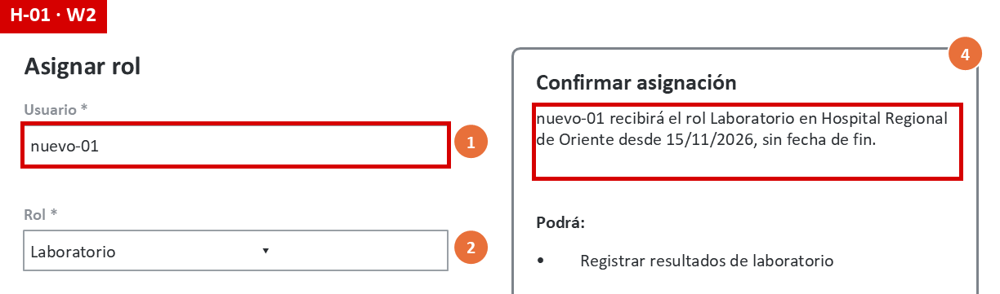

| | |
|---|---|
| Heurística / WCAG | N5 Prevención de errores · N6 Reconocer antes que recordar · WCAG 3.3.4 (parcial) |
| Qué pasa | «Usuario *» es un campo de texto libre. Hay que saberse el identificador («nuevo-01»). La confirmación repite ese mismo identificador: no muestra nombre, servicio ni cargo. |
| Por qué importa en RBAC | Una errata que coincide con otro identificador válido (`nuevo-01` / `nuevo-10`) **otorga permisos a otra persona**. La confirmación no ayuda a detectarlo. La asignación queda auditada, pero el daño (acceso clínico indebido) ya ocurrió. |
| Severidad × impacto | 4 × 3 = **12 · P1** |

### H-02 · Etiquetas, encabezados y pistas con contraste insuficiente — W1–W6

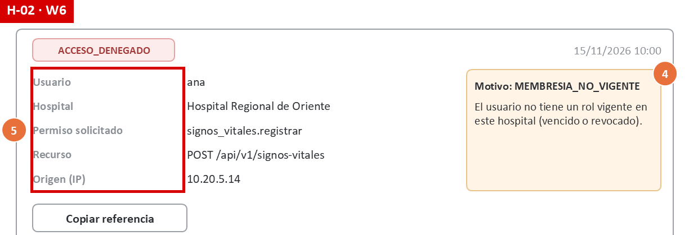

| | |
|---|---|
| Heurística / WCAG | WCAG 1.4.3 Contraste mínimo |
| Qué pasa | El gris `#8A8F96` da 3.26:1 sobre blanco y 2.93:1 sobre `#F2F3F5` (C-01..C-05). El mínimo es 4.5:1. |
| Por qué importa en RBAC | Afecta textos que forman parte de la trazabilidad: «Motivo * (queda en la bitácora)» (W3), las etiquetas del evento auditado (Usuario, Permiso solicitado, Recurso, W6) y «Este intento quedó registrado» (W5). Un usuario con baja visión no lee lo que se audita. |
| Severidad × impacto | 3 × 3 = **9 · P1** |

### H-03 · Bordes de campos y casilla de confirmación con contraste insuficiente — W1, W2, W3, W6

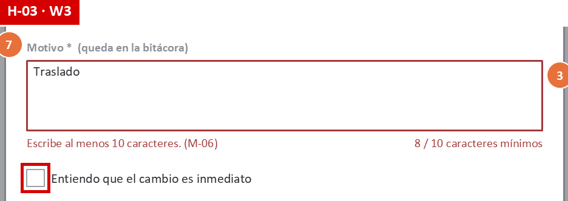

| | |
|---|---|
| Heurística / WCAG | WCAG 1.4.11 Contraste de no texto |
| Qué pasa | El borde `#9AA0A6` da 2.64:1 (C-06, C-07); el mínimo es 3:1. El borde rojo de error sí cumple (6.51:1). |
| Por qué importa en RBAC | La casilla «Entiendo que el cambio es inmediato» es una de las dos protecciones contra una revocación accidental. Si no se distingue, el administrador no sabe por qué no se habilita «Revocar rol» (se suma a H-05). |
| Severidad × impacto | 3 × 3 = **9 · P1** |

### H-04 · La página «Acceso denegado» no se anuncia ni recibe el foco — W5 (y rutas de la SPA)

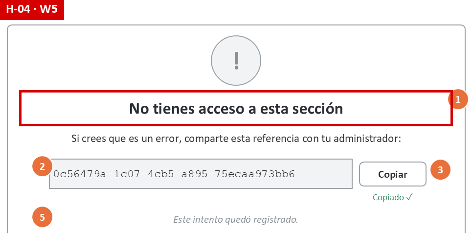

| | |
|---|---|
| Heurística / WCAG | WCAG 2.4.2 Página con título · 2.4.3 Orden del foco · 4.1.3 Mensajes de estado · N1 |
| Qué pasa | `permisoGuard` redirige a W5 dentro de la SPA. No hay recarga, y la especificación no define el título del documento, ni dónde queda el foco, ni el anuncio. El lector de pantalla sigue en el elemento anterior o en el inicio del documento, y no dice nada. |
| Por qué importa en RBAC | Es la **denegación trazable**: si el usuario no se entera de que fue denegado, no encuentra la referencia y la cadena usuario → administrador → auditor se corta. El checklist RBAC falla en R-UX-03. |
| Severidad × impacto | 3 × 3 = **9 · P1** |

### H-05 · «Revocar rol» deshabilitado sin decir qué falta — W3

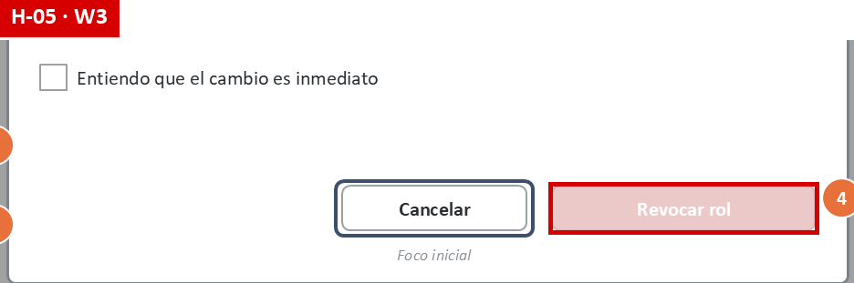

| | |
|---|---|
| Heurística / WCAG | N1 Visibilidad del estado · WCAG 3.3.2 Etiquetas o instrucciones · 2.1.1 (parcial) |
| Qué pasa | El botón deshabilitado no recibe foco: con `Tab` se salta, y el lector de pantalla no lo encuentra (recorrido W3, paso 4). Las dos condiciones (motivo de 10 o más caracteres y casilla) no se dicen antes. El contraste 1.53:1 está exento por estar deshabilitado, pero el botón casi no se ve. |
| Por qué importa en RBAC | Revocar es un cambio de permisos con efecto inmediato. Si el administrador no entiende qué falta, cancela o lo intenta de nuevo más tarde, y el rol sigue activo más tiempo del debido. |
| Severidad × impacto | 2 × 3 = **6 · P2** |

### H-06 · Cambiar de hospital descarta el formulario sin avisar — cabecera (todas; crítico en W2)

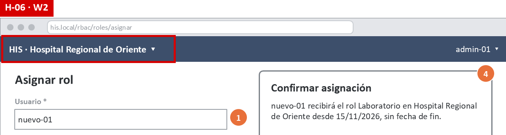

| | |
|---|---|
| Heurística / WCAG | N3 Control y libertad · N5 Prevención de errores · WCAG 3.3.7 Entrada redundante |
| Qué pasa | La regla I-10 vacía la caché y recarga la pantalla al cambiar de hospital. Con W2 a medio llenar, se pierde lo escrito sin confirmación. Tampoco se dice si el formulario recargado conserva los datos, lo que permitiría enviarlos al **otro** hospital. |
| Por qué importa en RBAC | El hospital es el tenant (R-01). Hay dos riesgos: perder trabajo, o asignar un rol en un hospital distinto al que el administrador tenía en mente. El checklist RBAC falla en R-UX-06. |
| Severidad × impacto | 3 × 3 = **9 · P1** |

### H-07 · La fecha se escribe en AAAA-MM-DD y se muestra en dd/mm/aaaa — W2

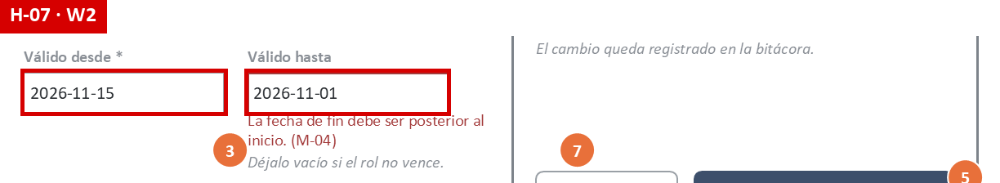

| | |
|---|---|
| Heurística / WCAG | N2 Coincidencia con el mundo real · N4 Consistencia · WCAG 3.3.2 |
| Qué pasa | Los campos aceptan `2026-11-15`. W1, la confirmación de W2 y W6 muestran `15/11/2026`. El formato no se indica en la etiqueta: solo aparece cuando hay error (M-01). |
| Por qué importa en RBAC | La vigencia decide PERMITIDO o DENEGADO (R-02, RF-07). Confundir `2026-11-01` con «11 de enero» deja el rol vigente en fechas equivocadas. La tarjeta de confirmación, al mostrar dd/mm/aaaa, mitiga el riesgo. Por eso la severidad es 2 y no 3. |
| Severidad × impacto | 2 × 3 = **6 · P2** |

### H-08 · El diálogo de revocación deja la cabecera operable — W3

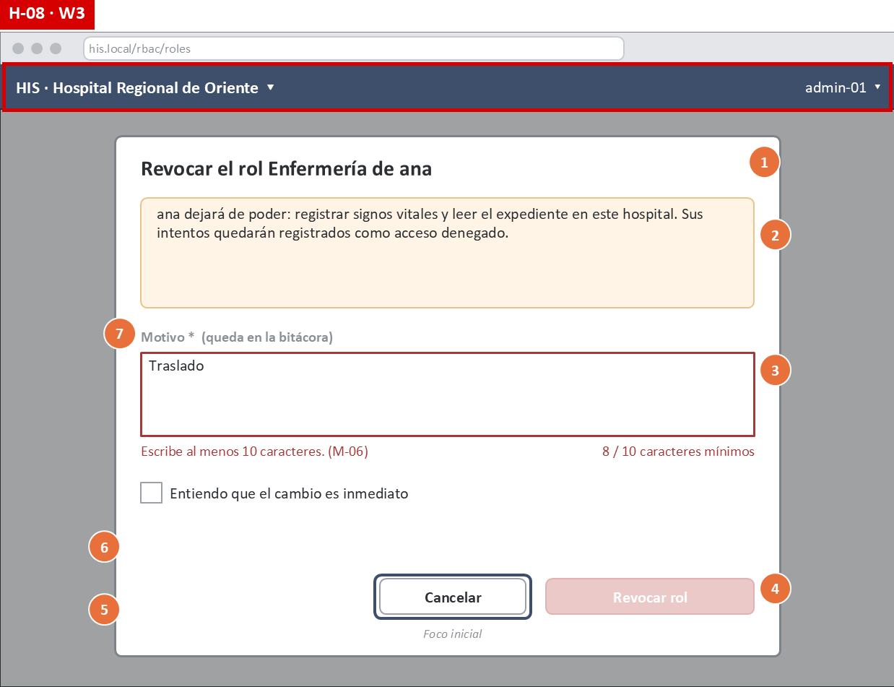

| | |
|---|---|
| Heurística / WCAG | WCAG 2.4.3 Orden del foco · 2.4.11 Foco no oculto · N5 |
| Qué pasa | El velo oscuro empieza **debajo** de la cabecera (se ve en el recorte). I-05 define el foco inicial y `Esc`, pero no que `Tab` quede dentro del diálogo ni que el fondo sea inerte (`aria-modal="true"`, `inert`). Desde el teclado se puede llegar al selector de hospital con el diálogo abierto. |
| Por qué importa en RBAC | Se podría cambiar de hospital (tenant) en medio de una revocación. El diálogo seguiría mostrando «ana · Enfermería» del hospital anterior. |
| Severidad × impacto | 3 × 3 = **9 · P1** |

### H-09 · La referencia de 36 caracteres es difícil de dictar o transcribir — W4, W5

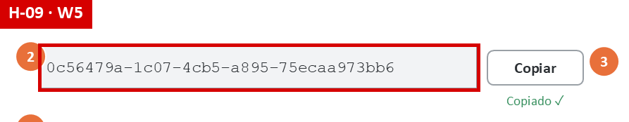

| | |
|---|---|
| Heurística / WCAG | N2 Coincidencia con el mundo real · N7 Flexibilidad |
| Qué pasa | En un hospital, la referencia se comparte a menudo por teléfono o se copia a mano a otra estación. Son 36 caracteres en un solo bloque. W6 rechaza espacios (M-30) y responde M-31 si falta un carácter. |
| Por qué importa en RBAC | Una referencia mal transcrita rompe la trazabilidad: el auditor no encuentra la denegación (R-UX-10). |
| Severidad × impacto | 2 × 3 = **6 · P2** |

### H-10 · El 404 de auditoría no sugiere revisar el hospital activo — W6

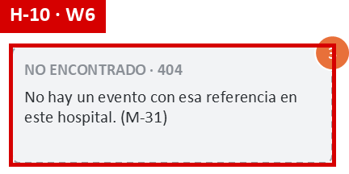

| | |
|---|---|
| Heurística / WCAG | N9 Ayudar a recuperarse de errores |
| Qué pasa | M-31 es igual si la referencia no existe o si es de otro hospital. Eso es correcto, porque no revela nada (D-3). Pero un auditor con acceso a varios hospitales no tiene ninguna pista para recuperarse. |
| Por qué importa en RBAC | El auditor concluye «no hay registro» de una denegación que sí existe. |
| Severidad × impacto | 2 × 3 = **6 · P2** |

### H-11 · El error del motivo aparece mientras se escribe — W3

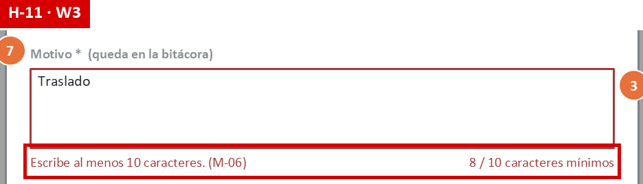

| | |
|---|---|
| Heurística / WCAG | N4 Consistencia (contradice la regla I-03 de la propia especificación) |
| Qué pasa | Con «Traslado» (8 caracteres) ya se ven en rojo M-06 y el contador. I-03 dice que los errores aparecen al salir del campo o al enviar. |
| Por qué importa en RBAC | Presiona a escribir rápido un motivo mínimo en vez de uno útil para la auditoría. |
| Severidad × impacto | 2 × 2 = **4 · P3** |

### H-12 · La duración del aviso de éxito con la referencia no está definida — W2, W3

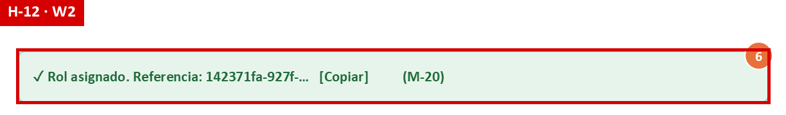

| | |
|---|---|
| Heurística / WCAG | WCAG 2.2.1 Tiempo ajustable · 4.1.3 Mensajes de estado |
| Qué pasa | M-20 y M-21 llevan la referencia y «Copiar». Si se implementan como un *toast* que desaparece en pocos segundos, un usuario de teclado o lector de pantalla no alcanza a llegar a «Copiar». |
| Por qué importa en RBAC | La referencia es la evidencia del cambio de permisos para el propio administrador. |
| Severidad × impacto | 3 × 2 = **6 · P2** |

### H-13 · La ayuda «?» no está definida para teclado ni tiene nombre accesible — W1

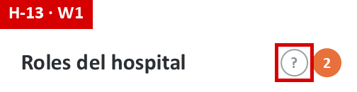

| | |
|---|---|
| Heurística / WCAG | WCAG 2.1.1 · 1.4.13 Contenido en hover o foco · 4.1.2 · N10 |
| Qué pasa | Se describe como «explica: un rol da permisos solo en este hospital…», sin decir cómo se abre ni cómo se cierra. Un lector de pantalla leería «signo de interrogación». |
| Por qué importa en RBAC | Es la única ayuda sobre el alcance por hospital y la vigencia de los roles. |
| Severidad × impacto | 2 × 2 = **4 · P3** |

### H-14 · La celda «—» en Acción no explica por qué no se puede revocar — W1

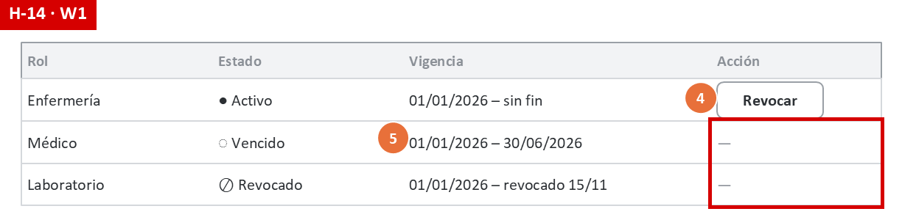

| | |
|---|---|
| Heurística / WCAG | N1 · WCAG 1.3.1 Información y relaciones |
| Qué pasa | Las filas vencidas o revocadas muestran «—», y un lector de pantalla lee «guion». En las filas del propio administrador, «Revocar» simplemente no aparece. |
| Por qué importa en RBAC | El administrador no distingue «no se puede porque no está activo» de «no se puede porque es mi propio rol» (autorrevocación). |
| Severidad × impacto | 2 × 2 = **4 · P3** |

### H-15 · «Copiado ✓» con contraste insuficiente — W5

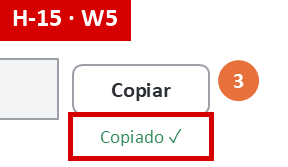

| | |
|---|---|
| Heurística / WCAG | WCAG 1.4.3 |
| Qué pasa | El verde `#2E8B57` sobre blanco da 4.25:1 a 9.5 pt (C-08). Se anuncia con `aria-live` (I-07), así que el lector de pantalla sí lo recibe. |
| Por qué importa en RBAC | Es la confirmación de que la referencia quedó copiada. |
| Severidad × impacto | 1 × 2 = **2 · P3** |

### H-16 · La pestaña activa solo se distingue por el relleno y la negrita — W4

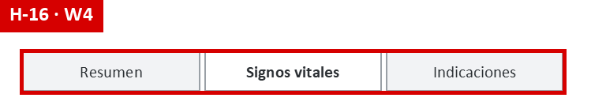

| | |
|---|---|
| Heurística / WCAG | WCAG 1.4.11 · 4.1.2 · N4 |
| Qué pasa | El relleno de la pestaña activa contra el de las inactivas da 1.11:1 (C-09). El estado tampoco está especificado para tecnologías de apoyo (`aria-selected`). |
| Por qué importa en RBAC | Poco: es navegación de la ficha, fuera de la decisión. |
| Severidad × impacto | 1 × 1 = **1 · P3** |

## 5. Fortalezas (se mantienen)

| Aspecto | Evidencia |
|---|---|
| El 403 no revela rol, permiso ni motivo | W4, W5 · R-UX-01 |
| Toda denegación da una referencia copiable y un siguiente paso | M-10 + M-11 · R-UX-02 |
| Fail-closed visible: esqueleto mientras carga, M-13 si el PDP falla | W4 · R-UX-04 |
| Estados con icono + texto, no solo color | W1 · WCAG 1.4.1 |
| Diálogo destructivo: título específico, consecuencias, foco inicial en «Cancelar», `Esc` | W3 · I-05 |
| Errores junto al campo, en texto y con sugerencia | Catálogo M-01..M-31 · WCAG 3.3.1, 3.3.3 |
| Mismo 404 para «no existe» y «otro hospital» | W6 · D-3 |
| Texto principal, botones, errores y avisos con buen contraste (5.70–13.49:1) | C-10..C-19 |

## 6. Backlog priorizado

Orden: prioridad, luego puntaje, luego esfuerzo y luego roles afectados (§2.1).

**Esfuerzo:**

| Nivel | Qué implica |
|---|---|
| S | Cambio de especificación o de estilo |
| M | Cambio de interacción o de un componente |
| L | Requiere backend |

| # | Hallazgo | P | Puntaje | Esfuerzo | Corrección propuesta | Criterio verificable |
|---|---|---|---:|---|---|---|
| BL-01 | H-01 Usuario sin identificar | **P1** | 12 | L | 1. Reemplazar el campo libre por un buscador con autocompletado: nombre, identificador y servicio, solo del hospital activo. 2. El valor solo es válido si se elige un resultado. 3. La confirmación dice «**Nombre Apellido** (`nuevo-01`) · Servicio». 4. Requiere `GET /api/v1/usuarios?q=` filtrado por tenant (nueva brecha **B-4**, junto a B-3). | **Dado** el texto «nuevo-1», **cuando** el administrador pulsa «Revisar asignación» sin elegir un resultado, **entonces** no avanza y se muestra «Elige un usuario de la lista». **Y** la tarjeta de confirmación contiene el nombre completo y el identificador. Se verifica con una prueba e2e (Playwright). |
| BL-02 | H-02 Contraste de texto secundario | **P1** | 9 | S | Cambiar el gris secundario `#8A8F96` → `#5F6670` en todo el sistema de diseño. | `python herramientas/contraste.py` reporta CUMPLE en C-01..C-05 y termina con código 0. En la implementación: axe-core sin infracciones `color-contrast` en W1–W6. |
| BL-03 | H-04 Denegación sin anuncio | **P1** | 9 | S | 1. Al navegar a W5: `document.title = "Acceso denegado · HIS"`. 2. Foco en el `<h1>` (`tabindex="-1"`). 3. Región `aria-live="assertive"` con «Acceso denegado». 4. El primer `Tab` lleva a «Copiar referencia», con nombre accesible completo. 5. Se agrega como regla I-12 de la especificación. | **Dado** NVDA activo, **cuando** `permisoGuard` redirige a W5, **entonces** se anuncia «Acceso denegado» en menos de 1 s y el primer `Tab` enfoca «Copiar referencia». La prueba e2e comprueba `document.title` y `document.activeElement` = `h1`. |
| BL-04 | H-03 Contraste de bordes | **P1** | 9 | S | Borde de campos y casillas `#9AA0A6` → `#7D838A`. | `contraste.py`: C-06 y C-07 ≥ 3.0 (hoy 3.83 con la propuesta). |
| BL-05 | H-08 Diálogo sin trampa de foco | **P1** | 9 | S | 1. Diálogo con `role="dialog"` y `aria-modal="true"`. 2. El resto de la página, **incluida la cabecera**, con `inert`. 3. `Tab` y `Shift+Tab` ciclan dentro del diálogo. 4. El velo cubre también la cabecera. 5. Se amplía la regla I-05. | **Dado** el diálogo abierto, **cuando** se pulsa `Tab` 20 veces, **entonces** `document.activeElement` siempre está dentro del diálogo, y el selector de hospital no responde ni al clic ni al teclado. Se verifica con una prueba e2e. |
| BL-06 | H-06 Cambio de hospital | **P1** | 9 | M | 1. Si hay un formulario con cambios, preguntar: «Tienes cambios sin guardar en **Hospital Regional de Oriente**. ¿Cambiar a **Hospital del Norte** y descartarlos?», con [Seguir aquí] y [Cambiar y descartar]. 2. Al cambiar, el formulario se vacía siempre. 3. Se anuncia «Ahora trabajas en Hospital del Norte» (`aria-live`). | **Dado** W2 con datos, **cuando** se elige otro hospital, **entonces** aparece la confirmación. Si se acepta, la prueba e2e verifica que **no** se envió ningún `POST /roles/asignaciones` con el `X-Tenant-ID` nuevo y que los campos están vacíos. |
| BL-07 | H-05 Revocar deshabilitado | **P2** | 6 | S | 1. Mantener «Revocar rol» enfocable (`aria-disabled="true"` en vez de `disabled`). 2. Asociarle con `aria-describedby` el texto visible «Para revocar: escribe un motivo de al menos 10 caracteres y marca la casilla». 3. Al activarlo incompleto, mover el foco al primer requisito pendiente. | **Dado** el motivo vacío, **cuando** se llega con `Tab` a «Revocar rol» y se pulsa `Enter`, **entonces** no se envía nada, el foco pasa al campo «Motivo» y el lector anuncia M-06. |
| BL-08 | H-07 Formato de fecha | **P2** | 6 | S | Usar `<input type="date">`, que muestra la fecha en el formato local (dd/mm/aaaa) y envía ISO. Etiqueta «Válido desde (dd/mm/aaaa)». | Con el navegador en `es-GT`, el campo muestra `15/11/2026` y el payload enviado contiene `"desde":"2026-11-15"`. Prueba de componente. |
| BL-09 | H-10 404 de auditoría | **P2** | 6 | S | Ampliar M-31: «No hay un evento con esa referencia en **este hospital**. Si el usuario trabaja en otro hospital, cámbialo en la cabecera y vuelve a buscar.» No revela si el evento existe. | El texto de M-31 nombra el hospital activo y la acción. La respuesta HTTP sigue siendo 404 idéntico para «no existe» y «otro hospital» (prueba existente HTTP-06 del Micro-HIS: hoy pasa). |
| BL-10 | H-12 Aviso de éxito temporal | **P2** | 6 | S | M-20 y M-21 como avisos **persistentes**, que se cierran con un botón «×» o al iniciar otra acción. Nunca con un temporizador. | Prueba e2e: tras asignar, el aviso sigue visible 60 s después, y «Copiar» es alcanzable con `Tab`. |
| BL-11 | H-09 Referencia larga | **P2** | 6 | M | 1. Mostrar la referencia en monoespaciada agrupada (`0c56479a · 1c07 · 4cb5 · …`). 2. W6 normaliza la entrada: quita espacios y `·` antes de validar. 3. M-31 sugiere «revisa que tenga 36 caracteres». | Prueba unitaria del normalizador: `"0c56479a 1c07 4cb5…"` → `"0c56479a-1c07-4cb5-…"`. W6 encuentra el evento cuando la referencia se pega con espacios. |
| BL-12 | H-11 Error mientras se escribe | **P3** | 4 | S | Contador neutro mientras se escribe («8 / 10 mínimo», gris); el rojo, M-06 y `aria-invalid` solo al salir del campo o al enviar (I-03). | **Dado** el foco en «Motivo» con 8 caracteres, **entonces** no hay texto rojo y `aria-invalid` es falso. Al salir del campo, `aria-invalid="true"` y M-06 visible. |
| BL-13 | H-13 Ayuda «?» | **P3** | 4 | S | Botón con nombre accesible «Ayuda: alcance de los roles», que abre un *popover* con el foco dentro. Se cierra con `Esc` o «Cerrar» y no desaparece al mover el ratón. | Recorrido de teclado: `Tab` llega al botón, `Enter` lo abre, `Esc` lo cierra y el foco vuelve al botón. axe-core sin `button-name`. |
| BL-14 | H-14 Celda «—» | **P3** | 4 | S | Texto visible «Sin acciones (rol no activo)». En las filas propias: «Tu propio rol · otro administrador puede revocarlo». | Ninguna celda de la columna «Acción» queda con «—» o vacía. Se verifica con una prueba de componente. |
| BL-15 | H-15 «Copiado ✓» | **P3** | 2 | S | Verde `#2E8B57` → `#1F6B3A` (el mismo del aviso de éxito). | `contraste.py`: C-08 ≥ 4.5 (6.52 con la propuesta). |
| BL-16 | H-16 Pestaña activa | **P3** | 1 | S | Barra inferior de 3 px `#3D4F6B` en la pestaña activa + `role="tab"` y `aria-selected="true"`. | `contraste.py`: C-09 ≥ 3.0 (7.48). axe-core sin infracciones `aria-required-attr`. |

### 6.1 Qué cambia en la especificación de la semana 8

| Corrección | Documento afectado |
|---|---|
| BL-03 | Nueva regla I-12 (navegación a W5) |
| BL-05 | Ampliar I-05 (modal inerte) |
| BL-06 | Ampliar I-10 (confirmar el cambio de hospital) |
| BL-07, BL-12 | Ajustar W3 |
| BL-08 | Ajustar W2 |
| BL-09 | Nuevo texto de M-31 |
| BL-10 | M-20 y M-21 persistentes |
| BL-01 | Nueva brecha B-4 del contrato (`GET /api/v1/usuarios?q=`) |
| BL-02, BL-04, BL-15, BL-16 | Paleta del sistema de diseño |

Esta semana no se modificaron los wireframes de la semana 8: la tarea es evaluar y priorizar. Las correcciones quedan listas para aplicarse en la siguiente iteración. Los criterios de contraste ya se pueden comprobar hoy con el script.

## 7. Limitaciones

- **Se evaluó un diseño, no una implementación.**
  - El contraste es una medición real sobre los colores definidos.
  - El teclado y el lector de pantalla se evaluaron recorriendo la especificación, no con NVDA sobre una página real.
  - Los criterios del backlog están escritos para verificarse cuando exista el frontend.
- **Un solo evaluador.** Nielsen recomienda de 3 a 5 evaluadores para encontrar la mayoría de los problemas. Un compañero del grupo podría repetir la checklist como segunda opinión.
- **Sin pruebas con usuarios.** Las severidades son el juicio del evaluador. BL-01 y BL-10 conviene validarlos con 3–5 usuarios: un administrador y personal clínico.
- **Tamaños de letra en puntos.** Los umbrales de «texto grande» de WCAG se aplicaron a los tamaños de los wireframes (en puntos). Si la implementación usa otros tamaños, hay que volver a correr el script con ellos.
