# Semana 10 — Diseño para movilidad del flujo RBAC

**Estudiante:** Boris Alexander Quiroa Orellana · **Módulo:** RBAC: roles, permisos y protección de rutas

**Proceso:** «asignación de rol, autorización de una operación y denegación trazable», adaptado a teléfonos de **320 a 430 px**.

**Entregables:**

| Pedido | Dónde |
|---|---|
| Propuesta responsive de 3–5 pantallas | 5 pantallas M1–M5. Son un [prototipo HTML/CSS](prototipo/) navegable que se ve en el navegador, con [31 capturas](capturas/) en 320, 360, 430, 768 y 1024 px. |
| Reglas de breakpoint | §4. 4 de ellas se verifican con un [script](herramientas/verificar-responsive.cjs): [resultado](evidencia/verificacion-responsive.txt). |
| Dos escenarios móviles con decisiones de contenido y error | §9 y §10, con [tiras de capturas](escenarios/) |

## 1. Punto de partida

Este diseño adapta el de la [semana 8](../semana-08/semana-08-ux-rbac.md) (W1–W6) y aplica el backlog de la [semana 9](../semana-09/semana-09-evaluacion-ux-rbac.md) (§12). No es un rediseño.

| Escritorio (semana 8) | Móvil (semana 10) | Cambio principal |
|---|---|---|
| W1 Roles del hospital | **M1** Roles de una persona | La tabla pasa a tarjetas |
| W2 Asignar rol | **M2** Asignar rol en 3 pasos | Un formulario de 4 campos pasa a 3 pasos de una decisión cada uno |
| W3 Revocar rol | **M3** Revocar (hoja inferior) | El diálogo centrado pasa a hoja inferior |
| W4 + W5 Operación y denegación | **M4** Operación protegida | La denegación se muestra en la misma pantalla, con «Compartir» |
| W6 Auditoría | **M5** Consulta de auditoría | Los detalles técnicos quedan plegados |

**¿Quién usa el teléfono y para qué?**

| Rol | Situación móvil | Tarea móvil prioritaria |
|---|---|---|
| Enfermería, medicina, laboratorio | Rondas, de pie, una mano, señal irregular en pasillos y ascensores | Ejecutar una operación protegida y entender una denegación |
| Administrador de hospital | De guardia, fuera de la oficina, ante una urgencia («el médico de reemplazo no puede prescribir») | Asignar o revocar **un** rol a **una** persona |
| Auditor | Casi siempre en escritorio | Consultar **una** referencia que le enviaron |

**Decisión de alcance.** En el teléfono se hace **una** cosa por vez. Las tareas masivas quedan para escritorio: revisar todos los roles del hospital o investigar muchas denegaciones.

## 2. Jerarquía de contenido

Cada dato tiene una prioridad:

- **P1**: visible siempre, incluso a 320 px.
- **P2**: visible desde 320 px, por debajo de P1.
- **P3**: aparece desde 431 px (clase `.extra`) o queda plegado.
- **—**: no se muestra en el teléfono.

| Pantalla | P1 · lo que decide | P2 · lo que explica | P3 · lo que amplía | Fuera del teléfono |
|---|---|---|---|---|
| M1 Roles | Persona (nombre); rol; estado con icono + texto; acción «Revocar» | Vigencia; «Sin acciones: el rol no está activo» | Quién lo asignó; referencia de la asignación | Lista de todos los usuarios del hospital |
| M2 Asignar | Persona elegida por nombre; rol; botón del paso | Permisos que obtendrá; vigencia | Aviso «queda en la bitácora con tu nombre» | Asignación a varias personas a la vez |
| M3 Revocar | Rol y persona en el título; consecuencia; motivo; casilla | Hospital; contador del motivo | — | — |
| M4 Operación | Acción permitida; aviso 403 con referencia y «Compartir» | Formulario clínico | Última toma | Acciones no permitidas (ocultas, igual que en escritorio) |
| M5 Auditoría | Tipo de evento; persona; qué intentó; motivo en lenguaje claro | Fecha; código técnico del motivo | Permiso, recurso, IP y referencia completa, plegados en «Detalles técnicos» | Búsqueda por fechas o por persona |

**Lo que el teléfono nunca recorta,** aunque falte espacio:

1. **El hospital activo.** A 320 px se abrevia («H. R. Oriente»), pero el nombre completo queda en el `aria-label` y en el menú.
2. **La referencia de una denegación.**
3. **Las consecuencias de revocar.**
4. **Los permisos que otorga una asignación.**

Son los datos que sostienen la autorización y su trazabilidad.

## 3. Reducción de carga cognitiva

| Técnica | Dónde | Antes (escritorio, semana 8) | Ahora (móvil) |
|---|---|---|---|
| Una decisión por pantalla | M2 | 4 campos y la confirmación al mismo tiempo | 3 pasos, cada uno con una sola pregunta: ¿quién?, ¿qué y hasta cuándo?, ¿confirmas? |
| Reconocer en vez de recordar | M2 paso 1 | Escribir `nuevo-01` | Elegir «Luis García · Laboratorio clínico» de una lista (BL-01) |
| Lenguaje claro primero, código después | M5 | `MEMBRESIA_NO_VIGENTE` en el título | «Motivo: rol no vigente» + explicación; el código va debajo, más pequeño |
| Divulgación progresiva | M5 | 5 datos técnicos visibles | «Detalles técnicos» plegado (`<details>`) |
| Controles nativos | M2 | Fecha escrita a mano en AAAA-MM-DD | `type="date"`: el teléfono abre su propio calendario (BL-08) |
| Teclado adecuado | M4 | — | `inputmode="numeric"` o `"decimal"` en los signos vitales |
| Menos navegación para quien tiene un solo permiso | M4 | — | Ana solo tiene «Pacientes»: no se le muestra barra de navegación |
| Acción principal donde está el pulgar | Todas | Botones en el cuerpo | Barra de acción fija abajo |

## 4. Reglas de breakpoint

El CSS es *mobile-first*: la base es 320 px y cada breakpoint **agrega**, nunca quita funciones. Ver [prototipo/estilos.css](prototipo/estilos.css).

| Nombre | Rango | Dispositivo típico | Qué cambia |
|---|---|---|---|
| **XS** (base) | 320–359 px | Teléfono pequeño (iPhone SE de 1.ª generación, Android de gama baja) | Hospital abreviado; una columna; botones a todo el ancho; tarjetas; barra de acción fija; hoja inferior |
| **S** | 360–430 px | Teléfono estándar (la mayoría) | Nombre completo del hospital en la barra |
| **M** | 431–767 px | Teléfono grande o en horizontal | Aparecen los datos P3 (`.extra`) y el rol del usuario en la barra; los botones de la hoja quedan en fila |
| **L** | 768–1023 px | Tableta | La navegación inferior pasa a riel lateral; la hoja pasa a diálogo centrado; la acción ya no queda fija |
| **XL** | ≥ 1024 px | Escritorio | Las tarjetas de membresía vuelven a ser **tabla** (W1); contenedor de hasta 960 px |

Por qué 430 y no 480: 430 px es el ancho del teléfono más grande en uso común (iPhone Pro Max) y el límite que pide la tarea. De 431 en adelante ya cabe una segunda línea de datos sin empujar la acción fuera de la pantalla.

### 4.1 Reglas transversales

Las marcadas con ✓ se verifican automáticamente en las 31 vistas con [herramientas/verificar-responsive.cjs](herramientas/verificar-responsive.cjs).

| ID | Regla | Verificación |
|---|---|---|
| R-B1 | No hay desplazamiento horizontal en ningún ancho de 320 px en adelante. | ✓ `scrollWidth − innerWidth ≤ 0` |
| R-B2 | Todo objetivo táctil mide al menos **44 × 44 px**. | ✓ medición de cada botón, enlace, campo y opción |
| R-B3 | Los campos usan letra de **16 px** o más, para que iOS no haga zoom al enfocarlos. | ✓ `font-size` calculado |
| R-B4 | El hospital activo es visible en todas las pantallas y anchos (D-7). | ✓ alto de `.barra .hospital` > 0 |
| R-B5 | La tabla de membresías se muestra solo desde 1024 px. Debajo se usan tarjetas, una por membresía, y cada tarjeta repite la etiqueta de su dato. | Capturas `m1-roles-base-*.png` |
| R-B6 | La acción principal va en la barra fija inferior hasta 767 px; desde 768 px queda al final del contenido. | Capturas 360 / 768 |
| R-B7 | Una acción destructiva (revocar) se abre como hoja inferior hasta 767 px, con «Cancelar» abajo, donde cae el pulgar. Desde 768 px se abre como diálogo centrado, con «Cancelar» a la izquierda. En ambos casos el resto de la página queda `inert` (BL-05). | Capturas `m3-revocar-base-360.png` / `-768.png` |
| R-B8 | La navegación muestra **solo** las secciones permitidas por el PDP. Si hay una sola, no se muestra. | M4 (Ana) sin navegación; M1/M5 (admin) con 3 |
| R-B9 | Los datos P3 se ocultan con `display: none` (fuera del árbol de accesibilidad), nunca con texto diminuto. | Revisión de `estilos.css` |

**Resultado:** `Vistas: 31  Fallan: 0`. La primera corrida encontró un fallo real: el botón «Reintentar» de la barra de red medía 40 px. Se corrigió a 44 px y la verificación se volvió a correr.

## 5. Navegación

| Ancho | Patrón | Contenido |
|---|---|---|
| < 768 px | **Barra superior** (hospital + usuario) + **barra inferior** con hasta 3 secciones permitidas | Admin: Roles · Auditoría · Más. Clínico con una sola sección: sin barra inferior. |
| 768–1023 px | Barra superior + **riel lateral** de 96 px | Las mismas secciones |
| ≥ 1024 px | Igual que en escritorio (semana 8) | — |

**Cómo se protege la navegación:**

- **Rutas protegidas.** Una sección no permitida no aparece en la barra. Si el usuario llega por un enlace, `permisoGuard` lo lleva a la pantalla de acceso denegado con la referencia.
- **Flechas de volver.** En los flujos de varios pasos (M2, M4), «←» vuelve a la pantalla anterior.
- **Pasos de M2.** «Atrás» va al paso anterior **sin perder** lo elegido.
- **Cambio de hospital.** El selector de la barra aplica BL-06: confirma si hay cambios sin guardar y vacía el formulario al cambiar.

## 6. Tablas, formularios y confirmaciones

**Tablas → tarjetas (M1).** Cada membresía es una tarjeta con:

- rol y estado en la primera línea;
- vigencia en la segunda;
- la acción a todo el ancho.

Las filas no activas dicen «Sin acciones: el rol no está activo» en vez de «—» (BL-14).

En el prototipo, tabla y tarjetas están dos veces en el HTML, y CSS muestra una u otra. En Vue será un solo componente con `v-if` según el ancho. No se usa `display: block` sobre una `<table>`, porque algunos navegadores pierden la semántica de tabla.

**Formularios:**

- una columna;
- etiqueta siempre visible arriba (no se usa el placeholder como etiqueta);
- controles nativos (`type="date"`, `type="search"`, `inputmode`);
- ayuda debajo del campo;
- error junto al campo, solo al salir de él o al enviar (I-03, BL-12).

En M4, los signos vitales van en 2 columnas porque son números cortos. Cada campo mide 140 px o más a 320 px.

**Confirmaciones:**

| Acción | Confirmación móvil | Por qué |
|---|---|---|
| Asignar (M2) | Paso 3 completo, que confirma el **nombre** de la persona, el rol, el hospital y los permisos que obtendrá | Es la última barrera contra dar permisos a la persona equivocada (H-01) |
| Revocar (M3) | Hoja inferior con la consecuencia, el motivo (10 caracteres o más) y la casilla. El foco inicial está en «Cancelar». | Es destructivo e inmediato |
| Compartir referencia (M4) | Hoja nativa del sistema (Web Share API). El texto compartido lleva solo la referencia y el hospital. | El teléfono comparte por canales externos (WhatsApp, correo): **no** puede salir ningún dato del paciente |

## 7. Recuperación ante conexión limitada

### 7.1 Estados de la red

| Estado | Cuándo | Qué ve el usuario |
|---|---|---|
| Normal | Respuesta en menos de 2 s | Nada |
| **Lenta** | 2 s sin respuesta | Barra amarilla «Conexión lenta» bajo la cabecera; el botón sigue en «Asignando…» |
| **Sin conexión** | `navigator.onLine = false` o falla de red | Barra oscura «Sin conexión» + «Reintentar». Las acciones protegidas quedan deshabilitadas y dicen «requiere conexión». |
| **Resultado incierto** | Se envió una escritura y no llegó respuesta antes del tiempo límite | «No sabemos si se asignó», lo que se envió, y [Ver sus roles] [Reintentar] |

### 7.2 Tiempos y reintentos

| Operación | Tiempo límite | Reintento automático | Reintento manual |
|---|---|---|---|
| Lecturas: membresías, auditoría | 8 s | 1, tras 1 s | Sí |
| Decisión del PDP (`POST /autorizaciones/decisiones`) | 8 s | 1, tras 1 s (es una consulta, no cambia nada) | Sí («Reintentar» de M-13) |
| Asignar rol | 15 s | **Nunca** | Ver la tabla siguiente |
| Revocar rol | 15 s | **Nunca** | Sí |
| Operación clínica protegida | 15 s | **Nunca** | Sí |

Entre servicios, el `ClienteRbac` del Micro-HIS usa 0.5 s y 1 reintento (semana 5), porque los dos servicios están en la misma red. Un teléfono en 3G o con mala señal tiene latencias de segundos. Por eso los tiempos de la tabla son mayores, y por eso las escrituras nunca se reintentan sin que el usuario lo decida.

### 7.3 ¿Es seguro reintentar? Medido, no supuesto

Se envió dos veces la misma solicitud al kernel real del Micro-HIS, como haría un teléfono que no recibió la primera respuesta ([herramientas/reintento.php](herramientas/reintento.php), [salida](evidencia/reintento.txt)):

```text
Asignar sin fecha de fin   1.er envío: 201   reintento idéntico: 409 ASIGNACION_DUPLICADA     → SEGURO (no repite el efecto)
Asignar con fecha de fin   1.er envío: 201   reintento idéntico: 201 ROL_ASIGNADO             → NO SEGURO (repite el efecto)
Revocar                    1.er envío: 200   reintento idéntico: 404 MEMBRESIA_NO_ENCONTRADA  → SEGURO (no repite el efecto)
```

La regla R-03 solo impide duplicar membresías **abiertas** (`valido_hasta IS NULL`). Esto lleva a la decisión de diseño **R-C1**:

| Caso | Botón principal en «resultado incierto» | Interpretación del reintento |
|---|---|---|
| Asignación **sin** fecha de fin | «Reintentar» | 201 → «Rol asignado» · **409 → «Ya estaba asignado: tu solicitud anterior sí llegó»** |
| Asignación **con** fecha de fin | «Ver sus roles» (verificar primero). «Reintentar» solo aparece si la verificación muestra que no se asignó. | Si se reintentara a ciegas, se crearía una segunda membresía |
| Revocación | «Reintentar» | 200 → «Rol revocado» · **404 → M-07 «Este rol ya no está activo»** |

**Brecha B-5.** La solución de fondo es que la API acepte una cabecera `Idempotency-Key` en asignar y revocar. Así cualquier reintento sería seguro, sin depender de R-03. Mientras no exista, rige R-C1. «Ver sus roles» también depende de B-1, que es `GET /roles/membresias`.

### 7.4 Lo que el diseño **no** hace sin conexión, a propósito

| No se hace | Por qué |
|---|---|
| Autorizar sin conexión, aunque haya una decisión en caché | La caché de 30 s solo sirve para mostrar u ocultar acciones. Sin conexión no se puede ejecutar nada, así que las acciones se deshabilitan (fail-closed, P-2). |
| Guardar en cola asignaciones o revocaciones para enviarlas «cuando vuelva la red» | Un cambio de permisos debe ocurrir cuando el administrador lo decide, con el hospital y la persona que tiene a la vista. Enviado más tarde, podría aplicarse en otro contexto, por ejemplo después de un cambio de hospital. |
| Guardar el formulario clínico en el teléfono (`localStorage`) | Son datos clínicos en un dispositivo que se pierde o se comparte. Se conservan **en memoria** mientras la pantalla siga abierta, y se dice así: «No se guarda en el teléfono». |
| Mostrar una denegación sin conexión | El 403 solo lo da el servidor. Sin conexión, el mensaje es «requiere conexión», nunca «acceso denegado». |

## 8. Las 5 pantallas

### M1 · Roles de una persona (admin)

| 320 px | 360 px | 1024 px |
|---|---|---|
| 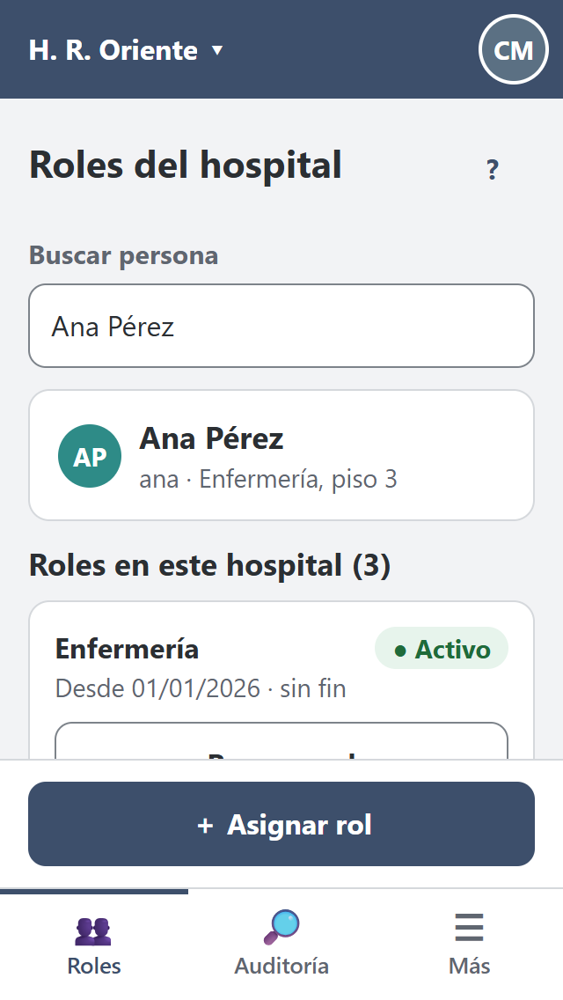 | 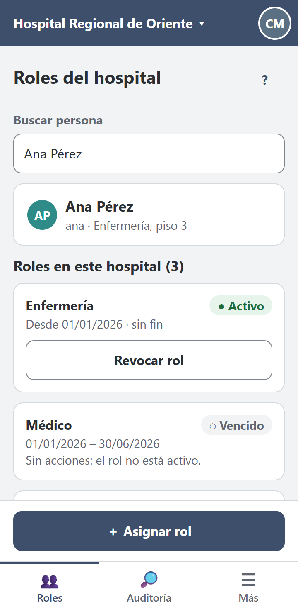 | 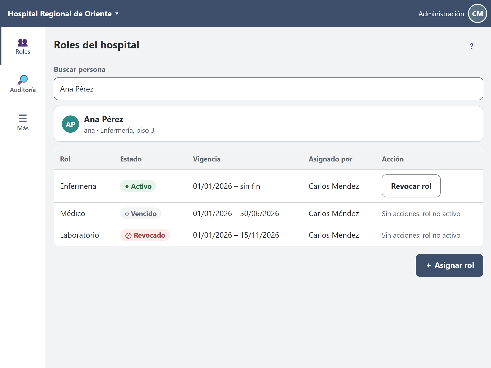 |

- A 320 px el hospital se abrevia.
- Desde 431 px aparece «Asignado por».
- A 1024 px las tarjetas pasan a tabla.
- Sin conexión ([captura](capturas/m1-roles-sin-conexion-360.png)) se muestra lo último cargado, con su antigüedad, y las acciones dicen «requiere conexión».

### M2 · Asignar rol en 3 pasos (admin)

| Paso 1 · persona | Paso 2 · rol y vigencia | Paso 3 · confirmar |
|---|---|---|
| 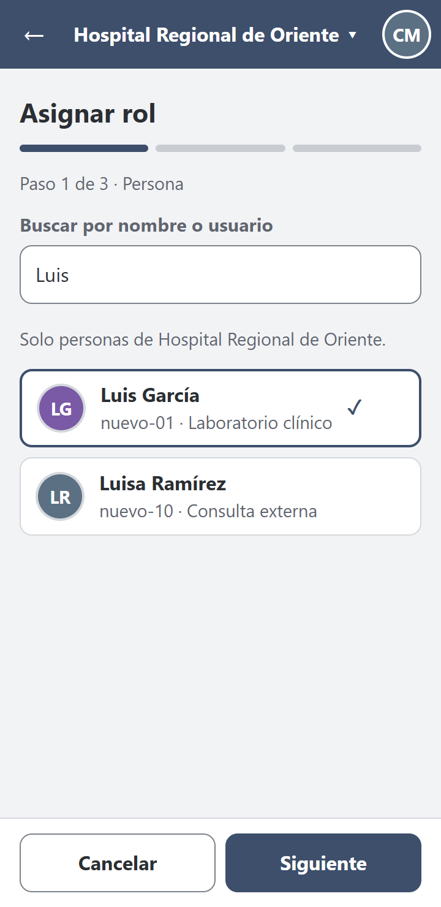 | 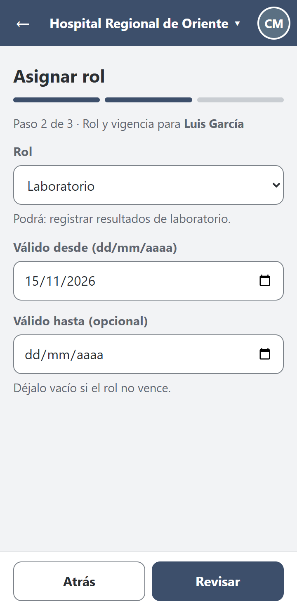 | 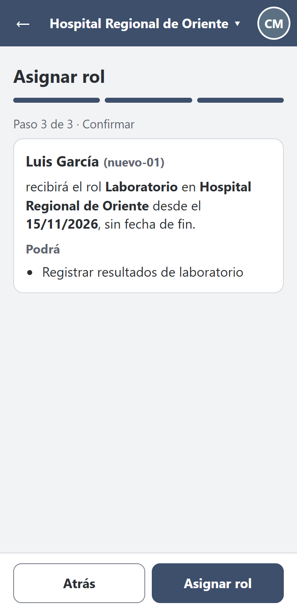 |

Los estados de envío, resultado incierto y «ya estaba asignado» están en el escenario 2.

### M3 · Revocar rol (hoja inferior)

| 360 px | Sin conexión | 768 px (diálogo) |
|---|---|---|
| 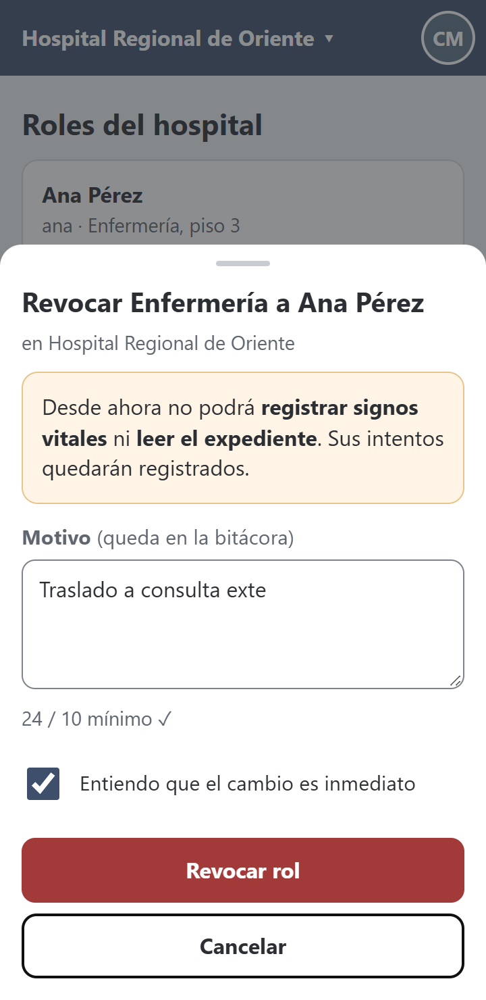 | 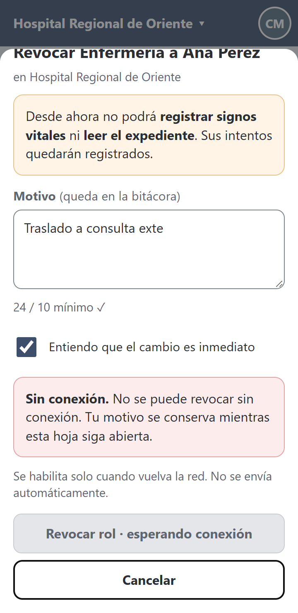 | 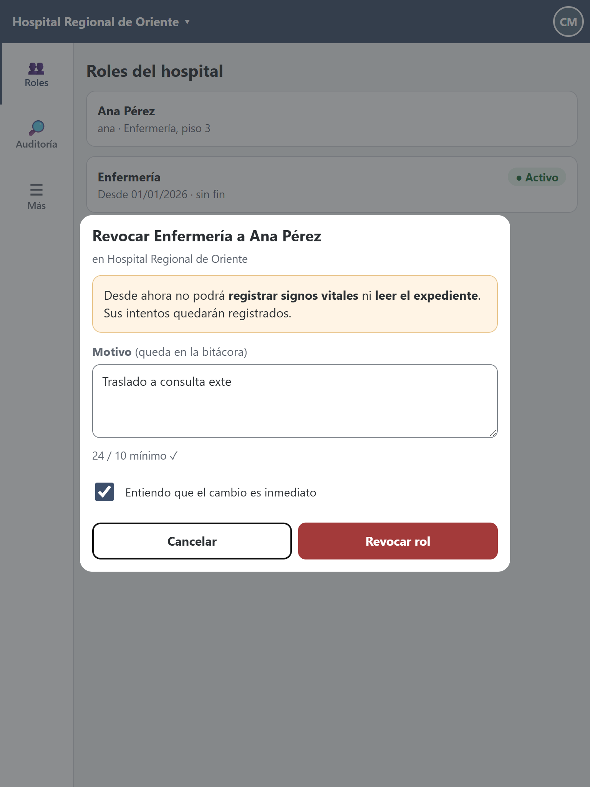 |

### M4 · Operación protegida (clínico)

| Carga | Permitida | Denegada (403) |
|---|---|---|
| 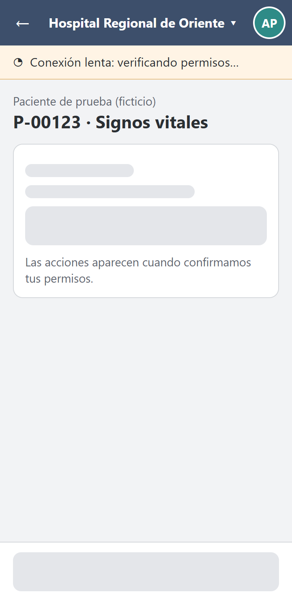 | 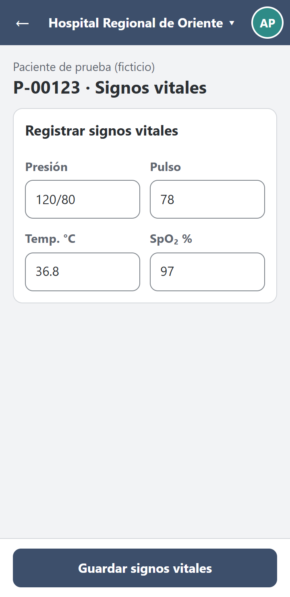 | 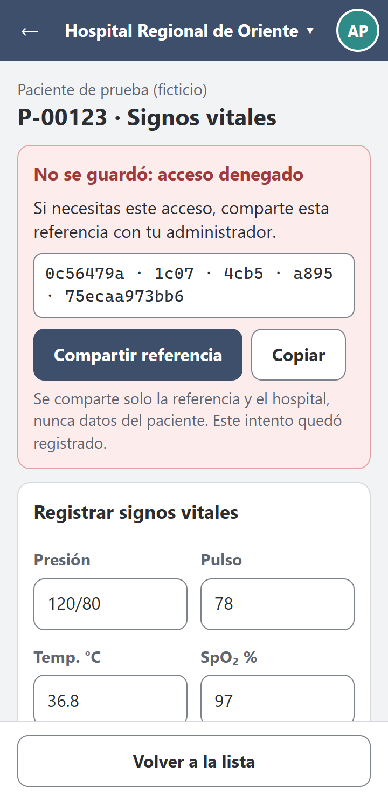 |

### M5 · Consulta de auditoría

| Evento encontrado | No encontrado (320 px) |
|---|---|
| 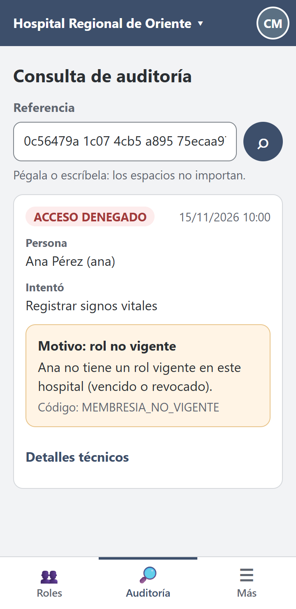 | 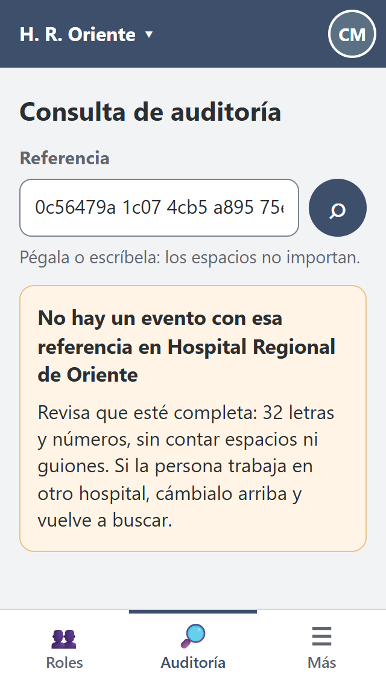 |

## 9. Escenario 1 · Ana, enfermera en ronda, con señal intermitente

**Contexto.** Teléfono de 360 px, una mano, pasillo del piso 3 con señal irregular. Ana abrió la ficha con señal. Mientras estaba sin señal, el administrador le revocó el rol de Enfermería (traslado). Ella no lo sabe.

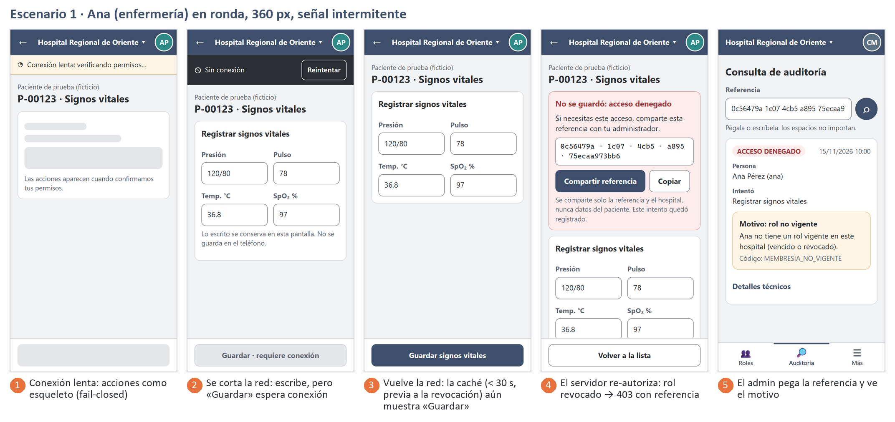

| # | Lo que pasa | Decisión de contenido | Decisión de error |
|---|---|---|---|
| 1 | Abre la ficha; el PDP tarda | El nombre del paciente y el formulario se cargan; las **acciones** quedan como esqueleto: «Las acciones aparecen cuando confirmamos tus permisos» | Barra «Conexión lenta» a los 2 s. No se muestra ninguna acción «por si acaso» (fail-closed). |
| 2 | Se corta la red mientras escribe | Lo escrito sigue en pantalla. «No se guarda en el teléfono» le dice que no salga de la ficha. | «Guardar · requiere conexión» (deshabilitado, con motivo). No es una denegación: no se usa la palabra «denegado». |
| 3 | Vuelve la red a los pocos segundos | La decisión del PDP que se pidió al abrir la ficha, **antes** de la revocación, sigue en la caché de 30 s. Por eso «Guardar» aparece habilitado. | — (la UI no puede saber de la revocación hasta preguntar) |
| 4 | Pulsa «Guardar»; el servidor **vuelve a autorizar** y deniega | El aviso va **arriba** («No se guardó: acceso denegado»), recibe el foco y se anuncia (BL-03). La referencia va agrupada en bloques (BL-11). | 403 sin rol, sin permiso, sin motivo (R-08). «Compartir referencia» abre la hoja del sistema, y el texto lleva **solo** la referencia y el hospital: nunca el paciente. |
| 5 | Carlos, el administrador, recibe la referencia por mensaje y la pega en M5 | Primero en lenguaje claro: «Motivo: rol no vigente». El código y los datos técnicos van debajo o plegados. | Si la pega con espacios, se normaliza (BL-11). Si es de otro hospital, M-31 sugiere cambiar el hospital (BL-09). |

**Qué demuestra:** el teléfono nunca decide la autorización. La denegación llega del servidor aunque la pantalla mostrara la acción, y la referencia viaja del teléfono de Ana al de Carlos sin datos clínicos.

## 10. Escenario 2 · Carlos, administrador de guardia, asigna un rol con red lenta

**Contexto.** 23:40, teléfono pequeño de 320 px, datos móviles lentos. Luis García, de laboratorio, cubre un turno y no puede registrar resultados. Carlos le asigna el rol Laboratorio sin fecha de fin.

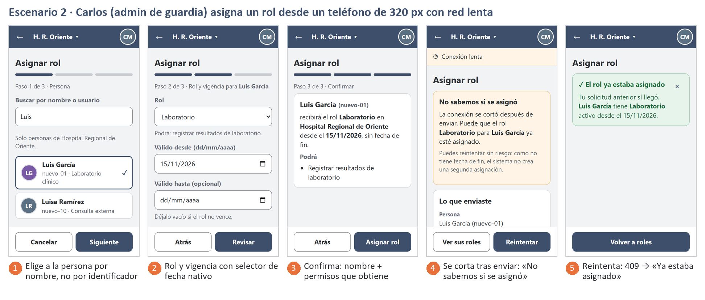

| # | Lo que pasa | Decisión de contenido | Decisión de error |
|---|---|---|---|
| 1 | Busca «Luis» | Resultados con **nombre + identificador + servicio**, solo del hospital activo (BL-01). «Luis García» y «Luisa Ramírez» se distinguen a simple vista (`nuevo-01` / `nuevo-10`). | Sin resultados: «No hay personas con ese nombre en H. R. Oriente». «Siguiente» no avanza si no se eligió a alguien. |
| 2 | Elige rol y vigencia | Debajo del rol: «Podrá: registrar resultados de laboratorio». La fecha usa el calendario nativo, en dd/mm/aaaa. | Fin anterior al inicio: M-04 junto al campo, al salir de él |
| 3 | Confirma | El paso entero es la confirmación: **nombre** completo, rol, hospital, fecha y permisos | — |
| 4 | Pulsa «Asignar rol»; la red se cae antes de la respuesta | «No sabemos si se asignó», lo que se envió, y por qué reintentar es seguro **en este caso** (sin fecha de fin, R-C1) | Sin reintento automático. Botones [Ver sus roles] [Reintentar]. |
| 5 | Reintenta; el servidor responde **409** | «✓ El rol ya estaba asignado: tu solicitud anterior sí llegó». El aviso se cierra solo con «×» (BL-10). | Un 409 que en escritorio sería un error (M-03) aquí se **interpreta** como éxito, porque la UI sabe que viene de un reintento de lo mismo |

**Variante con fecha de fin.** Si Carlos hubiera puesto «hasta 16/11/2026», en el paso 4 el botón principal sería «Ver sus roles» y no «Reintentar». La medición de §7.3 muestra que reintentar a ciegas crearía una segunda membresía.

## 11. Trazabilidad

| Pantalla móvil | Escritorio | Endpoint | Casos de uso / reglas |
|---|---|---|---|
| M1 | W1 | *(B-1)* `GET /roles/membresias` | CU-01, CU-07 · R-01, R-02 |
| M2 | W2 | `POST /api/v1/roles/asignaciones` + *(B-4)* búsqueda de usuarios | CU-01 · RF-01..RF-04 · R-03, R-04 |
| M3 | W3 | `POST /api/v1/roles/revocaciones` | CU-07 · RF-11..RF-14 |
| M4 | W4 + W5 | `POST /api/v1/autorizaciones/decisiones` + operación clínica | CU-02..CU-04 · RF-05..RF-09 · R-05, R-08 |
| M5 | W6 | `GET /api/v1/auditoria/eventos/{correlationId}` | CU-06 · RF-10 · D-3 |

## 12. Backlog de la semana 9 aplicado

| Ítem | Aplicado en el prototipo | Cómo |
|---|---|---|
| BL-01 Persona por nombre | ✓ (diseño) | M2 paso 1; la confirmación muestra el nombre. Requiere B-4 en la API. |
| BL-02 / BL-04 / BL-15 Contraste | ✓ | `--secundario: #5F6670`, `--borde: #7D838A`, verde `#1F6B3A` |
| BL-03 Denegación anunciada | ✓ | Aviso con `role="alert"` y `tabindex="-1"`, arriba del contenido |
| BL-05 Modal inerte | ✓ | El fondo de M3 tiene `inert`, incluida la barra; el velo cubre todo |
| BL-06 Cambio de hospital | Diseño (§5) | No se dibujó una pantalla para esto |
| BL-07 Botón deshabilitado explicado | ✓ | `aria-disabled` + `aria-describedby` en «Revocar · esperando conexión» |
| BL-08 Fecha | ✓ | `type="date"` |
| BL-09 404 con pista | ✓ | M5: nombra el hospital y sugiere cambiarlo |
| BL-10 Aviso persistente | ✓ | Avisos de éxito con «×», sin temporizador |
| BL-11 Referencia agrupada | ✓ | M4 en bloques; M5 acepta espacios |
| BL-12 Contador neutro | ✓ | «24 / 10 mínimo ✓» en gris |
| BL-13 Ayuda con nombre | ✓ | `aria-label="Ayuda: alcance de los roles"` |
| BL-14 Sin «—» | ✓ | «Sin acciones: el rol no está activo» |
| BL-16 Pestaña o sección activa | ✓ | Indicador de 3 px `#3D4F6B` + `aria-current="page"` en la navegación |

## 13. Brechas

| ID | Brecha | Nueva | Afecta |
|---|---|---|---|
| B-1 | `GET /api/v1/roles/membresias` | No (semana 8) | M1; «Ver sus roles» de M2 |
| B-4 | Búsqueda de usuarios con nombre, por tenant | No (semana 9) | M2 paso 1 |
| **B-5** | Cabecera `Idempotency-Key` en asignar y revocar | **Sí** | Reintento seguro de asignaciones con fecha de fin (§7.3) |

## 14. Verificación y limitaciones

**Comandos:**

```bash
cd docs/modulos/rbac/semana-10
php herramientas/reintento.php                    # 3 casos; uno NO SEGURO (con fecha de fin)
npm install --no-save puppeteer-core@23.11.1      # una vez
node herramientas/verificar-responsive.cjs prototipo capturas
# → Vistas: 31  Fallan: 0
```

Para ver el prototipo, abrir `prototipo/m1-roles.html` en el navegador y usar el modo de dispositivo (F12). Los estados se eligen con `?estado=`, por ejemplo `m4-operacion.html?estado=denegado`.

**Limitaciones:**

- **Navegador emulado.** Las capturas salen de Chrome con viewport emulado (`isMobile`, `hasTouch`, escala 2), no de teléfonos reales.
- **Prototipo estático.** No hace llamadas de red: los estados de conexión se muestran con `?estado=`. Los tiempos de §7.2 son una especificación, no una medición.
- **Sin lector de pantalla.** No se probó con lector de pantalla en un teléfono (VoiceOver o TalkBack).
- **Datos de ejemplo.** Los nombres de personas son ficticios. La API actual devuelve solo identificadores (B-3).
- **Web Share API.** No existe en todos los navegadores de escritorio. En ese caso «Compartir referencia» se reemplaza por «Copiar».
