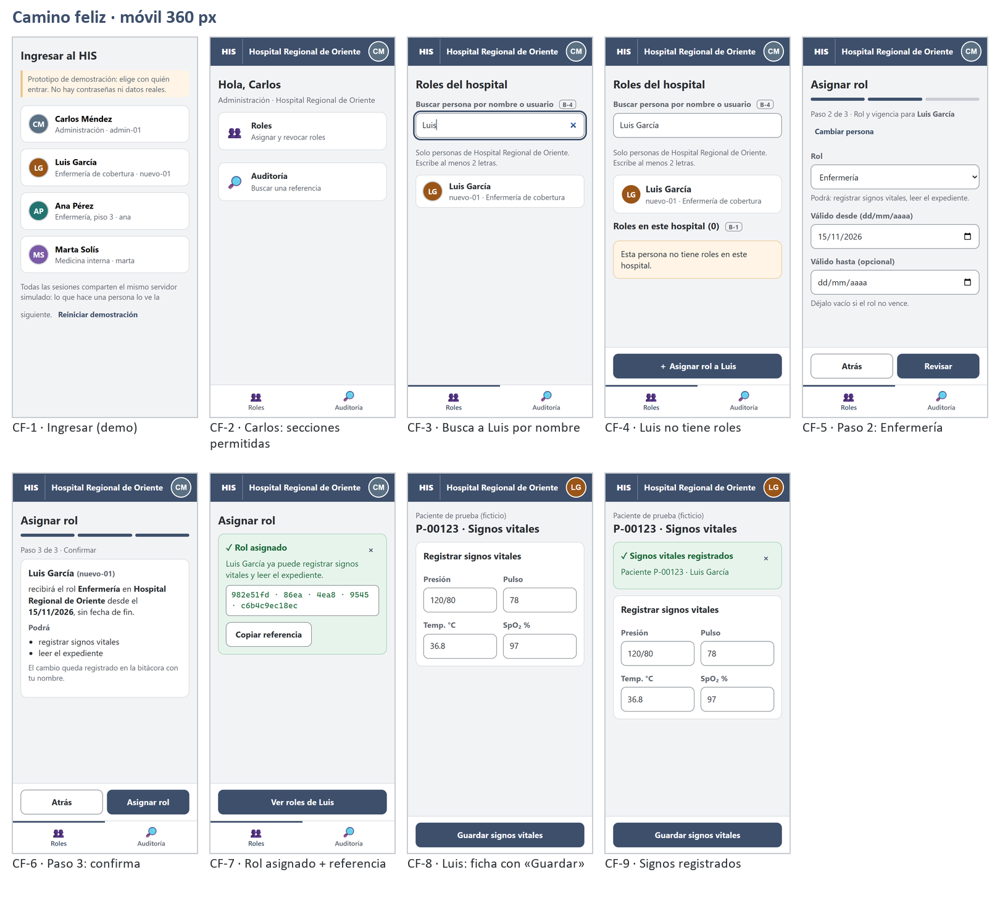
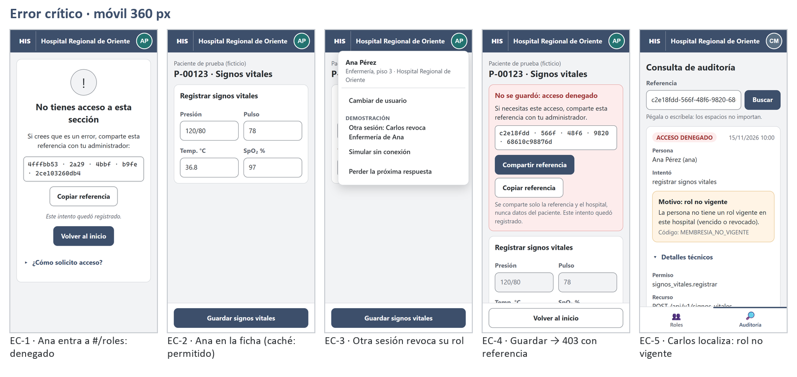
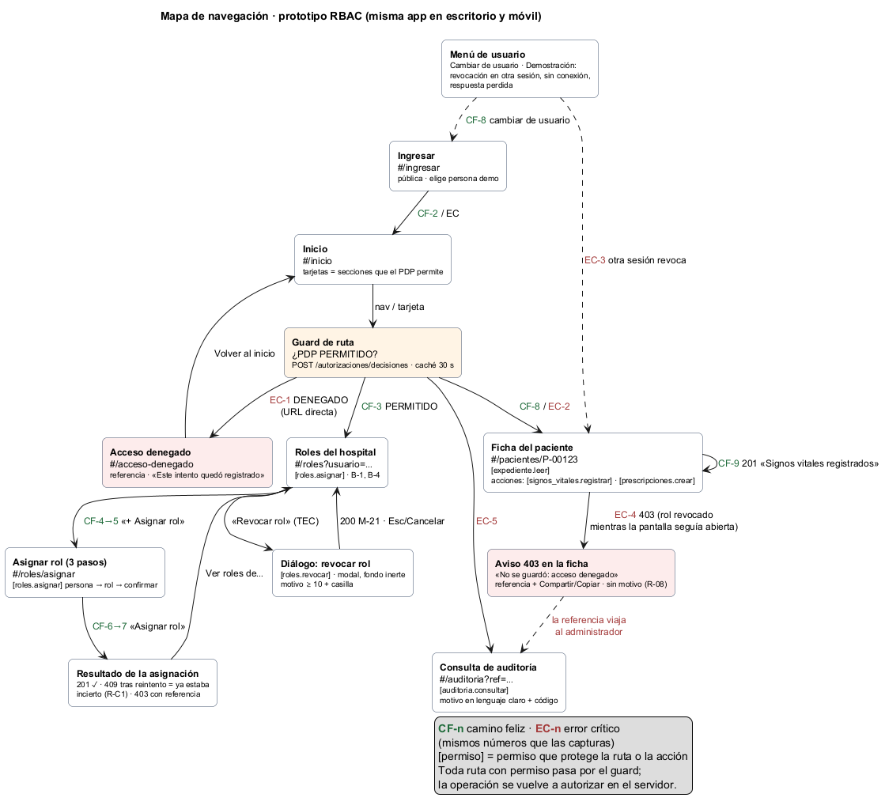

# Semana 11 — Prototipo navegable desktop y móvil del flujo RBAC

**Estudiante:** Boris Alexander Quiroa Orellana · **Módulo:** RBAC: roles, permisos y protección de rutas

**Flujo principal:** «asignación de rol, autorización de una operación y denegación trazable».

**Entregables:**

| Pedido | Dónde |
|---|---|
| Archivo del prototipo | [prototipo/index.html](prototipo/index.html). Se abre con doble clic: no necesita servidor ni instalación. Es **una sola aplicación** para escritorio y móvil. |
| Mapa de navegación | [diagramas/semana-11-mapa-navegacion.png](diagramas/semana-11-mapa-navegacion.png), con su fuente [.puml](diagramas/semana-11-mapa-navegacion.puml) (§4) |
| Capturas desktop/móvil del camino feliz | [capturas/escritorio/cf-*](capturas/escritorio/) y [capturas/movil/cf-*](capturas/movil/). Láminas: [escritorio](laminas/camino-feliz-escritorio.png) · [móvil](laminas/camino-feliz-movil.png) |
| Capturas desktop/móvil del error crítico | [capturas/escritorio/ec-*](capturas/escritorio/) y [capturas/movil/ec-*](capturas/movil/). Láminas: [escritorio](laminas/error-critico-escritorio.png) · [móvil](laminas/error-critico-movil.png) |

Las 32 capturas **no se armaron a mano**. Las tomó [herramientas/recorrido.cjs](herramientas/recorrido.cjs), que recorre el prototipo como una persona: clics, escritura y teclado. En cada paso comprueba el resultado esperado y mide accesibilidad con axe-core. Resultado: **38 comprobaciones, 0 fallas** ([evidencia](evidencia/recorrido.txt)).

## 1. Qué es el prototipo

Es una aplicación web de una sola página (HTML, CSS y JavaScript, sin dependencias):

- **Navegación.** Rutas por *hash* (`#/roles`, `#/pacientes/P-00123`…), con guard de ruta y caché de decisiones.
- **Ventanas que la tarea pide.** Diálogo modal, búsqueda, asistente de 3 pasos y avisos.
- **Diseño responsive.** Los estilos son los de la semana 10 (mobile-first, mismos breakpoints).
- **Servidor simulado.** La API simulada ([prototipo/api-simulada.js](prototipo/api-simulada.js)) reproduce el kernel del Micro-HIS en el navegador:
  - mismo orden de validación: ruta, luego hospital (400), luego sesión (401), luego permiso (403), luego controlador;
  - mismas reglas, en el mismo orden;
  - mismos códigos HTTP y de negocio;
  - mismo formato de respuesta;
  - los eventos de auditoría quedan en memoria.
- **Fuente única de datos** ([prototipo/datos.js](prototipo/datos.js)). Contiene:
  - la semilla del Micro-HIS (usuarios, roles, permisos, membresías y tokens);
  - nombres para mostrar;
  - estados;
  - motivos;
  - el catálogo de mensajes M-xx.

**La API simulada responde igual que el backend real, comprobado.** [herramientas/paridad.cjs](herramientas/paridad.cjs) envía la **misma secuencia de 33 solicitudes** al kernel PHP del Micro-HIS y a la API simulada, y compara cada respuesta. La secuencia cubre el camino feliz, el error crítico y todos los códigos de error. Resultado: **33 de 33 iguales** ([evidencia](evidencia/paridad.txt)).

```text
IGUAL   1. Camino feliz: admin asigna Enfermería a Luis   PHP: 201 ROL_ASIGNADO ref
IGUAL  18. Error crítico: admin revoca Enfermería a Ana   PHP: 200 ROL_REVOCADO ref
IGUAL  20. Error crítico: Ana intenta registrar signos    PHP: 403 ref
IGUAL  21. Error crítico: el auditor localiza la refer…   PHP: 200 ACCESO_DENEGADO MEMBRESIA_NO_VIGENTE ref
...
Pasos: 33  Iguales: 33  Difieren: 0
```

### 1.1 Cómo usarlo

1. Abrir `prototipo/index.html` en Chrome, Edge o Firefox. Para ver la versión móvil, F12 → modo dispositivo → 360 px.
2. Elegir con quién entrar:

| Persona | Usuario | Rol al empezar | Qué ve |
|---|---|---|---|
| Carlos Méndez | `admin-01` | Administración | Roles, Auditoría |
| Luis García | `nuevo-01` | **ninguno** | «No tienes secciones disponibles» (hasta que Carlos le asigne un rol) |
| Ana Pérez | `ana` | Enfermería | Pacientes |
| Marta Solís | `marta` | Médico | Pacientes (con «Nueva prescripción») |

Todas las sesiones comparten el mismo servidor simulado: lo que hace Carlos lo ve Luis al entrar.

El menú del avatar tiene **herramientas de demostración**, rotuladas como tales:
- «Otra sesión: Carlos revoca Enfermería de Ana»;
- «Simular sin conexión»;
- «Perder la próxima respuesta».

Sirven para mostrar en vivo situaciones que necesitan dos personas a la vez, o una red que falla.

## 2. Camino feliz: asignar un rol y operar con él

Carlos asigna Enfermería a Luis, y Luis registra signos vitales.

| # | Quién | Pantalla (ruta) | Qué pasa | Endpoint | Escritorio | Móvil |
|---|---|---|---|---|---|---|
| CF-1 | — | Ingresar (`#/ingresar`) | Elige persona de demostración | — | [captura](capturas/escritorio/cf-01-ingresar.png) | [captura](capturas/movil/cf-01-ingresar.png) |
| CF-2 | Carlos | Inicio | Solo ve las secciones que el PDP le permite: Roles y Auditoría | `POST /autorizaciones/decisiones` ×3 | [captura](capturas/escritorio/cf-02-inicio-admin.png) | [captura](capturas/movil/cf-02-inicio-admin.png) |
| CF-3 | Carlos | Roles (`#/roles`) | Busca «Luis» por nombre | *(B-4)* `GET /usuarios?q=` | [captura](capturas/escritorio/cf-03-buscar-persona.png) | [captura](capturas/movil/cf-03-buscar-persona.png) |
| CF-4 | Carlos | Roles de Luis | «Esta persona no tiene roles en este hospital» | *(B-1)* `GET /roles/membresias` | [captura](capturas/escritorio/cf-04-roles-de-luis.png) | [captura](capturas/movil/cf-04-roles-de-luis.png) |
| CF-5 | Carlos | Asignar, paso 2 | Elige Enfermería; aparece «Podrá: registrar signos vitales, leer el expediente» | — | [captura](capturas/escritorio/cf-05-paso2-rol.png) | [captura](capturas/movil/cf-05-paso2-rol.png) |
| CF-6 | Carlos | Asignar, paso 3 | Confirma: **nombre**, rol, hospital, fecha y permisos | — | [captura](capturas/escritorio/cf-06-paso3-confirmar.png) | [captura](capturas/movil/cf-06-paso3-confirmar.png) |
| CF-7 | Carlos | Resultado | «✓ Rol asignado» + referencia. El aviso recibe el foco y no desaparece solo. | `POST /roles/asignaciones` → **201** | [captura](capturas/escritorio/cf-07-rol-asignado.png) | [captura](capturas/movil/cf-07-rol-asignado.png) |
| CF-8 | Luis | Ficha P-00123 | Ahora ve «Pacientes» y «Guardar signos vitales». Al tener una sola sección, no tiene barra de navegación. | decisiones → PERMITIDO | [captura](capturas/escritorio/cf-08-luis-ficha.png) | [captura](capturas/movil/cf-08-luis-ficha.png) |
| CF-9 | Luis | Ficha P-00123 | «✓ Signos vitales registrados» | `POST /signos-vitales` → **201** | [captura](capturas/escritorio/cf-09-signos-registrados.png) | [captura](capturas/movil/cf-09-signos-registrados.png) |



## 3. Error crítico: operación denegada por un rol revocado mientras la pantalla seguía abierta

**Por qué este error es el crítico.** Es el único caso en que la **interfaz y el servidor no están de acuerdo**: la pantalla muestra «Guardar» porque la decisión está en caché, pero el servidor ya no lo permite. Se pone a prueba todo lo que el módulo promete:

- que la UI no decide;
- que la ruta se vuelve a autorizar;
- que el 403 no revela el motivo;
- que la denegación queda auditada y se puede localizar.

Además ocurre en el trabajo clínico real: un traslado, o un rol revocado a mitad de turno.

| # | Quién | Pantalla | Qué pasa | Endpoint | Escritorio | Móvil |
|---|---|---|---|---|---|---|
| EC-1 | Ana | `#/roles` por URL directa | Guard → «No tienes acceso a esta sección» + referencia (**ruta protegida**) | decisiones → DENEGADO (auditado como `PERMISO_NO_ASIGNADO`) | [captura](capturas/escritorio/ec-01-ruta-protegida.png) | [captura](capturas/movil/ec-01-ruta-protegida.png) |
| EC-2 | Ana | Ficha P-00123 | Ve «Guardar». No ve «Nueva prescripción» porque Enfermería no la permite. | decisiones → PERMITIDO, guardado en caché 30 s | [captura](capturas/escritorio/ec-02-ana-ficha.png) | [captura](capturas/movil/ec-02-ana-ficha.png) |
| EC-3 | (Carlos, en otra sesión) | Menú → Demostración | Carlos revoca Enfermería a Ana: «Traslado a consulta externa» | `POST /roles/revocaciones` → 200 | [captura](capturas/escritorio/ec-03-menu-demostracion.png) | [captura](capturas/movil/ec-03-menu-demostracion.png) |
| EC-4 | Ana | Ficha P-00123 | Pulsa «Guardar». **El servidor vuelve a autorizar y deniega.** Aparece «No se guardó: acceso denegado» con la referencia agrupada, Compartir y Copiar. El aviso recibe el foco y se anuncia; «Guardar» desaparece; no se menciona motivo, rol ni permiso. | `POST /signos-vitales` → **403** + `correlation_id` | [captura](capturas/escritorio/ec-04-operacion-denegada.png) | [captura](capturas/movil/ec-04-operacion-denegada.png) |
| EC-5 | Carlos | Auditoría | Pega la referencia **tal como la vio Ana** (con « · »). Se normaliza y aparece «Acceso denegado · Ana Pérez · registrar signos vitales · Motivo: rol no vigente (`MEMBRESIA_NO_VIGENTE`)». | `GET /auditoria/eventos/{ref}` → 200 | [captura](capturas/escritorio/ec-05-auditor-localiza.png) | [captura](capturas/movil/ec-05-auditor-localiza.png) |



El recorrido automático comprueba en EC-4 cuatro cosas a la vez:
- hay referencia;
- el foco está en el aviso;
- el botón «Guardar» ya no existe;
- el aviso **no** contiene «MEMBRESIA», «revoc» ni «Enfermería».

En EC-5 comprueba que el evento encontrado es exactamente el de esa referencia.

## 4. Mapa de navegación



| Ruta | Permiso que la protege | Escritorio (≥ 1024 px) | Móvil (360 px) |
|---|---|---|---|
| `#/ingresar` | pública | Tarjetas de personas en 2 columnas | 1 columna |
| `#/inicio` | sesión | Secciones en 3 columnas | 1 columna |
| `#/roles?usuario=…` | `roles.asignar` | **Tabla** de membresías | **Tarjetas**, una por membresía |
| `#/roles/asignar` | `roles.asignar` | 3 pasos; acciones al final del contenido | 3 pasos; barra de acción fija abajo |
| Diálogo «Revocar rol» | `roles.revocar` | Diálogo centrado, con «Cancelar» a la izquierda | Hoja inferior, con «Cancelar» abajo |
| `#/pacientes/P-00123` | `expediente.leer`; acciones con `signos_vitales.registrar` y `prescripciones.crear` | Formulario de 2 columnas | Formulario de 2 columnas (números cortos) |
| `#/auditoria?ref=…` | `auditoria.consultar` | Tarjeta del evento | Tarjeta con detalles técnicos plegados |
| `#/acceso-denegado` | — (destino del guard) | Tarjeta centrada | Tarjeta a todo el ancho |

**Navegación por permisos:**

| Ancho | Patrón |
|---|---|
| Menos de 768 px | Barra inferior |
| 768 px o más | Riel lateral |

En los dos casos se muestran **solo las secciones que el PDP permite**. Con una sola sección no hay barra de navegación (R-B8). Ana y Luis, por ejemplo, no tienen barra.

## 5. Consistencia de roles, estados y mensajes

La regla es: **un dato, un nombre, un lugar.** Todo texto de rol, permiso, estado, motivo o mensaje sale de `datos.js`, así que escritorio y móvil no pueden diferir.

| Elemento | Cómo se muestra en las dos versiones |
|---|---|
| Roles | `admin_hospital` → «Administración», `enfermeria` → «Enfermería»… (`DATOS.roles`) |
| Permisos | En lenguaje claro: «registrar signos vitales» (`DATOS.permisos`). El código técnico solo aparece en «Detalles técnicos» de la auditoría. |
| Estados de membresía | Icono + texto: ● Activo · ◌ Vencido · ⊘ Revocado · ◔ Aún no vigente (`DATOS.estados`). Iguales en tabla y en tarjeta. |
| Referencia | **Siempre agrupada** en bloques (`xxxxxxxx · xxxx · …`) en todo aviso, y completa en los detalles técnicos. La auditoría acepta cualquiera de los dos formatos. |
| Hospital activo | Visible en la barra superior, en todas las pantallas y anchos |
| Mensajes | Catálogo M-xx (`DATOS.mensajes`), el mismo de la semana 8 |
| Avisos | ✓ éxito en verde, persistente, con «×» · 403 en rojo con `role="alert"` · atención en ámbar |

**Inconsistencia encontrada y corregida al construir.** La referencia salía agrupada en el aviso de denegación y sin agrupar en el de éxito. Ahora todos los avisos usan la misma función de formato.

## 6. Accesibilidad

| Comprobación | Resultado |
|---|---|
| axe-core (WCAG 2.0/2.1/2.2 A y AA) en las 32 pantallas capturadas | **0 infracciones** |
| Objetivos táctiles ≥ 44 px y sin desplazamiento horizontal (móvil) | 0 fallas en las 16 pantallas móviles |
| Foco al cambiar de ruta | El foco va al `<h1>` y `document.title` cambia («Asignar rol · HIS») |
| Foco tras un resultado | El aviso recibe el foco (CF-7, EC-4: comprobado por el script) |
| Diálogo «Revocar rol» | Foco inicial en «Cancelar». 12 `Tab` seguidos sin salir del diálogo, porque el fondo es `inert`. `Esc` cierra y devuelve el foco a «Revocar rol». La revocación completa se hizo **solo con teclado** (TEC-2). |
| Anuncios | Región `aria-live` para cambios y `assertive` para el 403 |
| Errores de formulario | Junto al campo, con `aria-invalid` y `aria-describedby`. El error del motivo aparece al salir del campo, no mientras se escribe. |
| Salto de bloques | «Saltar al contenido» visible al recibir el foco |

**La primera corrida no salió limpia** y la corregí antes de entregar. axe y el medidor encontraron 4 tipos de problema en 24 de 38 comprobaciones:

| Problema | Corrección |
|---|---|
| Avatares de Luis (`#B5651D`, 4.34:1) y Ana (`#2E8B87`, 4.07:1) bajo 4.5:1 | `#9A5518` (5.70:1) y `#237370` (5.59:1) |
| Un elemento `role="status"` dentro de una `role="list"` (`aria-required-children`) | El anuncio del número de resultados va fuera de la lista |
| `aria-pressed` dentro de un `role="menuitem"` (`aria-allowed-attr`) | El menú pasó a un panel de botones simple (patrón *disclosure*) |
| Enlace «HIS» de menos de 44 px de ancho en móvil | Ancho mínimo de 48 px |

## 7. Mejores prácticas aplicadas

| Práctica | Dónde |
|---|---|
| Una sola base de código responsive, no dos aplicaciones | `index.html` + `estilos.css` mobile-first |
| HTML semántico primero: `<main>`, `<nav>`, `<form>`, `<label>`, `<table>` con `<caption>`, `<details>` | Todas las vistas |
| Mejora progresiva de controles nativos: `type="date"`, `type="search"`, `inputmode` | Asignar, ficha |
| La UI no decide: guard + PDP para mostrar; servidor para ejecutar | Guard de ruta, EC-4 |
| Fail-closed: si el PDP no responde, «No pudimos verificar tus permisos» y ninguna acción | `vSinVerificar` |
| Sin datos sensibles en el dispositivo: caché solo en memoria, borrada al cambiar de usuario; nada en `localStorage` | `est.cache` |
| Sin datos del paciente al compartir: solo referencia y hospital | «Compartir referencia» |
| Nada se deshace en silencio: cada cambio de permisos da una referencia persistente | CF-7, M-21 |
| Escapar todo texto que viene del usuario o del servidor (prevención de XSS) | `esc()` en todas las plantillas |
| Pruebas automáticas del recorrido y de la accesibilidad | `recorrido.cjs`, `paridad.cjs` |

## 8. Hallazgo: la interfaz genera ruido en la auditoría (brecha B-6)

En el Micro-HIS, el endpoint del PDP **audita toda decisión DENEGADO**. Es correcto para una operación real. Pero la interfaz también pregunta al PDP solo para decidir qué mostrar, y esas preguntas también se auditan. Medido con la API simulada ([evidencia](evidencia/ruido-auditoria.txt)):

```text
Ana                  eventos ACCESO_DENEGADO solo por mostrar el menú: 2  + por mostrar la ficha: 1
Luis (sin rol aún)   eventos ACCESO_DENEGADO solo por mostrar el menú: 3  + por mostrar la ficha: 2
Marta                eventos ACCESO_DENEGADO solo por mostrar el menú: 2  + por mostrar la ficha: 0
Carlos               eventos ACCESO_DENEGADO solo por mostrar el menú: 1  + por mostrar la ficha: 2
```

Son de 1 a 5 «denegaciones» por persona sin que nadie intentara nada. En un hospital con cientos de usuarios, el auditor tendría que separar intentos reales de consultas de la interfaz.

**Propuesta B-6:** un endpoint de **permisos efectivos** para la interfaz, `GET /api/v1/autorizaciones/permisos-efectivos`. Devuelve la lista de permisos vigentes de la sesión y **no** genera eventos. Las operaciones reales y las rutas protegidas del servidor siguen auditando todo.

No se cambió el backend esta semana. El prototipo conserva el comportamiento real, a propósito, para que el hallazgo sea visible.

## 9. Brechas del contrato

| ID | Brecha | Origen | En el prototipo |
|---|---|---|---|
| B-1 | `GET /api/v1/roles/membresias?usuario=` | Semana 8 | Simulado, con la etiqueta «B-1» en pantalla |
| B-4 | `GET /api/v1/usuarios?q=` (búsqueda por nombre, por tenant) | Semana 9 | Simulado, con la etiqueta «B-4» en pantalla |
| B-5 | `Idempotency-Key` en asignar y revocar | Semana 10 | El resultado incierto aplica R-C1 («Perder la próxima respuesta») |
| **B-6** | Permisos efectivos sin auditar, para la UI | **Semana 11** | Documentado (§8) |

Los endpoints B-1 y B-4 están **solo** en la API simulada y no participan en la prueba de paridad, porque el backend real no los tiene.

## 10. Verificación y limitaciones

**Comandos:**

```bash
cd docs/modulos/rbac/semana-11
node herramientas/paridad.cjs         # 33/33 iguales contra el kernel PHP real
npm install --no-save puppeteer-core@23.11.1 axe-core@4.10.2   # una vez
node herramientas/recorrido.cjs       # 38 comprobaciones, 0 fallas; regenera capturas/
```

**Limitaciones:**

- **El servidor está simulado en el navegador.** La paridad con el Micro-HIS está medida en 33 casos, pero no es el backend real (no hay red ni base de datos).
- **Navegador emulado.** Las capturas móviles salen de Chrome con viewport emulado, no de un teléfono real. axe-core detecta alrededor de un tercio de los problemas de accesibilidad: no reemplaza una prueba con NVDA, VoiceOver o TalkBack, que no se hizo.
- **Hora fija.** Es 2026-11-15 10:00, igual que en las pruebas del Micro-HIS, para que las vigencias den el mismo resultado.
- **Datos ficticios.** Personas y paciente son ficticios.
