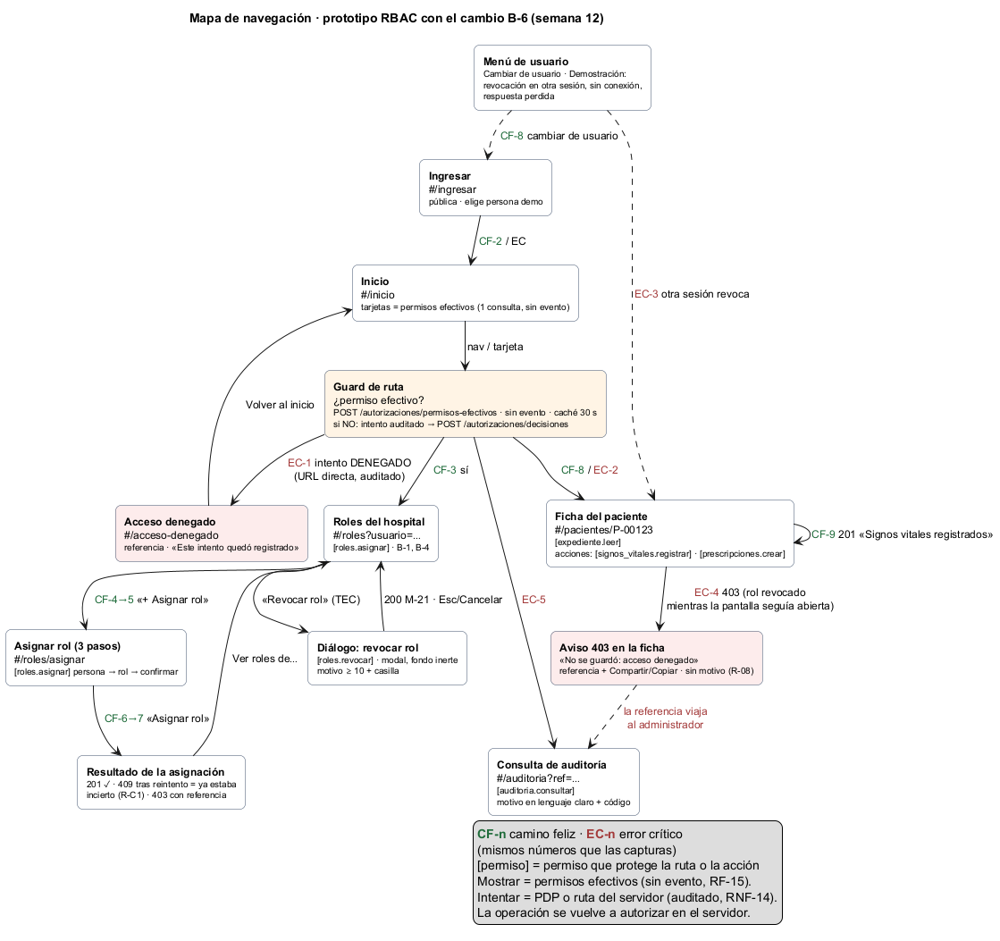

# Recorrido navegable — demostración con el prototipo

**Estudiante:** Boris Alexander Quiroa Orellana · **Prototipo:** [prototipo/index.html](prototipo/index.html), el de la semana 11 con el cambio solicitado aplicado.

**Cómo abrirlo:**
1. Doble clic en `prototipo/index.html`. No hace falta servidor ni instalación.
2. Para la vista móvil: F12 → modo dispositivo → 360 × 740.
3. Si algo se desordena, ir a Ingresar → «Reiniciar demostración».

Cada paso tiene su resultado esperado y su captura. El script [herramientas/recorrido.cjs](herramientas/recorrido.cjs) hace **este mismo recorrido** con clics y teclado, en escritorio y en móvil, y lo verifica: **42 comprobaciones, 0 fallas** ([salida](evidencia/recorrido.txt)).

## Parte A · Camino feliz: roles, estados y permisos

| # | Acción en el prototipo | Qué demuestra | Resultado esperado | Escritorio | Móvil |
|---|---|---|---|---|---|
| A1 | Ingresar → **Carlos Méndez** | Navegación por permisos (D-31) | Inicio muestra **Roles** y **Auditoría**, y nada más | [cf-02](capturas/escritorio/cf-02-inicio-admin.png) | [cf-02](capturas/movil/cf-02-inicio-admin.png) |
| A2 | Roles → escribir «Luis» | Persona por nombre, no por identificador (D-22) | «Luis García · nuevo-01 · Enfermería de cobertura» | [cf-03](capturas/escritorio/cf-03-buscar-persona.png) | [cf-03](capturas/movil/cf-03-buscar-persona.png) |
| A3 | Elegir a Luis | Estado vacío | «Esta persona no tiene roles en este hospital» | [cf-04](capturas/escritorio/cf-04-roles-de-luis.png) | [cf-04](capturas/movil/cf-04-roles-de-luis.png) |
| A4 | «＋ Asignar rol» → Enfermería | Ayuda contextual | «Podrá: registrar signos vitales, leer el expediente» | [cf-05](capturas/escritorio/cf-05-paso2-rol.png) | [cf-05](capturas/movil/cf-05-paso2-rol.png) |
| A5 | Revisar | Confirmación con nombre y permisos (D-22) | «Luis García (nuevo-01) recibirá el rol Enfermería…» | [cf-06](capturas/escritorio/cf-06-paso3-confirmar.png) | [cf-06](capturas/movil/cf-06-paso3-confirmar.png) |
| A6 | Asignar rol | Éxito persistente con referencia; foco en el aviso | «✓ Rol asignado» + referencia agrupada | [cf-07](capturas/escritorio/cf-07-rol-asignado.png) | [cf-07](capturas/movil/cf-07-rol-asignado.png) |
| A7 | Avatar → Cambiar de usuario → **Luis** → Pacientes | El rol nuevo cambia lo que se ve; con una sola sección no hay barra de navegación | Ficha con «Guardar signos vitales» | [cf-08](capturas/escritorio/cf-08-luis-ficha.png) | [cf-08](capturas/movil/cf-08-luis-ficha.png) |
| A8 | Guardar signos vitales | Operación autorizada por el servidor | «✓ Signos vitales registrados» · **0** `ACCESO_DENEGADO` en la bitácora (B-6) | [cf-09](capturas/escritorio/cf-09-signos-registrados.png) | [cf-09](capturas/movil/cf-09-signos-registrados.png) |

## Parte B · Error crítico: rol revocado con la pantalla abierta

| # | Acción en el prototipo | Qué demuestra | Resultado esperado | Escritorio | Móvil |
|---|---|---|---|---|---|
| B1 | Cambiar a **Ana** y escribir `#/roles` en la barra de direcciones | Ruta protegida; un **intento** queda auditado | «No tienes acceso a esta sección» + referencia | [ec-01](capturas/escritorio/ec-01-ruta-protegida.png) | [ec-01](capturas/movil/ec-01-ruta-protegida.png) |
| B2 | Inicio → Pacientes | Solo acciones permitidas | «Guardar», sin «Nueva prescripción» | [ec-02](capturas/escritorio/ec-02-ana-ficha.png) | [ec-02](capturas/movil/ec-02-ana-ficha.png) |
| B3 | Avatar → «Otra sesión: Carlos revoca Enfermería de Ana» | Cambio de permisos mientras la pantalla sigue abierta | Menú de demostración rotulado como tal | [ec-03](capturas/escritorio/ec-03-menu-demostracion.png) | [ec-03](capturas/movil/ec-03-menu-demostracion.png) |
| B4 | **Guardar** | La UI no decide: el servidor vuelve a autorizar. 403 sin motivo. | «No se guardó: acceso denegado» + referencia + Compartir/Copiar; desaparece «Guardar»; foco en el aviso | [ec-04](capturas/escritorio/ec-04-operacion-denegada.png) | [ec-04](capturas/movil/ec-04-operacion-denegada.png) |
| B5 | Copiar → cambiar a **Carlos** → Auditoría → pegar → Buscar | Denegación trazable de punta a punta | «Acceso denegado · Ana Pérez · registrar signos vitales · Motivo: rol no vigente (`MEMBRESIA_NO_VIGENTE`)» | [ec-05](capturas/escritorio/ec-05-auditor-localiza.png) | [ec-05](capturas/movil/ec-05-auditor-localiza.png) |

El script comprueba después de B4 que Ana tiene **exactamente 2** `ACCESO_DENEGADO` en la bitácora: `ruta:#/roles` (B1) y `POST /api/v1/signos-vitales` (B4). Con el prototipo de la semana 11 habría tenido además 3 «fantasma» (§6 del [registro del cambio](registro-cambio-solicitado.md)).

## Parte C · Accesibilidad y riesgos (opcional, si hay tiempo)

| # | Acción | Qué demuestra | Captura |
|---|---|---|---|
| C1 | Carlos → `#/roles?usuario=marta` → `Tab` hasta «Revocar rol» → `Enter` | Diálogo con foco inicial en «Cancelar» y fondo inerte | [tec-01](capturas/escritorio/tec-01-dialogo-revocar.png) · [móvil](capturas/movil/tec-01-dialogo-revocar.png) |
| C2 | `Tab` varias veces, luego `Esc` | El foco no sale del diálogo; `Esc` lo devuelve a «Revocar rol» | — |
| C3 | Reabrir, escribir el motivo, `Espacio` en la casilla, `Enter` | Revocación completa solo con teclado | [tec-02](capturas/escritorio/tec-02-revocado-con-teclado.png) |
| C4 | Avatar → «Perder la próxima respuesta» → asignar un rol | Riesgo de red (R-C1): «No sabemos si se asignó» → Reintentar → «Ya estaba asignado» | — |
| C5 | Avatar → «Simular sin conexión» | Fail-closed sin red: barra «Sin conexión», nada se envía | — |

## Mapa

El cambio B-6 no agregó rutas de interfaz respecto del [mapa de la semana 11](../semana-11/diagramas/semana-11-mapa-navegacion.png). Lo que cambió es **cómo** consultan los permisos el guard y el menú:
- para mostrar, permisos efectivos (sin evento);
- para un intento, el PDP (auditado).
