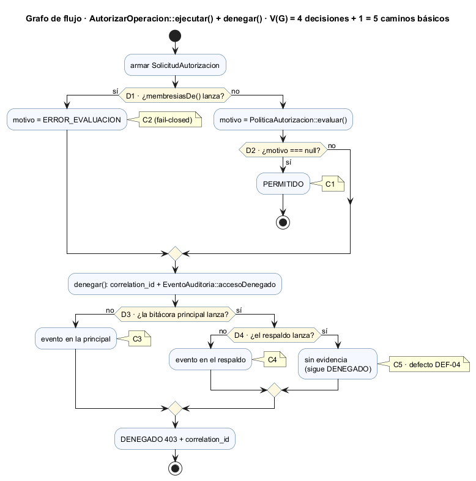
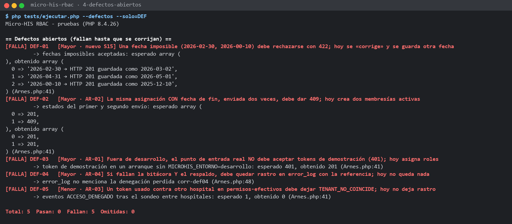

# Semana 15 — Pruebas unitarias, de caja blanca y de caja negra de RBAC

**Estudiante:** Boris Alexander Quiroa Orellana · **Módulo:** RBAC: roles, permisos y protección de rutas

**Proceso:** «asignación de rol, autorización de una operación y denegación trazable»

## Entregables

| Pedido | Dónde |
|---|---|
| Matriz RF/RNF → prueba | [matriz-rf-rnf-pruebas.md](matriz-rf-rnf-pruebas.md): RF-01..RF-15 y RNF-01..RNF-14 contra las pruebas nuevas y las existentes |
| Mínimo 3 unitarias | **9**: UNI-01..UNI-09 → [`tests/Dominio/UnitariasReglasPrueba.php`](../micro-his-rbac/tests/Dominio/UnitariasReglasPrueba.php) |
| Mínimo 2 de caja blanca | **4**: CB-01..CB-04, con **98.7 %** de cobertura de líneas medida → [`tests/Aplicacion/CajaBlancaPrueba.php`](../micro-his-rbac/tests/Aplicacion/CajaBlancaPrueba.php) |
| Mínimo 4 de caja negra | **6**: CN-01..CN-06 → [`tests/Presentacion/CajaNegraPrueba.php`](../micro-his-rbac/tests/Presentacion/CajaNegraPrueba.php) |
| Comandos y resultados | §5 y [evidencia/](evidencia/), salidas reales |
| Capturas | [capturas/](capturas/), una por ejecución |
| Defectos registrados | [registro-defectos.md](registro-defectos.md): 5 defectos con prueba que los reproduce (uno **nuevo**: fechas imposibles), más 1 observación |

## 1. Qué se prueba y qué no

**Sí se prueba** la implementación de RBAC: el Micro-HIS (`docs/modulos/rbac/micro-his-rbac/`), con sus reglas, casos de uso, kernel HTTP y contrato.

**No se prueba:**

| Excluido | Por qué |
|---|---|
| El proyecto Laravel principal | Hoy **no tiene código de RBAC**: solo `JwtAuth` y `TenantMiddleware`, que son del módulo de autenticación y tenancy de otros compañeros, y un `AuthController` y un modelo `Tenant` que aún no existen. Probarlos sería probar módulos ajenos, que la tarea prohíbe. |
| Prescripciones y signos vitales | De esas operaciones clínicas solo se prueba la **decisión** de autorización. Sus endpoints son *stubs* de demostración. |
| La interfaz | Cubierta en S11–S12 con el recorrido automático |

Llevar RBAC al proyecto principal (middleware de permisos, migraciones de roles con spatie, pruebas PHPUnit) sería una tarea de integración aparte. Cuando se haga, estas mismas pruebas sirven de especificación.

## 2. Pruebas unitarias (UNI-01..09)

Cada regla de dominio se prueba **aislada**: sin caso de uso, sin HTTP, con los puertos resueltos por adaptadores en memoria construidos en la propia prueba. Varias usan **valores límite**.

| ID | Unidad | Qué afirma | RF/RNF |
|---|---|---|---|
| UNI-01 | `ReglaTenantCoincide` | Mismo hospital → pasa; distinto → `TENANT_NO_COINCIDE` | RF-06, RNF-08 |
| UNI-02 | `Membresia::estaVigenteEn` + `ReglaMembresiaVigente` | Límites: `desde = ahora` vigente; `desde = ahora + 1 s` no; `hasta = ahora` **no** (exclusivo); `hasta = ahora + 1 s` sí; revoked e inactive no | RF-07 |
| UNI-03 | `ReglaRolConcedePermiso` | Concede si **alguna** membresía vigente incluye el permiso; un médico vencido no cuenta | RF-05 |
| UNI-04 | `ReglaVigenciaValida` | `hasta = desde` → 422; `hasta = desde + 1 s` y sin fin → válidas | RF-03 |
| UNI-05 | `ReglaMotivoSuficiente` | 9 → insuficiente; 10 → suficiente; recorta espacios; 9 «ñ» (18 bytes) siguen siendo 9 caracteres | RF-14 |
| UNI-06 | `ReglaNoAutoasignacion`, `ReglaNoAutorrevocacion` | Prohíbe actuar sobre uno mismo; sobre otro sí | R-04, RF-14 |
| UNI-07 | `ReglaUsuarioDestinoActivo` | Inexistente → `USUARIO_NO_ENCONTRADO` 404; inactivo → `USUARIO_INACTIVO` 422. **Cierra el hueco M2 de la S14.** | RF-03 |
| UNI-08 | `EventoAuditoria::accesoDenegado` | Los 8 datos de R-06; el hospital es el de la **solicitud** | RF-09 |
| UNI-09 | `PoliticaAutorizacion` | Devuelve el motivo de la primera regla que falla y **no evalúa** las siguientes (espía) | RNF-05 |

## 3. Pruebas de caja blanca (CB-01..04)

Diseñadas **leyendo el código**.

### CB-01 · Caminos básicos de `AutorizarOperacion` (McCabe)



V(G) = 4 decisiones + 1 = **5 caminos básicos**. Cada uno se fuerza con dobles que fallan a pedido:

| Camino | D1 lectura | D2 motivo nulo | D3 principal | D4 respaldo | Resultado esperado y obtenido |
|---|:-:|:-:|:-:|:-:|---|
| C1 | no | sí | — | — | PERMITIDO, 0 eventos |
| C2 | **sí** | — | no | — | DENEGADO 403, `ERROR_EVALUACION` en la principal (fail-closed) |
| C3 | no | no | no | — | DENEGADO, `correlation_id`, 1 evento en la principal |
| C4 | no | no | **sí** | no | DENEGADO, el evento va al respaldo |
| C5 | no | no | **sí** | **sí** | DENEGADO y no lanza, pero **0 eventos** → defecto **DEF-04** |

### CB-02 · Ramas de `PoliticaAutorizacion::evaluar()`

Se cubren cuatro ramas:
- sin reglas → `SIN_REGLAS_CONFIGURADAS`;
- todas pasan → `null`;
- una regla lanza una excepción → `ERROR_EVALUACION`;
- la segunda regla da motivo → ese motivo.

### CB-03 · MC/DC de `Membresia::estaVigenteEn()`

La condición es `A ∧ B ∧ (C1 ∨ C2)`, con:
- A = activa;
- B = `desde ≤ ahora`;
- C1 = sin fin;
- C2 = `ahora < hasta`.

| Caso | A | B | C1 | C2 | Resultado | Demuestra |
|---|:-:|:-:|:-:|:-:|:-:|---|
| 1 | V | V | V | — | V | caso base |
| 2 | **F** | V | V | — | F | efecto de A (frente al 1) |
| 3 | V | **F** | V | — | F | efecto de B (frente al 1) |
| 4 | V | V | F | V | V | C2 sostiene el resultado cuando C1 es falsa |
| 5 | V | V | F | **F** | F | efecto de C2 (frente al 4) |

### CB-04 · Orden de decisiones de `Kernel::procesar()` y `manejar()`

Con rutas de prueba propias se fuerza cada salida, en el orden del código:

| Paso | Respuesta | Qué se comprueba |
|---:|---|---|
| 1 | 404 | Ruta inexistente: se resuelve antes que todo lo demás |
| 2 | 405 | Método no permitido |
| 3 | 400 | Sin hospital: se rechaza **antes** de mirar el token |
| 4 | 401 | Sin token o con token inválido |
| 5 | 200 | Ruta sin permiso: no pasa por el autorizador |
| 6 | 403 | Permiso denegado: se rechaza **antes** del controlador |
| 7 | 200 | Permiso concedido |
| 8 | 500 | El controlador lanza una excepción: respuesta genérica, sin el mensaje de la excepción |
| 9 | 500 | El controlador devuelve algo que no es una respuesta |
| 10 | — | Un registro de acceso que falla no tumba la respuesta: se conserva `X-Request-ID` |

### Cobertura medida

Medida con `phpdbg`, que viene con PHP. [herramientas/cobertura-caja-blanca.php](herramientas/cobertura-caja-blanca.php) corre **solo** CB-01..04 y cuenta las líneas ejecutadas:

```text
src/Aplicacion/CasosDeUso/AutorizarOperacion.php      17/18    94.4 %
      sin cubrir  l.40   return $this->ejecutar(new ComandoAutorizar(... 'membresias', $ip));
src/Dominio/Servicios/PoliticaAutorizacion.php        12/12   100.0 %
src/Dominio/Modelo/Membresia.php                       3/3    100.0 %
src/Presentacion/Http/Kernel.php                      42/42   100.0 %
TOTAL                                                 74/75    98.7 %
```

La única línea sin cubrir es el atajo `exigir()`, que usan los casos de uso de administración y no el flujo de autorización que estas pruebas diseñan. Lo cubren APP-04 y REV-03 en la suite completa.

**Limitación:** `phpdbg` mide **líneas**, no ramas. La cobertura de ramas y condiciones se garantiza por diseño, con las tablas de CB-01 y CB-03.

## 4. Pruebas de caja negra (CN-01..06)

Diseñadas desde el **contrato** (OpenAPI v1.2.0) y las reglas, sin mirar el código. Solo usan la interfaz HTTP (`Kernel::manejar`). Cada caso empieza con un sistema nuevo.

| ID | Técnica | Casos |
|---|---|---|
| CN-01 | **Particiones de equivalencia** (asignar) | 1 clase válida (201) y 6 inválidas: usuario inexistente 404, inactivo 422, rol fuera del catálogo 422, autoasignación 422, duplicado 409, formato 422 |
| CN-02 | **Valores límite** (motivo de 10 a 500) | 9 → 422 `MOTIVO_INSUFICIENTE` · 10 → 200 · 500 → 200 · 501 → 422 `DATOS_INVALIDOS` |
| CN-03 | **Valores límite** (vigencia, referencia, lista) | `hasta = desde` → 422 y `+1 día` → 201. Referencia de 1, 64 y 65 caracteres para alguien sin permiso → 403/403/404. Lista de 0, 1, 20 y 21 permisos → 422/200/200/422. |
| CN-04 | **Permisos** (tabla de decisión) | Matriz de **7 identidades × 5 rutas = 35 celdas**. Identidades: admin, médica, enfermera, médico vencido, enfermera revocada, persona sin rol, admin de otro hospital. Solo pasa quien tiene el permiso; todo 403 trae únicamente `mensaje` + `correlation_id` y queda auditado con el motivo correcto (`PERMISO_NO_ASIGNADO`, `MEMBRESIA_NO_VIGENTE` o `TENANT_NO_COINCIDE`). |
| CN-05 | **Errores** (conjetura de errores) | 400 sin hospital, 401 sin token o con token inválido, 404 ruta, 405 método, 422 cuerpo ausente; el 404 de auditoría para otro hospital es **idéntico** al de «no existe» |
| CN-06 | **Escenario** de punta a punta | Revocar → 403 → el auditor encuentra persona, permiso y `MEMBRESIA_NO_VIGENTE`; la persona denegada no puede consultarlo |

**Pruebas exploratorias.** Antes de escribir CN-03 se probaron casos raros: fechas imposibles, membresías ya vencidas, tenant en mayúsculas, motivos de 500 «ñ». Salieron **DEF-01** (defecto nuevo) y **OBS-01** (observación).

## 5. Comandos y resultados

Todos se corren desde `docs/modulos/rbac/micro-his-rbac/`, salvo los que se indican.

| Comando | Resultado | Evidencia | Captura |
|---|---|---|---|
| `php tests/ejecutar.php --solo=UNI` | 9 · 9 pasan · 0 fallan | [1-unitarias.txt](evidencia/1-unitarias.txt) | [png](capturas/1-unitarias.png) |
| `phpdbg -qrr herramientas/cobertura-caja-blanca.php` (en `semana-15/`) | CB-01..04 pasan · **98.7 %** de líneas | [2-caja-blanca-cobertura.txt](evidencia/2-caja-blanca-cobertura.txt) | [png](capturas/2-caja-blanca-cobertura.png) |
| `php tests/ejecutar.php --solo=CN` | 6 · 6 pasan · 0 fallan | [3-caja-negra.txt](evidencia/3-caja-negra.txt) | [png](capturas/3-caja-negra.png) |
| `php tests/ejecutar.php --defectos --solo=DEF` | 5 · **5 fallan** (defectos abiertos, a propósito) | [4-defectos-abiertos.txt](evidencia/4-defectos-abiertos.txt) | [png](capturas/4-defectos-abiertos.png) |
| `php tests/ejecutar.php` | **99 · 97 pasan · 0 fallan · 2 omitidas** (antes: 80 · 78 · 0 · 2) | [5-suite-completa.txt](evidencia/5-suite-completa.txt) | [png](capturas/5-suite-completa.png) |
| `medir-sqa.php` (plan de la S14) | **M2: 88.9 % → 100 %**. M6 sigue en ROJO (3 Mayor = DEF-02..04) y M7 en ÁMBAR | [6-medir-sqa-despues.txt](evidencia/6-medir-sqa-despues.txt) | [png](capturas/6-medir-sqa-despues.png) |



**Cambio en el ejecutor de pruebas.** `tests/ejecutar.php` acepta dos opciones nuevas:
- `--solo=UNI,CB,CN`: muestra y cuenta solo esos prefijos;
- `--defectos`: incluye `tests/Defectos/`.

Sin opciones se comporta igual que antes. Los defectos van aparte para no poner en rojo la suite (M1 del plan SQA), pero se pueden reproducir cuando se quiera.

## 6. Limitaciones

- **Pruebas sin ejecutar.** CON-PDO e INT-00..05 siguen omitidas por falta de una base PostgreSQL con contraseña conocida. Por eso RNF-03 (append-only en SQL) y RNF-09 (rendimiento) no tienen prueba ejecutada esta semana.
- **Cobertura de líneas, no de ramas.** Las ramas y condiciones están cubiertas por diseño (CB-01, CB-03), no medidas.
- **Defectos sin corregir.** Los 5 defectos quedan abiertos: corregirlos es el retrabajo de la revisión S13 y del plan SQA. Cada uno tiene su prueba lista para pasar a regresión.
- **La semana 14 aún no está integrada en `develop`.** Para medir el plan SQA se extrajo su script de la rama `semana-14-rbac` sin cambiar de rama.
