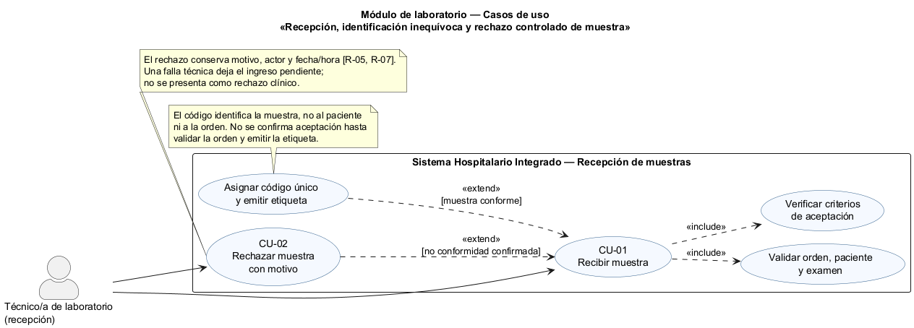
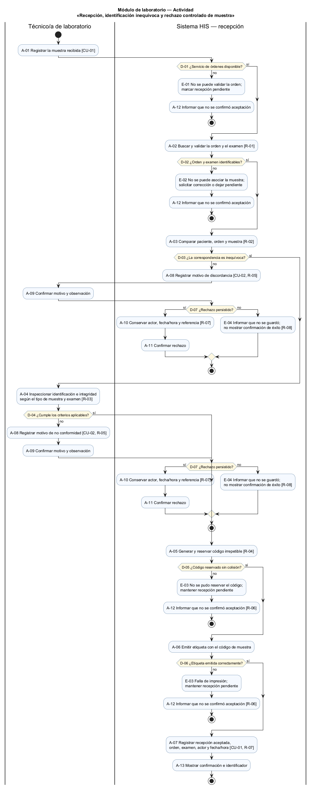
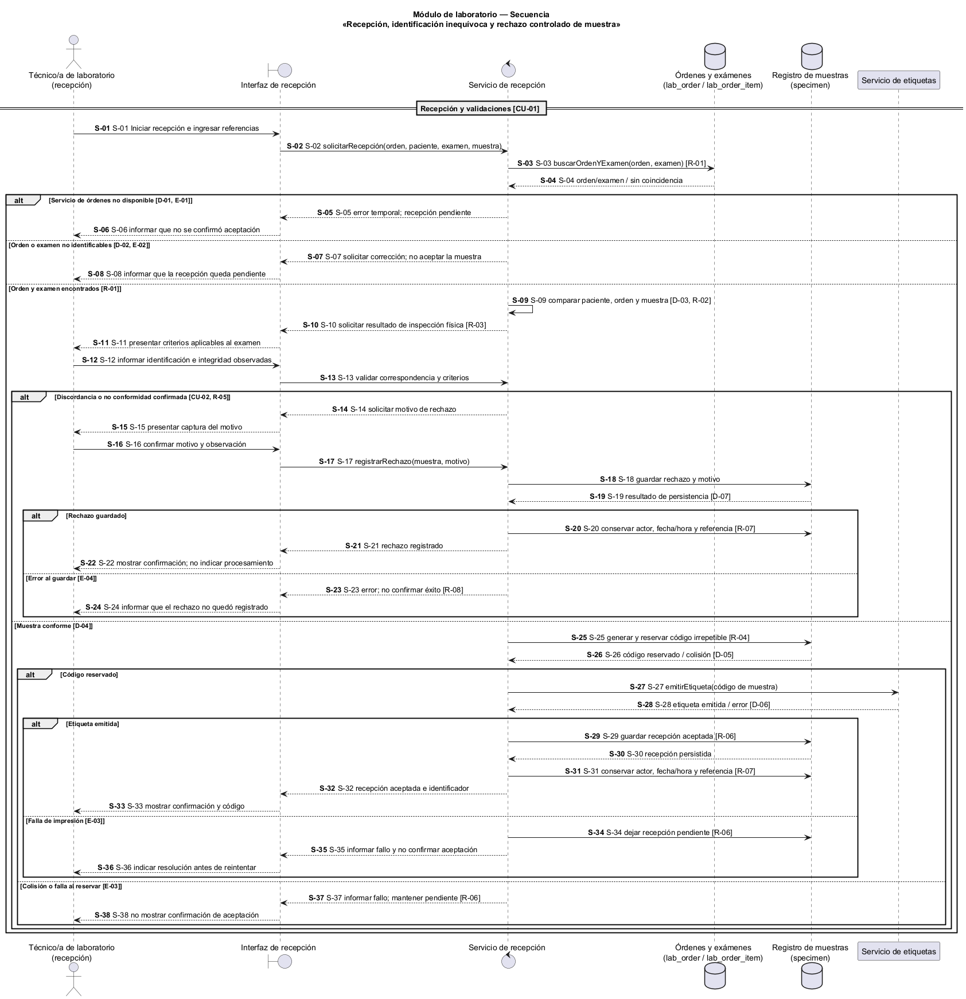

# Semana 1 — Modelado UML de recepción de muestras

| | |
|---|---|
| **Curso** | Análisis de Sistemas II — Proyecto Final 2026 |
| **Proyecto** | Sistema Hospitalario Integrado (HIS) |
| **Módulo** | Recepción de muestras y códigos identificadores |
| **Tema de la semana** | Conceptos generales, orientación a objetos y UML |
| **Proceso modelado** | «Recepción, identificación inequívoca y rechazo controlado de muestra» |
| **Estudiante** | Mercedes Azucena Lopez Perez |
| **Fecha** | Octubre 2026 |

## 1. Introducción

Una muestra de laboratorio debe poder vincularse sin ambigüedad con la orden, el paciente y el examen para el que fue recolectada. Si la muestra llega sin información suficiente, no coincide con la orden o incumple los criterios aplicables, el sistema no debe aceptarla como apta para procesamiento: debe registrar el motivo y dejar evidencia de la decisión.

Este documento presenta tres vistas complementarias del proceso:

- **Casos de uso:** quién interactúa con el proceso y qué objetivos persigue.
- **Actividad:** decisiones, excepciones y resultados del flujo de recepción.
- **Secuencia:** mensajes y validaciones entre el personal, la interfaz y los componentes del HIS.

Los identificadores CU, A, D, E, S y R conectan las tres vistas y permiten rastrear cada regla. Los diagramas son un modelo conceptual de la entrega académica; no afirman que el flujo o una API de recepción ya estén implementados.

## 2. Narrativa de alcance

**Objetivo.** Registrar la llegada de una muestra de laboratorio y decidir si puede aceptarse para la orden indicada. Si cumple las validaciones, el HIS le asigna un código único, genera la etiqueta y registra la recepción. Si existe una no conformidad confirmada, el personal autorizado registra un rechazo con motivo y evidencia. Una falla técnica que impida validar o etiquetar no se presenta como aceptación ni como rechazo clínico: la recepción queda pendiente de resolución.

**Escenario de referencia.** Una persona del laboratorio recibe un recipiente identificado con los datos de una orden. Busca la orden y verifica que corresponda al paciente y al examen, y que la muestra satisfaga los criterios definidos para ese examen. Si las comprobaciones resultan satisfactorias, el sistema genera un identificador irrepetible, imprime una etiqueta con el código y confirma la recepción. Si encuentra una discordancia o una condición de rechazo, registra el resultado y el motivo; la muestra queda diferenciada de las aceptadas y no continúa al procesamiento del examen.

**Dentro del alcance:**

- localizar y validar la orden y el examen al que se pretende asociar la muestra;
- comprobar la correspondencia entre la muestra, el paciente y la orden;
- verificar los criterios de identificación e integridad aplicables a la muestra;
- asignar un identificador único y emitir la etiqueta para una muestra aceptada;
- registrar la decisión y el motivo de rechazo cuando la no conformidad esté confirmada;
- conservar la trazabilidad de la recepción y del rechazo.

**Fuera del alcance:**

- crear o modificar pacientes, órdenes de laboratorio y el catálogo de exámenes;
- recolectar físicamente la muestra o definir criterios clínicos específicos por examen;
- procesar muestras, capturar resultados, validarlos o emitir alertas críticas;
- definir endpoints, pantallas, permisos definitivos, impresoras o protocolos de códigos;
- decidir el transporte, almacenamiento, eliminación o recolocación de una muestra rechazada.

**Supuestos y límites del modelo:**

1. Cada muestra que se recibe debe asociarse a una orden existente y a un examen identificable. No se considera suficiente una coincidencia por nombre del paciente solamente.
2. El identificador interno de la muestra es único y distinto del identificador del paciente y del número de orden. El algoritmo y el formato del código quedan pendientes de diseño posterior.
3. Los criterios de aceptación dependen del examen y del tipo de muestra; esta entrega los representa como una validación, sin inventar umbrales clínicos.
4. Un rechazo es una decisión registrada, no la eliminación del registro. El estado y el motivo deben permanecer consultables.
5. Si el HIS no puede verificar la orden, reservar un código o emitir la etiqueta, no confirma la aceptación. El personal resuelve la condición técnica antes de reintentar.
6. El diseño se alinea conceptualmente con las entidades `lab_order`, `lab_order_item` y `specimen` previstas para la base HOSPITAL en `openspec/changes/postgresql-federated-schema-rebuild`. Esa especificación todavía no define el flujo de usuario ni un contrato de API para esta tarea.

## 3. Actores

| Actor | Tipo | Objetivo |
|---|---|---|
| Técnico/a de laboratorio (recepción) | Primario | Registrar la recepción, revisar la muestra y completar o rechazar el ingreso con un motivo. |

El servicio de recepción, el repositorio de órdenes, el registro de muestras y el mecanismo de impresión son componentes internos o dispositivos de soporte; no son actores humanos del límite del HIS.

## 4. Diagrama de casos de uso

Fuente editable: [semana-01-casos-de-uso.puml](diagramas/semana-01-casos-de-uso.puml).

## 5. Especificación de casos de uso

### CU-01 — Recibir muestra

| Campo | Descripción |
|---|---|
| Actor principal | Técnico/a de laboratorio (recepción). |
| Objetivo | Registrar una muestra recibida y decidir si queda aceptada para la orden o rechazada con trazabilidad. |
| Precondición | El actor está autorizado para operar en el hospital correspondiente y tiene la muestra física y sus datos de remisión. |
| Disparador | El actor inicia el registro de una muestra recibida. |
| Flujo principal | 1. El actor inicia la recepción con la referencia de la orden. 2. El sistema valida la orden y el examen. 3. El actor verifica la correspondencia y los criterios aplicables. 4. Si la muestra cumple, el sistema asigna un código único y emite la etiqueta. 5. El sistema registra la recepción aceptada con actor y fecha/hora. 6. El sistema muestra la confirmación y el identificador. |
| Alternativas y excepciones | Si la discordancia o no conformidad está confirmada, continúa CU-02. Si la orden no se puede verificar, se deja pendiente (E-01 o E-02). Si no es posible reservar el identificador o imprimir la etiqueta, tampoco se confirma aceptación (E-03). |
| Postcondición de éxito | Existe un registro de muestra recibida y vinculada a la orden y al examen, con identificador único y etiqueta emitida. |
| Postcondición de rechazo | Existe un registro de rechazo con motivo, actor y fecha/hora; no se indica que la muestra fue aceptada para procesamiento. |

### CU-02 — Rechazar muestra con motivo

| Campo | Descripción |
|---|---|
| Actor principal | Técnico/a de laboratorio (recepción). |
| Objetivo | Registrar de forma controlada una muestra que no cumple un criterio de aceptación o no corresponde a la orden. |
| Precondición | Se identificó una no conformidad confirmada y se puede dejar constancia de la muestra y de la decisión. |
| Flujo principal | 1. El actor selecciona la causa aplicable y agrega observaciones cuando sean necesarias. 2. El sistema valida que el motivo esté presente y permitido. 3. El sistema registra el rechazo sin borrar el historial de recepción. 4. El sistema confirma que el rechazo quedó registrado. |
| Alternativas y excepciones | Si falta el motivo o la muestra no puede identificarse con certeza, el sistema no registra un rechazo definitivo y solicita completar o escalar la información. Si falla el guardado, se informa el error y no se muestra una confirmación de éxito (E-04). |
| Postcondición | El rechazo queda registrado y es consultable; la muestra no se trata como aceptada. |

## 6. Diagrama de actividad

Fuente editable: [semana-01-actividad.puml](diagramas/semana-01-actividad.puml).

El flujo distingue un rechazo confirmado de una condición técnica pendiente. Una muestra con no conformidad no se acepta; una indisponibilidad técnica tampoco produce una respuesta de éxito ni una decisión clínica de rechazo.

## 7. Diagrama de secuencia

Fuente editable: [semana-01-secuencia.puml](diagramas/semana-01-secuencia.puml).

## 8. Matriz de trazabilidad

| Regla | Narrativa / caso de uso | Actividad | Secuencia |
|---|---|---|---|
| R-01 — Toda muestra aceptada se vincula con una orden y un examen existentes. | CU-01, paso 2 | A-02 | S-03 a S-04 |
| R-02 — La muestra, el paciente y la orden deben corresponder inequívocamente. | CU-01, paso 3 | D-03, A-03 | S-09 |
| R-03 — La aceptación requiere cumplir los criterios aplicables a muestra y examen. | CU-01, paso 3 | D-04, A-04 | S-10 a S-13 |
| R-04 — El código de muestra es único y distinto de las referencias de paciente y orden. | CU-01, paso 4 | D-05, A-05 | S-25 a S-26 |
| R-05 — Una no conformidad confirmada se registra con un motivo y no se borra. | CU-02 | A-08 a A-11 | S-14 a S-19 |
| R-06 — Si falla una validación técnica o la etiqueta, la recepción no se confirma como aceptada. | CU-01, alternativas | E-01 a E-03, A-12 | S-05 a S-08, S-28, S-34 a S-38 |
| R-07 — La aceptación y el rechazo conservan actor, fecha/hora y referencia de la decisión. | CU-01, CU-02 | A-07, A-10 | S-20, S-29 a S-31 |
| R-08 — Errores de persistencia se informan sin respuesta de éxito falsa. | CU-02, alternativas | E-04 | S-23 a S-24 |

## 9. Reglas de negocio

- **R-01:** No se acepta una muestra sin una orden existente y un examen identificable.
- **R-02:** Se verifica la concordancia entre paciente, orden, examen y muestra; el nombre del paciente por sí solo no prueba la correspondencia.
- **R-03:** La aceptación depende de los criterios configurados para el tipo de muestra y examen. Esta entrega no fija criterios clínicos.
- **R-04:** El identificador asignado a la muestra debe ser irrepetible. No sustituye el identificador del paciente ni el de la orden.
- **R-05:** Un rechazo requiere un motivo explícito; no se elimina el registro de la decisión.
- **R-06:** Una falla técnica o de impresión deja la recepción sin confirmación de aceptación y requiere resolución antes de reintentar.
- **R-07:** La aceptación y el rechazo conservan actor, fecha/hora y referencia de la decisión.
- **R-08:** El sistema informa fallos de registro y no devuelve confirmaciones que no correspondan a un cambio persistido.

## 10. Conclusión

Los diagramas describen una recepción con dos resultados controlados: aceptación identificable o rechazo justificado. También separan las no conformidades clínicas de los fallos técnicos, para que una indisponibilidad no se interprete como una decisión sobre la muestra. La matriz permite comprobar la consistencia de actores, validaciones, excepciones y reglas en las tres vistas UML.

## 11. Referencias

1. Captura de la consigna de Semana 1 compartida por la estudiante: «Recepción de muestras y códigos identificadores». Se usa como fuente del objetivo y alcance académico.
2. Repositorio del proyecto, `openspec/changes/postgresql-federated-schema-rebuild/design.md` y `specs/hospital-clinical-schema/spec.md`: entidades previstas para órdenes y muestras (`lab_order`, `lab_order_item`, `specimen`) y límites del modelo HOSPITAL.
3. Repositorio del proyecto, `docs/README.md` y `docs/modulos/rbac/semana-01/`: convenciones de organización documental y estructura de la entrega UML de Semana 1.
