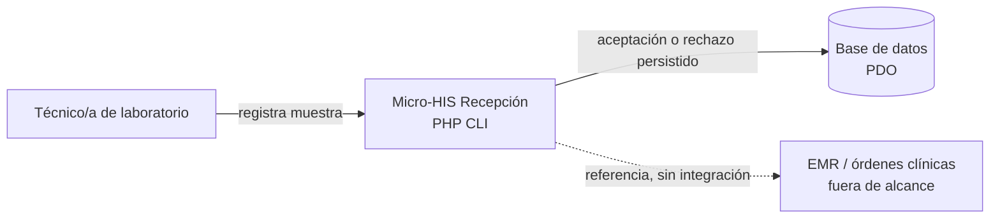
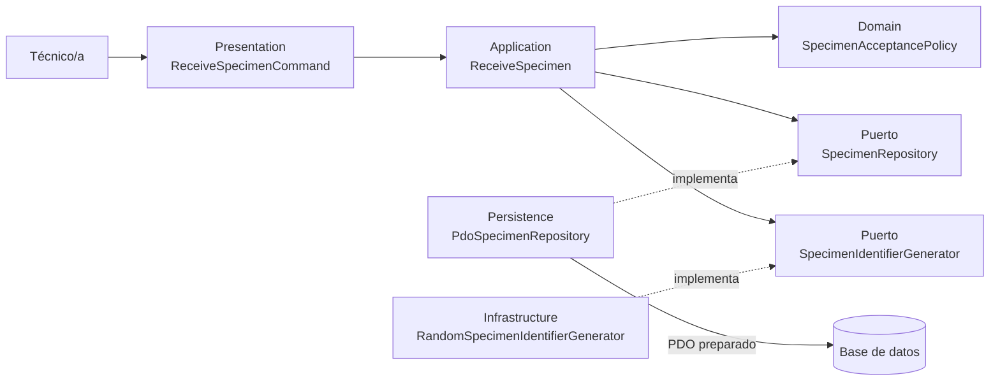
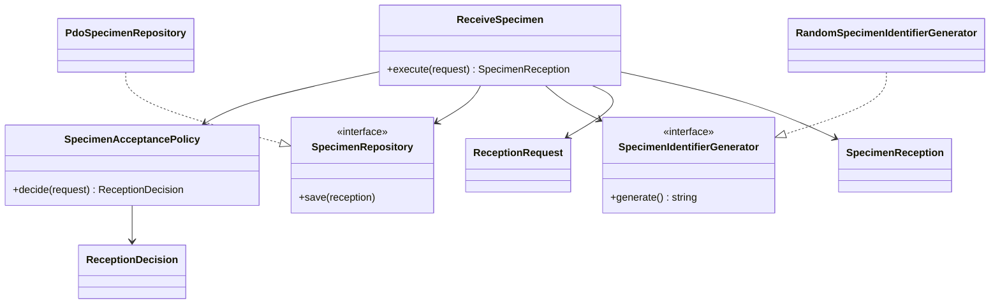

# Semana 3 — Micro-HIS CLI para recepción de muestras

| | |
|---|---|
| **Curso** | Análisis de Sistemas II — Proyecto Final 2026 |
| **Proyecto** | Sistema Hospitalario Integrado (HIS) |
| **Módulo** | Recepción de muestras y códigos identificadores |
| **Tema** | Diseño arquitectónico, vistas y patrones |
| **Estudiante** | Lopez Perez, Mercedes Azucena |
| **Email** | mlopez58@miumg.edu.gt |
| **Fecha** | Octubre 2026 |

## 1. Objetivo y alcance

Iniciar «Micro-HIS Recepción de muestras y códigos identificadores» en PHP 8.2+ CLI y sin framework. El ejemplo materializa el flujo ya modelado en Semana 1 y las decisiones de aceptación de Semana 2: captura las referencias de orden, paciente y examen; valida la condición de la muestra; asigna un identificador; registra aceptación o rechazo con trazabilidad y guarda el resultado mediante PDO.

No sustituye una integración productiva. Las referencias clínicas se reciben como argumentos; no se consultan ni crean órdenes o pacientes, no hay autenticación, impresora, API o definición de criterios por examen. La asociación enviada por el operador no equivale a verificarla con el EMR.

## 2. Requerimientos

### Requerimientos funcionales

| ID | Requerimiento |
|---|---|
| RF-01 | La CLI recibe las referencias obligatorias de orden, paciente, examen y tipo de muestra, además de sus condiciones de identificación e integridad. |
| RF-02 | El dominio rechaza una muestra sin etiqueta, con recipiente dañado, con sello de tubo sanguíneo no íntegro o con un motivo de rechazo explícito. |
| RF-03 | A toda recepción se le asigna un identificador único y se conserva su vínculo declarado con orden, paciente y examen. |
| RF-04 | El sistema persiste el resultado aceptado o rechazado y sus motivos antes de presentar confirmación. |
| RF-05 | Los errores de validación técnica o persistencia se muestran como errores; nunca se convierten en éxito ni en un rechazo clínico guardado. |

### Requerimientos no funcionales

| ID | Requerimiento |
|---|---|
| RNF-01 | El prototipo se ejecuta con PHP 8.2+ CLI, sin framework ni dependencias externas. |
| RNF-02 | Presentación, aplicación, dominio y persistencia son módulos separados con dependencias dirigidas hacia el dominio o puertos. |
| RNF-03 | El adaptador PDO usa sentencias preparadas y parámetros; no concatena valores de entrada en SQL. |
| RNF-04 | Las pruebas verifican camino feliz, regla de dominio y fallo de persistencia usando dobles. |

## 3. Criterios de aceptación

| ID | Criterio verificable | Evidencia |
|---|---|---|
| CA-01 | Una muestra con etiqueta, recipiente íntegro y sin no conformidades produce estado `accepted` y se guarda. | `php tests/run.php` |
| CA-02 | Una muestra sin etiqueta queda `rejected`, conserva una razón y se guarda como rechazo. | Pruebas del dominio y repositorio en memoria. |
| CA-03 | Un fallo del repositorio se propaga y no produce respuesta de éxito. | Doble de persistencia con error en `tests/run.php`. |
| CA-04 | El adaptador PDO hace inserción con placeholders y parámetros nombrados. | `src/Persistence/PdoSpecimenRepository.php`. |
| CA-05 | Los archivos PHP pasan `php -l`. | `Get-ChildItem . -Filter '*.php' -Recurse \| ForEach-Object { php -l $_.FullName }` desde `ejemplo/`. |
| CA-06 | Las vistas C4/UML muestran módulos, puertos, adaptadores y persistencia. | Fuentes en `diagramas/`. |

## 4. Arquitectura y dependencias

El prototipo sigue una arquitectura por capas con inversión de dependencias en la salida a persistencia:

| Módulo | Responsabilidad | Depende de |
|---|---|---|
| Presentation / CLI | Leer opciones, invocar el caso de uso y presentar un resultado confirmado. | Application. |
| Application | Coordinar decisión, identificador y guardado del caso de uso `ReceiveSpecimen`. | Domain y puertos `SpecimenRepository`, `SpecimenIdentifierGenerator`. |
| Domain | Validar los datos mínimos, aplicar reglas de aceptación y mantener invariantes del registro. | Ninguna capa externa. |
| Persistence | Guardar el registro con PDO y parámetros preparados. | Puerto de repositorio y PDO. |
| Infrastructure / Identity | Generar el código `SP-...`. | Puerto del generador y funciones seguras del runtime. |

La aplicación no conoce `PDO`. La dirección del contrato de repositorio apunta hacia Application; el adaptador concreto lo implementa en Persistence. La presentación solo informa que la operación fue registrada una vez que el caso de uso regresó correctamente. Si `save()` falla, la excepción llega al límite CLI y se informa con código de salida no cero.

### Vista C4 de contexto



Fuente PlantUML editable: [contexto.puml](diagramas/contexto.puml).

### Vista C4 de componentes



Fuente PlantUML editable: [componentes.puml](diagramas/componentes.puml).

### Vista UML de clases y dependencias



Fuente PlantUML editable: [clases.puml](diagramas/clases.puml).

## 5. Patrones y decisiones

- **Separación por capas:** evita que la CLI implemente reglas clínicas o instrucciones SQL.
- **Puertos y adaptadores:** `SpecimenRepository` y `SpecimenIdentifierGenerator` permiten sustituir persistencia y generación de identificadores por dobles.
- **Objeto de decisión:** aceptación/rechazo es un resultado de dominio con razones explícitas; fallos técnicos siguen siendo errores.
- **PDO preparado:** cada valor se pasa mediante parámetros nombrados y el identificador funciona como clave primaria para evitar duplicados silenciosos.
- **Identificador aleatorio:** `random_bytes()` genera una referencia no secuencial; no contiene datos personales.

## 6. Pruebas y ejecución

Desde `ejemplo/`:

```powershell
php -l bin/reception.php
php tests/run.php
```

El suite usa dobles y no requiere una base de datos ni driver PDO. La ejecución de la CLI requiere PDO y el driver de la conexión elegida (por defecto, `pdo_sqlite`). El resultado verificado se conserva en [salida-pruebas.txt](evidencia/salida-pruebas.txt). Las fuentes PlantUML están junto a los diagramas y las vistas Mermaid se renderizan directamente en Markdown.

La validación con PHP 8.2.33 y el driver SQLite también ejecutó una recepción aceptada y otra rechazada contra una base temporal, comprobó sus estados y el motivo persistido y eliminó la base de prueba: [validacion-pdo-sqlite.txt](evidencia/validacion-pdo-sqlite.txt).

## 7. Relación con entregas anteriores

- **Semana 1:** conserva el flujo de recepción, identificación inequívoca y rechazo controlado, así como la relación declarada con orden, paciente y examen.
- **Semana 2:** lleva la decisión de políticas al inicio del flujo persistible; una regla de dominio rechaza con motivo y no acopla esa decisión a PDO.
- **Semana 3:** agrega límites arquitectónicos y un prototipo ejecutable CLI; no afirma que las integraciones EMR o la operación productiva estén terminadas.
