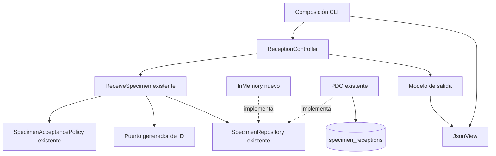
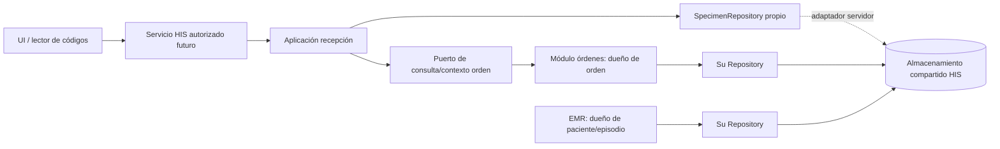

# Semana 4 — MVC y Repository: Recepción de muestras

**Estudiante:** Mercedes Azucena Lopez Perez.

Continúa el **mismo Micro-HIS** de [semana 3](../semana-03/semana-03-arquitectura-recepcion-muestras.md), base f507568, flujo de recepción, identificación inequívoca y rechazo controlado. Se reutilizan sin copiar/modificar ReceptionRequest, SpecimenAcceptancePolicy, ReceiveSpecimen, SpecimenRepository, generador y PdoSpecimenRepository. Se añaden MVC CLI y adaptador InMemory. PHP 8.2+ sin framework.

## Ejecución

Desde raíz, con PHP y pdo_sqlite para modo PDO/suite:

```powershell
php docs/modulos/recepcion-muestras/semana-04/mvc/cli.php memory accept
php docs/modulos/recepcion-muestras/semana-04/mvc/cli.php pdo accept
php docs/modulos/recepcion-muestras/semana-04/mvc/cli.php memory reject
php docs/modulos/recepcion-muestras/semana-04/mvc/cli.php pdo reject
php docs/modulos/recepcion-muestras/semana-04/mvc/tests/run.php
php docs/modulos/recepcion-muestras/semana-03/ejemplo/tests/run.php
```

Resultado RECORDED con identificador y decisión accepted/rejected; rechazo guardado es operación exitosa, no error de infraestructura. Modo/escenario inválido termina con código 2; operación no registrada con código 1. Ambas bases son temporales: InMemory por instancia y SQLite en memoria por proceso. No se presume durabilidad tras cerrar CLI, conexión clínica ni servidor HTTP.

## Capas y objetos reutilizables

| Rol MVC / capa | Objeto | Responsabilidad |
|---|---|---|
| Composición | mvc/cli.php | Selecciona adaptador, inicializa DB de demo e inyecta dependencias. No es controlador clínico. |
| Controller / Presentation | ReceptionController | Valida forma/tipos y convierte tipo de muestra de entrada; construye Request y delega ReceiveSpecimen. Sin SQL ni condiciones de aceptación/rechazo. |
| View / Presentation | JsonView | Serializa resultado con etiqueta DEMO_ONLY; no evalúa muestra ni accede a persistencia. |
| Model / Application existente | ReceiveSpecimen | Coordina política, ID, fecha y persistencia; devuelve recepción solo tras save. |
| Model / Domain existente | ReceptionRequest, SpecimenAcceptancePolicy, SpecimenReception | Referencias requeridas, tipo, identificación/recipiente/sello y motivos coherentes. |
| Puerto de aplicación existente | SpecimenRepository | save(SpecimenReception):void; adaptadores no deciden aceptación. |
| Persistence existente | PdoSpecimenRepository | INSERT preparado de recepción completa, clave primaria para identificador. |
| Persistence nuevo | InMemoryRepository | Mismo contrato, registro por ID y rechazo de colisiones sin sobrescribir. Volátil, sin garantías multiproceso. |

Model incluye aplicación/dominio, no es una tabla. Repository pertenece al límite de persistencia de recepciones del caso de uso; no es un repositorio universal de muestras, órdenes, expediente y resultados. Controller no depende del tipo concreto de Repository. InMemory count es inspección de prueba, no parte del puerto.

## MVC y dependencias



[Fuente UML editable](diagramas/mvc-repository.puml). Mermaid presenta el diseño sin depender de renderizar un servicio externo. PlantUML no se ha convertido a PNG en esta entrega.

## Contratos y errores

Entrada: order/patient/exam/type strings, label/container/seal booleanos y reason opcional string/null. No convertir la cadena “false” a true mediante casteo. Las referencias vacías y motivo vacío son rechazados por ReceptionRequest; la decisión por recipiente/identificación/sello sigue en SpecimenAcceptancePolicy. Rechazo requiere motivo y se guarda como recepción rechazada, preservando trazabilidad.

Salida: RECORDED, identifier, decision y reasons solo tras persistencia. INVALID_INPUT para forma/valor no representable; OPERATION_UNAVAILABLE para RuntimeException de operación, incluido PDOException o colisión. No se expone stack/SQL ni ID como si se hubiera guardado tras error. La base actual no tiene excepciones tipadas por causa: no atribuir OPERATION_UNAVAILABLE exclusivamente a BD; también puede fallar el generador.

PDO tiene un único INSERT con decisión/motivos serializados en la misma fila, por eso no se agrega una transacción ficticia de múltiples tablas. InMemory impide sobrescritura con mismo ID y PDO lo hace por PK. La restricción de unicidad es última defensa: el generador aleatorio no garantiza matemáticamente ausencia de colisiones. No hay reintento automático ni idempotencia implementada. Un timeout con resultado desconocido exige reconciliación autorizada antes de registrar otra muestra.

## Integración de repositorio de datos compartido



Compartir almacenamiento de servidor no significa exponer SQL remoto al cliente o mezclar responsabilidades en un objeto común. Recepción posee identidad y decisión de recepción/motivos; órdenes posee pruebas/orden/estado; EMR posee paciente/episodio. Este módulo conserva referencias mínimas y valida pertenencia mediante contrato autorizado al integrar. La demo actual solo comprueba referencias no vacías, no existencia o correspondencia en HIS.

| Responsabilidad compartida | Decisión de integración propuesta |
|---|---|
| Identidad/tenant | Obtener sesión y ámbito en servidor; añadir tenant/contexto a esquema y consultas antes de uso multitenant. No existe aislamiento tenant implementado en esta demo. |
| Referencias clínicas | Dueños validan orden/paciente/prueba y compatibilidad; no copiar expediente ni editar orden desde Repository de recepción. |
| Unicidad | Definir alcance de ID entre tenants/sedes y restricción DB correspondiente; comprobar colisiones y duplicación de operación concurrente. |
| Cadena de custodia | Acordar evento de quién/cuándo/dónde/transferencia con responsable; receivedAt solo no demuestra cadena completa. No inventar actor o historial que no existen en esquema actual. |
| Seguridad | Credenciales de BD solo en servidor y acceso mínimo; logs técnicos sin identificadores clínicos/secreto innecesarios. |
| Cambios de esquema | Migraciones por dueño de tablas; acordar FK/índices/retención y compatibilidad sin escrituras cruzadas no autorizadas. |

Migración razonada: acordar contratos y propiedad; incorporar autorización/tenant y validaciones de referencias; implementar adaptador servidor con mismo puerto ajustado explícitamente si necesita contexto; probar aislamiento, unicidad, persistencia y recuperación; activar piloto con datos ficticios. No escribir simultáneamente dos almacenes clínicos para “sincronizar”. Fallo de otro servicio no implica aceptación permisiva.

Rollback de piloto desactiva borde nuevo manteniendo registros existentes; migración real requiere plan aprobado/restauración y reconciliación, no borrar recepciones para ocultar fallos. No se despliega repositorio compartido ni se migra información productiva en esta entrega.

## Evidencia y trazabilidad

[Suite MVC](evidencia/mvc.txt): 26 aserciones usando el mismo controlador/aplicación con PDO e InMemory. Aceptación, rechazo guardado con motivo, tipos incorrectos, referencias vacías, vista sin alterar resultado, colisión sin sobrescritura y PDO roto sin éxito. [Regresión de semana 3](evidencia/regresion-semana-03.txt): 13 aserciones. Salidas CLI en evidencia/ con ambos modos y decisiones. Lint de archivos nuevos registrado.

| Regla / atributo heredado | Evidencia |
|---|---|
| Referencias requeridas y muestra tipada | Dominio previo reutilizado, tipos de entrada inválidos rechazados. |
| Identificación/recipiente/sello | Política previa decide; controller no duplica esas reglas. |
| Rechazo controlado con motivo | Mismo resultado en ambos adaptadores, guardado y representado en vista. |
| Identificador inequívoco | InMemory y PDO rechazan duplicado sin sobrescribir. Alcance global/operación idempotente pendientes. |
| Éxito solo al guardar | RuntimeException no devuelve RECORDED ni ID de éxito. |
| Responsabilidades reutilizables | MVC + puerto existente y dos adaptadores; no copia de lógica de semana 3. |

No se demuestran autenticación real, integración de lector físico, correspondencia clínica, cadena completa de custodia, JWT, permisos, API ni datos durables compartidos. Todo dato es ficticio. Esta entrega satisface separación y sustitución de infraestructura en el mismo flujo acotado.