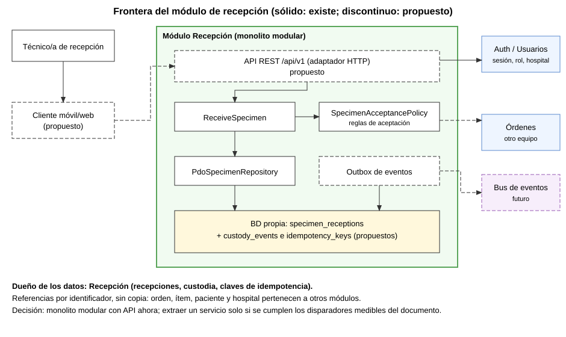

# Semana 5 — Cliente-servidor, API REST, microservicios e integración: recepción de muestras y códigos identificadores

| | |
|---|---|
| **Curso** | Análisis de Sistemas II — Proyecto Final 2026 |
| **Módulo** | Recepción de muestras y códigos identificadores |
| **Flujo** | «Recepción, identificación inequívoca y rechazo controlado de muestra» |
| **Estudiante** | Lopez Perez, Mercedes Azucena |
| **Fecha** | 27 de octubre de 2026 |

## 1. Alcance y decisión

Se evoluciona el **mismo** Micro-HIS de la Semana 3 hacia un diseño cliente-servidor con contrato API y se evalúa si una frontera de microservicio se justifica. Es diseño y prototipo de medición: no se construye infraestructura de producción ni se divide el sistema.

**Decisión: monolito modular con API REST ahora; no extraer un microservicio todavía.** La frontera del módulo ya es limpia (sección 3), pero no hay una necesidad medida que justifique pagar el costo de un servicio aparte (sección 4). Se definen disparadores medibles para reconsiderarlo.



Fuentes editables: [componentes](diagramas/semana-05-componentes.puml) y [secuencia](diagramas/semana-05-secuencia.puml).

## 2. Contrato API (propuesta)

Base: `/api/v1`, JSON, HTTPS. Errores con formato `application/problem+json` (RFC 9457). El **hospital y el actor salen de la sesión**, nunca del cuerpo (lección del hallazgo REV13-01 en el módulo de validación).

### 2.1 Endpoints

| Método | Ruta | Permiso | Descripción |
|---|---|---|---|
| POST | `/specimen-receptions` | `reception:create` | Registra la recepción de un recipiente; exige `Idempotency-Key` |
| GET | `/specimen-receptions/{specimenId}` | `reception:read` | Consulta una recepción del hospital de la sesión |
| GET | `/specimens/{specimenId}/custody-events` | `custody:read` | Lista la cadena de custodia |
| POST | `/specimens/{specimenId}/custody-events` | `custody:write` | Agrega un traspaso (solo se agrega, nunca se edita) |

### 2.2 `POST /specimen-receptions`

Cabeceras: `Authorization`, `Idempotency-Key` (obligatoria, 1 a 64 caracteres), `X-Correlation-Id` (opcional; si falta, el servidor la crea).

Cuerpo:

| Campo | Tipo | Regla |
|---|---|---|
| `orderId` | texto | Obligatorio; debe existir en Órdenes y ser del hospital de la sesión |
| `orderItemId` | texto | Obligatorio; debe pertenecer a la orden |
| `specimenType` | `blood`, `urine`, `swab` | Enumeración (la del prototipo) |
| `labelPresent` | booleano | Obligatorio |
| `containerIntact` | booleano | Obligatorio |
| `sealIntact` | booleano | Obligatorio si es sangre; ignorado en otros tipos |
| `rejectionReason` | texto | Opcional; hasta 200 caracteres. El catálogo de motivos lo define el laboratorio |

Respuesta `201` (también `200` en una repetición idéntica):

```json
{
  "specimenId": "SP-3F9A...",
  "orderId": "ORD-0000",
  "orderItemId": "ITEM-1",
  "status": "rejected",
  "reasons": ["El sello del tubo de sangre no está íntegro."],
  "receivedAt": "2026-10-27T11:42:00-06:00"
}
```

### 2.3 Códigos de respuesta

| Código | Cuándo |
|---:|---|
| 200 | Repetición con la misma clave y el mismo contenido: devuelve la recepción original |
| 201 | Recepción creada |
| 400 | Cabecera o JSON mal formados |
| 401 | Sin sesión válida |
| 403 | Sin permiso `reception:create` |
| 404 | Orden o ítem inexistente, o de otro hospital (no se revela cuál) |
| 409 | La misma clave con contenido distinto |
| 422 | Campos inválidos o ítem que no corresponde a la orden |
| 503 | Órdenes no disponible o falla de persistencia; incluye `Retry-After`; no se guarda nada |

Un estado `rejected` es un resultado de negocio y responde `201`, no un error. Una falla técnica **nunca** se informa como rechazo ni como aceptación.

### 2.4 Diferencias con el prototipo actual

| Aspecto | Prototipo (Semana 3) | Contrato propuesto |
|---|---|---|
| Entrada | CLI con `orderReference`, `patientReference`, `examCode` como texto | JSON con `orderId` y `orderItemId`; paciente y examen vienen de Órdenes |
| Verificación de la orden | Ninguna: acepta una orden inexistente (Semana 12) | Consulta a Órdenes antes de guardar |
| Idempotencia | No | Obligatoria por clave |
| Custodia | No | Eventos solo-agregar |
| Autorización | No | Permiso, rol y hospital desde la sesión |

## 3. Medición de la frontera

[verificacion/frontera.php](verificacion/frontera.php), salida en [evidencia/frontera-semana-05.txt](evidencia/frontera-semana-05.txt): **8 comprobaciones, 0 fallidas**.

| Medida (prototipo de la Semana 3) | Resultado |
|---|---:|
| Tablas propias del módulo | 1 |
| Claves foráneas hacia otros módulos | 0 |
| Menciones de PDO en dominio y aplicación | 0 |
| SQL fuera del adaptador de persistencia | 0 |
| Adaptadores del repositorio | 1 |
| Imports de otros módulos en el núcleo | 0 |
| Datos personales del paciente duplicados | 0 |

Lectura: la orden y el paciente se guardan como **referencias**, y el núcleo no conoce la base de datos. Eso es una condición **necesaria** para extraer un servicio. No demuestra que convenga extraerlo.

## 4. Evaluación de la frontera de microservicio

| Criterio | Evidencia actual | ¿Favorece extraer? |
|---|---|---|
| Datos propios y sin acoplamiento | Medido: 1 tabla, 0 claves foráneas | Sí |
| Equipos distintos o ritmo de despliegue propio | Un solo equipo y un repositorio | No |
| Carga o escalado diferenciado | Sin datos de carga; el prototipo es una CLI | No medido |
| Aislamiento de fallos | La recepción no debe caer si falla otro módulo; hoy es una sola aplicación | Parcial |
| Costo operativo (despliegue, red, observabilidad) | Alto para un equipo de estudiantes | No |
| Consistencia | La recepción y la custodia comparten una transacción local; separarlas la volvería eventual | No |

**Conclusión:** una sola condición se cumple con evidencia. No se divide «sin una justificación medible», como pide el enunciado.

### Disparadores para reconsiderar (propuestos, aún no medidos)

| Disparador | Umbral propuesto |
|---|---|
| Ritmo de cambio | Recepción necesita desplegarse por separado en 3 entregas consecutivas |
| Carga | El percentil 95 de la latencia de recepción supera 500 ms por contención con otros módulos |
| Propiedad | Un equipo distinto asume el módulo |
| Fallos | Una caída de otro módulo tumba la recepción 2 veces en un periodo |

Los umbrales son una propuesta de la autora, no cifras acordadas con el curso.

## 5. Propiedad de datos

| Dato | Dueño | Cómo lo usa Recepción |
|---|---|---|
| Recepción, decisión y motivo | Recepción | Lo crea y lo lee |
| `specimenId` | Recepción | Lo genera; no sustituye ni orden, ni ítem, ni paciente |
| Eventos de custodia | Recepción | Solo agrega |
| Claves de idempotencia | Recepción | Las guarda para repetir respuestas |
| Orden, ítem, examen | Órdenes | Referencia por identificador y consulta |
| Paciente | Pacientes / Órdenes | Referencia; no se copian sus datos personales |
| Usuario, rol, hospital | Usuarios y autenticación | Lee la sesión |

## 6. Comunicación e integración

| Interacción | Estilo | Motivo |
|---|---|---|
| Cliente → Recepción | REST síncrono | La persona espera la confirmación |
| Recepción → Órdenes | REST síncrono con timeout corto | Hay que verificar antes de guardar |
| Recepción → otros módulos (por ejemplo, ingreso de resultados) | Evento asíncrono `SpecimenReceived` o `SpecimenRejected` mediante outbox | Evita acoplamiento y pérdida de eventos |

Los eventos llevan solo identificadores y estado, sin datos personales. Se publican desde una tabla outbox escrita en la **misma transacción** que la recepción; así no hay recepción sin evento ni evento sin recepción.

## 7. Seguridad

1. Autenticación por sesión o token emitido por el módulo de Usuarios; el servidor verifica rol y hospital en **cada** lectura y escritura.
2. El hospital sale de la sesión; un `hospitalId` en el cuerpo se ignora o se rechaza.
3. Un identificador difícil de adivinar no sustituye la autorización.
4. Una orden de otro hospital responde `404`, igual que una inexistente.
5. Mínimo de datos personales en respuestas, registros y eventos.
6. HTTPS obligatorio; límite de tamaño del cuerpo y de la tasa de peticiones.
7. Los registros no guardan nombres ni datos clínicos.

## 8. Resiliencia

| Riesgo | Mecanismo |
|---|---|
| Duplicado por reintento del cliente | `Idempotency-Key` y respuesta original |
| Órdenes lento o caído | Timeout corto, reintento acotado con espera creciente y `503` con `Retry-After`; no se guarda |
| Falla a mitad de la escritura | Una transacción para recepción, custodia y outbox |
| Evento no publicado | El outbox reintenta hasta confirmar |
| Fallo en cascada | Cortacircuitos hacia Órdenes tras varios fallos seguidos |

El reintento automático solo se aplica a operaciones idempotentes.

## 9. Observabilidad

- Identificador de correlación en cada petición, propagado hacia Órdenes y presente en los registros.
- Registros estructurados con identificadores, sin datos personales.
- Métricas: tasa de peticiones, latencia p50 y p95, tasa de cada código de respuesta, rechazos por motivo, repeticiones idempotentes y errores hacia Órdenes.
- Alertas: tasa de `503` sostenida y backlog creciente del outbox.
- Una comprobación de salud que distingue «proceso vivo» de «dependencias disponibles».

## 10. Consistencia

- **Fuerte, dentro del módulo:** recepción, custodia, clave de idempotencia y outbox se guardan juntas o no se guarda nada.
- **Eventual, entre módulos:** otros módulos se enteran por eventos; pueden verlos con un retraso corto.
- Una muestra con recepción pendiente o rechazada no avanza a procesamiento.
- Si Órdenes cambia después de la recepción, no se reescribe la recepción: se registra un evento nuevo.

## 11. Migración razonada

| Fase | Cambio | Criterio para pasar | Reversión |
|---:|---|---|---|
| 0 | CLI de la Semana 3 | Estado actual (8 de 8 en la medición) | — |
| 1 | Adaptador HTTP sobre `ReceiveSpecimen`, con pruebas de contrato | Los códigos de la sección 2.3 pasan | Quitar el adaptador |
| 2 | Puerto de Órdenes, idempotencia y tabla de custodia | Pruebas de repetición, de conflicto y de caída de Órdenes | Desactivar la función |
| 3 | Outbox y eventos | Sin pérdida de eventos en la prueba de falla | Dejar de publicar |
| 4 | Evaluar la extracción contra los disparadores de la sección 4 | Algún disparador medido | No extraer |

Cada fase conserva el módulo desplegado como uno solo. La extracción de un servicio solo sería la fase 4 y requeriría medir antes.

## 12. Plan de issue, rama, worktree y PR

| Paso | Contenido |
|---|---|
| Issue | Título: «ASII Recepción de muestras: Semana 5 contrato API y frontera de microservicio». Debe vincular el RF/RNF y los criterios de esta entrega. **Pendiente de crear y vincular:** el ID de módulo y el issue no están confirmados |
| Rama | `semana-5-recepcion-muestras-api-microservicio-mercedes-lopez` |
| Worktree | `git worktree add -b <rama> ..\shi-semana-5-recepcion-muestras-api-microservicio-mercedes-lopez origin/develop` |
| Contenido | Solo `docs/modulos/recepcion-muestras/semana-05`; no mezcla otros módulos |
| PR | Hacia `develop`, con la plantilla del repositorio y los resultados de `php .../frontera.php` y `git diff --check` |
| Revisión | Se pide cuando la evidencia mínima está completa |

## 13. Limitaciones

- El contrato, la idempotencia, la custodia, el outbox y la integración con Órdenes son **propuestas**; no hay API implementada ni probada.
- No hay datos de carga: la decisión de no extraer se basa en la ausencia de necesidad medida, no en pruebas de rendimiento.
- Los umbrales de los disparadores los propone la autora.
- La medición usa expresiones regulares sobre el código; es un indicio, no un análisis completo.
- Los diagramas SVG se dibujaron a mano; los `.puml` son la fuente editable.
- El módulo de Órdenes es de otro equipo; el contrato con él debe acordarse.
