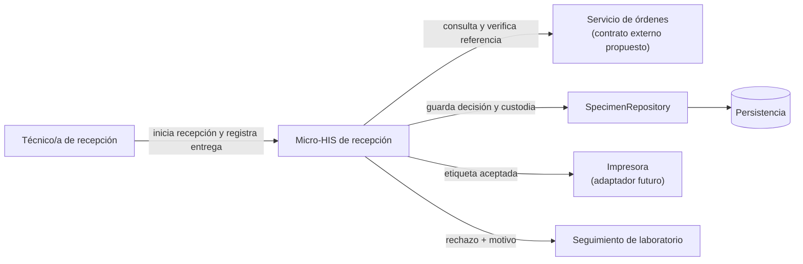
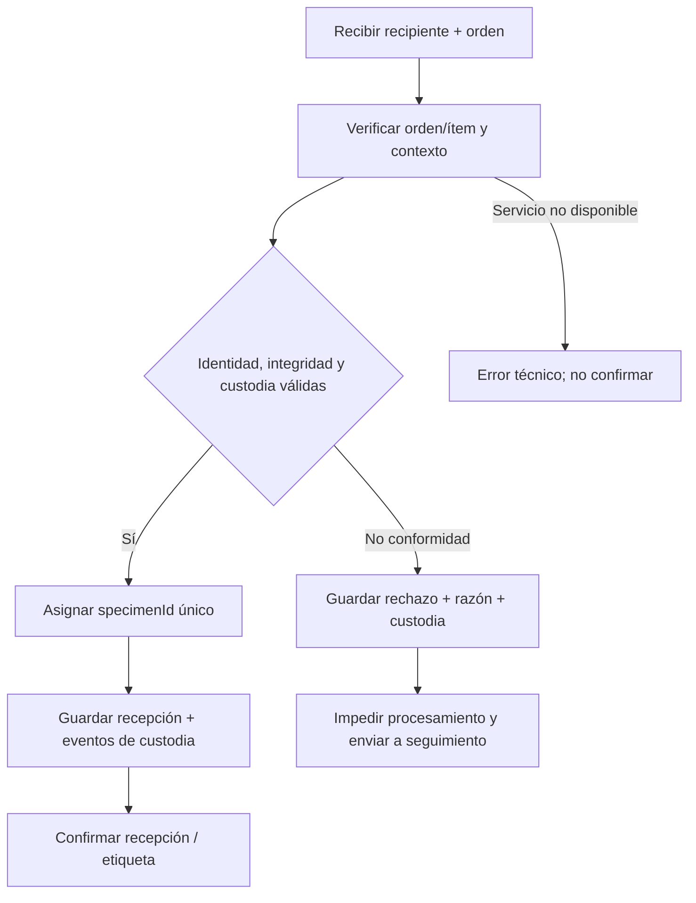
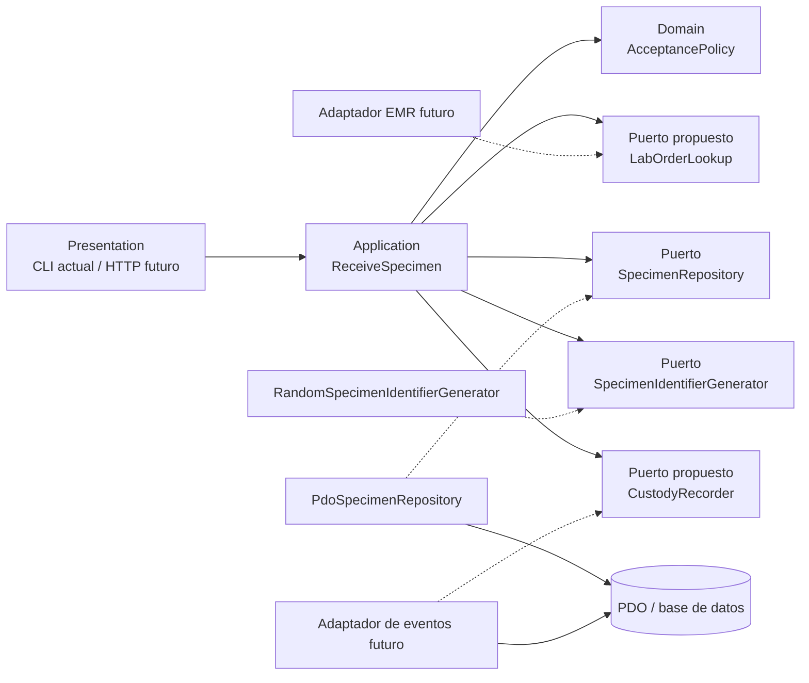

# Semana 6 — Primera evaluación parcial
## Defensa de arquitectura: recepción de muestras y códigos identificadores

**Estudiante:** Lopez Perez, Mercedes Azucena

**Proyecto:** Sistema Hospitalario Integrado 2026 · G1

**Flujo defendido:** recepción, identificación inequívoca y rechazo controlado de muestra

**Formato:** 8 diapositivas · 6–8 minutos

---

## Diapositiva 1 de 8 — Decisión arquitectónica

### Objetivo

Registrar cada muestra asociada a una orden y un examen, decidir aceptación o rechazo con un motivo trazable y conservar quién recibió qué y cuándo.

### Decisión

- Monolito modular pequeño; caso de uso de recepción detrás de un puerto de repositorio.
- Identificador interno de muestra independiente de paciente, orden y código externo.
- Rechazo es un resultado de negocio persistido; error técnico no es rechazo ni aceptación.
- La recepción queda confirmada solo después de guardar.

**Límite de la evidencia:** Semana 3 es un prototipo CLI con PDO/SQLite, no una API clínica ni integración EMR en producción.

**Nota oral:** «Defiendo límites claros y una evolución incremental: primero integridad de la recepción; luego conectores clínicos e impresión sin mover las reglas de negocio.»

---

## Diapositiva 2 de 8 — Actores y UML del proceso



### Flujo UML resumido



**Nota oral:** Técnico/a es el actor primario; órdenes, repositorio, impresora y cola son sistemas/dispositivos, no actores humanos. La consulta de órdenes y la impresión son contratos propuestos, no integraciones existentes.

---

## Diapositiva 3 de 8 — Requisitos y criterios verificables

| ID | Requisito defendido | Evidencia / criterio |
|---|---|---|
| RF-01 | Vincular recepción a orden, ítem, paciente y examen correctos. | No aceptar si el servicio de órdenes no confirma asociación. |
| RF-02 | Asignar un identificador interno único distinto de las referencias clínicas. | Identificador 128-bit del prototipo; clave primaria evita guardar duplicado. |
| RF-03 | Aceptar solo si etiqueta, recipiente y condiciones aplicables cumplen. | CA-01 acepta; CA-02 rechaza etiqueta ausente; CA-03 falla de escritura no simula éxito. |
| RF-04 | Rechazar con motivo explícito, conservar registro y bloquear procesamiento. | Rechazo persistido con razón; no se elimina la muestra ni la orden. |
| RF-05 | Trazar cada traspaso de custodia con actor y fecha/hora. | Cambio práctico: evento append-only desde recolección a recepción. |
| RNF-01 | Persistencia preparada y sin interpolar datos en SQL. | PDO `prepare()` + parámetros nombrados. |
| RNF-02 | Respuesta idempotente y segura ante repetición/concurrencia. | `Idempotency-Key`, restricción única, conflicto explícito (propuesta). |
| RNF-03 | Error técnico separado del rechazo de dominio. | CLI sale con error si falla conexión o guardado. |

**Nota oral:** «Las tres primeras decisiones tienen prueba ejecutable de Semana 3. La verificación real de orden y cadena de custodia son la extensión que defiendo en esta evaluación.»

---

## Diapositiva 4 de 8 — Capas y patrón Repository



- **Repository** oculta SQL y traduce entre agregado de dominio y almacenamiento.
- El caso de uso coordina decisión, código y guardado; no depende de PDO.
- Transacción requerida: recepción + decisión + primer evento de custodia juntos.
- El adaptador actual guarda una fila; `LabOrderLookup` y `CustodyRecorder` son propuestas aún no implementadas.

**Nota oral:** «No creo que la tabla sea el repositorio: el contrato expresa operaciones del dominio; PDO es solo una implementación sustituible.»

---

## Diapositiva 5 de 8 — SOLID: qué cumple y qué falta

| Principio | Aplicación / evaluación honesta |
|---|---|
| **S — SRP** | CLI presenta; caso de uso coordina; política decide; adaptador PDO persiste. Evita mezclar SQL con aceptación. |
| **O — OCP** | Puertos permiten nuevos adaptadores, pero la política de aceptación actual es concreta; especializar reglas debería depender de un contrato. |
| **L — LSP** | Reemplazos de repositorio y generador deben conservar sus contratos: guardar o informar error, sin respuestas éxito-falsas. |
| **I — ISP** | Contratos pequeños: repositorio y generador. No agrupar lectura de órdenes, impresión y custodia en una interfaz grande. |
| **D — DIP** | El repositorio y el generador se inyectan. Mejora pendiente: inyectar también política y reloj; `ReceiveSpecimen` crea el reloj directamente y tipa una política concreta. |

**Decisión:** tratar estos dos acoplamientos como mejora arquitectónica explícita; no afirmar que la demo implementa SOLID perfecto.

**Nota oral:** «La defensa no es que todo esté terminado. Señalo una brecha y propongo la abstracción mínima sin reescribir el sistema.»

---

## Diapositiva 6 de 8 — Contrato API propuesto

**No está implementado en Semana 3.** El adaptador futuro podrá exponer:

```http
POST /api/v1/lab-orders/{orderId}/specimens
Idempotency-Key: 9f3d...
Content-Type: application/json
```

```json
{
  "orderItemId": "LOI-204",
  "patientId": "PAT-58",
  "examCode": "CBC",
  "specimenType": "blood",
  "externalBarcode": "LAB-EXT-774",
  "condition": {"labelPresent": true, "containerIntact": true, "sealIntact": true},
  "custody": [{"event": "COLLECTED", "actorId": "USR-12", "occurredAt": "2026-10-25T08:10:00-06:00"}]
}
```

**201** recepción registrada · **409** clave repetida con payload diferente/orden cerrada · **422** asociación inválida o no conformidad sin motivo · **503** dependencia técnica no disponible.

Respuesta: `specimenId`, `labOrderId`, `orderItemId`, estado, razón si rechazado, momento y referencia del evento de auditoría. Nunca incluir datos clínicos extra en etiqueta/código.

**Nota oral:** «El código externo se conserva como identificador de origen; el sistema genera su propio specimenId. El contrato devuelve confirmación solo cuando toda la transacción se guardó.»

---

## Diapositiva 7 de 8 — Cambio práctico defendido

### Escenario

Una orden contiene dos ítems de examen; se recolecta un tubo, pasa de toma de muestra a mensajería y después a recepción. Llega sin etiqueta legible.

### Cambio y decisión

1. Resolver orden + ítem + paciente antes de recibir; un `labOrderId` no basta si tiene varios ítems.
2. Crear un `specimenId` interno único por recipiente físico; preservar el código externo si existe.
3. Registrar traspasos de custodia como eventos inmutables con actor, lugar y hora.
4. Guardar rechazo por falta de etiqueta, razón y evento terminal de recepción; impedir que llegue a procesamiento.
5. Reintento con la misma clave devuelve la recepción ya registrada, no genera una segunda muestra.

**Defensa del trade-off:** privilegia trazabilidad e idempotencia sobre confirmar rápido; si el servicio de órdenes no responde, queda pendiente, nunca aceptada por suposición.

**Nota oral:** «La orden identifica el trabajo; specimenId identifica el recipiente. La cadena registra quién lo tuvo. Son tres conceptos diferentes y no deben compartir código.»

---

## Diapositiva 8 de 8 — Matriz decisión → evidencia y cierre

| Decisión | Evidencia local | Estado |
|---|---|---|
| Aceptación y código de muestra | [pruebas Semana 3](../semana-03/ejemplo/tests/run.php): aceptación, identificador aleatorio, etiqueta ausente, recipiente/sello y error de guardado | Implementado y probado |
| Relación con orden/paciente/examen | [modelo de dominio](../semana-03/ejemplo/src/Domain/ReceptionDecision.php) y [esquema](../semana-03/ejemplo/database/schema.sql) | Referencias capturadas; no verificadas contra EMR |
| Rechazo controlado | [ReceptionDecision](../semana-03/ejemplo/src/Domain/ReceptionDecision.php) y persistencia con razón | Implementado y probado |
| Cadena de custodia append-only | Cambio práctico, diapositiva 7 y registro | Propuesto; no implementado |
| Contrato HTTP y `Idempotency-Key` | Diapositiva 6 y registro | Propuesto; la demo es CLI |
| Persistencia como dependencia sustituible | [SpecimenRepository](../semana-03/ejemplo/src/Application/ReceptionPorts.php) + [PdoSpecimenRepository](../semana-03/ejemplo/src/Persistence/PdoSpecimenRepository.php) | Demostrado con pruebas y PDO SQLite |

### Cierre

**Mantener** capas y Repository; **extender** por puertos de orden y custodia; **no aceptar** ni imprimir etiqueta cuando falte validación o persistencia. Ver [registro del cambio práctico](registro-cambio-practico.md).

**Nota oral:** «La propuesta respeta las entregas UML, LSP y arquitectura previas, y separa claramente lo que probé de lo que queda como integración futura.»
