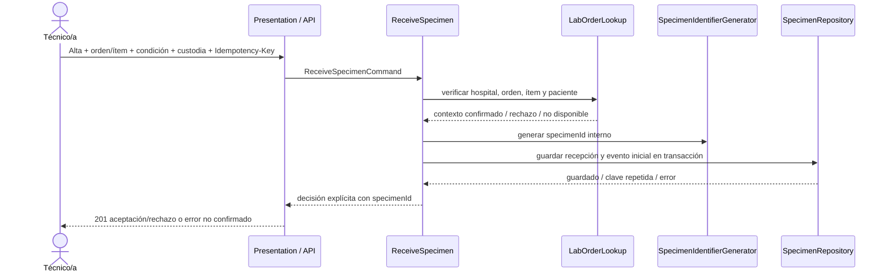

# Registro del cambio práctico defendido — Semana 6

| Campo | Valor |
|---|---|
| **ID** | CHG-REC-06-01 |
| **Módulo** | Recepción de muestras y códigos identificadores |
| **Solicitante** | Escenario de evaluación parcial |
| **Estado** | Propuesta defendida; pendiente de aprobación clínica y de integración |
| **Evidencia base** | Arquitectura y prototipo de Semana 3 |
| **Alcance** | Orden de laboratorio, espécimen individual, recepción/rechazo e historial de custodia |

## 1. Cambio solicitado

Una orden de laboratorio puede tener varios ítems y más de un recipiente. Cada muestra recolectada debe poder seguirse desde su origen, durante los traspasos, hasta recepción aceptada o rechazo. Una entrega repetida por timeout no debe crear dos recepciones. Un recipiente rechazado no puede continuar a procesamiento.

## 2. Situación anterior

El prototipo CLI de Semana 3:

- toma `orderReference`, paciente y examen como texto;
- genera un `SP-...` y persiste una fila de recepción;
- guarda aceptación o rechazo con motivo;
- no verifica la orden/ítem contra un sistema de órdenes;
- no modela eventos intermedios de cadena de custodia;
- no expone API HTTP ni clave de idempotencia.

Por tanto, una referencia capturada no prueba que la orden exista, esté abierta o corresponda al ítem de examen indicado. La fila de recepción no reemplaza el historial completo de quién entregó o recibió el recipiente.

## 3. Cambio defendido

### Reglas de dominio

1. `specimenId` interno identifica un recipiente físico; es distinto de paciente, orden, ítem, examen y código externo.
2. Cada recepción aceptada o rechazada debe referenciar un `labOrderId` y un `orderItemId` que hayan sido verificados mediante un puerto `LabOrderLookup`.
3. Cada evento de custodia (`COLLECTED`, `TRANSFERRED`, `RECEIVED`, `REJECTED`) es inmutable y contiene `specimenId`, actor, ubicación y hora con zona horaria.
4. El rechazo requiere código de motivo y observación cuando aplique. Se conserva el registro y se marca fuera de procesamiento; no se borra ni convierte en aceptado.
5. El alta de recepción, primer evento, resultado y relación con la orden se confirma en una sola transacción.
6. La misma `Idempotency-Key` y payload devuelve el mismo `specimenId`; la misma clave con payload distinto responde conflicto. La clave única de base de datos es la última defensa frente a repetición concurrente.
7. Si órdenes o persistencia no responden, la operación queda sin confirmar. El sistema no crea una aceptación provisional ni imprime etiqueta como si hubiera guardado.

### Secuencia de extensión

Los puertos `LabOrderLookup` y `CustodyRecorder` son una extensión propuesta: no se afirma que existan en el código de Semana 3. La implementación real puede consolidar ambos dentro de una operación atómica de `SpecimenRepository`.

## 4. Contrato externo propuesto

`POST /api/v1/lab-orders/{labOrderId}/specimens`

- `Idempotency-Key` requerido.
- Cuerpo: `orderItemId`, referencia de paciente, examen, tipo de muestra, código externo opcional, observaciones de condición y eventos de custodia recibidos.
- `201 Created`: recepción persistida; respuesta incluye `specimenId`, estado, orden/ítem y motivo si fue rechazo.
- `409 Conflict`: misma clave con contenido distinto, orden no vigente o estado concurrente incompatible.
- `422 Unprocessable Content`: vínculo orden/ítem/paciente inconsistente, entrada incompleta o motivo de rechazo faltante.
- `503 Service Unavailable`: orden o persistencia temporalmente no disponible; no se emite confirmación.

El contrato no define todavía campos de paciente identificables, formato de etiqueta, catálogo de rechazo ni autenticación. Deben acordarse con el módulo de órdenes, privacidad y responsables de laboratorio antes de producción.

## 5. Impacto arquitectónico y principios SOLID

| Componente | Impacto |
|---|---|
| Presentation | Adaptador HTTP nuevo; validación sintáctica de entrada y mapeo de estados a códigos HTTP. CLI se puede conservar para demo. |
| Application | Ampliar comando/caso de uso para verificación de orden, clave idempotente y evento inicial; confirmar operación antes de responder. |
| Domain | Entidades/valores `SpecimenId`, `LabOrderReference`, `CustodyEvent`, decisión y política de aceptación; invariantes independientes de HTTP/PDO. |
| Repository | Guardado atómico de espécimen + vínculo de orden + decisión + primer evento; historial append-only y restricción única. |
| Adapters | Consulta al servicio de órdenes y adaptador de almacenamiento/clock; pruebas usan dobles. |

- **SRP:** cada capa mantiene un motivo de cambio distinto.
- **OCP:** una nueva integración de órdenes reemplaza un adaptador, no el modelo de decisión.
- **LSP:** adaptadores del repositorio deben preservar idempotencia, atomicidad y errores contractuales.
- **ISP:** contrato de búsqueda de órdenes y contrato de persistencia no se juntan con impresora/autorización.
- **DIP:** el caso de uso depende de puertos. Además, la demo actual debería extraer su política concreta y su reloj directo a contratos inyectables antes de añadir adaptadores.

## 6. Evidencia y criterios de aceptación del cambio

### Evidencia actual — no confundir con evidencia de la propuesta

La [prueba de Semana 3](../semana-03/ejemplo/tests/run.php) valida aceptación, generación de identificador, motivos de rechazo y fallo de escritura con 13 aserciones. La [validación PDO SQLite](../semana-03/evidencia/validacion-pdo-sqlite.txt) demuestra inserción real de aceptación y rechazo. No hay prueba que verifique una orden remota, una API HTTP o la cadena completa de custodia.

### Criterios para aceptar la futura implementación

| ID | Criterio | Prueba prevista |
|---|---|---|
| CHG-CA-01 | Orden, ítem, paciente y hospital coinciden antes de crear el registro. | Prueba del caso de uso con doble de órdenes; no coincidencia → `422`, cero escrituras. |
| CHG-CA-02 | Dos recipientes de la misma orden reciben `specimenId` distintos. | Prueba de integración; restricciones únicas de `specimenId`. |
| CHG-CA-03 | Traspaso inválido conserva eventos previos, rechaza con motivo y bloquea procesamiento. | Prueba de transición de custodia y consulta de historial inmutable. |
| CHG-CA-04 | Una repetición con la misma clave y payload devuelve el resultado original. | Prueba HTTP idempotente: mismo ID, exactamente una recepción. |
| CHG-CA-05 | La misma clave con payload diferente produce conflicto. | Prueba HTTP: `409`, sin segundo espécimen. |
| CHG-CA-06 | Una falla de persistencia no devuelve `201` y no deja filas/eventos parciales. | Prueba transaccional de rollback. |
| CHG-CA-07 | Un rechazo conserva motivo y no puede pasar al flujo de procesamiento. | Prueba de estado y contrato de transición. |

## 7. Decisión registrada y defensa

**Decisión:** aprobar como siguiente evolución de diseño, no como funcionalidad ya desplegada. Mantener el prototipo/contrato actual como evidencia académica; antes de producción validar campos, orden de eventos, roles, retención y etiquetas con el laboratorio y el equipo de integración.

**Alternativas consideradas:**

- **Usar el código de orden como código de muestra:** rechazado porque una orden puede contener varios ítems o recipientes y no identifica de forma única el objeto físico.
- **Aceptar y completar la orden/custodia después:** rechazado porque separa la muestra de su origen y puede liberar un recipiente sin trazabilidad.
- **Guardar eventos en una sola columna mutable:** rechazado porque pierde el historial de traspasos y dificulta la auditoría.
- **Persistir recepción y cadena en una transacción con eventos append-only:** seleccionado por preservar identidad, origen y evidencia como una decisión coherente.

**Registro de defensa:** presentado como el cambio práctico de Semana 6. Estado de aprobación productiva: pendiente; ninguna interfaz de órdenes, API HTTP o bitácora de custodia se afirma implementada por este documento.
