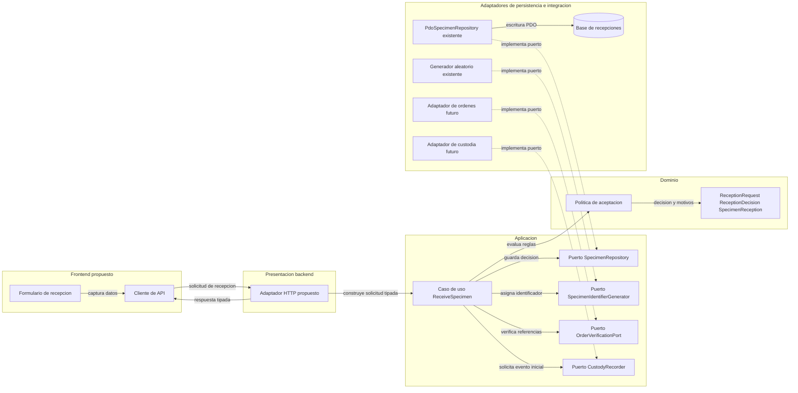

# Semana 7 — Componentes y refactor de recepción de muestras

| | |
|---|---|
| **Curso** | Análisis de Sistemas II — Proyecto Final 2026 |
| **Proyecto** | Sistema Hospitalario Integrado (HIS) |
| **Módulo** | Recepción de muestras y códigos identificadores |
| **Tema** | Diseño de componentes backend/frontend y refactorización |
| **Estudiante** | Lopez Perez, Mercedes Azucena |
| **Fecha** | Octubre 2026 |

## 1. Objetivo y alcance

Separar las responsabilidades de interfaz, aplicación, dominio y persistencia para el flujo de recepción, identificación inequívoca y rechazo controlado de una muestra. El diseño propone contratos claros entre el futuro frontend y el backend, y entre el caso de uso y los límites de órdenes y custodia, sin convertir esta evidencia en una afirmación de que exista una interfaz web, API o integración productiva.

El refactor se presenta **conceptualmente**, como pide la consigna. Se toma como punto concreto el método `ReceiveSpecimenCommand::run()` del prototipo de Semana 3: actualmente interpreta argumentos de CLI, construye la solicitud, invoca el caso de uso y escribe la respuesta en consola. No se modifica ese prototipo ni se amplía el alcance funcional.

### Evidencia de implementación actual

- El ejemplo de Semana 3 está en `docs/modulos/recepcion-muestras/semana-03/ejemplo/`.
- La presentación actual es una CLI; no se encontró un controlador ni una ruta de recepción en la aplicación Laravel principal. `app/Http/Controllers/Controller.php` es una clase base abstracta sin lógica del módulo.
- El caso de uso `ReceiveSpecimen` usa `SpecimenAcceptancePolicy`, `SpecimenRepository` y `SpecimenIdentifierGenerator`. El adaptador PDO persiste la recepción.
- El modelo actual guarda referencias de orden, paciente y examen, pero no consulta el EMR, aplica autorización/tenant ni registra una línea de eventos de custodia.
- Por tanto, el frontend web, el adaptador HTTP, la verificación autorizada de órdenes y el registro de custodia indicados abajo son **interfaces propuestas**, no comportamiento implementado.

## 2. Componentes propuestos

| Componente | Capa | Responsabilidad | Estado |
|---|---|---|---|
| `ReceptionForm` | Frontend | Capturar orden, ítem, tipo, observaciones de condición y decisión solicitada; mostrar errores de campo. | Propuesto |
| `ReceptionApiClient` | Frontend | Enviar una operación y traducir respuestas de backend a estados visibles sin duplicar decisiones de negocio. | Propuesto |
| `ReceptionController` | Presentación/backend | Validar la forma del mensaje, obtener el contexto autorizado y convertir el DTO de entrada en una solicitud de aplicación. | Propuesto |
| `ReceiveSpecimen` | Aplicación | Coordinar validación de orden, decisión, asignación de ID y persistencia usando contratos. | Existe en el prototipo; la verificación externa y la custodia aún no |
| `SpecimenAcceptancePolicy` | Dominio | Aplicar reglas de aceptación/rechazo de la muestra y devolver motivos explícitos. | Existe en el prototipo |
| `ReceptionRequest` / `SpecimenReception` | Dominio | Representar la solicitud y el resultado de recepción, separado de HTTP, CLI y SQL. | Existen en el prototipo |
| `OrderVerificationPort` | Puerto de integración | Solicitar una coincidencia autorizada de orden, paciente e ítem sin importar el protocolo del sistema de órdenes. | Propuesto |
| `SpecimenRepository` | Puerto de persistencia | Guardar una recepción y comunicar fallo sin simular éxito. | Existe en el prototipo |
| `PdoSpecimenRepository` | Persistencia | Implementar el guardado PDO con parámetros preparados. | Existe en el prototipo |
| `CustodyRecorder` | Puerto de integración | Registrar un evento de recepción vinculado al `specimenId` sin modificar eventos anteriores. | Propuesto |

El generador de identificadores existente se conserva detrás de `SpecimenIdentifierGenerator`. No se propone que el identificador de muestra sustituya a la orden, al paciente, al ítem de examen ni a un código externo.

## 3. Diagrama de componentes

Las líneas sólidas representan dependencias del flujo propuesto; las discontinuas representan la implementación de un puerto por un adaptador. Los componentes de órdenes y custodia se muestran como límites externos: su conexión debe acordarse con los módulos responsables.

<!-- mermaid-checked: no \n, no em-dash/en-dash, no {} in labels, subgraphs are id["label"], arrows are -->|"label"|, all subgraphs closed by end, ids unique -->


### Límites y orden seguro de operaciones

1. El adaptador HTTP autentica y autoriza en el ámbito del hospital antes de revelar datos de una orden. La existencia de una referencia no demuestra autorización.
2. El caso de uso solicita al puerto de órdenes confirmar la correspondencia del ítem; `MATCH`, `NO_MATCH` y `UNAVAILABLE` son resultados distintos. `UNAVAILABLE` no se transforma en rechazo clínico.
3. El dominio aplica criterios aprobados y devuelve una decisión y sus motivos. El caso de uso genera el `specimenId` y guarda el resultado.
4. El registro de recepción y el evento inicial de custodia deben confirmarse de manera atómica o mediante una estrategia de consistencia explícita. El prototipo actual solo persiste `SpecimenReception`; no ofrece esta garantía entre sistemas.
5. Solo después de confirmar el guardado se devuelve éxito. Un timeout de resultado incierto requiere consultar la misma operación antes de reintentar; no se debe crear otra muestra.

No se definen umbrales clínicos, catálogo de rechazos, formato de etiqueta, credenciales ni campos adicionales de expediente. Estos quedan sujetos al procedimiento del laboratorio y a los contratos institucionales.

## 4. Contratos de entrada y salida

Los contratos siguientes son una propuesta de diseño para una futura interfaz; no describen un endpoint implementado.

### Frontend → adaptador de recepción

| Campo de entrada | Tipo | Regla |
|---|---|---|
| `orderReference` | string | Obligatorio; referencia, no prueba de que la orden exista o sea accesible. |
| `patientReference` | string | Obligatorio; el backend verifica la correspondencia dentro del ámbito autorizado. |
| `examCode` | string | Obligatorio; corresponde al ítem seleccionado en una orden verificada. |
| `type` | enum | `blood`, `urine` o `swab`, de acuerdo con el tipo del dominio existente. |
| `labelPresent` | boolean | Observación verificada del recipiente. |
| `containerIntact` | boolean | Observación verificada conforme al procedimiento vigente. |
| `sealIntact` | boolean | Observación del sello; su aplicación depende de las reglas configuradas para el tipo. |
| `rejectionReason` | string o null | Motivo explícito de rechazo; no usarlo para representar errores técnicos. |
| `operationId` | string | Clave idempotente propuesta para evitar recepciones duplicadas ante reintentos. |

El contexto de usuario, permisos y hospital se deriva de la sesión/autorización del servidor; no se confía en un `tenantId` libre enviado por el navegador.

### Resultado del caso de uso → frontend

| Campo de salida | Tipo | Significado |
|---|---|---|
| `specimenId` | string | Identificador interno ya persistido. |
| `status` | enum | `accepted` o `rejected`; ambos son decisiones de recepción registradas. |
| `orderReference` | string | Referencia vinculada que puede mostrarse según permisos. |
| `reasons` | lista de string | Motivos del rechazo; vacía cuando se acepta. |
| `receivedAt` | fecha/hora ISO 8601 | Momento de registro con zona horaria definida por la institución. |
| `custodyEventId` | string | Identificador obligatorio del evento inicial una vez habilitada la integración de custodia. No existe en la respuesta del prototipo CLI actual. |

Una respuesta aceptada o rechazada solo se entrega como resultado confirmado después de guardar. La ausencia de respuesta no significa que el guardado haya fallado; el cliente consulta por `operationId` antes de repetir. Los errores de entrada se asocian al campo, `NO_MATCH` bloquea la decisión y `UNAVAILABLE` permite reintentar sin crear una recepción. Los errores técnicos no incluyen mensajes SQL ni datos clínicos.

### Contrato entre aplicación y puertos

| Puerto | Entrada | Salida/efecto | Fallo observable |
|---|---|---|---|
| `OrderVerificationPort` | Referencias de orden, paciente e ítem y ámbito autorizado | `MATCH`, `NO_MATCH` o `UNAVAILABLE` | No continuar con una decisión cuando el resultado es `UNAVAILABLE`. |
| `SpecimenRepository` | `SpecimenReception` | Persistencia confirmada | Propagar fallo; no producir respuesta con forma de éxito. |
| `SpecimenIdentifierGenerator` | Sin datos clínicos | ID interno no vacío, no reutilizado | Fallo técnico explícito; no persistir sin ID válido. |
| `CustodyRecorder` | ID de muestra, tipo de evento, actor, ubicación y momento | Evento de custodia persistido | No afirmar cadena de custodia completa si el registro no se confirma. |

La unicidad en memoria no reemplaza una restricción de unicidad persistente. La política de reintentos y el almacenamiento de `operationId` requieren un acuerdo de implementación.

## 5. Refactor conceptual antes/después

### Antes: responsabilidades de presentación concentradas

En el prototipo de Semana 3, `ReceiveSpecimenCommand::run()` recorre argumentos requeridos, interpreta valores (`yes`/`no`), crea `ReceptionRequest`, ejecuta el caso de uso y compone/escribe la salida en consola. Este es un acoplamiento concreto entre el adaptador de entrada, la invocación de aplicación y la presentación CLI:

```php
foreach ($required as $name) {
    if (!isset($options[$name]) || $options[$name] === false) {
        throw new InvalidArgumentException("Falta el argumento --{$name}.");
    }
}

$request = new ReceptionRequest(
    orderReference: (string) $options['order'],
    patientReference: (string) $options['patient'],
    examCode: (string) $options['exam'],
    type: $type,
    labelPresent: $this->parseBoolean((string) $options['label'], 'label'),
    containerIntact: $this->parseBoolean((string) $options['container'], 'container'),
    sealIntact: $this->parseBoolean((string) $options['seal'], 'seal'),
);

$reception = $this->useCase->execute($request);
echo sprintf(
    "%s: identificador=%s orden=%s estado=%s\n",
    $reception->status === ReceptionStatus::ACCEPTED ? 'ACEPTADA' : 'RECHAZADA',
    $reception->identifier,
    $reception->orderReference,
    $reception->status->value,
);

foreach ($reception->reasons as $reason) {
    echo "Motivo: {$reason}\n";
}

return 0;
```

**Efecto:** el adaptador CLI conoce los nombres de opciones y detalles de representación. Reutilizarlo desde una UI web obligaría a introducir lógica HTTP/HTML/JSON en un componente que escribe directamente en `stdout`.

### Después: adaptadores delgados y salida explícita

Se propone que cada interfaz traduzca su propio formato al comando de aplicación y que un presenter de CLI se encargue solo de la salida de consola. La interfaz web tendría su propio mapper y presenter JSON; ambos invocarían el mismo caso de uso, sin compartir detalles de presentación.

```php
$request = $this->requestMapper->fromCliOptions($options);
$reception = $this->useCase->execute($request);

return $this->presenter->render($reception);
```

Responsabilidades resultantes:

- `ReceiveSpecimenCommand`: coordina el adaptador CLI.
- `CliReceptionRequestMapper`: valida/convierte argumentos CLI al tipo esperado por la aplicación.
- `CliReceptionPresenter`: representa el resultado y el código de salida; no decide aceptación.
- `ReceptionController` + mapper/presenter HTTP: traducen HTTP a los mismos tipos de aplicación y regresan DTOs; no escriben en `stdout`.
- `ReceiveSpecimen`, `SpecimenAcceptancePolicy` y puertos: conservan el flujo de aplicación, las reglas y las dependencias reemplazables.

El refactor no cambia el resultado de aceptación/rechazo, los motivos, el identificador ni la persistencia del prototipo. La verificación de órdenes y la custodia aparecen como puertos propuestos, separados del refactor de presentación y pendientes de integración.

## 6. Trazabilidad de la consigna y validación

| Necesidad | Evidencia |
|---|---|
| Componentes frontend propios | `ReceptionForm` y `ReceptionApiClient` en la tabla y diagrama. |
| Componentes backend propios | Adaptador de presentación, caso de uso, dominio, repositorio e integraciones por puertos. |
| Orden de laboratorio y custodia | `OrderVerificationPort` y `CustodyRecorder`; límites identificados como propuestos. |
| Identificador y rechazo controlado | Contratos de `SpecimenIdentifierGenerator`, `SpecimenReception` y política de dominio existente. |
| Contratos de entrada/salida | Tablas frontend/backend y contratos de puertos. |
| Comparación antes/después concreta | Refactor conceptual de `ReceiveSpecimenCommand::run()`. |
| No ampliar el módulo ni inventar comportamiento productivo | Secciones de alcance y límites distinguen implementado de propuesto. |

Validación local del prototipo existente:

```text
php tests/run.php
Resultado: OK: 13 aserciones.
```

El prototipo tiene pruebas CLI deterministas. El diseño web, la consulta de órdenes y la custodia no son código ejecutable y por eso no se reportan como probados.

## 7. Riesgos y decisiones pendientes

- Acordar identidad, ámbito del hospital y permisos antes de exponer el adaptador HTTP.
- Acordar con el módulo de órdenes qué prueba la correspondencia y qué datos mínimos devuelve.
- Definir persistencia atómica o reconciliación entre la recepción y el evento inicial de custodia.
- Acordar idempotencia durable, estrategia ante timeout y unicidad del `specimenId`.
- Validar las reglas de recipiente, razones de rechazo, etiqueta, privacidad y accesibilidad con personal autorizado.
- Mantener errores de verificación y persistencia distintos de un rechazo clínico.

## 8. Referencias de implementación inspeccionadas

- [Ejemplo PHP de Semana 3](../semana-03/ejemplo/README.md)
- [Caso de uso `ReceiveSpecimen`](../semana-03/ejemplo/src/Application/ReceiveSpecimen.php)
- [Puertos de aplicación](../semana-03/ejemplo/src/Application/ReceptionPorts.php)
- [Política y modelo de dominio](../semana-03/ejemplo/src/Domain/ReceptionDecision.php)
- [Adaptador PDO](../semana-03/ejemplo/src/Persistence/PdoSpecimenRepository.php)
- [Comando CLI actual](../semana-03/ejemplo/src/Presentation/Cli/ReceiveSpecimenCommand.php)
