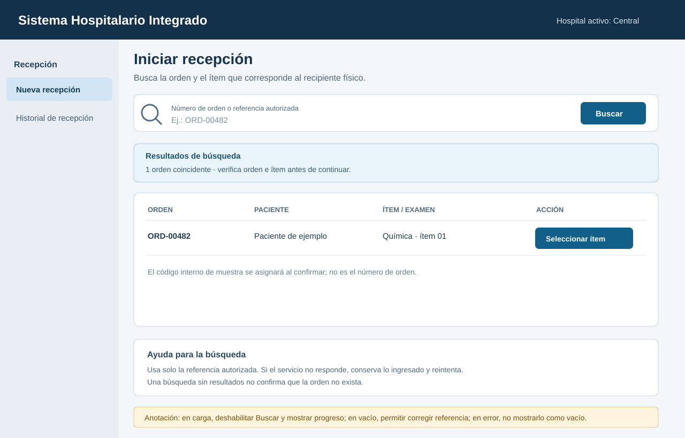
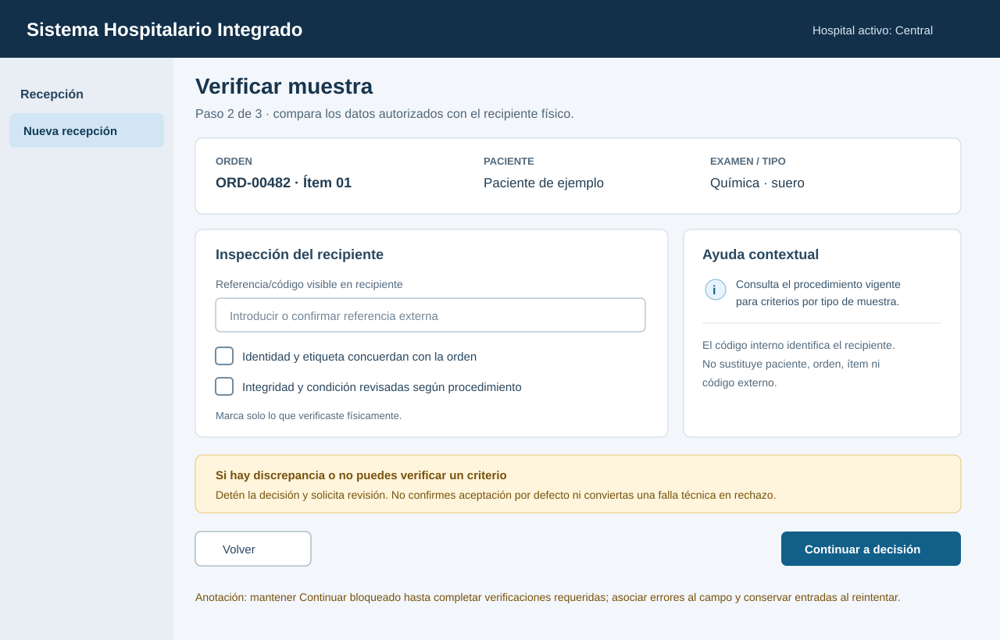
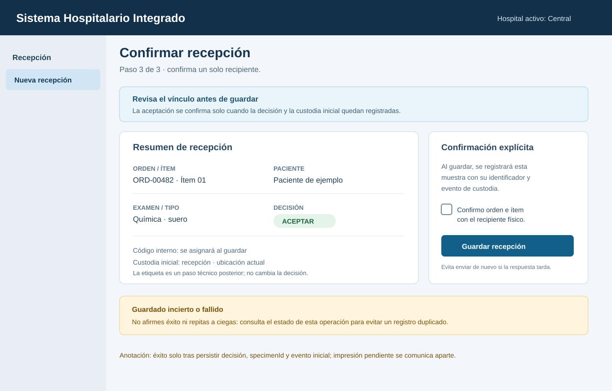
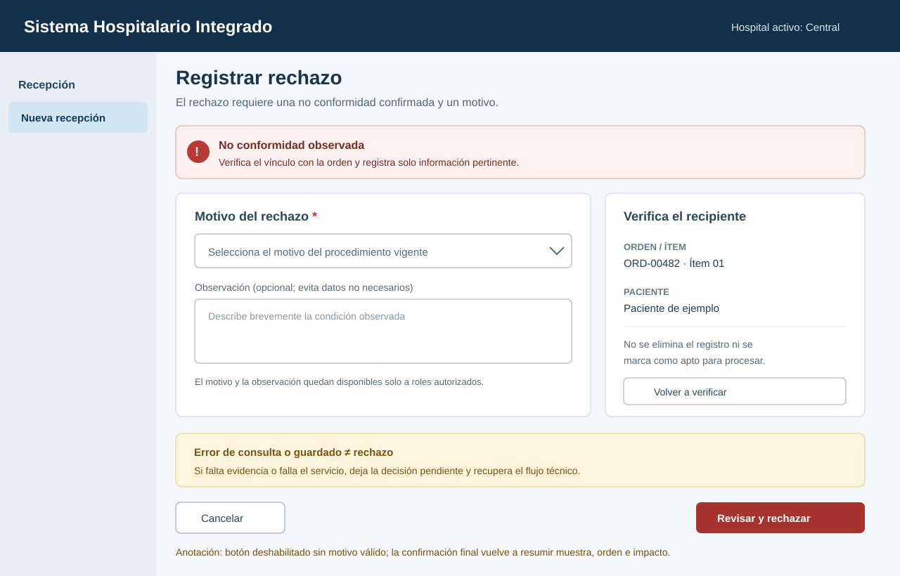
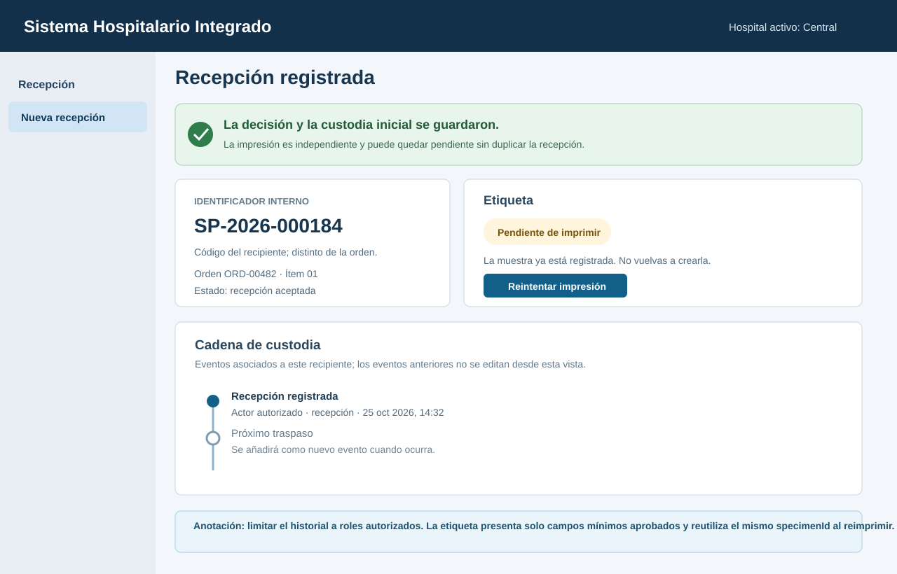
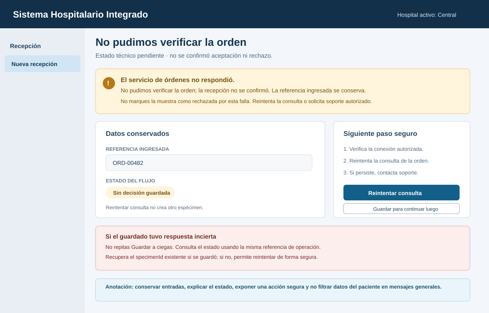

# Semana 8 — Diseño UX de recepción de muestras y códigos identificadores

| | |
|---|---|
| **Curso** | Análisis de Sistemas II — Proyecto Final 2026 |
| **Proyecto** | Sistema Hospitalario Integrado (HIS) |
| **Módulo** | Recepción de muestras y códigos identificadores |
| **Tema** | Diseño de experiencia de usuario |
| **Flujo** | «Recepción, identificación inequívoca y rechazo controlado de muestra» |
| **Estudiante** | Lopez Perez, Mercedes Azucena |
| **Fecha** | Octubre 2026 |

## 1. Objetivo y alcance

Diseñar la UX para el personal de recepción autorizado que registra una entrega, vincula cada recipiente con una orden e ítem de examen, comprueba identidad e integridad y confirma aceptación o rechazo con trazabilidad. La propuesta incluye entrada, decisión, confirmación, estados de carga/vacío/éxito, errores recuperables, ayuda contextual, código único, etiqueta, orden y cadena de custodia.

Se presentan **seis wireframes anotados**. Son una propuesta conceptual, no pantallas, API, lector, impresora ni integración con órdenes ya implementados. Los datos son sintéticos. Una referencia escrita por el operador no prueba por sí sola la existencia ni la correspondencia de la orden. El prototipo de Semana 3 recibe referencias como entrada; la verificación externa se describe como una integración futura.

Los criterios concretos de aceptación/rechazo dependen de la orden, el tipo de muestra y el procedimiento vigente del laboratorio. Este diseño no inventa requisitos por examen, valores clínicos, códigos de rechazo ni algoritmos de identificadores. Si la evidencia no alcanza para aceptar o rechazar con certeza, la recepción queda pendiente de resolución técnica/operativa; una falla técnica no se convierte en rechazo clínico.

## 2. Roles y permisos UX

| Rol | Permisos contemplados en la propuesta | Límites |
|---|---|---|
| Técnico/a de recepción autorizado/a | Iniciar recepción, consultar la referencia permitida, registrar condiciones, confirmar aceptación/rechazo y consultar la custodia necesaria para la tarea. | El acceso se limita al hospital y a la función asignada. No crea órdenes ni cambia datos del paciente. |
| Personal de laboratorio autorizado para seguimiento | Consultar el rechazo y su motivo/contexto mínimo para dar seguimiento según procedimiento. | No puede cambiar un rechazo a aceptación ni decidir en nombre de recepción. |
| Jefatura / soporte con permiso explícito | Resolver escalaciones y revisar eventos conforme a su función. | No se otorga acceso general por el solo hecho de soporte. |

La aplicación y el servidor verifican la autorización por acción y ámbito del hospital en cada lectura y escritura. La interfaz nunca trata un identificador difícil de adivinar como sustituto de autorización. Los roles, el ámbito y los permisos definitivos deben acordarse antes de producción.

## 3. Principios UX y flujo

1. **Una muestra física por recepción:** revisar un recipiente a la vez; no confirmar en bloque una entrega mixta.
2. **Vínculo explícito:** orden, ítem, paciente, examen y tipo de muestra deben ser congruentes. El nombre por sí solo no identifica una orden.
3. **Código interno distinto:** `specimenId` identifica al recipiente; no sustituye ID de paciente, orden, ítem, examen ni código externo.
4. **Decisión consciente:** mostrar primero la inspección y después una confirmación que resume el vínculo. Rechazar exige un motivo registrado.
5. **Guardar antes de confirmar:** solo se presenta aceptación/rechazo exitoso después de persistir la decisión y el primer evento de custodia requeridos. Una etiqueta fallida no genera una aceptación de papel ni un rechazo clínico.
6. **Custodia append-only:** cada traspaso conserva actor, ubicación y momento; no se sobrescriben eventos previos.
7. **Privacidad:** datos mínimos en lista, etiquetas y mensajes; motivo e historial detallado solo para roles autorizados.
8. **Accesibilidad:** foco visible, teclado, texto junto a iconos/estados, instrucciones persistentes y mensajes de error asociados a su campo. No usar color como única señal.

```text
Rol y hospital verificados
  → 01 Iniciar entrega: orden + ítem
  → 02 Verificar vínculo, recipiente, etiqueta/estado y datos requeridos
      ├─ No conformidad confirmada → 04 Motivo + confirmación de rechazo
      ├─ Cumple criterios vigentes → 03 Confirmar recepción
      └─ Orden/criterio/servicio incierto → 06 Pendiente / recuperar
  → Guardar decisión + specimenId + evento inicial de custodia
  → 05 Resultado persistido + código/etiqueta + línea de tiempo de custodia
```

Las condiciones de custodia de la entrega inicial (recolección, traslado, recepción) pueden ser consultadas o agregadas según el punto del proceso. La pantalla no permite reescribir eventos pasados.

## 4. Wireframes anotados

### WF-01 — Inicio: seleccionar orden e ítem

La persona receptora busca la referencia de orden y el ítem a recibir. La vista debe permitir distinguir varios exámenes/recipientes bajo una orden sin confundir el identificador de muestra con las demás referencias.



Estados contemplados:

- **Carga:** mostrar progreso al buscar, deshabilitar envío duplicado y mantener la referencia ingresada.
- **Vacío:** indicar «No encontramos órdenes disponibles para esos datos» y permitir corregir búsqueda o contactar el canal autorizado; no inferir que no existe si el servicio falló.
- **Error recuperable:** separar indisponibilidad de resultado vacío; reintentar sin perder entrada y no crear una recepción provisional.
- **Éxito de búsqueda:** mostrar solo el contexto necesario para confirmar la orden/ítem.

### WF-02 — Verificar identidad y condición del recipiente

Resumen de orden, ítem, paciente con datos mínimos, examen/tipo de muestra y recipiente. El operador confirma lo observado físicamente y los criterios del procedimiento autorizado. Una discrepancia entre recipiente y orden detiene la aceptación.



El código externo, cuando exista, se conserva como referencia distinta del código interno. La pantalla no supone que hay lector de códigos ni que una lectura exitosa valida por sí sola paciente/orden.

### WF-03 — Confirmación de aceptación

La confirmación resume orden, ítem, paciente y recipiente para reducir asociación equivocada. La acción confirma una muestra individual. El identificador interno único se genera según el mecanismo aprobado y se persiste junto con la decisión y el evento inicial de custodia antes del mensaje de éxito.



La etiqueta debe priorizar el `specimenId` y usar únicamente los datos mínimos aprobados. En el wireframe se distingue el estado de registro guardado del estado de impresión. La integración de impresión y reimpresión aún no está acreditada por el prototipo; un fallo de impresión se informa como pendiente técnico, no como rechazo.

### WF-04 — Rechazo controlado con motivo

La persona selecciona/ingresa el motivo definido por el procedimiento, agrega observación cuando corresponda y confirma el rechazo. No se cierra el rechazo si falta el motivo o no se identifica con suficiente certeza la muestra. La muestra rechazada conserva su registro y no se presenta como apta para procesamiento.



Los catálogos de razones y su obligatoriedad requieren aprobación del laboratorio. El wireframe usa categorías ilustrativas y no configura códigos productivos. Motivo, observaciones e identificadores completos no aparecen en notificaciones generales.

### WF-05 — Recepción confirmada y cadena de custodia

Después de persistir, se muestra el identificador, resultado, relación con la orden y evento de recepción. La línea de tiempo añade eventos de custodia sin sustituir los anteriores: actor, ubicación y fecha/hora con zona horaria, conforme a los requisitos acordados.



En el caso rechazado se muestra el resultado de rechazo al rol que lo registró y se direcciona al seguimiento autorizado. Etiquetas e historial detallado tienen controles de acceso. Las capturas no deben utilizar datos reales.

### WF-06 — Estados vacíos, fallos y recuperación

Presenta variantes de orden no encontrada, discrepancia, conflicto/doble envío, indisponibilidad de órdenes/persistencia e impresión fallida. Cada variante indica si hay una decisión persistida y qué acción segura sigue.



| Situación | Respuesta UX |
|---|---|
| No hay resultado de búsqueda | Corregir referencia/filtros y volver a consultar. No crear un rechazo ni afirmar que el servicio consultado funciona cuando falló. |
| Orden/ítem/paciente no coincide | Detener aceptación/rechazo automático; explicar el vínculo que requiere revisión y escalar por el canal autorizado. |
| No conformidad confirmada | Seguir WF-04, pedir motivo y conservar evento/registro. No borrar la evidencia. |
| Timeout o servicio de órdenes no disponible | «No pudimos verificar la orden. No se confirmó la recepción». Reintentar consulta; preservar la entrada, sin crear decisión provisional. |
| Guardado con resultado incierto | «No confirmamos el registro». Consultar el estado por referencia/idempotencia antes de repetir para evitar dos especímenes. |
| Persistencia fallida antes de confirmar | Mostrar error técnico recuperable; no indicar aceptación/rechazo ni emitir una etiqueta de éxito. |
| Etiqueta/impresión no disponible después de guardar | Mantener visible el estado real del registro y señalar impresión pendiente. Reimpresión requiere verificar autorización y el mismo `specimenId`; no registrar una segunda muestra. |
| Usuario sin permiso | Mensaje de acceso genérico; no revelar si una orden de otro hospital o ámbito existe. |

## 5. Reglas de validación e interacción

| Elemento | Regla UX/negocio | Resultado observable |
|---|---|---|
| Rol y hospital | Verificar permiso antes de buscar y al confirmar; el ámbito activo permanece visible. | Acceso denegado no muestra detalles del recurso externo al ámbito. |
| Orden/ítem | La referencia seleccionada debe vincularse al ítem/examen y paciente correspondientes mediante fuente autorizada antes de confirmar. | Falta de respuesta no equivale a coincidencia; bloquea decisión hasta recuperar. |
| Recipiente | Confirmar identidad física, etiqueta e integridad conforme a requisitos aplicables. | Una condición desconocida se marca pendiente, no se convierte por defecto en aceptada. |
| Identificador | `specimenId` es único, no vacío, no reutilizado y separado de ID de orden/paciente/código externo. | Mostrarlo después de guardado; repetición idempotente recupera el mismo resultado. |
| Aceptación | Confirmación explícita de un espécimen; decisión, código y primer evento de custodia persisten juntos según el diseño. | Solo entonces mostrar estado de recepción registrada. |
| Rechazo | Motivo requerido y legible; no conformidad confirmada; conservar registro y excluir del procesamiento según reglas acordadas. | Error junto al motivo si falta; rechazo no se confunde con falla técnica. |
| Custodia | Evento nuevo con recipiente, actor, ubicación y tiempo; preservar secuencia append-only y zona horaria definida. | Mostrar cronología ordenada; no editar eventos anteriores desde recepción. |
| Doble envío | Proteger reintentos con clave idempotente donde la interfaz/API lo implemente; verificar resultado ante timeout. | Misma operación no crea dos especímenes; conflicto se explica y no se oculta. |
| Etiqueta | Emitir únicamente una etiqueta correspondiente al espécimen persistido y con datos mínimos aprobados. | Impresión pendiente/fallida no invalida ni duplica en silencio el registro. Formato final queda pendiente de aprobación. |
| Errores y datos sensibles | No exponer datos clínicos en URL, alertas, logs visibles ni tickets generales. | Mensajes con referencia técnica y soporte autorizado; mantener datos no enviados al reintentar. |

## 6. Trazabilidad con las entregas del módulo

| Consigna / regla | Pantalla / evidencia UX |
|---|---|
| Inicio y roles autorizados | WF-01, WF-06; tabla de permisos |
| Orden e ítem de laboratorio | WF-01, WF-02 |
| Identificación inequívoca | WF-02, WF-03, reglas de identificador |
| Confirmación de recepción | WF-03, WF-05 |
| Rechazo controlado | WF-04 |
| Estados vacío, carga y éxito | WF-01, WF-05, WF-06 |
| Errores recuperables | WF-06 |
| Ayuda contextual | WF-02, procedimiento autorizado y vigente |
| Protección de datos vinculados | Todos los wireframes; reglas de privacidad |
| Cadena de custodia | WF-05 |
| No confundir error técnico con rechazo | WF-04, WF-06 |

La propuesta continúa el proceso UML de Semana 1, el contrato de aceptación con respuesta explícita «no aplica» de Semana 2, el micro-HIS CLI por capas de Semana 3 y la distinción entre prototipo y extensiones propuestas documentada en Semana 6. La consulta real al sistema de órdenes, impresión, catálogo de razones, permisos definitivos e historial completo de custodia deben validarse e implementarse por separado.

## 7. Límites y validación posterior

Este entregable no demuestra usabilidad ni accesibilidad con personal real. Antes de implementar, revisar los wireframes con técnicos de recepción, personal de seguimiento, jefatura y responsables de privacidad/accesibilidad. Acordar orden de custodia, campos mínimos de etiqueta, criterios por examen, catálogo de motivos, tratamiento de entrega parcial, permisos, reimpresión e idempotencia. Después, probar con escenarios aceptados, rechazados, ambiguos, duplicados y fallas técnicas sin usar datos clínicos reales.
