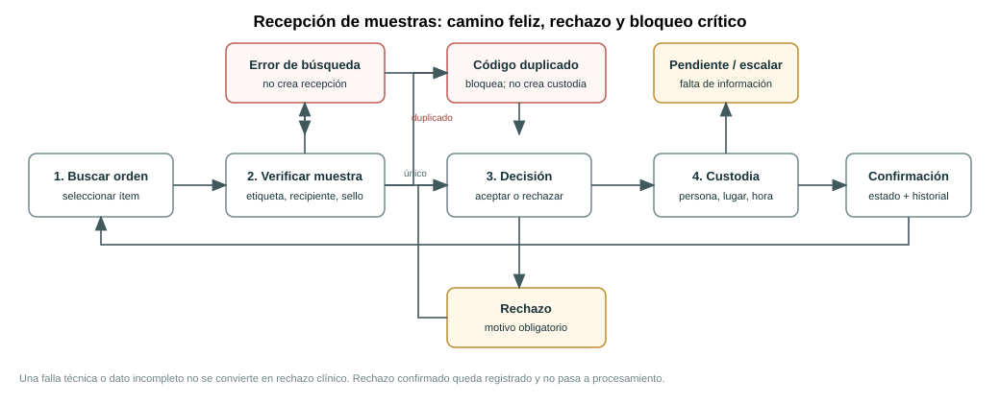

# Semana 11 - Prototipo navegable de recepción de muestras y códigos identificadores

Estudiante: LOPEZ PEREZ, MERCEDES AZUCENA 
Flujo: recepción de muestras y códigos identificadores 
Fecha: 27 de octubre de 2026

## 1. Entregable y alcance

Prototipo web estático, navegable en desktop y móvil, que cubre:

- Camino feliz de una recepción aceptada y su primer evento de custodia.
- Rechazo de una no conformidad confirmada con motivo obligatorio.
- Error crítico por código externo duplicado, bloqueando el alta y sin crear otro evento de custodia.
- Estados de orden, muestra, recepción y etiqueta distinguibles.
- Navegación con teclado, etiquetas accesibles, foco visible, región de error y estados que no dependen solo del color.

**No es una integración real con HIS:** utiliza datos de demostración en memoria del navegador; no se envían ni guardan datos clínicos en servidor.

## 2. Cómo ejecutar

Abrir [index.html](../../../../public/prototipos/recepcion-semana-11/index.html) directamente en un navegador moderno o servir la raíz del repositorio con un servidor estático y abrir:

`/public/prototipos/recepcion-semana-11/`

No requiere dependencias ni build.

Escenarios reproducibles:

- `?demo=happy`: pantalla final de recepción aceptada.
- `?demo=rejection`: pantalla final de recepción rechazada.
- `?demo=critical`: bloqueo de código duplicado.

Flujo manual: buscar `ORD-2026-0418` → seleccionar ítem → revisar verificaciones y código → confirmar decisión → registrar ubicación de custodia → guardar.

## 3. Mapa de navegación

Fuente: [semana-11-mapa-navegacion.puml](diagramas/semana-11-mapa-navegacion.puml).

| Pantalla | Acción | Siguiente estado |
|---|---|---|
| Buscar orden | Buscar y elegir ítem de laboratorio | Verificación física |
| Verificar muestra | Confirmar etiqueta, recipiente, integridad, sello y código | Decisión, o bloqueo crítico |
| Decisión | Aceptar conforme o rechazar con motivo confirmado | Registro de custodia |
| Custodia | Confirmar responsable, ubicación y hora | Confirmación |
| Confirmación | Mostrar decisión, identificador y primer evento | Iniciar otra recepción |
| Bloqueo crítico | Código ya asociado a otra recepción | Volver a verificar o escalar; nunca guardar duplicado |

## 4. Actores, permisos y datos

- **Técnica de recepción autorizada:** busca orden, verifica el recipiente, registra decisión y custodia.
- **Jefatura de recepción:** recibe escalaciones de duplicidad o discrepancia.
- **Personal de laboratorio:** consulta el contexto y los rechazos; el prototipo no permite convertir un rechazo en aceptación.
- El actor/hospital mostrado es ilustrativo; en producción debe venir de una sesión validada y autorización por acción.
- Se muestran iniciales y dato de paciente minimizado. Los registros son ficticios.

## 5. Reglas de negocio demostradas

1. La recepción requiere una orden/ítem y un identificador externo no reutilizado.
2. No se informa éxito antes de completar la decisión y el primer evento de custodia en el flujo.
3. La aceptación exige verificaciones físicas confirmadas.
4. El rechazo requiere no conformidad confirmada y motivo del catálogo ilustrativo.
5. Si faltan verificaciones, la aceptación queda bloqueada; una causa confirmada requiere rechazo justificado. Una falla técnica o dato insuficiente debe escalarse, no convertirse en rechazo clínico.
6. El rechazo conserva código, motivo y custodia; la muestra no pasa a procesamiento.
7. El error crítico de duplicidad bloquea la recepción: no crea espécimen, no duplica el evento y no ofrece “forzar”.
8. La impresión es un estado aparte. Un fallo de impresión no cambia el resultado de recepción.
9. El evento de custodia se presenta como append-only: persona, ubicación y tiempo con zona horaria.

## 6. Matriz de escenarios y evidencias

| Escenario | Pasos / resultado esperado | Evidencia |
|---|---|---|
| Camino feliz | Orden → verificaciones completas → aceptar → guardar → muestra identificada + evento de custodia | [Desktop](evidencia/desktop-camino-feliz.png), [móvil](evidencia/movil-camino-feliz.png) |
| Rechazo confirmado | Marcar una no conformidad → elegir RECHAZAR → motivo obligatorio → guardar → custodia y no procesamiento | [Pantalla de rechazo](evidencia/desktop-rechazo.png) |
| Error crítico | Probar código duplicado → bloqueo → sin recepción ni cambio de custodia → escalar | [Desktop](evidencia/desktop-error-critico.png), [móvil](evidencia/movil-error-critico.png) |
| Recuperación | Orden no encontrada → revisar el código y reintentar sin crear registro | Interacción en la pantalla de búsqueda |

Las capturas son de un prototipo local con datos ficticios. El prototipo no acredita persistencia en producción.

Resultado de las pruebas de interacción y validación móvil: [verificación de Semana 11](evidencia/verificacion-semana-11.md).

## 7. Accesibilidad y responsive

- `lang="es"`, landmarks, títulos por pantalla y enlace de salto al contenido.
- Controles con etiquetas, radio/checkbox nativos, foco visible y navegación de teclado.
- Errores críticos usan `role="alert"`; mensajes de estado usan `role="status"`.
- Estado con texto además de color.
- Reglas responsive: escritorio con navegación lateral y columnas; móvil de una columna y navegación inferior. Las acciones de los pasos largos se mantienen accesibles y el bloqueo crítico evita que la barra de acciones tape la trazabilidad.
- Respeta `prefers-reduced-motion`.

## 8. Límites y decisiones pendientes

- No hay backend, integración con Órdenes/LIS, Auth, impresión ni almacenamiento durable.
- El catálogo de rechazo es ilustrativo y debe aprobarlo el laboratorio.
- Los criterios clínicos dependen del tipo de muestra y procedimiento vigente; el prototipo solo representa comprobaciones generales.
- La validación de unicidad está simulada con un escenario determinista, no contra una base real.
- En producción, idempotencia, autorización, persistencia de decisión y primer evento de custodia deben ser una operación segura del servidor.
