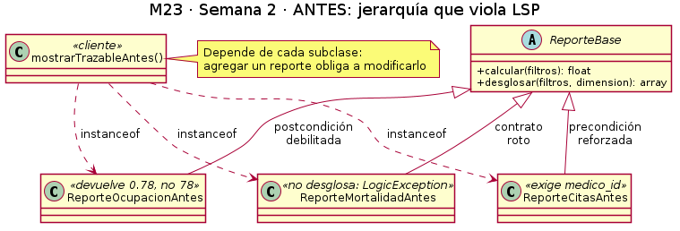
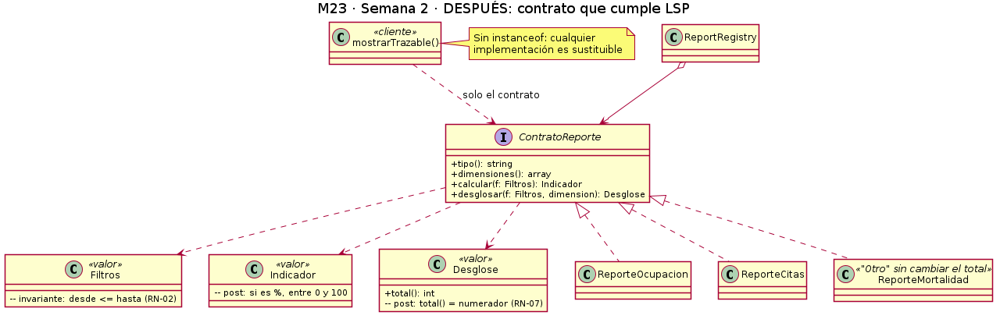

# Módulo 23 · Reportes y analytics básicos — Semana 2

**Tema:** proceso y modelo de diseño; principios SOLID.
**Principio aplicado:** LSP (*Liskov Substitution Principle*) al flujo «cálculo y visualización trazable de un indicador hospitalario».

## Requerimientos funcionales

| ID | Requerimiento | Caso de uso (semana 1) |
|---|---|---|
| RF-01 | El sistema debe calcular cada indicador para un período y filtros dados, con su comparación respecto al período anterior y su tendencia | CU-01, CU-03 |
| RF-02 | El sistema debe validar los filtros: período obligatorio, fecha inicial no mayor que la final y granularidad día, semana o mes | CU-02 |
| RF-03 | El sistema debe mostrar la ficha de trazabilidad de cada indicador: fórmula, período, filtros, fuente y fecha del cálculo | CU-04 |
| RF-04 | El sistema debe desglosar cada indicador por las dimensiones que declara (sala, médico, estado, servicio o día) | CU-07 |
| RF-05 | El sistema debe mostrar los registros de origen de cada parte del desglose, con datos mínimos | CU-08 |
| RF-06 | El sistema debe agrupar como "Otro" los grupos con menos de 3 casos | CU-06 |
| RF-07 | El sistema debe restringir cada indicador y cada nivel de detalle según el rol; el Médico solo ve sus citas | CU-05 |

## Requerimientos no funcionales

| ID | Tipo | Requerimiento |
|---|---|---|
| RNF-01 | Rendimiento | Un indicador de un mes debe responder en menos de 2 segundos |
| RNF-02 | Seguridad | Toda consulta exige sesión válida y permiso del rol; sin permiso responde 403 |
| RNF-03 | Privacidad | Los registros de origen identifican al paciente solo con su código, sin datos clínicos |
| RNF-04 | Solo lectura | El módulo no escribe en las tablas de otros módulos |
| RNF-05 | Mantenibilidad | Agregar un indicador nuevo debe requerir solo una clase nueva, sin modificar el cliente ni los otros reportes |
| RNF-06 | Verificabilidad | Cada reporte debe pasar las mismas pruebas de contrato |

## Criterios de aceptación

| ID | Dado | Cuando | Entonces |
|---|---|---|---|
| CA-01 (RF-01) | un período válido del 01/10 al 31/10 | el usuario consulta la ocupación | ve el valor en porcentaje entre 0 y 100, su comparación y su tendencia |
| CA-02 (RF-02) | un período del 31/10 al 01/10 | el usuario consulta cualquier indicador | el sistema responde 422 y no calcula nada |
| CA-03 (RF-03) | un indicador calculado | el usuario abre la ficha | ve fórmula, período, filtros, fuente y fecha del cálculo |
| CA-04 (RF-04) | la ocupación de 78 % (39 de 50 camas) | el usuario desglosa por sala | la suma de las salas es exactamente 39 camas |
| CA-05 (RF-05) | el desglose por sala | el usuario abre Medicina | ve cada cama con su estado y el código del paciente, sin diagnóstico |
| CA-06 (RF-06) | un servicio con 2 defunciones | el usuario desglosa la mortalidad | ese servicio aparece en "Otro" y el total no cambia |
| CA-07 (RF-07) | un Médico con sesión iniciada | consulta las citas de otro médico | el sistema responde 403 |
| CA-08 (RNF-05) | un reporte nuevo que implementa el contrato | se registra en el `ReportRegistry` | funciona sin modificar el cliente ni los demás reportes |

## Aplicación de LSP

LSP dice que **un objeto de un subtipo debe poder usarse en lugar del tipo base sin que el programa deje de funcionar**. Para eso, el subtipo no puede **exigir más** de lo que exige el tipo base (precondiciones) ni **entregar menos** de lo que promete (postcondiciones).

En este módulo, el cliente (el controlador que muestra un indicador trazable) confía en un contrato: *cualquier reporte se calcula, se desglosa, y la suma del desglose coincide con el valor* (RN-07).

### Antes: el diseño viola LSP



| Clase | Violación | Consecuencia |
|---|---|---|
| `ReporteOcupacionAntes` | **Debilita la postcondición:** devuelve 0.78 en lugar de 78 % | El cliente muestra un valor equivocado o tiene que multiplicar por 100 solo para este caso |
| `ReporteCitasAntes` | **Refuerza la precondición:** exige `medico_id`, que la clase base no pide | Falla si el cliente lo usa como cualquier otro reporte |
| `ReporteMortalidadAntes` | **Rompe el contrato:** lanza un error al desglosar | La trazabilidad deja de funcionar justo para un indicador sensible |

El cliente termina lleno de `instanceof` y parches: **depende de cada clase concreta**, y agregar un reporte obliga a modificarlo. En el después, las dependencias apuntan a la **abstracción**.

### Después: el diseño cumple LSP



| Decisión | Cómo resuelve la violación |
|---|---|
| Interfaz `ContratoReporte` con precondiciones y postcondiciones explícitas | Todos los reportes prometen lo mismo |
| `Indicador` declara su `unidad`; los porcentajes siempre van de 0 a 100 | Se elimina la diferencia de escala |
| `Filtros` es la única precondición común; la restricción del Médico la aplica la política de permisos, no el reporte | Ningún reporte exige filtros extra |
| Cada reporte **declara** sus `dimensiones()` en lugar de fallar | Mortalidad sí desglosa: agrupa los casos pequeños como "Otro" sin cambiar el total |
| `Desglose::total()` debe ser igual a `Indicador::numerador` | El cliente puede confiar en RN-07 con cualquier reporte |

## Responsabilidades y dependencias

| Elemento | Responsabilidad | Depende de |
|---|---|---|
| `ContratoReporte` | Definir qué promete todo reporte | `Filtros`, `Indicador`, `Desglose` |
| `ReporteOcupacion`, `ReporteCitas`, `ReporteMortalidad` | Calcular y desglosar **un** indicador | Solo del contrato y sus objetos de valor |
| `Filtros` | Validar el período (RN-02) | Nada |
| `Indicador` y `Desglose` | Llevar el resultado con su trazabilidad y su total | Nada |
| `ReportRegistry` | Entregar el reporte según su tipo | `ContratoReporte` (no las clases concretas) |
| Cliente (`mostrarTrazable`) | Mostrar el indicador trazable | Solo `ContratoReporte` |

## Evidencia verificable

El ejemplo está en `ejemplo-lsp/`, en PHP 8.2+ sin framework: `antes/Reportes.php` (jerarquía que viola LSP y cliente con parches), `despues/Contrato.php` y `despues/Reportes.php` (contrato, tres reportes, registro y cliente sin `instanceof`), y `verificar.php`, que aplica **las mismas pruebas de contrato** a cada reporte.

Para ejecutarlo:

```bash
cd docs/modulos/reportes-analytics-basicos/semana-02/ejemplo-lsp
php verificar.php
```

El resultado obtenido está en `evidencia/salida-verificar.txt`: el **antes** muestra los tres problemas, y el **después** pasa las **16 pruebas** y termina con *"todos los reportes son sustituibles (LSP cumplido)"*.

## Fuente

- MVP Cluster. *Diseño de software (parte 2): principios SOLID*. https://mvpcluster.com/diseno-de-software-2/
