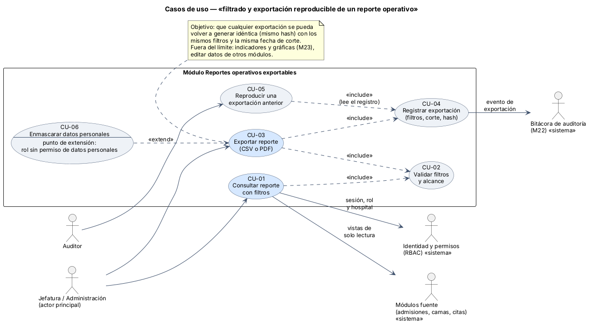
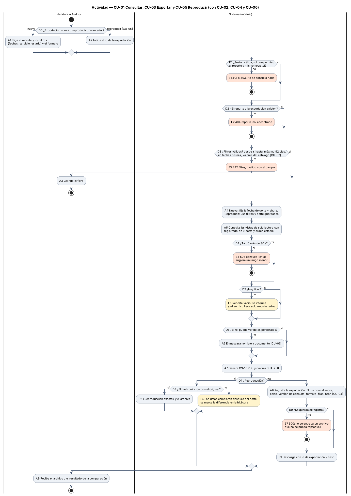
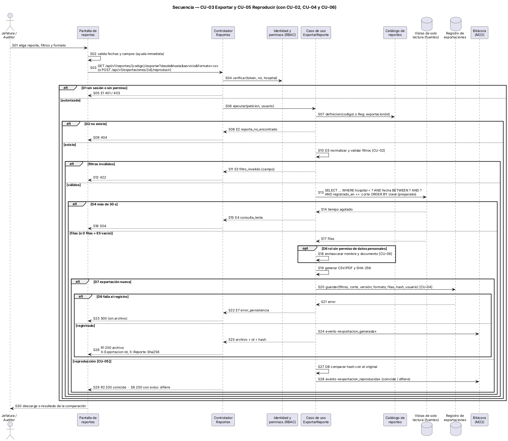

# Semana 1 — UML del filtrado y la exportación reproducible de reportes operativos

**Estudiante:** Joshua Eduardo García Reyes (`jgarciar73@miumg.edu.gt`, `jgarciar73-svg`) · **Módulo:** Reportes operativos exportables y filtros administrativos (módulo 27, reasignado dentro del grupo G1) · **Proceso:** «filtrado y exportación reproducible de un reporte operativo»

| Pedido | Dónde |
|---|---|
| Casos de uso: actores y objetivo | §2 y [diagrama](diagramas/semana-01-casos-de-uso.png) |
| Actividad con decisiones, excepciones y resultado | §3 y [diagrama](diagramas/semana-01-actividad.png) |
| Secuencia con participantes, mensajes, validaciones y respuesta | §4 y [diagrama](diagramas/semana-01-secuencia.png) |
| Trazabilidad entre los tres diagramas | §5 |
| Narrativa de alcance | §1 |

## 1. Narrativa de alcance

**Objetivo.** Que jefaturas y administración filtren un reporte operativo y lo exporten a CSV o PDF, de modo que cualquier exportación se pueda volver a generar **idéntica**: mismos filtros, misma fecha de corte y mismo hash SHA-256. Si dos personas presentan cifras distintas del mismo período, el registro de la exportación muestra qué filtros y qué corte usó cada una.

**Ejemplos de reportes:** censo diario de pacientes por servicio, egresos por período y tipo de alta, citas atendidas y ausentes por especialidad.

**Actores**

| Actor | Tipo | Qué busca |
|---|---|---|
| Jefatura / Administración | Principal (humano) | Filtrar, ver y exportar un reporte del hospital |
| Auditor | Secundario (humano) | Reproducir una exportación anterior y comprobar que no cambió |
| Identidad y permisos (RBAC) | Secundario (sistema) | Confirmar sesión, rol, hospital y permiso de datos personales |
| Módulos fuente (admisiones, camas, citas) | Secundario (sistema) | Entregar sus datos por vistas de solo lectura |
| Bitácora de auditoría (M22) | Secundario (sistema) | Guardar el evento de cada exportación y reproducción |

**Dentro del alcance:** catálogo de reportes operativos, filtros validados, vista previa paginada, exportación a CSV y PDF (la impresión usa el PDF), registro de cada exportación, reproducción y enmascaramiento de datos personales según el rol.

**Fuera del alcance:** indicadores y gráficas (módulo Reportes y analytics básicos, M23), el tablero de ocupación (M9), modificar datos de otros módulos, reportes programados por correo.

**Supuestos.** Los módulos fuente publican vistas de solo lectura con la fecha en que se registró cada fila (`registrado_en`). Si alguien corrige una fila después del corte, la reproducción lo detecta porque el hash cambia (E6).

**Reglas de negocio**

| ID | Regla |
|---|---|
| RN-01 | Solo ve un reporte quien tiene permiso para ese reporte, y solo con datos de su hospital |
| RN-02 | El rango de fechas es obligatorio: desde ≤ hasta, máximo 92 días y sin fechas futuras |
| RN-03 | Los filtros se normalizan (orden de campos, formato de fecha, mayúsculas) antes de consultar y de guardarlos |
| RN-04 | Cada exportación fija una fecha de corte y solo incluye filas con `registrado_en` ≤ corte, en un orden estable |
| RN-05 | No se entrega un archivo sin registrar antes su exportación: filtros, corte, versión de la consulta, formato, filas, hash y usuario |
| RN-06 | Sin permiso de datos personales, el nombre y el documento del paciente salen enmascarados |
| RN-07 | Reproducir usa los filtros y el corte guardados; si el hash difiere, se marca en la bitácora |
| RN-08 | Una consulta que pasa de 30 s se corta y se sugiere un rango menor |

## 2. Casos de uso



| CU | Nombre | Actor | Relación |
|---|---|---|---|
| CU-01 | Consultar reporte con filtros | Jefatura / Administración | Vista previa paginada; «include» CU-02 |
| CU-02 | Validar filtros y alcance | — | «include» de CU-01 y CU-03 |
| CU-03 | Exportar reporte (CSV o PDF) | Jefatura / Administración | Base del proceso; «include» CU-02 y CU-04 |
| CU-04 | Registrar exportación | — | «include» de CU-03; CU-05 lo lee |
| CU-05 | Reproducir una exportación anterior | Auditor | Usa el registro de CU-04 |
| CU-06 | Enmascarar datos personales | — | «extend» de CU-03 si el rol no tiene ese permiso |

**CU-03 en breve.** Precondición: sesión iniciada con permiso al reporte. Flujo principal: elige reporte, filtros y formato; el sistema valida (CU-02), fija el corte, consulta, enmascara si corresponde (CU-06), genera el archivo con su hash, lo registra (CU-04) y lo entrega. Alternativos: E1 a E7 de §3. Poscondición: archivo entregado con id y hash, y exportación registrada; o nada entregado.

## 3. Actividad



| Decisión | Si falla | Resultado |
|---|---|---|
| D0 nueva o reproducir | — | Elige el camino (A1 o A2) |
| D1 sesión, rol y hospital | E1 | 401 o 403 |
| D2 existe el reporte o la exportación | E2 | 404 `reporte_no_encontrado` |
| D3 filtros válidos | E3 | 422 `filtro_invalido` con el campo |
| D4 consulta de más de 30 s | E4 | 504 `consulta_lenta` |
| D5 hay filas | E5 | Aviso: archivo solo con encabezados (no es error) |
| D6 permiso de datos personales | — | Si no, A6 enmascara |
| D7 / D8 reproducción y hash | E6 | Aviso: los datos cambiaron después del corte |
| D9 registro guardado | E7 | 500 sin archivo |

**Resultados:** R1 descarga con id de exportación y hash; R2 «reproducción exacta».

## 4. Secuencia



Participantes: usuario, pantalla, controlador, RBAC, caso de uso `ExportarReporte`, catálogo de reportes, vistas de solo lectura, registro de exportaciones y bitácora. Las validaciones están en S02 (pantalla), S04 (permiso), S07 (existe), S10 (filtros) y S13–S14 (corte y tiempo). La respuesta es S26 (archivo) o S29 (reproducción), o la de cada error (S05, S09, S12, S16, S23). CU-01 sigue el mismo camino hasta S17 y muestra la vista previa en lugar de generar el archivo.

## 5. Trazabilidad entre los tres diagramas

| Caso de uso | Actividad | Secuencia | Regla |
|---|---|---|---|
| CU-01 Consultar | A1, D1, D2, A4, A5, D4, D5 · E1, E2, E4, E5 | S01–S09, S13–S17 | RN-01, RN-04, RN-08 |
| CU-02 Validar filtros | D3 · E3, A3 | S02, S10–S12 | RN-02, RN-03 |
| CU-03 Exportar | A7, D7, R1, A9 | S03, S19, S25–S26, S30 | RN-04, RN-05 |
| CU-04 Registrar exportación | A8, D9 · E7 | S20–S24 | RN-05 |
| CU-05 Reproducir | D0, A2, A4, D8, R2 · E6 | S03, S07, S27–S29 | RN-07 |
| CU-06 Enmascarar | D6, A6 | S18 | RN-06 |

Cada nodo de la actividad y cada mensaje de la secuencia lleva el mismo ID (D3, E3, CU-02…), así que un camino se puede seguir de un diagrama a otro.

## 6. Fuentes de los diagramas

Las fuentes editables están en [diagramas/](diagramas/) (`.puml`). Para regenerar las imágenes:

```bash
java -jar plantuml.jar -charset UTF-8 -tpng docs/modulos/reportes-operativos-exportables/semana-01/diagramas/*.puml
```

**Defensa en 1 minuto:** «El usuario filtra y exporta; el sistema valida permiso y filtros, fija una fecha de corte, consulta con orden estable y genera el archivo con su hash. Antes de entregarlo registra filtros, corte y hash. Así un auditor puede reproducir la exportación: si el hash coincide, las cifras son las mismas; si no, los datos se corrigieron después y queda marcado.»
