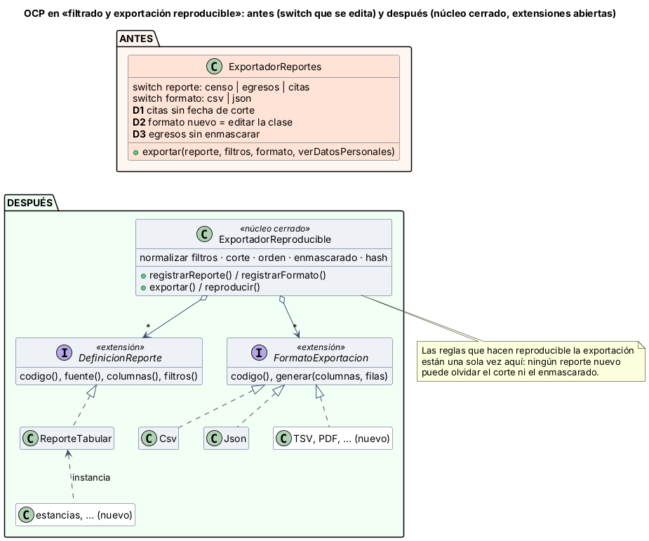

# Semana 2 — RF/RNF, criterios de aceptación y OCP en reportes exportables

**Estudiante:** Joshua Eduardo García Reyes (`jgarciar73@miumg.edu.gt`, `jgarciar73-svg`) · **Módulo:** Reportes operativos exportables y filtros administrativos (módulo 27, reasignado dentro del grupo G1) · **Flujo:** «filtrado y exportación reproducible de un reporte operativo» (CU-01 a CU-06 de la [semana 1](../semana-01/semana-01-uml-reportes-operativos.md))

**Contenido:** RF/RNF (§1), criterios de aceptación (§2), OCP antes/después con responsabilidades y dependencias (§3, [diagrama](diagramas/semana-02-ocp-antes-despues.png), [`ejemplo-ocp/`](ejemplo-ocp/)) y evidencia verificable (§4, [captura](evidencia/verificar-ocp.png)).

## 1. Requerimientos

| ID | Requerimiento funcional | CU |
|---|---|---|
| RF-01 | Ofrecer un catálogo de reportes operativos (censo por servicio, egresos, citas) con sus columnas y filtros | CU-01 |
| RF-02 | Exigir rango de fechas: desde ≤ hasta, máximo 92 días, sin fechas futuras | CU-02 |
| RF-03 | Aceptar solo los filtros opcionales que cada reporte declara, con valores de su lista | CU-02 |
| RF-04 | Mostrar una vista previa paginada | CU-01 |
| RF-05 | Exportar en los formatos registrados (CSV y JSON en el ejemplo; PDF en el Micro-HIS) | CU-03 |
| RF-06 | Fijar una fecha de corte y exportar solo filas registradas hasta ese momento, en orden estable | CU-03 |
| RF-07 | Registrar cada exportación con filtros normalizados, corte, formato y hash SHA-256 antes de entregarla | CU-04 |
| RF-08 | Reproducir una exportación desde su registro y decir si el hash coincide | CU-05 |
| RF-09 | Enmascarar las columnas marcadas como datos personales cuando el rol no tiene ese permiso | CU-06 |
| RF-10 | Rechazar con código estable: `filtro_invalido` (con el campo), `reporte_no_encontrado`, `formato_no_soportado` | CU-02, CU-03 |

| ID | Requerimiento no funcional |
|---|---|
| RNF-01 | Reproducibilidad: misma exportación + mismo corte → mismo hash, aunque después lleguen datos nuevos |
| RNF-02 | Confidencialidad: solo datos del hospital del usuario; datos personales enmascarados sin permiso |
| RNF-03 | Rendimiento: la consulta se corta a los 30 s |
| RNF-04 | Extensibilidad (OCP): un reporte o formato nuevo se agrega sin modificar el exportador |
| RNF-05 | Consistencia: las reglas comunes (filtros, corte, orden, enmascarado, hash) existen en un solo lugar |
| RNF-06 | Verificabilidad: las reglas y las extensiones se prueban con un script que sale con 0 o 1 |

## 2. Criterios de aceptación

| ID | Dado | Cuando | Entonces | Evidencia |
|---|---|---|---|---|
| CA-01 | Usuario sin permiso al reporte | exporta | 403 | Micro-HIS (S3) |
| CA-02 | Consulta de más de 30 s | se exporta | 504 `consulta_lenta` | Micro-HIS (S3) |
| CA-03 | Rango del 1 de junio al 26 de octubre | se exporta | `filtro_invalido` en «hasta» (más de 92 días) | `verificar.php` |
| CA-04 | desde 20 y hasta 10 de octubre | se exporta | `filtro_invalido` en «desde» | `verificar.php` |
| CA-05 | hasta en el futuro | se exporta | `filtro_invalido` en «hasta» | `verificar.php` |
| CA-06 | Egresos con filtro «servicio» | se exporta | `filtro_invalido` en «servicio» (egresos no lo admite) | `verificar.php` |
| CA-07 | Formato «xlsx» no registrado | se exporta | `formato_no_soportado` | `verificar.php` |
| CA-08 | Mismos filtros en otro orden y con mayúsculas | se exporta dos veces | el mismo hash | `verificar.php` |
| CA-09 | Rango sin datos | se exporta | archivo solo con encabezados, registrado | `verificar.php` |
| CA-10 | Una cita registrada después del corte | se reproduce | el hash coincide (DEF-01) | `verificar.php` |
| CA-11 | Rol sin permiso de datos personales | exporta egresos | nombre y documento salen `***` (DEF-02) | `verificar.php` |

## 3. OCP: antes y después



**OCP** pide que un módulo esté **abierto a extensión y cerrado a modificación**: para agregar un reporte o un formato no debería hacer falta editar el código que ya funciona.

**Antes** ([`antes.php`](ejemplo-ocp/antes.php)): `ExportadorReportes` tiene un `switch` por reporte y otro por formato (5 ramas). Cada reporte nuevo es otra rama donde hay que repetir filtros, corte y enmascarado, y eso ya produjo tres defectos:

| ID | Defecto | Consecuencia |
|---|---|---|
| D1 | La rama de citas olvidó la fecha de corte | La exportación de citas **no se puede reproducir**: una cita registrada después cambia el hash |
| D2 | Un formato nuevo (TSV o PDF) exige agregar otra rama | Cada cambio toca la clase que ya funcionaba y puede romper los reportes existentes |
| D3 | La rama de egresos no enmascara | Un rol sin permiso **ve el documento del paciente** |

**Después** ([`despues.php`](ejemplo-ocp/despues.php)):

| Clase | Responsabilidad | Depende de |
|---|---|---|
| `ExportadorReproducible` (núcleo cerrado) | Normalizar y validar filtros, fijar corte, ordenar, enmascarar, generar hash, registrar y reproducir | Solo las dos interfaces |
| `DefinicionReporte` (extensión) | Decir de qué fuente salen los datos, qué columnas son personales y qué filtros admite | Nada |
| `ReporteTabular` | Implementación configurable: un reporte nuevo es una instancia, no una clase ni una rama | `DefinicionReporte` |
| `FormatoExportacion` (extensión) | Escribir columnas y filas en un formato | Nada |
| `Csv`, `Json` | Formatos de ejemplo; TSV se agrega desde afuera en la prueba | `FormatoExportacion` |

**Por qué así:** lo que cambia seguido (qué reporte y en qué formato) quedó detrás de dos interfaces. Lo que no debe cambiar ni olvidarse (las reglas que hacen reproducible y segura la exportación) quedó una sola vez en el núcleo. Por eso un reporte nuevo ya no puede saltarse el corte (D1) ni el enmascarado (D3), y un formato nuevo no toca el núcleo (D2). Los formatos y reportes se registran al arrancar, sin `switch`.

## 4. Evidencia

```bash
cd docs/modulos/reportes-operativos-exportables/semana-02/ejemplo-ocp
php verificar.php     # sale con 0 si todo da lo esperado y con 1 si algo falla
```

| ID | Qué comprueba | Resultado |
|---|---|---|
| OCP-01 | Antes hay 5 ramas `case`; el código del núcleo después no nombra ningún reporte ni formato y no tiene `switch` ni `match` | PASA |
| OCP-02 | Un reporte nuevo («estancias») y un formato nuevo (TSV) se agregan desde `verificar.php` sin tocar `despues.php`: exportan y se reproducen | PASA |
| OCP-03 | Antes, TSV da `formato_no_soportado` y solo se arregla editando la clase | PASA |
| DEF-01 | Cita registrada después del corte: antes la reproducción da otro hash; después coincide | PASA |
| DEF-02 | Egresos sin permiso: antes sale el documento; después sale `***` | PASA |
| CA-03 a CA-09 | Criterios de aceptación de §2 | PASAN |

Si en el núcleo se quita la condición de corte, DEF-01 falla: la prueba sí detecta el error ([captura](evidencia/verificar-ocp.png)).

**Defensa en 1 minuto:** «Antes, cada reporte era una rama de un `switch`, y en dos ramas se olvidaron reglas: citas sin corte y egresos sin enmascarar. Ahora el núcleo tiene esas reglas una sola vez y no conoce reportes ni formatos: se registran desde afuera. Lo demuestro agregando un reporte y un formato nuevos sin tocar el núcleo, y con la prueba que muestra los dos defectos antes y su corrección después.»
