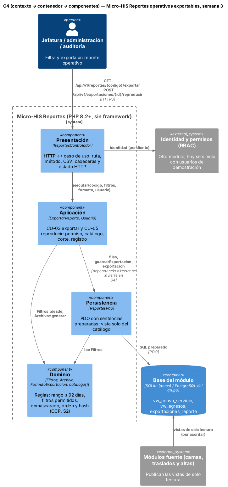

# Semana 3 — Micro-HIS Reportes operativos en capas y vista arquitectónica

**Estudiante:** Joshua Eduardo García Reyes (`jgarciar73-svg`) · **Módulo:** Reportes operativos exportables y filtros administrativos (módulo 27, reasignado dentro del grupo G1) · **Flujo:** «filtrado y exportación reproducible de un reporte operativo»

El Micro-HIS está en [`../micro-his-reportes/`](../micro-his-reportes/): PHP 8.2+ sin framework ni Composer, PDO con sentencias preparadas y pruebas propias. Ejecuta CU-03 (exportar) y CU-05 (reproducir) de la semana 1 con el diseño OCP de la semana 2.

## 1. Vista arquitectónica (C4) y dependencias



| Capa | Archivos | Responsabilidad | Puede depender de |
|---|---|---|---|
| Presentación | `src/Presentacion/ReportesControlador.php` | Ruta, método, usuario de demostración, CSV con `X-Exportacion-Id` y `X-Reporte-Sha256`; estados 200, 400, 401, 403, 404, 405, 422 y 500 | Aplicación, `ErrorDominio` |
| Aplicación | `src/Aplicacion/ExportarReporte.php` | Rol permitido, reporte del catálogo, formato, hora de corte, generar y registrar antes de entregar; reproducir y comparar hash | Dominio, Persistencia (*) |
| Dominio | `src/Dominio/Reportes.php` | Filtros normalizados (rango obligatorio, ≤ 92 días, sin futuro, solo filtros del catálogo), enmascarado `***`, orden estable, SHA-256 | Nada |
| Persistencia | `src/Persistencia/ReportesPdo.php`, `sql/esquema.sql` | `hospital_id = ? AND fecha BETWEEN ? AND ? AND registrado_en <= ?` + filtros, siempre preparado; guarda y lee `exportaciones_reporte` | Dominio, `ErrorPersistencia` |

(*) Hoy `ExportarReporte` recibe `ReportesPdo` directamente. Es la única flecha que apunta hacia afuera; en la semana 4 se invierte con una interfaz Repository y un adaptador en memoria. `bootstrap.php` carga las capas de adentro hacia afuera, y la prueba ARQ-01 falla si el Dominio menciona otra capa o PDO, o si aparece SQL fuera de Persistencia.

**Decisiones:**
- **Reproducible:** se guardan filtros normalizados, hora de corte, formato, permiso de datos personales y hash. Reproducir usa esos mismos datos, así que una fila registrada después del corte no cambia el archivo.
- **Seguro:** el usuario elige el reporte, nunca la vista ni las columnas; el nombre de la vista viene del catálogo y se valida otra vez en Persistencia. Cada consulta filtra por el hospital del usuario.
- **Sin archivo si falla el registro:** si `exportaciones_reporte` no acepta el registro, se responde 500 y no se entrega contenido (una exportación sin rastro no es auditable).
- **Vistas fuente:** `vw_censo_servicio` y `vw_egresos` aún no existen en la base del grupo; aquí son tablas de prueba con la forma esperada. Se definirán sobre `bed_stays` y `care_episodes` con el módulo de Verificación de BD.
- La identidad usa usuarios de demostración hasta integrar el módulo RBAC (no son credenciales).

## 2. Pruebas

```bash
cd docs/modulos/reportes-operativos-exportables/micro-his-reportes
php tests/ejecutar.php     # Pasan: 7  Fallan: 0  (base de prueba: SQLite en memoria)
```

| ID | Pide la tarea | Qué comprueba |
|---|---|---|
| APP-01 | Camino feliz | Censo del hosp-1: columnas del catálogo, filas ordenadas, hash correcto y 1 registro (no aparece el hosp-2) |
| DOM-01 | Regla de dominio | Más de 92 días, filtro de otro reporte, fecha futura o sin `desde` → `filtro_invalido` con su campo y 0 registros |
| DOM-02 | Regla de dominio | Auditor sin permiso: paciente y documento salen `***`; « Cirugia » se normaliza |
| PER-01 | Error de persistencia | Sin tabla de registro: `ErrorPersistencia` que envuelve la `PDOException`, HTTP 500 y ningún archivo |
| APP-02 | Reproducible | Una fila tardía no cambia el hash al reproducir; una exportación nueva sí la ve |
| HTTP-01 | Presentación | 200 con cabeceras, 401, 403, 404, 405, 400 y 422 |
| ARQ-01 | Dependencias | Dominio sin otras capas ni PDO; sin SQL en Aplicación ni Presentación |

Evidencia de la ejecución: [`evidencia/pruebas-micro-his.png`](evidencia/pruebas-micro-his.png). Se comprobó que las pruebas detectan errores: al quitar el corte, el enmascarado, el orden, el límite de 92 días o el envoltorio de `PDOException`, falla la prueba correspondiente.

**Defensa en 1 minuto:** «Cuatro capas con dependencias hacia adentro: el Dominio decide qué filtros valen, qué se enmascara y cómo se calcula el hash, sin saber de HTTP ni de SQL. El caso de uso fija la hora de corte y registra antes de entregar. Las pruebas usan SQLite en memoria y cubren camino feliz, regla de dominio y error de persistencia. La única deuda, depender de `ReportesPdo`, se paga en la semana 4.»
