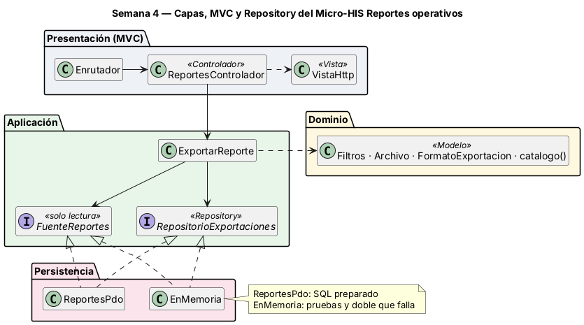
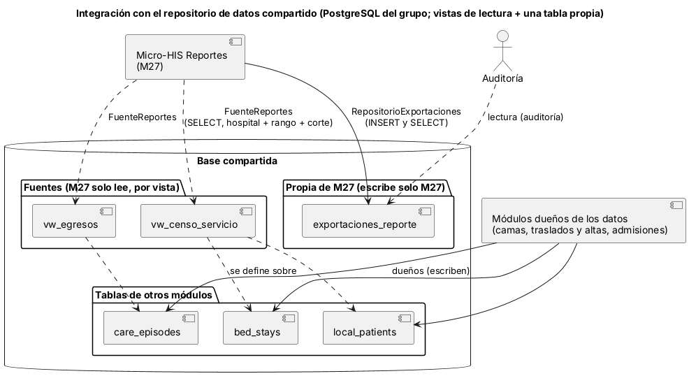

# Semana 4 — MVC, Repository y repositorio de datos compartido

**Estudiante:** Joshua Eduardo García Reyes (`jgarciar73-svg`) · **Módulo:** Reportes operativos exportables y filtros administrativos (módulo 27, reasignado dentro del grupo G1) · Continúa el [Micro-HIS de la semana 3](../semana-03/semana-03-arquitectura-micro-his.md)

## 1. Capas, responsabilidades y objetos reutilizables



| Capa | Objeto | Responsabilidad | Reutilizable en |
|---|---|---|---|
| Presentación | `public/index.php`, `Enrutador`, `Peticion` | Front controller (elige PDO o memoria) y método + ruta → acción; 404 y 405 | Rutas nuevas: una fila en `RUTAS` |
| Presentación | `ReportesControlador` | Lee la petición, identifica al usuario, llama al caso de uso y elige la vista. **Sin SQL ni reglas de reportes** | — |
| Presentación | `VistaHttp` | Estado, cuerpo y cabeceras (CSV o JSON); único mapa código → estado | Toda respuesta del módulo |
| Aplicación | `ExportarReporte` (CU-03, CU-05) | Orquesta; depende solo de interfaces. El Dominio no cambia | — |
| Aplicación | `RepositorioExportaciones` (interfaz) | Repository de lo que el módulo escribe: `guardarExportacion` y `exportacion` (por hospital) | Exportar, reproducir y auditar |
| Aplicación | `FuenteReportes` (interfaz) | Lectura de vistas que publican otros módulos: `filas(vista, hospital, filtros, corte)` | Cualquier reporte nuevo del catálogo |
| Persistencia | `ReportesPdo` | Implementa ambas interfaces con SQL preparado | Producción (SQLite o PostgreSQL) |
| Persistencia | `EnMemoria` | Implementa ambas interfaces sin base; `fallarAlGuardar` simula una falla | Pruebas y demostración |

**Dónde va el límite:** las interfaces están en Aplicación, porque son lo que el caso de uso necesita; Persistencia las implementa y la flecha de la semana 3 (`ExportarReporte → ReportesPdo`) queda invertida. Se separaron dos interfaces porque los datos tienen dueños distintos: las exportaciones son de este módulo (se escriben) y las vistas fuente son de otros (solo se leen). `ReportesPdo` y `EnMemoria` cumplen las dos.

## 2. Repositorio de datos compartido



Así se integraría este módulo con la base PostgreSQL compartida del grupo:

| Regla de integración | Cómo se cumple |
|---|---|
| Una sola tabla propia | M27 escribe solo `exportaciones_reporte`; el rol de base de datos del módulo tendría `INSERT` y `SELECT` ahí, sin `UPDATE` ni `DELETE` (el registro es evidencia de auditoría) |
| Las fuentes se leen por vista | `FuenteReportes` hace `SELECT` solo a `vw_censo_servicio` y `vw_egresos`, que se definirían sobre `bed_stays`, `care_episodes` y `local_patients`; si cambia una tabla base, cambia la vista y no el módulo |
| Un reporte nuevo no toca tablas | Se agrega al catálogo del Dominio y su vista; el caso de uso, el controlador y los adaptadores no cambian (OCP, semana 2) |
| Aislamiento por hospital | Hoy cada consulta filtra `hospital_id` y `exportacion()` también; con la base del grupo lo refuerza RLS o la base propia de cada hospital |
| Sin transacción compartida | M27 solo lee fuentes y escribe su registro; no bloquea ni depende de la transacción de traslados y altas |
| Riesgo: reproducir necesita historia estable | `registrado_en <= corte` supone que la vista expone cuándo se registró cada fila. `bed_stays` guarda `started_at` y `ended_at`, y `ended_at` se rellena después: una vista que no reconstruya el estado «a la fecha de corte» cambiaría el hash. Se resuelve en la definición de las vistas con Verificación BD |

## 3. Pruebas

```bash
cd docs/modulos/reportes-operativos-exportables/micro-his-reportes
php tests/ejecutar.php     # Pasan: 9  Fallan: 0
```

Siguen las 7 de la semana 3 (HTTP-01 pasa a MVC-01, ahora por el Enrutador, e incluye reproducir) y se agregan dos: REP-01 (contrato: PDO y memoria devuelven el mismo archivo, hash, corte, reproducción y aislamiento por hospital) y PER-02 (doble en memoria que falla al guardar → 500, sin archivo y sin registro). ARQ-01 se amplía: la Aplicación no importa Persistencia ni PDO y el controlador no tiene SQL ni usa clases del Dominio salvo `ErrorDominio`.

**Mutaciones comprobadas:** importar `ReportesPdo` en Aplicación o escribir un `SELECT` en el controlador hace fallar ARQ-01; quitar el filtro de hospital o el corte en `EnMemoria` hace fallar REP-01; responder 404 en lugar de 405 hace fallar MVC-01; no mapear el error de persistencia hace fallar PER-01 y PER-02.
