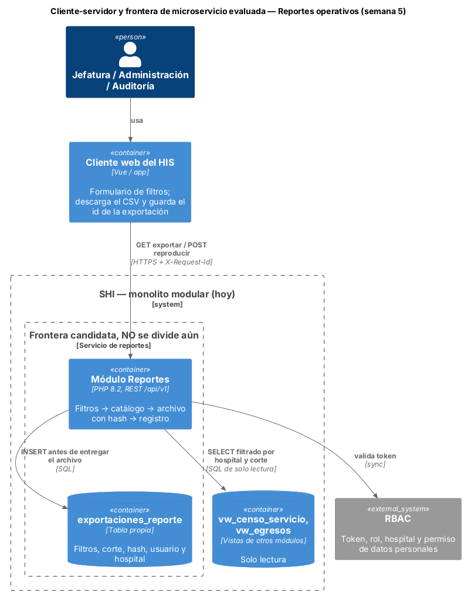
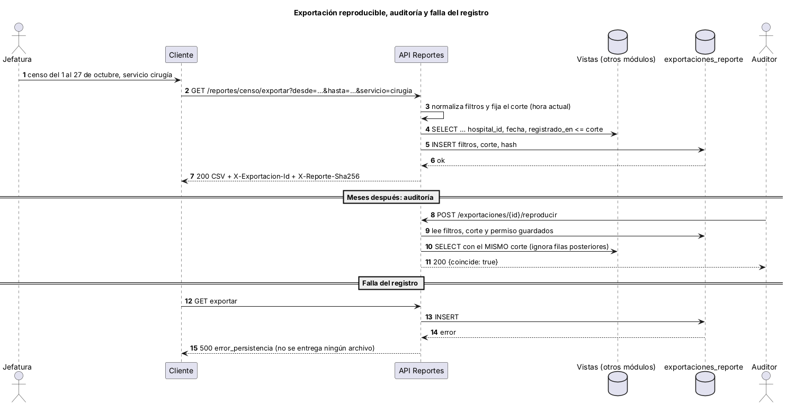
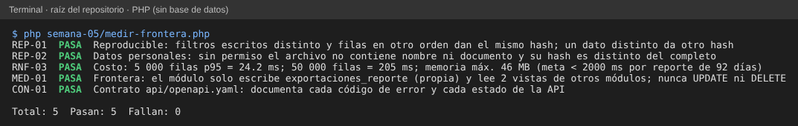

# Semana 5 — Cliente-servidor, contrato API y frontera de microservicio

**Estudiante:** Joshua Eduardo García Reyes (`jgarciar73-svg`) · **Módulo:** Reportes operativos exportables y filtros administrativos (módulo 27, reasignado dentro del grupo G1) · **Flujo:** «filtrado y exportación reproducible de un reporte operativo» · Evoluciona el [Micro-HIS de la semana 3](../semana-03/semana-03-arquitectura-micro-his.md)

**Entregables:** contrato [`api/openapi.yaml`](api/openapi.yaml) (OpenAPI 3.0.3, validado con `openapi-spec-validator`), diagramas, evaluación de la frontera con mediciones ([`medir-frontera.php`](medir-frontera.php)), migración razonada y plan de issue, rama, worktree y PR (§9). Esta entrega es de **diseño y evidencia**: no cambia el código del Micro-HIS (solo suma archivos nuevos en esta carpeta), así que no depende de cómo haya quedado la semana 4.

## 1. Diseño cliente-servidor



| Operación | Respuestas | Notas |
|---|---|---|
| `GET /api/v1/reportes/{codigo}/exportar?desde=&hasta=&…&formato=csv` | 200 (CSV) · 400 · 401 · 403 · 404 · 405 · 422 · 500 | `codigo`: `censo` o `egresos`. Cabeceras `X-Exportacion-Id` y `X-Reporte-Sha256` |
| `POST /api/v1/exportaciones/{id}/reproducir` | 200 `{id, coincide, hash}` · 401 · 403 · 404 · 405 · 500 | Vuelve a generar con los filtros, el corte y el permiso guardados |

El contrato documenta las rutas que el controlador ya atiende. Todo error devuelve `{codigo, mensaje, campo}` con uno de 9 códigos estables (enum del contrato); el cliente decide por `codigo`. El cliente no elige vista ni columnas: eso lo fija el catálogo del servidor.

## 2. ¿Separarlo como microservicio? Evaluación medible

Mediciones con `php medir-frontera.php` (solo el Dominio, datos sintéticos, sin base de datos):

| Criterio | Medición o hecho | ¿Justifica dividir? |
|---|---|---|
| Costo de generar el archivo | 5 000 filas (≈ 92 días de un hospital mediano, supuesto): p95 = **24 ms**; 50 000 filas: **205 ms**, 46 MB de memoria (RNF-03, meta < 2 s) | No |
| Datos | MED-01: **escribe 1 tabla propia** (`exportaciones_reporte`) y **solo lee 2 vistas** de otros módulos; nunca `UPDATE` ni `DELETE`. No hay transacción compartida con otros módulos | No, pero es la frontera más limpia del SHI |
| Reproducibilidad | REP-01: mismos filtros (en cualquier orden o formato de texto) y mismos datos → mismo hash; un dato distinto → otro hash | No afecta |
| Escala independiente | Un reporte lo piden unas pocas personas de jefatura; sin picos medidos | No |
| Despliegue y equipo | Un equipo pequeño publica todo el SHI junto | No |

**Límite de la medición:** no incluye el tiempo del `SELECT` contra PostgreSQL ni la red; en la demo las vistas son tablas de prueba. Esa parte debe medirse con las vistas reales antes de decidir.

**Decisión:** seguir como módulo del monolito modular. De todos los módulos, Reportes es el candidato más fácil de separar después, porque solo lee vistas y escribe una tabla propia. **Se dividiría** (o se sacaría la generación a un trabajo asíncrono) si ocurre alguna de estas condiciones: una exportación real supera 2 s o 128 MB (con 205 ms por 50 000 filas, eso ocurriría a varios cientos de miles de filas: estimación, no medición), los reportes pesados degradan la base operativa y hace falta una réplica de lectura, o otro equipo se hace cargo del módulo.

## 3. Propiedad de datos

| Dato | Dueño | Acceso de este módulo |
|---|---|---|
| `exportaciones_reporte` | Reportes | Escribe (un `INSERT` por exportación) y lee |
| `vw_censo_servicio` | Admisión y camas (sobre `bed_stays` y `care_episodes`) | Solo lectura, filtrada por `hospital_id` |
| `vw_egresos` | Admisión y episodios | Solo lectura, filtrada por `hospital_id` |
| Identidad, rol y permiso de datos personales | RBAC | Solo lee del token |

## 4. Comunicación

- **Síncrona (REST/JSON y CSV):** el cliente espera el archivo; hoy es corto (MED-01 y RNF-03).
- **Lectura por vistas, no por llamadas:** las fuentes se leen con SQL de solo lectura sobre vistas publicadas por sus dueños. Si algún día se separa, esas vistas pasan a una réplica o a un modelo de lectura.
- **Asíncrona (propuesta, sin implementar):** para reportes grandes, `POST` devolvería 202 con un id y el cliente consultaría el estado hasta poder bajar el archivo.

## 5. Seguridad

| Riesgo | Control |
|---|---|
| Suplantación | Hoy `X-Usuario-Demo` (solo demostración). En el SHI: token del módulo RBAC; usuario, hospital y permiso salen del token |
| Ver datos de otro hospital | Cada consulta filtra por el `hospital_id` del usuario; reproducir también (404 si la exportación es de otro hospital) |
| Fuga de datos personales | Sin permiso, nombre y documento salen como `***` (REP-02); el permiso queda guardado y se respeta al reproducir |
| Inyección o vistas no autorizadas | El usuario elige el código del reporte, nunca la vista; filtros solo del catálogo; sentencias preparadas |
| Abuso | Rango obligatorio, máximo 92 días, sin fechas futuras; formato validado |
| Rol sin permiso | Solo `jefatura`, `administracion` y `auditor` (403) |

## 6. Resiliencia



| Falla | Respuesta del diseño | Estado |
|---|---|---|
| No se puede registrar la exportación | 500 `error_persistencia` y **no se entrega archivo** (una exportación sin rastro no es auditable) | Implementado (semana 3, PER-01) |
| El cliente reintenta la descarga | El archivo es determinista: mismos filtros y mismo corte dan el mismo hash. Cada intento queda registrado con su propio id | Implementado (REP-01) |
| Una fila llega después del corte | Reproducir usa el corte guardado y la ignora (semana 3, APP-02) | Implementado |
| Reportes grandes que tardan | Trabajo asíncrono con 202 y consulta de estado | Solo diseño |
| Vista fuente caída | 500 sin archivo; el reintento es seguro porque la consulta solo lee | Implementado |

## 7. Observabilidad

- `X-Exportacion-Id` y `X-Reporte-Sha256` ya permiten seguir y verificar cada archivo. **Implementado.**
- `X-Request-Id` para unir el log del cliente con el del servidor, y una línea JSON por petición sin datos personales: **propuestos** (marcados `x-estado: propuesto` en el contrato), porque aquí no se cambia el código.
- Métricas propuestas: exportaciones por hora y por reporte, tiempo p95 de generación, filas por archivo y porcentaje de reproducciones con `coincide = false` (cualquier valor distinto de cero debe alertar).

## 8. Consistencia

- **Fuerte para el rastro:** el registro de la exportación se escribe antes de entregar el archivo; si falla, no hay archivo.
- **Instantánea por corte:** la consulta usa `registrado_en <= corte`, así que el resultado es el mismo aunque lleguen datos nuevos.
- **Eventual respecto a las vistas fuente:** una fila registrada antes del corte pero publicada tarde por su módulo no aparecería; es un riesgo a revisar cuando las vistas sean reales.
- **Límite de la reproducción:** `coincide = false` puede indicar que se corrigió o borró un dato fuente después del corte. Eso es una señal de auditoría, no un error del módulo.

## 9. Migración razonada y plan de trabajo

| Paso | Qué se hace | Se considera listo cuando |
|---|---|---|
| 1 | Contrato y códigos estables (esta semana) | CON-01 pasa |
| 2 | Medir la generación y la frontera de datos (esta semana) | RNF-03 y MED-01 pasan |
| 3 | Correlación: `X-Request-Id` y log por petición | El log une cliente y servidor sin datos personales |
| 4 | Usuario de base propio del módulo, solo `SELECT` en las vistas e `INSERT` en su tabla | El módulo no puede escribir en otras tablas |
| 5 | Medir con las vistas reales de PostgreSQL | Hay tiempo de consulta con datos reales |
| 6 | Trabajo asíncrono o servicio separado, solo si se cumple un criterio de §2 | Medición que lo justifique |

**Plan de issue, rama, worktree y PR (esta entrega):**

```bash
# Issue: "Semana 5 Reportes: contrato API, evaluación de microservicio y evidencia de reproducibilidad"
git fetch origin
git worktree add ../shi-reportes-s5 -b semana-5-reportes-operativos-joshua-garcia origin/develop
cd ../shi-reportes-s5      # trabajo aislado sin tocar la carpeta principal
php docs/modulos/reportes-operativos-exportables/semana-05/medir-frontera.php
git commit -am "Semana 5: contrato API y evaluación de microservicio en Reportes operativos"
git push -u origin semana-5-reportes-operativos-joshua-garcia
# PR hacia develop (menos de 400 líneas, «Semana 5» en el título, lo revisa otro integrante); luego: git worktree remove ../shi-reportes-s5
```

## 10. Evidencia

```bash
cd docs/modulos/reportes-operativos-exportables
php semana-05/medir-frontera.php     # Total: 5  Pasan: 5  Fallan: 0
```



**Mutación:** si se quita el orden estable de las filas en `Archivo::generar`, falla REP-01. El contrato se validó con `openapi-spec-validator`.

**Defensa en 1 minuto:** «Documenté el contrato que la API ya tiene, con códigos estables. Medí: generar 50 000 filas tarda 205 ms y el módulo solo escribe una tabla propia y lee dos vistas. Por eso es el módulo más fácil de separar, pero hoy no hay una razón medida para hacerlo, y dejé escritas las condiciones. Lo que sí garantiza el diseño es la reproducibilidad: mismos filtros y mismo corte dan el mismo hash, y la exportación se registra antes de entregarse.»
